# 03 — Object Lifecycles

The real statuses each core object can hold and the transitions between them, with
the role/permission that triggers each. Extracted from the schema + code — including
**vestigial fields** (defined but never advanced) and **unguarded transitions**,
which are called out and repeated in `99-gaps-and-risks.md`.

Paths are relative to `phpapp/`.

---

## Call

A call carries **two** status columns:

- **Legacy `calls.status`** (`ops.php:153`) — in normal operation it only ever reaches
  `OPEN → FORWARDED → ALLOCATED`. **`CLOSED` is read as a guard but never written by
  app code** (only by seed data) — treat it as vestigial (`ops.php:5175`, `:6459` read it; no write).
- **`calls.op_status`** (`tosrm.php:77`) — the richer TOSRM service-request lifecycle
  (`CALL_STATUSES`, `tosrm.php:26-42`), set by a manual picker that now follows
  **forward-rank transition rules** (R6 fixed): forward/same-phase moves, ON_HOLD/CANCELLED
  from any live status, REJECTED only in intake, terminal states have no exit; a manager may
  override with a reason.

### Legacy `calls.status` (what actually moves)

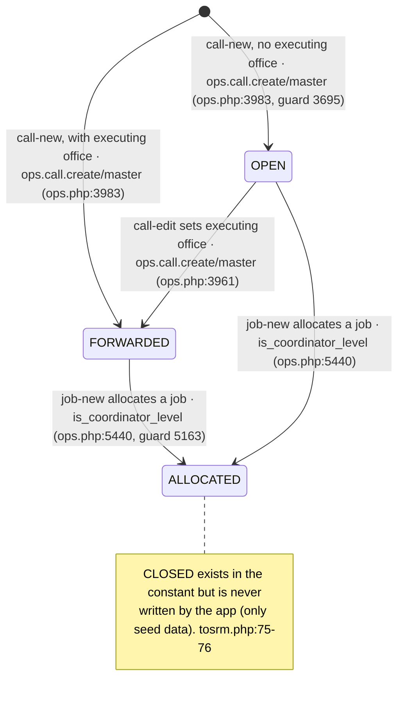

### `calls.op_status` (TOSRM — rank-based transitions, R6)

Any user passing `tosrm_can_edit()` (master, or `mod.calls.edit`/`ops.job.allocate`,
or coordinator-level; **inspectors refused** — `tosrm.php:216-227`) can advance a call
via `call-status`. The active statuses carry a forward **rank** (`tosrm_status_rank`):
`tosrm_set_status` now allows only a **legal next step** (`tosrm_can_transition` /
`tosrm_allowed_next`) — forward or same-phase, ON_HOLD/CANCELLED from any live status,
REJECTED only in intake — and the picker lists only those. The terminal states
(CLOSED / REJECTED / CANCELLED) have **no exit**. A manager (`is_admin_level`) may
**override with a reason**, recorded as `[override]` in history. Every change writes an
audit row (`tosrm.php`). When blank it is *derived* from the legacy status + jobs
(`tosrm_derive_status()`).

> States (by rank): RECEIVED/DRAFT (1) → UNDER_REVIEW/CLARIFICATION (2) → ACCEPTED (3)
> → READY_TO_SCHEDULE (4) → SCHEDULED (5) → ASSIGNED (6) → IN_PROGRESS (7) →
> COMPLETED/REPORT_PENDING (8) → CLOSED (9); plus ON_HOLD, REJECTED, CANCELLED
> (`tosrm.php:26-42`).

---

## Job

The real job lifecycle is driven by **`closed_flag`** (`ops.php:163`) +
**`report_approval`** (`ops.php:445`) + **`invoice_raised`** (`ops.php:428`). The rich
`jobs.stage` field (`JOB_STAGES`, `ops.php:32`) is **vestigial**: the only write anywhere
is `stage='CANCELLED'` (`tosrm.php:656`); it never advances through the intermediate stages.

```mermaid
stateDiagram-v2
  [*] --> Open : job-new allocates · is_coordinator_level (ops.php:5163)
  Open --> Closed : job-close · is_master OR ops.job.close OR job owner (R2), then business-rule blocks (ops.php job-close)
  Closed --> ReportPending : report produced at close → report_approval=PENDING (ops.php:5666)
  ReportPending --> ReportApproved : report-approve (approve) · can_approve_report (workforce.php:700-704)
  ReportPending --> ReportRejected : report-approve (reject) · can_approve_report (workforce.php:700-704)
  Closed --> Invoiced : job-bill/job-invoice · finance.reconcile/invoicing/master; needs Closed (ops.php:5514,5518)
  Invoiced --> [*]
```

- **`job-close` has no `ops_require`** — it is gated only by business blocks (deadline
  lock, bills on file, site check-in, open visit-days, final docs). Comment says
  "Inspector (or coordinator) closes" (`ops.php:5560`). **⚠ implicit — see gaps doc.**
- Re-close is refused if already closed (`ops.php:5573`).
- `report_approval`: `'' → PENDING` at close; `PENDING → APPROVED/REJECTED` via
  `report-approve` (`workforce.php:701-704`), gated by `can_approve_report` (master, the
  inspector's reporting manager, `workforce.report.approve`, or `ops.job.close`+admin/coord).

---

## Voucher

`vouchers.status` (`ops.php:217-225`) — **DRAFT → SUBMITTED → APPROVED → PAID**, with a
`reopen` back to DRAFT. A separate **month-freeze** overlay (`voucher_month_frozen()`
→ `cost_month_frozen()`, `costing.php:282`) locks *editing* regardless of status.

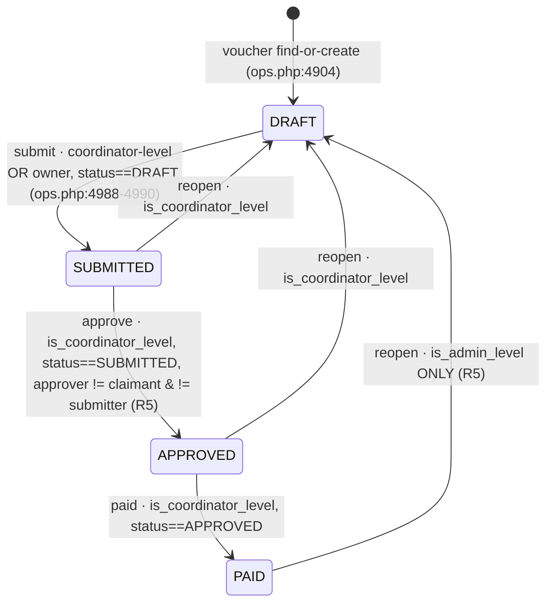

- **R5 fixed:** `reopen` now checks the source status — a **PAID** voucher reopens only for a
  real manager (`is_admin_level`), not any coordinator; SUBMITTED/APPROVED reopen by
  coordinator-level. **Approve now enforces segregation of duties** — the approver must be
  neither the claimant nor the person who submitted it (`vouchers.submitted_by`), matching the
  maker≠checker control used for contracts and reports.

---

## Quotation (`quotations.status`)

`QUOTE_STATUS` (`crm.php:129-138`) — **DRAFT, PENDING_APPROVAL, APPROVED, SENT, REJECTED,
ACCEPTED, LOST, EXPIRED**. `QUOTE_OPEN_STATES / PENDING / CLOSED` (`crm.php:140-142`) group
them for the §14 register views. A sent quotation is **immutable** — the way forward is a new
**revision** (`parent_id`/`rev`/`is_current`), which is a fresh DRAFT with its own approval.

```mermaid
stateDiagram-v2
  [*] --> DRAFT : quote-new / opp-create-quote · crm.quote.create/master
  [*] --> SENT : quote-external — a portal-lodged quote is registered SENT (or LOST), never ACCEPTED/APPROVED (20 Oct)
  DRAFT --> PENDING_APPROVAL : submit · the quote's editors or the person assigned · builds the chain from the rules
  REJECTED --> PENDING_APPROVAL : re-submit after correction · the earlier rejection stays in the history
  DRAFT --> APPROVED : submit when no approval is needed (D-03 "none") · or direct set by crm.quote.approve when no rule covers it
  PENDING_APPROVAL --> APPROVED : final chain step signed · step's approver, in branch scope, only while PENDING_APPROVAL
  PENDING_APPROVAL --> REJECTED : any level rejects, reason required · the chain ends there
  APPROVED --> PENDING_APPROVAL : retract before it leaves · quote_can_retract
  PENDING_APPROVAL --> DRAFT : a commercial or terms change on edit cancels the approval in progress (D-07)
  APPROVED --> DRAFT : a commercial or terms change on edit cancels the approval (D-07)
  APPROVED --> SENT : send · crm.quote.send/master
  DRAFT --> SENT : send without approval — only when no rule covers its value and the company needs none (D-02/D-03)
  SENT --> ACCEPTED : the person assigned records the customer's yes (D-08) · lands client + wins deal + converts lead
  EXPIRED --> ACCEPTED : the same, after expiry · recorded as accepted-after-expiry
  SENT --> LOST : the person assigned, reason required
  DRAFT --> LOST : the person assigned, reason required (the deal died before it was sent)
  SENT --> EXPIRED : validity lapsed · crm_expire_quotes cron, no user
  SENT --> SENT : raise a revision (new rev, new DRAFT; this row is superseded and can no longer move)
  ACCEPTED --> [*] : final — no route moves it; Accounts registers the contract on the current revision
  LOST --> [*]
```

**Enforced at the server since 20 Oct 2026** (`crm_quote_transition_problem()`,
`lib/crm.php`): any move not drawn above is refused with a sentence saying why —
including DRAFT → ACCEPTED, ACCEPTED ↔ LOST, a typed EXPIRED / REJECTED / DRAFT,
any move of a superseded revision, and any approval step signed after the
quotation stopped waiting for approval. Before that date the diagram was
documentation only; the Sales audit (SA-01…SA-06) drove each of those moves
through the old code. Rule values are measured **before tax** (D-04). Every move
writes one line in the quotation's history (who, what, why).

- **Immutable once SENT / sent_at set** (`quote_is_locked` `crm.php:959-973`) — not even the
  master edits it; only a revision moves forward (`canRevise` bypasses the lock, `crm.php:1498`).
- **Validity → EXPIRED** (Module 03): a SENT quote past `sent_at + validity_days` is stamped
  `EXPIRED` by the `crm_expire_quotes()` cron (`cron.php`); `validity_days=0`/blank never
  expires; a quote that became a contract is skipped. `quote_validity()` is the read-only
  computation; expiry never blocks accepting or revising. EXPIRED is its own closed state,
  counted separately from LOST.
- **Approval segregation** (Module 03): when an active `quote_approval_rules` row matches the
  amount/BU, the direct `quote-status → APPROVED` path is routed through the chain
  (`crm_quote_needs_chain` / `crm_quote_chain_satisfied`); a master may override, logged as a
  bypass. When no rule matches, the company's own answer decides (owner's rule D-03,
  setting `quote_unmatched_approval`): the **highest level's** approvers (the default,
  the owner's answer of 20 Oct; with no levels at all, any approver), **any** approver
  (the behaviour before 20 Oct), or **none** needed (it may be sent straight from DRAFT). Matching uses the value **before tax** (D-04).
- **Closed unlock** — ACCEPTED/LOST are locked; a time-boxed unlock is granted by the master
  only in answer to a `quote_edit_requests` row (`crm.php:1007`, `quote_is_locked` 968-971).
- **On acceptance the outcome propagates back up the funnel** (Field #8): the sync lands the
  client on the master (`quote_land_on_client`), wins the linked deal (`opp_move` → the pipeline's
  WON stage), and — when the quote was raised straight off a lead (`quotations.lead_id` set), or is
  linked to a deal that itself came from a lead — **converts that lead**
  (`lead_convert_on_quote_win`, `leads.php`): lead `OPEN → CONVERTED` with the customer,
  `converted_partner_id` and `converted_at` stamped, and the deal filled with the customer. No
  duplicate customer or inquiry is created (both already exist by acceptance time). A lead already
  `CONVERTED`/`LOST` is left alone (idempotent), and the whole propagation is best-effort — it
  never blocks the acceptance it rides on.
- **Approval steps sign in order** (owner's D-05, 20 Oct 2026): a level-2 step is refused while any
  level-1 step is still pending. A step waiting longer than the days set in Set up Sales
  (`quote_approval_escalate_days`) is opened to the next level's approvers as well (D-11a); a
  delegate may sign for an approver who is away. Neither adds a status or a move.
  **Owner, 21 Oct 2026 — "simultaneous approval":** Set up Sales asks *"When a quotation needs more
  than one level, how do the levels approve?"* (`quote_approval_mode`: one after another — default ·
  all at the same time). At the same time, every level is asked at once and may sign in any order;
  the quotation is APPROVED when all have signed; escalation does not apply (all are asked), and
  taking one approval back does not reset the others. Project costings follow the same answer.
- **When no approval is needed** (owner, 21 Oct 2026): a quotation goes DRAFT → APPROVED on submit,
  with the reason in its history, when the company has **no approval levels at all** (*"no approval
  chain → top management is not required"* — it used to wait for "anyone who may approve"), or when
  it was **made from an approved project costing at that costing's prices** (*"skip the second
  approval"* — the levels already signed the costing; a changed price is approved again), or when no
  level covers its value and Set up Sales says none is needed (D-03). `crm_quote_needs_approval()`.
- **A man-month quotation stands on an approved costing** (owner's D-11 A, 20 Oct 2026): the moves
  to PENDING_APPROVAL, APPROVED and SENT, and each approval signature, are refused while a quotation
  with a man-month line has no linked project costing in APPROVED (any revision's link counts),
  unless the company answers "the costing is optional" in Set up Sales (`quote_manmonth_costing`).
  A save that changes such a quotation's prices away from its costing is allowed only to its creator
  (or a master), with a note, written in its history. No status or move is added.
- **The contract-review checklist holds the moves towards the customer** (owner's D-10, 20 Oct
  2026): when the company requires every point (`preorder_checklist_require`), the moves to APPROVED,
  SENT and ACCEPTED, and every approval signature, are refused until every point is ticked or the
  checklist is waived. Submitting for approval is not held — the approver reviews it. A revision
  starts unticked and unwaived; an accepted, lost or expired quotation's checklist no longer changes.
  No status or move is added.

## Project costing (`project_costings.status`)

Statuses as they have always been in the code (`PC_STATUS`, `lib/projcosting.php`); the moves were
unrestricted until 20 Oct 2026 and are now enforced by `pc_transition_problem()` (owner's D-11 B).

```mermaid
stateDiagram-v2
  [*] --> DRAFT : created — tagged with an enquiry, lead, deal, quotation or requisition (author recorded by id)
  DRAFT --> SUBMITTED : submit — at least one role; builds its approval levels
  REJECTED --> SUBMITTED : submit again — levels rebuilt
  SUBMITTED --> SUBMITTED : a level signs — the next level now waits
  SUBMITTED --> APPROVED : the last level signs — never its author
  SUBMITTED --> REJECTED : send back — a reason is required
  SUBMITTED --> DRAFT : reopen (withdraw)
  APPROVED --> DRAFT : reopen — the approval is withdrawn
  REJECTED --> DRAFT : reopen
```

- **Tagged and levelled (owner, 20 Oct 2026):** *"tagged with that inquiry or lead … approval level as
  of quotation shall be applicable."* A new costing must be tagged with what it prices — an enquiry or
  a lead (which fill in customer, branch, business unit and title), or the deal, quotation or
  recruitment requisition it was made from. Submitting writes one `project_costing_approvals` row per
  level a **quotation** of the costing's sell value (before tax) and business unit would need — the
  levels on Set up Sales, in order; each level goes to the people over the costing's branch and
  business unit (`crm_role_approvers_for()`), never its author. With no levels set up: one step,
  anyone who may approve. A costing submitted before this has no rows and is approved as before.
  Sending back closes the round; reopening deletes it. No new status.
- A quotation is drafted from a costing only when it is APPROVED; the quotation belongs to the person
  who drafted it and carries the costing's enquiry, lead and business unit.
- Reopening an APPROVED costing clears who approved it and when, and writes a line in its quotation's
  history; that quotation cannot move forward again until the costing is approved again.

---

## Lead (`leads.status`) and opportunity (`opportunities.status`) — closing and reopening

The stages are configurable per pipeline; the **status** follows the kind of stage
(`OPEN` · `WON` · `LOST`). Leads also have `CONVERTED` (a won lead becomes a customer and an
enquiry). Reopening is the owner's rule D-22 (20 Oct 2026, "Yes").

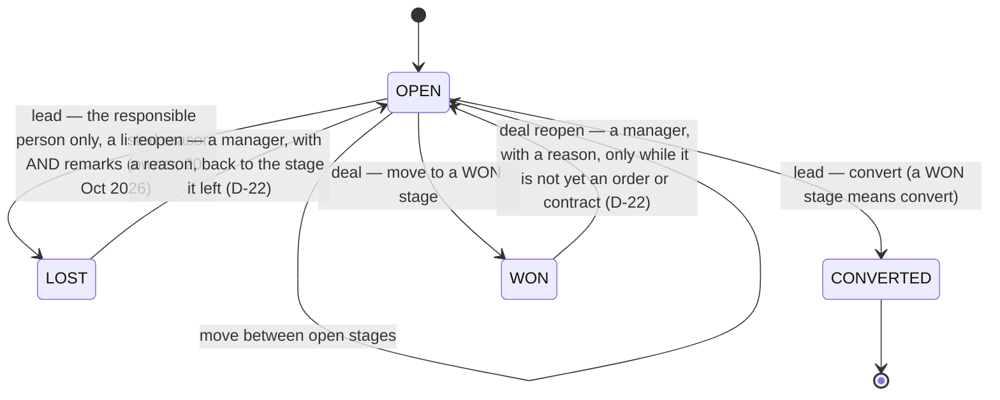

- **A manager** is `leads_can_reopen()`: `mod.leads.edit`, `crm.quote.approve`, or a master of leads.
- **A lost lead is not converted** — it is reopened first (it used to convert straight from LOST).
- A reopen is written in the record's history with who, the reason and why it had been closed,
  and adds a stage-history row; the lost reason is cleared so it no longer counts as lost.
- **Marking a lead lost** (owner, 20 Oct 2026: *"the responsible person must mark as lost with a
  valid reason and remarks"*): only the lead's owner (`lead_can_mark_lost()`; a lead nobody owns —
  anyone who may edit leads; a master always), with a reason from the lost-reason list **and**
  remarks, on the lead and in bulk alike (`lead_lost_problem()`). The bulk action used to fill in
  "No response" with no remarks.

### Lead reassignment request (`lead_reassign_requests.status`) — owner, 20 Oct 2026

*"Reassigning shall be done only after manager approval."* Giving a lead that **already has an
owner** to someone else is a request unless the person doing it is a manager over that lead.
The lead keeps its owner until the request is approved. Allocating a lead **nobody owns** is not
a reassignment and needs no approval.

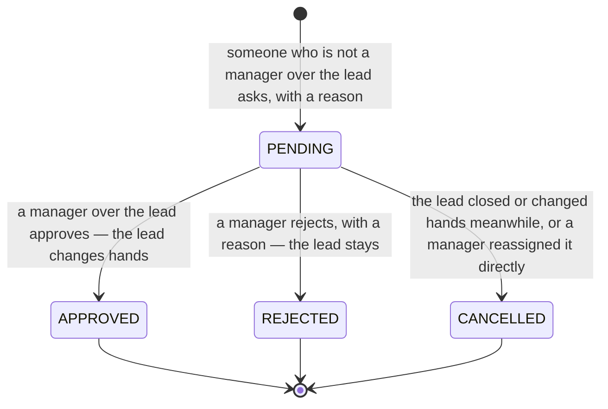

- **A manager over the lead** (`lead_user_is_manager_for()`): the current owner's reporting
  manager (Reports to), or someone with sales-manager authority (`mod.leads.edit` or
  `crm.quote.approve`, as D-22) whose data scope covers the lead's branch and business unit;
  a master always. Such a person reassigns directly, with a reason kept in the history.
- The person who asked never decides it (unless a master). One request per lead at a time.
- Decided from **Approvals** (`/approval-lead-decide`) — the approving manager needs no right to
  open the lead register — or on the lead itself when they can open it.

## Customer trade block — the owner's rule D-12 (20 Oct 2026)

Not a lifecycle of its own: it reads the customer's two existing status fields and
adds **no new status**. A customer whose `business_partners.status` is
**BLACKLISTED, INACTIVE or ON_HOLD**, or whose `hold_status` is **HOLD or BLOCKED**,
gets **nothing new** (`partner_trade_block()`, `lib/ops.php`): no enquiry, no
quotation, no submission, approval, sending or acceptance of one, no contract, no
work order (from the form or from a won deal), no job. A quotation may still be
marked **lost**. Invoices for work already done, payment reminders and receipts
are untouched — that is the "payment reminder" the owner kept. A person unblocks
them: a manager clears the hold under **Client holds**; someone who may edit the
client record sets the status back to Active. Before this rule, BLACKLISTED and
INACTIVE stopped nothing, HOLD only warned, and BLOCKED stopped only a
non-manager's quotation or work order.

---

## Contract opening (`partner_contracts.open_status`)

`CONTRACT_OPEN_STATES` (`contracts.php:462-467`) — **PENDING, OPEN, REJECTED, CLOSED**.
A deliberate two-signature model: **endorse** (a manager) then **approve** (the branch
manager), with segregation enforced (approver ≠ endorser unless master).

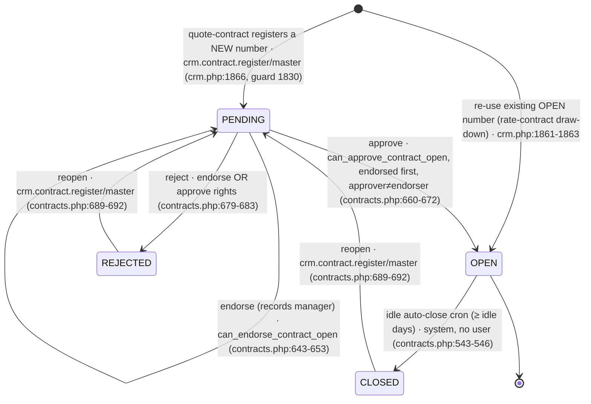

- `can_endorse_contract_open()` (`contracts.php:473-477`): master, or OPERATION_MANAGER /
  SBU_HEAD / ADMIN / BUSINESS_DIRECTOR, or `users.manage.branch`.
- `can_approve_contract_open()` (`contracts.php:478-481`): master, or BRANCH_MANAGER /
  BRANCH_APP_MANAGER.
- Each action guards `status==='PENDING'` (endorse 645, approve 662, reject 681); reopen is
  the deliberate from-closed/rejected path — **enforced since 20 Oct 2026**: a reopen of an OPEN
  or PENDING contract is refused (it used to wipe both signatures of an open contract, SA-19).
- A change to the value, dates or quantity lines of a PENDING contract that is already endorsed
  withdraws the endorsement (it was given for other figures).

### Contract amendment (`contract_amendments.status`) — the owner's D-25, 20 Oct 2026

A change to the value, dates or quantity lines of an **OPEN** contract does not apply at once:
it is recorded as an amendment, with its reason and the old and new figures, and takes the same
two signatures as the opening. Title, business unit and notes are saved directly.

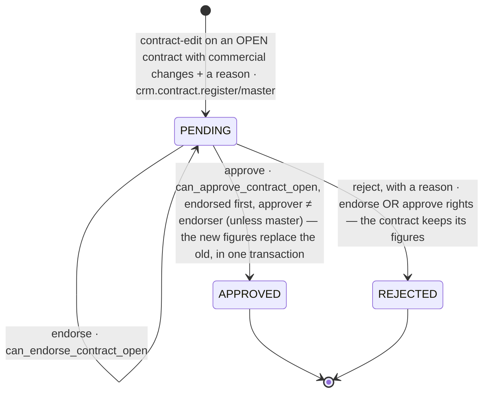

- One amendment waits at a time; the old figures stay on the amendment row for good.
- The contract's own `open_status` does not change — no status is added to it.

---

## Inspection report (`report_docs.status`) — IDEMS

`IDEMS_STATUS` (`idems.php:59`) — **DRAFT, SUBMITTED, VETTING, UNDER_REVIEW, APPROVED,
ISSUED, REJECTED (label "Sent back"), ARCHIVED**. `finalized` flag (`idems.php:116`) locks
the row at issue. `ARCHIVED` is defined but never set (vestigial).

```mermaid
stateDiagram-v2
  [*] --> DRAFT : document-new · idems.edit/master (idems.php:4250, guard 4185)
  DRAFT --> VETTING : document-submit, vetting gate ON · idems_can_edit_doc (idems.php:4430)
  DRAFT --> UNDER_REVIEW : document-submit, no vetting gate · idems_can_edit_doc (idems.php:4446)
  VETTING --> UNDER_REVIEW : vet VETTED (auto-forward) · idems_can_vet = master/idems.finalize (idems.php:5892)
  VETTING --> DRAFT : vet RETURNED · idems_can_vet (idems.php:5875-5877)
  UNDER_REVIEW --> UNDER_REVIEW : approve, more chain levels · idems_can_act_step (idems.php:5740)
  UNDER_REVIEW --> APPROVED : approve, last level · idems_can_act_step (idems.php:5743)
  UNDER_REVIEW --> REJECTED : reject (remark required) · idems_can_act_step (idems.php:5750)
  UNDER_REVIEW --> DRAFT : sendback (remark required) · idems_can_act_step (idems.php:5757)
  APPROVED --> ISSUED : document-finalize · idems.finalize/master, approver≠issuer (idems.php:4518, seg 4460)
  ISSUED --> [*] : locked (finalized=1); revise spawns a NEW DRAFT row (idems.php:4578)
  REJECTED --> DRAFT : editable again (idems_status_allows_edit idems.php:3463)
```

- **Segregation (new, this codebase):** at finalize, if the current user approved this
  report, issue is refused — approver ≠ issuer (`idems.php:4458-4463`), master excepted.
  Finalize also needs full chain approval, a completeness gate, an AI-QA critical gate
  (`4473-4487`) and a calibration/authorisation gate (`4497-4503`).
- Editable only in '', DRAFT, REJECTED (`idems_status_allows_edit`, `idems.php:3463-3466`).

---

## Profitability — **computed, no lifecycle**

There is **no stored profitability record and no status**. The profitability screen
(`callprofit.php` `ops_call_profit()` `:59-97`) queries jobs/calls/expenses live and calls
`job_profit()` (`ops.php:1547+`), a pure calculator, summing in memory — no writes, no
table (grep for a profitability `CREATE TABLE` is empty). Access is a **read gate** only
(`data.profitability` / `data.revenue` / admin, `callprofit.php:62`). The only related
persisted state is the month-end **cost freeze** (`cost_month_frozen()`, `costing.php:282`),
which locks voucher/cost editing for a frozen month — an editing lock, not a status.

---

## Credential (held certificate) — verification & derived status (Slice P1)

A held credential (`inspector_certs`) now carries an **additive** verification
verdict `verify_status` (`competence.php` `competence_migrate()`), set by a
manager via `/cert-verify` (gated by `competence_can_authorise()` — admin-level or
master). It is **not** a workflow with transitions so much as a manager-set flag;
a blank value (the default on every existing row) reproduces the previous
date-only behaviour exactly.

- **`verify_status` values** (`CREDENTIAL_VERIFY_STATES`): `''` (not verified),
  `UNDER_VERIFICATION`, `VERIFIED`, `REJECTED`, `SUPERSEDED`.
- **Derived display status** (`credential_status()`, read-only —
  `CREDENTIAL_STATUS`): `VALID`, `EXPIRING` (within 45 days), `EXPIRED`,
  `UNDER_VERIFICATION`, `REJECTED`, `SUPERSEDED`, `MISSING`. `REJECTED` /
  `SUPERSEDED` stand regardless of dates; an expired certificate reads `EXPIRED`
  even while `UNDER_VERIFICATION`; `VERIFIED` classifies by date like a normal
  in-date credential.
- **No gate change.** The allocation gate (`competence_lapsed()` /
  `auth_block()`) is untouched — it still reads `is_mandatory` + `valid_to`. The
  derived status is display-only (the Credential Vault), not a new block.
- **No new permission** — reuses `competence_can_authorise()` for setting the
  verdict and `mod.competence.view` / `person.iddoc.view` for viewing.

---

## Billable event (`billable_events.status`) — Revamp P4

The operational→commercial bridge (`lib/billable.php`). One additive record per
approved operational occurrence, keyed idempotently by
`(source_module, source_kind, source_id)`. The **books ledger stays the money
truth**: a billed event is reconciled to the invoice that consumed it and never
invents money.

`BILLABLE_STATUS`: **PENDING → APPROVED → BILLED**, plus **CANCELLED** and
**DISPUTED**.

```mermaid
stateDiagram-v2
  [*] --> PENDING : derived by billable_events_sync() from a closed, not-yet-invoiced billable job (idempotent upsert)
  PENDING --> APPROVED : billable-approve · billable_can_manage (finance.reconcile / master)
  PENDING --> CANCELLED : billable-cancel (reason required)
  APPROVED --> DISPUTED : billable-dispute (reason required)
  APPROVED --> CANCELLED : billable-cancel (reason required)
  DISPUTED --> APPROVED : billable-approve (re-approve)
  DISPUTED --> CANCELLED : billable-cancel
  APPROVED --> BILLED : (job source) reconciliation — the source job becomes invoiced (books_invoices_for_job); amount taken from the invoice
  PENDING --> BILLED : (job source) reconciliation, if invoiced before review
  APPROVED --> BILLED : (non-job source) billable-bill — finance attests the invoice number (bill_ref); P4c
  BILLED --> [*] : terminal, linked to invoice_id (reconciled) or bill_ref (attested)
  CANCELLED --> [*] : terminal
```

- **BILLED for a job source is never a manual transition** (`billable_allowed_next()`
  excludes it); it is set by `billable_events_sync()` when `books_invoices_for_job()`
  shows a non-cancelled invoice, taking the amount from the invoice.
- **BILLED for a non-job source (P4c)** — timesheet / placement, which have no
  automatic invoice linkage — is set by `billable_mark_billed()` via the
  `billable-bill` action, and **requires the invoice number** (`bill_ref`): finance
  attests the real invoice they raised, so the ledger still never claims BILLED
  without an invoice behind it. Only an APPROVED event can be billed this way.
- **Sources (`BILLABLE_SOURCES`):** `JOB_CLOSED` (inline hook + sync, job-invoice
  reconciled), `TIMESHEET_APPROVED` (inline hook on `pdso_att_approval_set_status`
  APPROVED; qty=man-days, amount priced at invoice), `PLACEMENT_FEE` (sync-derived
  from inspectors with `fee_status='CONFIRMED'` and a real `placement_fee`).
- **Permission:** reuses **`finance.reconcile`** (decision D1) via
  `billable_can_manage()`; viewing via `billable_can()` (`finance.reconcile` /
  `data.credit` / master). **No new permission** → `docs/02-permission-matrix.md`
  unchanged. Route gate maps to the existing `invoicing` module.
- **Idempotent:** re-running the sync refreshes only the derived fields while an
  event is still PENDING; a human decision (APPROVED/BILLED/CANCELLED/DISPUTED) is
  never overwritten.
- **P4a scope:** only the `JOB_CLOSED` source is wired, populated by the sync
  pass. Inline hooks at job-close / report-issue / timesheet-approval and more
  sources are P4b.

---

## Connect Requirement (`cx_requirements.status`) — marketplace (K2a)

A posted technical-manpower requirement in the marketplace folded into EXAACT
(`lib/connect_market.php`, `CX_REQ_TRANSITIONS`). Additive `cx_requirements` table;
no existing object touched.

> **DRAFT → OPEN → SHORTLISTING → AWARDED → CLOSED**, plus **CANCELLED** and
> **EXPIRED** as off-ramps.

- `DRAFT → OPEN` (post) · `DRAFT → CANCELLED`
- `OPEN → SHORTLISTING` · `OPEN → CLOSED` · `OPEN → CANCELLED` · `OPEN → EXPIRED`
- `SHORTLISTING → AWARDED` (via `cx_requirement_award`, which also accepts the
  chosen application) · `SHORTLISTING → OPEN` (reopen) · `SHORTLISTING → CLOSED` ·
  `SHORTLISTING → CANCELLED`
- `AWARDED → CLOSED`
- Terminal: `CLOSED`, `CANCELLED`, `EXPIRED`. Transitions are enforced by
  `cx_req_can_transition()`; an illegal move is refused, not applied.

## Connect Application (`cx_applications.status`) — marketplace (K2a)

A professional's application to a requirement (`CX_APP_TRANSITIONS`). Additive
`cx_applications` table; one live application per professional per requirement.

> **APPLIED → SHORTLISTED → OFFERED → ACCEPTED**, plus **DECLINED**, **WITHDRAWN**,
> **REJECTED** as off-ramps.

- `APPLIED → SHORTLISTED | REJECTED | WITHDRAWN`
- `SHORTLISTED → OFFERED | REJECTED | WITHDRAWN`
- `OFFERED → ACCEPTED | DECLINED | WITHDRAWN`
- Terminal: `ACCEPTED`, `DECLINED`, `WITHDRAWN`, `REJECTED`. Enforced by
  `cx_app_can_transition()`. Awarding a requirement drives the chosen application
  to `ACCEPTED` via its legal path.

- **Permission (K2a):** the staff desk reuses existing **coordinator/master**
  gates (`connect_market_can()`) — **no new permission**; `docs/02-permission-matrix.md`
  unchanged. External self-service (client-portal post, vendor/inspector-portal
  apply) is **K2b**, where the new portal permissions will be added to the matrix
  with the owner's sign-off.

## Connect Engagement / Booking (`cx_engagements.status`) — marketplace (K20)

The booking created once a requirement is **AWARDED** — it captures the *basis* on
which the person is engaged (`lib/connect_engage.php`). Additive `cx_engagements`
table; one engagement per requirement (upsert). The **basis** is one of
`MAN_DAYS · MAN_MONTHS · DEPUTATION · CONTINUOUS · FREQUENCY` (a descriptor, not a
status). The **status** is the engagement's own lifecycle:

> **BOOKED → ACTIVE → COMPLETED**, plus **CANCELLED** as an off-ramp.

- `BOOKED → ACTIVE | CANCELLED`
- `ACTIVE → COMPLETED | CANCELLED`
- Terminal: `COMPLETED`, `CANCELLED`. Set via `connect_engage_set_status()`.
- Recorded/edited only after the requirement is `AWARDED`
  (`connect_engage_save_for_requirement()`); the subject is derived from the awarded
  application (professional / inspector / agency-bench). It does not replace the P4
  **billable event** — it enriches the award with the basis finance bills on.
- **Permission (K20):** the staff desk reuses **coordinator/master**
  (`connect_market_can()`) — **no new permission**; a professional sees only their
  own bookings (`/pro/bookings`, subject-scoped) and withdraws only their own live
  application. `docs/02-permission-matrix.md` records this.
- **Rate model & voucher cadence (K21):** the booking also carries how the rate is
  quoted — `rate_inclusive` = `INCLUSIVE` (the rate covers fee + travel / hotel /
  local conveyance / allowances) or `EXCLUSIVE` (fee only; those are reimbursed) —
  and `voucher_cadence` = `PER_DAY | PER_DEPLOYMENT`. Both are chosen by the client
  at posting (`cx_requirements.rate_inclusive / voucher_cadence`, via
  `cx_requirement_save_terms()`) and inherited by the booking. Descriptors, not
  statuses.

## Connect Engagement Voucher (`cx_engagement_vouchers.status`) — marketplace + on-roll (K21)

A claim the engaged person raises against their booking (`lib/connect_engvoucher.php`).
**ONE** model serves every case because the engagement's subject is already
`professional | inspector | bench`: a marketplace freelancer, an inspector on a
company/agency roll, or an agency-bench person all raise the same voucher. A voucher
= header + day/period lines; **fee = Σ(units × rate)**; **reimbursable = Σ(expense
heads)** *only* when the engagement is `EXCLUSIVE`; **grand = fee + reimbursable**.
Cadence (`PER_DAY | PER_DEPLOYMENT`) is inherited from the engagement.

> **DRAFT → SUBMITTED → APPROVED → PAID**, with **REJECTED** ("sent back") as a
> return path.

- `DRAFT → SUBMITTED` (needs at least one line)
- `SUBMITTED → APPROVED | REJECTED | DRAFT`
- `APPROVED → PAID | REJECTED`
- `REJECTED → DRAFT | SUBMITTED`
- Terminal: `PAID`. Transitions via `connect_engv_set_status()`; only a `DRAFT`
  accepts new/removed lines. On an `INCLUSIVE` engagement every expense head is
  forced to 0 (the rate already covers them).
- **Who reviews / approves**: for a **client-posted** marketplace engagement the
  **client** who posted the job is the reviewer — the platform is a matchmaker, not a
  paymaster. The client **returns for clarification** (`SUBMITTED → REJECTED`, with a
  note in `decided_note`) or **approves** (`SUBMITTED → APPROVED`); the professional
  reopens a returned voucher (`REJECTED → DRAFT`, which clears the note), revises and
  resubmits. For an **on-roll / bench** engagement the internal desk plays that role
  on the existing coordinator/master gate. Same states, no new status — only who is
  allowed to move them (client, via the `market.vouchers` portal permission, scoped
  to their own `poster_party_id`).
- **Platform commission** (matchmaker model): the platform charges a nominal
  commission on the **fee only** (never on reimbursed expenses), **split 50/50**
  between client and professional. Rate is the admin setting `connect_commission_pct`
  (default 5%). `connect_engv_recompute()` stores `commission_total`,
  `commission_client`, `commission_pro`, `client_payable` (= grand + client half) and
  `pro_net` (= grand − pro half) on the voucher. The platform takes no responsibility
  for the settlement — it only records it.
- **Settlement** (both sides confirm): after the client APPROVES, each side confirms
  payment — the client that it has paid (`client_paid_at`), the professional that it
  has received (`pro_received_at`). When **both** confirm, `settled_at` is stamped and
  the voucher moves to **PAID** (`connect_engv_confirm()`). A voucher already PAID by
  any path counts as settled (`connect_engv_is_settled()`).
- **Report release gate**: the professional uploads the inspection report deliverable
  (`cx_engagement_reports`); the **client can download it only once the engagement is
  cleared** — every APPROVED/PAID voucher on it is settled
  (`connect_engv_engagement_cleared()`). Until then the client portal serves HTTP 402
  and shows a locked state. No new permission.
- **Supporting documents** (receipts / bills): a voucher carries an additive
  `cx_engagement_voucher_files` set — the claimant attaches receipts to back the
  claim and the approver sees them with the voucher. Attachments may be added or
  removed only while the voucher is **DRAFT or SUBMITTED** (`connect_engv_can_attach`);
  once `APPROVED`/`PAID` the set is frozen with the decision. Uploads go through the
  shared `upload_reject_reason()` guard; a document may optionally be pinned to one
  day line. No new status and **no new permission** — the freelancer serves their own
  via `/pro/voucher-file`, the desk via `/connect-voucher-file` on the same
  marketplace gate.
- **New object lifecycle** (this table did not exist before K21); documented here in
  the same commit as the code. Additive `cx_engagement_vouchers` +
  `cx_engagement_voucher_lines`; **no new named permission** — a professional owns
  only their own vouchers (`/pro/vouchers`, subject-scoped), and the desk
  approves/pays on the same coordinator/master gate used for the marketplace.

## Connect Dispute (`cx_disputes.status`) — marketplace (K9b)

A concern raised on a marketplace engagement (`lib/connect_disputes.php`,
`CX_DISPUTE_TRANSITIONS`). Additive `cx_disputes` table; no existing object touched.

> **OPEN → UNDER_REVIEW → RESOLVED**, plus **WITHDRAWN** as an off-ramp.

- `OPEN → UNDER_REVIEW | RESOLVED | WITHDRAWN`
- `UNDER_REVIEW → RESOLVED | WITHDRAWN`
- Terminal: `RESOLVED` (records a resolution note + who/when), `WITHDRAWN`.
  Enforced by `cx_dispute_can_transition()`.

Categories: `PROCESS`, `COMMERCIAL`, `CONDUCT`, `FINDING`. **The M14 rule is
encoded:** a `FINDING` dispute (about whether the material passed or was rejected)
has `affects_fee = 0` — it is settled by review and **never** by withholding the
professional's fee (`cx_dispute_affects_fee()`). Staff gate reuses
coordinator/master (`connect_market_can`) — **no new permission**.

## Connect Rating-Integrity Dispute (`cx_rating_disputes.status`) — Review & Reputation

A concern raised about a **rating itself** (not the job): a party believes a rating
about them is unfair, factually wrong, retaliatory or fraudulent. Distinct from the
work/fee dispute above. `lib/connect_rating_disputes.php`,
`CX_RDISPUTE_TRANSITIONS`. Additive `cx_rating_disputes` table; the only existing
object touched is `cx_ratings`, gaining additive `hidden` / `moderation_note` columns
(a removed rating is **hidden, never deleted** — the record is kept for audit).

> **OPEN → UNDER_REVIEW → RESOLVED**, plus **WITHDRAWN** as an off-ramp.

- `OPEN → UNDER_REVIEW | RESOLVED | WITHDRAWN`
- `UNDER_REVIEW → RESOLVED | WITHDRAWN`
- Terminal: `RESOLVED` (records an **outcome** + note + who/when), `WITHDRAWN`.
  Enforced by `cx_rating_dispute_can_transition()`.

Categories: `UNFAIR`, `FACTUAL`, `RETALIATORY`, `FRAUDULENT`, `OTHER`. On `RESOLVED`
the desk records one outcome: **`UPHELD`** (the rating stands), **`ANNOTATED`** (a
public note is attached to the rating), or **`REMOVED`** (the rating's `hidden=1`, so
every reputation summary excludes it). Raising is done by the affected party
(professional via `/pro/reputation`, client via `/portal/reputation`, each scoped to
ratings **about themselves**) or by staff on their behalf — **no new permission** on
either side. The investigation desk (`/rating-disputes`) reuses the marketplace
moderation gate (`connect_market_can`) — **no new permission**, exactly like the K9b
dispute and the verification desk.

---

## Candidate (`candidates.stage`) — recruitment

The legacy hiring pipeline (technical-manpower deputation) is a fixed set of
stage keys, `CAND_STAGES` (`ops.php:70`):

```
RECEIVED → SUBMITTED → SHORTLISTED → INTERVIEW → OFFERED → ACCEPTED (hired)
                 │                                   │
                 └─────────────→ HOLD / REJECTED / WITHDRAWN / OFFER_DECLINED (terminal)
```

Every move is written to `candidate_events (from_stage, to_stage, remark, actor,
created_at)`; hire (`ACCEPTED`) may create an `inspectors` row via the identity
ledger (candidate → employee, no duplicate person). Guards: create/edit and
stage-move `is_coordinator_level()`. **This lifecycle is unchanged.**

**Public entry point (Phase 7 — additive).** Besides staff creation, a candidate
may now enter at the **same `RECEIVED` start** through the opt-in public careers
page (`careers.php`): a self-application creates the row with `source=CAREERS`,
linked to the advertised requisition, and logs the intake to `candidate_events`
like any other. No new stage or transition — only a new, unauthenticated *source*
of a `RECEIVED` candidate, guarded by a honeypot + per-requisition de-dupe.

### Configurable pipeline (Phase 2 — additive, data-driven)

A per-tenant pipeline engine (`recruitpipe.php`; tables `recruit_pipelines` +
`recruit_stages`) lets each customer define their **own** ordered stages instead
of the fixed keys above — so different companies run different selection
processes on one engine (brief §9, §45–46). Stages carry a `kind`
(step/gate/interview/offer/terminal), a responsible role, an optional SLA, and an
optional **condition** (`condition_field`/`op`/`value`) that makes a stage apply
only when the requisition matches (e.g. an L2 only for senior grades; a medical
only when required — brief §10). `recruitpipe_for($requisition)` resolves the
applicable pipeline (narrowest applicability match wins, else the default), and
`recruitpipe_effective_stages()` returns the stages that apply after conditions.

This is **configuration data, not new code statuses/transitions**: it adds no
status to `candidates.stage` and does not alter the lifecycle above. Configuration
is gated `is_admin_level()` (route `recruit-pipelines`) — no new permission. The
default seed is the client's 18-stage *Corporate Recruitment Workflow*
(Staff Requisition → … → Offer → Onboarding), shipped alongside *Simple* and
*Executive* templates.

**Phase 2b — the candidate runs on the configured pipeline.** A candidate's
position within its resolved pipeline is stored additively in
`candidates.pipeline_id` / `candidates.pipeline_stage_id`; the candidate screen
shows this as its primary tracker and moves along it via the `candidate-flow`
route (`is_coordinator_level()`), auditing each move to `candidate_events`. The
legacy `candidates.stage` is kept in **coarse sync** only at the interview →
`INTERVIEW` and offer → `OFFERED` milestones, and **never over a terminal legacy
stage** — so the loss/withdraw handling and the explicit Hire (create-inspector)
action are never disturbed. Terminal outcomes (hire, reject, withdraw) remain the
legacy `candidate-stage` control's job.

---

## Interview (`interviews.result`) — recruitment (Phase 4)

Interviews are a multi-round entity (many per candidate; rounds L1/L2/L3/HR/
Technical/Management/Panel/Client/Practical/Assessment). Each carries a scorecard
(competencies, rating 0–5, recommendation, comments).

```
SCHEDULED ─▶ PASS
        ├──▶ FAIL
        ├──▶ HOLD
        ├──▶ RE_INTERVIEW
        ├──▶ NO_SHOW
        └──▶ CANCELLED
```

A concluding result (PASS/FAIL/HOLD/NO_SHOW/CANCELLED) stamps `done_at`. Managed
by `is_coordinator_level()` (`recruit_iv.php`, route `candidate-interview`) — no
new permission. Additive; does not affect the candidate stage lifecycle.

## Candidate document (`candidate_docs.status`) — recruitment (Phase 4)

A structured document set with configurable types (`candidate_doc_type` master).
Sensitive types (salary, medical, identity, PAN) are download-restricted to
admin-level users.

```
NOT_REQUIRED   REQUIRED ─▶ REQUESTED ─▶ UPLOADED ─▶ UNDER_REVIEW ─▶ VERIFIED
                                            ▲                          │
                                            └──── RESUBMIT ◀── REJECTED ┘
VERIFIED ─▶ EXPIRED   (derived when a verified document is past its expiry date)
```

Managed by `is_coordinator_level()` (`recruit_iv.php`, route `candidate-doc`) — no
new permission. `EXPIRED` is a derived display status (`doc_effective_status`),
not stored. Additive.

---

## Fulfilment allocation (`requisition_allocations.status`) — recruitment (Phase 4)

**One approved demand, fulfilled from several sources, staying one demand.**
Twenty approved positions filled ten from our own payroll, five through a
manpower agency and five through freelancers is still **one** requirement — not
three requirements that happen to look alike. An allocation is the promise that
one source will supply part of that one requirement's approved headcount.

An allocation **never** decides whether anybody holds a position. That is the
requisition's own lifecycle (M3) and the execution gate (M6). An allocation
decides only **which source is credited** with a person.

```
PLANNED ─▶ ACTIVE ─▶ FULFILLED          (states that still hold seats)
   │          │          │
   └──────────┴──────────┴──▶ RELEASED   (the source gives the rest back)
   └──────────┴──────────┴──▶ CANCELLED  (the source will not deliver)
```

- **PLANNED** — seats set aside for this source; nobody has arrived yet.
- **ACTIVE** — at least one person has arrived through this source.
- **FULFILLED** — everybody promised has arrived. **Not a closed state**: it is a
  live source that happens to be full, and it returns to ACTIVE by itself if a
  credited person later leaves a filled stage.
- **RELEASED** — the source gives its **undelivered** seats back to the
  requirement. **CANCELLED** — the source will not deliver at all.

ACTIVE and FULFILLED are **derived, never typed in** (`rful_sync_state()`): the
state is computed from how many credited people are in a filled stage, so the
state and the numbers cannot disagree. RELEASED and CANCELLED are chosen by a
person and are **terminal** — a closed allocation cannot be re-opened, resized or
credited with anybody new.

**Closing keeps what was delivered.** Closing pins `allocated_qty` down to
exactly the number of people that source has already delivered, so those seats
stay spent (they are filled) and only the undelivered remainder returns to the
requirement as sourceable capacity. History is never rewritten: a released
agency keeps the credit for whoever it did place.

**The quantities, and the invariant.** `AUTHORISED` is M3's approved headcount
(quantity less cancelled vacancies) — Phase 4 never writes it. `ALLOCATED` is the
sum of every allocation's `allocated_qty`. `SOURCED-FULFILLED` is the people in a
filled stage carrying an allocation link; `DIRECT-FULFILLED` is those in a filled
stage carrying none (the ADR-001 path, which stays legitimate). Then:

```
SOURCED-FULFILLED  ≤  ALLOCATED  ≤  AUTHORISED
ALLOCATED + DIRECT-FULFILLED (= COMMITTED)  ≤  AUTHORISED
```

The second line is why a seat somebody already filled directly cannot be promised
to a source. The one case where COMMITTED may exceed AUTHORISED is a direct
arrival landing **after** a promise was made — Phase 4 never refuses a joining
and never removes anybody, so the requirement is reported as **over-committed**
and a person trims it. It is shown, never silently corrected.

Adds **no new permission**: changing sourcing requires the same
`is_coordinator_level()` band the recruitment write routes already require, with
entitlement asked first and branch scope after. Adds no new status to any
existing object.

## Hiring request (`hiring_requests.status`) — recruitment (Phase 2 · M4)

The business **ask** to recruit, held apart from the requisition that executes
it. It answers one question: *may recruitment begin?* Not to be confused with a
**Recruitment Requisition** (`requisitions`, approved demand being executed) or a
**Marketplace Requirement** (`cx_requirements`, a client-posted demand) — the
three are defined in `phase2/M4-TERMINOLOGY-LOCK.md`.

```
DRAFT ─▶ SUBMITTED ─▶ UNDER_REVIEW ─▶ APPROVED ─▶ (raise a requisition)
  ▲        │             │       └─▶ REJECTED
  │        │             │              │
  │        │             │              └── reopen for correction ──┐
  └────────┴─────────────┴─────────▶ CANCELLED                      │
  └───────────────────────────────────────────────────────────────── ┘
```

- Values come from the `hiring_request_status` **lookup**, created through the
  existing lookup engine — not a hardcoded engine. **Phase 3 · M1** connected the
  request to the existing approval engine: on submit, where an administrator has
  configured a matching rule, a chain starts (`recruit_approval_requests`, entity
  `HIRING_REQUEST`), the request moves to **`UNDER_REVIEW`** and `approval_ref`
  records the chain. Where no rule matches it stays `SUBMITTED` and is decided
  directly, exactly as M4 behaved — a workspace that configured nothing is not
  forced into an approval process. No new status was added; `UNDER_REVIEW` **is**
  "approval pending".
- **`REJECTED` → `DRAFT` — reopen for correction** (added 2026-10-18, on the
  owner's UAT A1: *"Once Hiring Request is Rejected, it cannot be edited.
  Suppose there is mistake in period of something like that then it will be a
  problem or if there is any typo mistake."*). A rejected request was terminal,
  so one rejected because a duration was typed as 6 instead of 16 could only be
  abandoned and retyped — losing the discussion, the approval history and the
  record of why the company hired at all. `hreq_reopen()` performs it. Three
  properties keep it safe and all three are asserted in
  `tests/test_hreq_reopen.php`:
    - it returns the request to **`DRAFT`**, never to `APPROVED`. It must be
      submitted and decided again; there is no path from `REJECTED` to
      `APPROVED` that does not pass an approver.
    - the **rejection is not erased**. The decision, the decider and the note
      stay in the approval history, and the reopening is added to it with a
      mandatory reason — so the next approver can see it was rejected before,
      why, and what was changed.
    - it needs the **same right as raising a request** (`hreq_can_create()`) and
      obeys the same office scope. It grants nobody anything new, and any
      approval chain left open from the rejected round is closed so it cannot
      be acted on afterwards.
- **`APPROVED` is the only executable state** (`HREQ_EXECUTABLE`).
  `hreq_is_executable()` is the single question, and `hreq_to_requisition()` asks
  it **before it writes anything**: recruitment cannot begin from a `DRAFT` or a
  `SUBMITTED` request. A workspace with `approval_required = 0` goes from
  `DRAFT` straight to `APPROVED` on submit — the boundary still exists, it is
  simply satisfied at once.
- **Submitting takes a snapshot** (`snapshot_json`), so renaming a department or
  designation master afterwards cannot change what was approved.
- `APPROVED`, `REJECTED` and `CANCELLED` requests cannot be edited. The
  re-approval path for changing an approved request is **Phase 3**.
- **Rights.** Create / edit / submit / cancel / convert: `can('mod.hiring.edit')`,
  asked at each write, not only on the route. Decide **directly** (no chain
  matched): the module **and** `is_admin_level()`. Decide **through a chain**: be
  that step's approver — the named user or the configured role — which is
  configuration, not a hard-coded job title. Either way the **requestor may not
  decide their own request** (`requested_by_id`), with a master the single stated
  exception — segregation of duties, mirroring the IDEMS approver≠issuer rule —
  and branch scope (`hreq_in_scope()`) applies on top. A direct decision is
  refused while a chain is open: the chain is authoritative. Adds **no new
  permission**; see `02-permission-matrix.md` footnote 8.
- **One writer.** Both doors end at `hreq_apply_decision()`, which holds the state
  rule (only `SUBMITTED` / `UNDER_REVIEW` can be decided) and writes the audit
  entry, so a cancelled or already-decided request is refused whichever way the
  decision arrives. Approval history lives in the existing
  `recruit_approval_steps` — there is no second history store.
- One request may be executed as **many** requisitions
  (`requisitions.hiring_request_id`), and never for more than the approved
  quantity. A requisition raised directly carries `NULL` there, which is a
  supported route — see `phase2/M4-REQUISITION-PATHS.md` and the open decision
  `adr/ADR-001-direct-requisition-path.md`.

## Job offer (`job_offers.status`) — recruitment (Phase 5)

An offer is generated from an approved salary structure and moves through a
controlled lifecycle. **An unapproved offer can never be issued** (§32).

```
DRAFT ─▶ PENDING_APPROVAL ─▶ APPROVED ─▶ ISSUED ─▶ VIEWED ─▶ ACCEPTED
  │            │                │           │                    (→ onboarding)
  │            │                │           └──▶ DECLINED (reason) / EXPIRED
  └────────────┴────────────────┴──▶ WITHDRAWN  (any pre-accept state)
```

- Create / submit / issue / accept / decline / withdraw: `is_coordinator_level()`;
  **approve: `is_admin_level()`** (a manager). Route `candidate-offer`
  (`recruit_offer.php`). `offer_issue()` refuses unless the offer is `APPROVED`,
  generates the letter (`offer-letter` printable view) and coarse-syncs the
  candidate's legacy stage to `OFFERED`.
- **Salary structure** (`salary_structures`, versioned — a revision is a new row)
  and **HR discussion** (`hr_discussions`) are additive; salary figures are shown
  only to `can_see_salary()` (`data.salary`). Adds **no new permission**.
- **Onboarding hand-off (§34):** on `ACCEPTED` the candidate is completed through
  the existing `candidate-stage` → `ACCEPTED` + "add to workforce" path, which
  **reuses the same person** (candidate → inspector, no duplicate). This offer
  lifecycle does not itself create the employee.

## Approval request (`recruit_approval_requests.status`) — recruitment (Phase 6)

Recruitment approvals are **configurable, not hardcoded**. An administrator
defines *rules* (matched by entity — Requisition / Offer / Salary — and by
department / business unit / grade / position and a value band; the **narrowest
match wins**) and, per rule, a multi-*level* chain. Each level names an approver
role (or user), its own **SLA (days)**, a **reminder cadence** and an
**escalation** target.

At submit time a runtime **request** is opened with one **step** per level. The
request status:

```
PENDING ─▶ APPROVED        (every level approved → callback: entity approved)
   │
   └─────▶ REJECTED         (any level rejects → callback: entity reverted)
```

Per-step status: `PENDING ─▶ APPROVED` / `REJECTED`. The request's
`current_seq` names the level awaiting action; only that level's approver (role
match, named-user match, or a master) may act.

**Who may NOT act, whatever the chain says (Gate 4).** The person who raised the
request cannot decide it. This is asked at the single common choke point,
`appr_guard()`, for **every** entity — hiring request, requisition, offer, salary
structure, and Gate 2's two change entities — from the requester identity the engine
already records (the business object's own raiser id where it has one, the chain's
`requester_id` otherwise, and never a name). Before Gate 4 this guard returned
no-block for everything except a hiring request, so a person could approve their own
material change.

Two organisation settings govern it, both OFF for a new organisation:
`appr_self_approval` (may anyone decide their own?) and
`appr_self_master_exception` (may a superuser, when the first is off?). The second is
audited every time it is used. An **ADMIN role is not a superuser** and does not get
the exception. The policy in force when the chain opened is **stamped onto the
request** (`self_policy`), so reconfiguring the organisation never re-judges a
decision already in flight. Approving advances to the next
level; the final approval — or any rejection — fires a **callback** that updates
the underlying entity: `job_offers` → `APPROVED` (else back to `DRAFT`),
`requisitions` → `approved` (else `on_hold`). **An unapproved offer still can
never be issued** (§32) — the chain is the thing that approves it.

- Configure rules/levels: **`is_admin_level()`** (route `recruit-approvals`).
  Act on your own pending step: any signed-in approver whose role/id matches
  (route `my-approvals` — the approver inbox). Adds **no new permission**; it is
  additive to, and independent of, the platform's existing `/approval-rules`
  quote/report routing screen.
- **Reminders & escalations** run on the daily cron (`appr_tick()`): a step past
  its reminder date re-notifies the approver; a step past its SLA escalates once
  to the configured escalation role (or, if none, to management). Every
  notification is sent through the platform mailer (`ops_mail()`).
- The chain **coexists** with the manual admin approve on an offer: when no rule
  matches, `offer_submit()` leaves the offer in `PENDING_APPROVAL` for the
  existing `is_admin_level()` approve, so no tenant is forced to configure rules.

---

## Requirement change proposal (`requirement_change_proposals.status`) — recruitment (Gate 2)

An **approved** requirement — a Hiring Request or a Requisition — is immutable. A
change to something the approver authorised does not touch the record: it becomes a
**proposal**, and the approved version stays in force until somebody decides.

```
PENDING ─▶ APPROVED      (the change takes effect; a new approved version is recorded)
   │
   ├─────▶ REJECTED      (nothing changes; the proposal and its refused values are kept for ever)
   │
   └─────▶ WITHDRAWN     (the proposer stands it down; nothing changes)
```

- **One PENDING proposal per requirement**, enforced by the database (a
  `pending_key` that carries the requirement's identity only while the row is
  pending, under a unique index — portable across SQLite and MariaDB).
- A **reason is mandatory** to propose and to withdraw.
- A refused proposal is **never amended in place**: a further attempt is a new row,
  and the refused values remain available to prefill it.
- Approval is the **only** thing that moves an approved requirement's values, and it
  writes the record, the new version and the proposal's closure in one transaction.
- Routing uses the **existing** approval engine (`HREQ_CHANGE` / `REQ_CHANGE`), with
  the **proposed** values as context. "No matching rule" is **not** "approval off" —
  the proposal waits and the configuration gap is reported.
- While a proposal is pending, what recruitment may still do is configurable in four
  levels, expressed in the existing `REXEC_ACTIONS` vocabulary; the shipped default
  continues screening and interviewing and allows **no offer and no joining**.

---

## Requirement review (`candidate_reviews.status`) — recruitment (Gate 3)

When a **stricter** approved requirement version becomes effective, every candidate
still actively in that process is put in front of a human. This is the record of
that question and its answer. It belongs to **one candidate's one application**
(the candidate row *is* the candidate↔requirement relationship), never to a person:
the same human on two requirements has two rows and can be in review on one while
interviewing on the other. There is deliberately **no `candidates.review_required`
column**.

```
OPEN ─▶ CONTINUED     (a person with authority confirms they still meet it — reason required)
  │
  └───▶ REJECTED      (a person with authority rejects them — reason required, no further approval)
```

- **One OPEN review per relationship**, enforced by the database the same way the
  change proposal above is. A second stricter version while a review is open does
  not raise a second review; it moves the open one onto the newer version, because
  there is one decision to make and it must be made against the current bar.
- **Who it reaches (A1):** *all* active candidates on the affected process — no
  score, suitability or attribute of any kind exempts anybody, creates a review, or
  prevents one. The suitability figures shown on the screen are **evidence for the
  reviewer**, never a verdict.
- **Who it does not reach (A2):** anybody whose commitment was already made — an
  **issued** (or viewed, accepted) offer, or a joining. They stay on the version in
  force when that commitment was made, read from the version stamped on the offer at
  issue. A **draft** offer is still in scope.
- **A relaxed requirement raises nothing and reopens nobody.** A rejected candidate
  stays rejected until somebody deliberately reconsiders them.
- **Reject** lands on the organisation's own configured `closed` / not-proceeding
  off-ramp (preferring a *Not suitable* outcome where one is configured). There is
  no `REVIEW_REJECTED` state: a rejection is a rejection.
- **Deliberate reconsideration** returns the candidate to the stage recorded in the
  event ledger as the one they were on immediately **before** they were closed — not
  to the first stage — with a mandatory reason. The original rejection is appended
  to, never rewritten.
- Deciding a review requires **`hiring.review.clear`** plus recruitment scope.
  Being able to *see* a review confers no authority to decide it.
- While a review is open, an **offer** and a **joining** can never proceed; an
  organisation may optionally let screening and interviewing continue.

---

## Workforce operational status (`inspectors.status`) — Gate 5

**One column, one question: may this person be given work today.** There is no
second status column and no parallel workforce lifecycle. Adding one would be a
change, not a correction, and is explicitly out of scope.

| Status | Means | May be scheduled / allocated / counted |
|---|---|---|
| `ACTIVE` | on the team and available for work | **yes** |
| `PENDING_JOINING` | hired, but their first day has not happened yet | **no** |
| `INACTIVE` | no longer working with us | **no** |

A blank or missing status reads as `ACTIVE` (field-finding #26): every screen that
deactivates somebody writes a real non-empty value, so a person with no explicit
status is a working person.

**Transitions**

```
(offer accepted)  ──▶  PENDING_JOINING        rcv_convert()  — creates the team member
PENDING_JOINING   ──▶  ACTIVE                 wf_join_activate()   — joining recorded
ACTIVE            ──▶  PENDING_JOINING        wf_join_stand_down() — joining cleared
ACTIVE            ──▶  INACTIVE               a person, on the Inspector form
PENDING_JOINING   ──▶  INACTIVE               a person, on the Inspector form
INACTIVE          ──▶  ACTIVE                 a person, on the Inspector form
```

**Rules**

- Accepting an offer creates the team record — employee number, branch, identity
  link — and sets `PENDING_JOINING`. Acceptance never makes anybody operationally
  active. "Hired" and "joined" are different facts, and `candidates.joined_at` is
  what tells them apart.
- **Joining is the single activation boundary.** The only mechanism is the
  `candidate-joined` route; its workforce half is `wf_join_activate()`. The
  joining date and the status are written in one transaction.
- Both automatic transitions are **conditional on the status they expect to
  find**, so they are idempotent and cannot overrule a person's decision.
  Recording a joining for somebody since marked `INACTIVE` does not resurrect
  them, and the screen says so rather than reporting success.
- Clearing a joining returns the person to `PENDING_JOINING`. They remain hired.
- `PENDING_JOINING` is **not** "has left". Only `INACTIVE` is. The asset-recovery
  features ask `wf_has_left()`, never "not active", so a new starter issued a
  laptop before day one is not chased as a leaver.
- An accepted-but-not-joined person stays **visible** in the full team list and
  in the Next Action follow-up ("Mark as joined once they actually arrive"), while
  being excluded from scheduling, allocation and capacity.
- No permission changed. Recording or clearing a joining is coordinator-level
  plus recruitment scope, exactly as before Gate 5.
- **In reporting (Gate 6B).** The per-person utilisation breakdown on Reports
  leaves `PENDING_JOINING` people out, because the capacity denominator
  (`mis_available_days()`, `status='ACTIVE'`) never counted them: listing them gave
  a row of zero days against a capacity that excluded them, which reads as either
  "this person is idle" or "this report is broken". The rule lives in
  `mis_person_utilisation()` beside that denominator so the two cannot drift
  apart. It is applied at that one report and **not** in `inspectors_list()`,
  which the requisition form, voucher list, timesheet and person-linking picker
  share and where somebody starting next week should appear. `INACTIVE` people are
  **not** excluded from the breakdown: a leaver may have worked during the period
  reported, and dropping their days would understate what was delivered.

---

## `tenant_requests.status` — public workspace signup (operations tenants)

A NEW inspection company applies for its **own operations workspace** from the
public `/get-started` page (off by default; the operator turns online registration
on from the Workspaces panel). The request lands as **PENDING** for the Super-Admin
to approve — the operations-side mirror of Connect B1 (an org applies for itself).
Additive `tenant_requests` table; **nothing existing is touched**. Provisioning only
ever **adds** a workspace (its own subdomain + database), never changes or deletes one.

> **PENDING → APPROVED → PROVISIONED**, plus **REJECTED** as an off-ramp.

- `PENDING → PROVISIONED` — **since 22 Oct 2026 every approval goes straight here.**
  Approving builds the company with `saas_company_create()` (the same builder the
  console and self sign-up use): its database (cPanel when connected, otherwise chosen
  automatically), **its owner's login** (the applicant's e-mail, a temporary password
  e-mailed to them, changed at first sign-in) and the same 30-day free trial as a self
  sign-up. Before, approval created no owner login and sent nothing.
- `PENDING → APPROVED` — no longer produced; kept so requests approved before
  22 Oct can still be finished by hand.
- `APPROVED → PROVISIONED` — operator finishes the manual two-click setup and marks it.
- `PENDING → REJECTED` — Super-Admin declines. Terminal.
- Terminal: `PROVISIONED` (workspace exists), `REJECTED`.

Approve/decline reuse **`can_manage_tenants()`** — Master Admin, on the base/control
domain only (a workspace can never reach the fleet). **No new permission.** Each
provisioned workspace has its own database and data, and its owner as its first
administrator; since 22 Oct 2026 its people sign in at the one product address with
their e-mail (the same as console-created companies), never at the marketplace door.

## Self-serve company — what it may do today (owner, 22 Oct 2026)

Computed on every request from the company's own settings (`saas_access_state()`,
`lib/selfserve.php`); applies **only** to companies that signed themselves up (or
whose request was approved after 22 Oct). A company created by hand on the
Companies console is not affected.

> **TRIAL → PAID** · **TRIAL → VIEW-ONLY** · **PAID → VIEW-ONLY** · **VIEW-ONLY → PAID** · **TRIAL / VIEW-ONLY (never paid) → DELETED**

- `TRIAL` — every module, for the trial days the platform owner set (30 by default).
  New files are refused once the trial storage limit (if one is set) is reached.
  *Storage is not a status:* in any state, a company at its storage allowance
  (trial MB, or the paid allowance in GB) cannot add new files and can do
  everything else; freeing space or adding storage lifts it at once.
- `PAID` — exactly the modules and logins bought, until the paid-until date.
  Plan changes follow the owner's Q-L rule: an **upgrade** starts today with credit
  for the unused days; a **renewal** starts the day after the current period ends; a
  **downgrade** is booked for that day and nothing is charged now.
- `VIEW-ONLY` — the trial or paid period has ended. Everything opens, prints and
  exports; nothing new can be saved except paying for a plan. Never locked out.
- `DELETED` — only a company that has **never paid**, after no one has signed in for
  the deletion days (90 by default), with an e-mail warning every 15 days and at
  least one warning a full interval old. Recorded in `saas_deletions`. A company that
  has ever paid is never deleted automatically.

### Sign-up code (`selfserve_signups.status`)

> **CODE_SENT → CREATING → DONE**, plus **DUPLICATE**

- `CODE_SENT` — details given, a 6-digit code e-mailed (stored as a hash; valid 30
  minutes, 5 tries, "send a new code" resets both).
- `CREATING` — the right code was entered; claimed so a double press builds one company.
- `DONE` — the company exists; the password and code hashes are erased.
- `DUPLICATE` — the e-mail gained a workspace meanwhile; nothing created.

### Plan payment (`saas_orders.status`)

> **CREATED → PAID**

- `CREATED` — the price was worked out and the payment window opened; what was
  ordered is recorded here.
- `PAID` — Razorpay's signature checked; exactly the recorded order applied, once. A
  repeated callback finds no CREATED order and changes nothing.
- No new status. The order also records the GST charged with it, and, when GST was
  charged, the moment it becomes `PAID` it takes the next platform tax-invoice number
  (`invoice_no`, one series per financial year). A replayed callback takes no second number.
- **GST invoice register.** The tax invoice is also written to the platform's GST invoice register
  (append-only). A **correction** to the buyer is a new entry for the same number that keeps what it
  replaced; the latest entry is the invoice as it stands. There is no new status, and an invoice
  is never deleted or renumbered.
