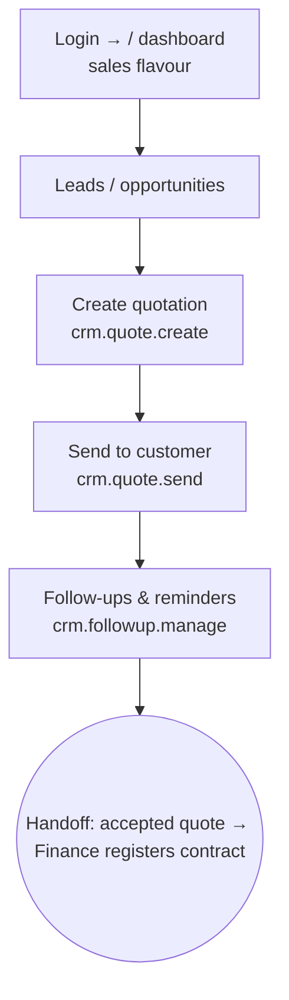

# Flow — BUSINESS_DEV_MANAGER

Front-line sales: chases leads, builds and sends quotations, follows up. Desk/mobile.
Scope OWN/ALL. Permissions: `access.php:456-457` (shared with KEY_ACCOUNTS_MANAGER).

- **Landing:** `/` dashboard, sales flavour (`dashboard.php:63`); sees Sales, Insights, Directory (clients).
- **Can:** edit inquiries/quotes/orders, create & send quotes, manage follow-ups; view sales reports & clients.
- **Cannot:** approve quotes (that's MARKETING_MANAGER), register contracts (Finance), touch operations, or manage users.
- **Handoff:** an accepted quote becomes Finance's "contracts to register" task (`ops.php:6306`). On the quote page a sales viewer sees an explicit **"✓ Won — handed to Accounts"** wall (C1, `quote_detail.php`): the accepted quote is locked (`quote_is_locked`), the only way to change it is a **revision**, and the contract/calls are Accounts' and Operations' to do — sales' part is done.
- **Three journey fixes (owner, 13 Nov 2026):** (1) a deal **won through its quotation** shows "✓ Won through quote Q-…" with the contract's number and state — "Send to Accounts" is not offered, because Accounts register the contract on the quotation (one sale, one contract). (2) A **won deal for a brand-new customer** (no lead behind it) has "＋ Add as a customer" right on the deal — name and State — instead of only "add them first"; an existing customer can still be picked. (3) Accounts register a no-quotation deal on their own screen, so nothing waits on someone opening the deal.
- **A deal for a brand-new customer (owner, 13 Nov 2026):** type the customer's name on the deal and press "＋ Create a new quotation" — no customer record is needed first. The quotation goes out in that name; when the customer accepts, they are added to the client master by themselves and put on the deal, and the deal is won. "Already a customer? pick them from the master" is a fold on the Quotes tab. While the deal is open its top line follows the quotation ("Quote Q-… is waiting for approval" → "is approved — ready to send" → "is sent — waiting for their answer") with a link to open it, and Back from that quotation returns to the deal. There is one quotation button at a time. After the win, the quotation says "With Accounts (names) to register the contract number. Nothing more for you to do here."
- **Won without a quotation (direct order):** on the deal, **"Send to Accounts to register the contract"** (`/opportunity-send-to-accounts`) hands it to Finance the same way — no quote needed — and it flows contract → endorse → approve → OPEN → calls. A quick **"raise a work order directly"** (no contract, doesn't pass Finance) is kept as a secondary, folded option for one-offs.
- **Generate quotation (quote-of-record):** any deal without a quotation offers **"Generate quotation"** (`/opportunity-generate-quote`) — a draft quote pre-filled from the deal (client, subject, value), linked to it, so even a direct order can carry a quote for the record. One is enough: the button greys out once the deal has a quotation. (Quotes are *not* mandatory per order — the invariant is order→contract and contract→rate-basis; this just makes a quote always **available**.)
- **On a lead — one next step** (owner, 12 Nov 2026): the lead page shows a three-step bar (*Talk to
  them → Send a quotation → Their answer*) and ONE main button for where it stands — "Log your first
  contact", then "Make the quotation", then "Open quotation …". A quotation made from the lead sits
  under the lead (Back returns to it), and when the customer accepts it the lead closes by itself as
  **Won — customer**. Moving between stages, working it as a deal, marking it lost and the direct
  *"They said yes without a quotation from us"* (for a purchase order that arrives without our
  quotation) are optional and sit under **More**. Same permissions as before.
- **Billing by milestones** (owner, 12 Nov 2026): on a quotation, "Billing by milestones" →
  "Set up milestones" sets the stages the customer pays in (shares adding up to 100% of the price
  before GST, optional retention). The schedule prints on the quotation PDF, and changing it
  cancels an approval. The contract takes it when the quotation is won. Same permissions as
  editing the quotation.
- **Contacts on a lead** (owner, 12 Nov 2026): the lead's **Contacts** tab lists every call, message,
  meeting, visit and note logged, newest first — how, which way, who, what was said, how it went, the
  time it took and the next step agreed on that contact. **＋ Log a contact** opens the form above the
  list; saving returns to it. Same permissions as before.
- **Project costing — quick start from the CTC** (owner, 13 Nov 2026): on "＋ Add a role", type the
  CTC per person a month and the margin wanted, press "Build the salary break-up": the heads (Basic,
  HRA, PF …) come from the company's salary components and add up to the CTC; the rate follows the
  margin. Any head can still be changed. Either Save on the page keeps both the role and the settings.
- **…or from the rate the client pays** (owner, 13 Nov 2026): the same Quick start asks "I know the
  CTC" or "I know the rate the client pays". Choose the second, type the rate and the margin: it tells
  you the CTC you can afford and fills in its break-up. Only the box for your choice is shown. The
  page remembers the question you last chose (in this browser), so "Save settings" no longer flips it
  back to "I know the CTC" — a client's rate typed into the CTC box is priced as a salary (SAL-176).
  On a costing priced per man-day the CTC is still a month's; the heads and figures are per man-day,
  and the strip shows the month beside the salary and direct cost (at the working days on the page).
- **A costing stays with its quotation once the quotation is sent, won or has a contract** (owner,
  13 Nov 2026): "Unlink" is replaced by "🔒 Stays linked". To change figures after that, raise a
  revision. While the quotation is a draft or in approval, unlinking works as before and is logged.
- Most common task = create & send a quote (a few clicks through the quote form).
