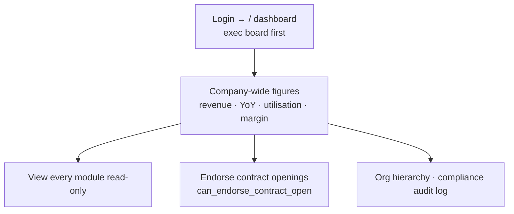

# Flow — BUSINESS_DIRECTOR

The top executive: reads the whole business across every branch and unit but does not
run the desks. Desk-first. Scope **ALL/ALL**. Permissions: `access.php:439-440`
(all dashboards + all `data.*` figures + `org.hierarchy.view` + `idems.audit.view`).

- **Landing:** `/` exec dashboard (`dashboard.php:391`).
- **Can:** view **every** module (except identity, stripped at `access.php:366-369`); read all money figures; view the compliance audit log; endorse contract openings (`contracts.php:473-477`).
- **The signatures are each company's own rule (owner, 13 Nov 2026).** What is described here is the standard rule. A company can change how many approvals a contract needs (two, one, none) and who gives each under **Admin → Approvals → Sales → Contract**. On the screen you are offered the one signature that is yours to give now, and you read — by name — who it is waiting for otherwise.
- **Cannot (by default):** edit operational records, manage users, change **system settings** (no `settings.manage` — the settings tile is hidden, `areas.php:213`), or see identity documents.
- **Handoffs:** primarily a reader; endorsing a contract hands off to the Branch Manager.
- Most common task = read dashboards (0-click landing) and drill into figures.

### Approving a project costing — the trail (owner, 13 Nov 2026)

On a costing waiting for you, the band at the top says what it waits for, by name. The Approval box
shows who prepared it, who submitted it and each level with who signed and when; your signature (with
its reference, if you type one) and any send-back with its reason are recorded there and in "History
of this costing". "Create quotation" is not offered after your signature unless every level has
signed — with "all levels at the same time" the others still sign. Nothing about who approves changed.

### Project costing — 14 Nov 2026

- **Settings are at the top** of a costing, four to a row: no scrolling to change Overhead, Negotiation or the default basis.
- **Each role has its own basis** — per man-month, per man-day or lump sum — so one costing can hold a man-month team and man-day specialists. The costing's basis is only the default for new roles.
- **An approved costing is reopened only by whoever gave the last approval**, someone at that level, their delegate, or someone above them — never by the person who prepared it.
- **When a costing is sent back**, the preparer and everyone who had already approved it get an e-mail and a dashboard notice; after it is revised, every level approves it again.
