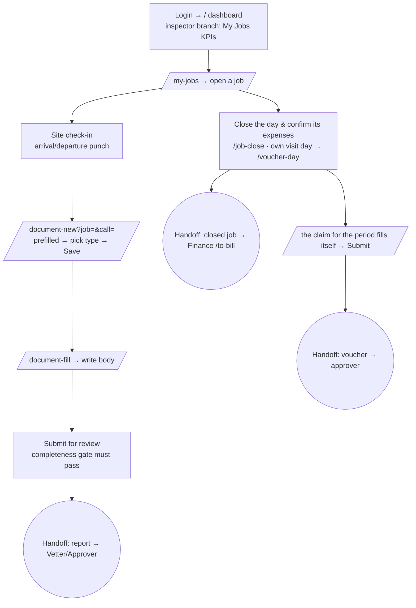

# Flow — INSPECTOR

The field engineer: goes to site, checks in, does the inspection, writes and submits
the report, then closes the job and files their expense/time voucher. **Phone-first,
patchy 4G** (offline queue). Least-privilege: no permissions, `idems` module only
(`access.php:464-465,360`); identified by having an `inspector_id`. The phone-first field UI
(My Jobs, site check-in, My Voucher, the stripped job view) triggers on `is_field_inspector()`
— **INSPECTOR or SR_INSPECTOR** (a senior inspector who also does field work), or any
non-management login seated on an inspector record (R7).

**Landing:** `/` → `views/dashboard.php` **inspector branch** (`dashboard.php:23-43`):
attendance widget + the **personal KPI board** — the same universal
`connect_kpi_board`/`connect_kpi_render` engine that powers the client and
freelancer dashboards, here at `audience='inspector'` scope (own `inspector_id`):
**Active jobs · Reports to write · Jobs overdue · Ratings · Completed** (Stage 1 B1 names; the same definitions as the Operations home, `lib/opskpi.php`), with one-tap
attention chips (reports to write / jobs overdue) — plus quick-action cards ("All my
jobs", "My Voucher") and the "Your pending tasks" panel. Least-privilege: the
board shows **no money figure**; the monthly voucher stays a link, not a total.

**Walkthrough:**
1. Land on the personal dashboard; tap into **My Jobs** (`/my-jobs`) — job cards + a week/month schedule.
2. Open a job (`/job?id=`). *(An assigned inspector can open and act on their own job even without the jobs module, via the owner bypass, `ops.php:2384-2388`.)*
3. **Site check-in** — arrival/departure punch (`/site-checkin`, `job_detail.php:263`); the timesheet is built from these punches, geofenced if enabled (`job_detail.php:204-219`).
4. **New report** → `/document-new?job=&call=` (`job_detail.php:504`) — prefilled (client/vendor/PO/scope carried from the call), pick the report type, Save.
5. **Fill** → `/document-fill?id=` — write the body (dictation/AI-polish helpers available).
6. **Submit for review** → `/document-submit` (`idems.php:4392`). A completeness gate must pass first (`idems.php:4399-4409`); untouched text fields default to "NA".
7. **Close the day & confirm its expenses** (Expenses Phase 1, owner 17 Nov 2026 — design v3 screen 1). "Close the day" on `/my-jobs` or the job opens `/job-close`; a multi-day job's own visit day is closed on the job's day-by-day panel (the engineer allocated to that day may close it) and leads to `/voucher-day`. **Today's expenses** are already filled in: travel = the usual distance for that site × the rate of his band or profile, the per-day allowances that are "added by itself", and a tick box for each one "added when he ticks it" (e.g. *Outstation today*); each figure says where it came from. A different distance than the approved usual one needs a reason (the approver sees it in amber). **＋ Add a bill** (ticket, hotel, cab: amount + photo) or a "no bill" expense (auto-rickshaw, food: amount + a short note, within its daily limit) — only the types his band or profile allows. Then **Close the day** — "no expenses today" is fine. The lines go into his claim for the period by themselves, with job, client, site and date; nothing is written to the job's `expenses`. If a coordinator closed the job, the day appears on his claim as "needs its expenses confirmed".
8. **The claim** → `/vouchers` → the period (weekly, fortnightly or monthly — the company setting). One card per day and job (job no., client, site, amounts), the total on top, "It will go to: N+1 → … → Finance", then **Submit ₹…**. He can change or remove his own lines while it is a draft and within the deadlines (a day's expenses for 8 days after the day, the claim within 8 days after the period — the owner's values, settings). After a deadline it is locked: he taps **Ask to reopen** and only his N+1 can reopen it, with a reason. "Not for a job" types (e.g. a courier from home) appear under **＋ Add an expense** only when switched on for his band or for him. A bill needs its photo before he can submit. He no longer types the advance — Finance enters it when paying. An older month voucher still opens with its own figures, and its month sheet (hours, days off, amounts per head) stays available while it is a draft; "Pull working days" is kept there for those months.

**The job view is phone-first and stripped for the inspector.** The job screen
(`views/ops/job_detail.php`) is shared with coordinators and managers, so it carries
desk/commercial panels the field engineer neither needs nor can act on. For a user
whose role is `INSPECTOR` (`$fieldInspector`, `job_detail.php`) those panels are
**hidden, not merely collapsed**:
- the **communication log** (client/coordinator correspondence),
- the **"contract number not available"** notice (a commercial gap they cannot cause or clear — work is never actually blocked for it),
- the **client-bills** panel ("Charged to the client — bills required"),
- the whole **Expenses & profitability** fold (client-billable cost is the coordinator's; profitability is managers-only).

With nothing left on it, the **Money tab stops appearing** for the inspector, leaving
**Overview** (who to contact / where to go, full job details, client documents),
**Schedule & site** (site check-in, day-by-day plan) and **Reports & QA** (QAP,
report formats, hold/witness points, approval status). Their own travel and
out-of-pocket expenses are pointed to on the **Site check-in** panel ("Travel &
expenses go on your voucher"), so no inspector-facing guidance is lost by dropping
the Money tab. This is a **visibility** change only — no permission changes; a
coordinator, manager or anyone holding the money permissions still sees the full record.

**Decision points:**
- **Job close is gated by business rules:** report upload date required unless NOREPORT (`ops.php:5581`); the chargeable bill must be on file (`ops.php:5602`); both site check-ins must exist or the close is bounced (a manager can override with a recorded reason that dents the rating, §WO-9 `ops.php:5609-5628`).
- **Report path forks on the vetting gate:** Submit → `VETTING` (to a vetter first) if the gate is on, else straight to the approval chain (`idems.php:4428-4436`). The gate is a single admin switch — **Settings → Vetting checklist** (`/vetting-checklist`), "Require technical vetting before approval" (`vetting_gate_required`, off by default; Release Notes are always exempt). See `docs/edge-cases/07-vetting-review-approval.md §13`.
- **Read the draft before you submit:** the report detail's primary **"📄 Download draft"** button (and *More ▾ → PDF (draft)*) gives the inspector the report as a PDF **watermarked DRAFT** at any point before it is issued — no submit or approval needed. Read it over, then submit for review (`ops_idems_pdf`, `idems.php:7648`).

- **Your own reports only (R2, owner 16 Nov 2026; point 5, 17 Nov 2026):** you open, edit and submit the reports where you are the inspector, or which you created. Another inspector's report no longer opens at all — not its page, PDF, Word copy or files, and the register and search do not list it ("This is another inspector's report …"). The one exception is a report whose approval chain names you as an approver (and a Senior Inspector's vetting / issue work).
- **Next stage of a work order (owner, 17 Nov 2026 — `QA-REPORTS/V51/29` §B):** when you are allocated a job on a work order that already has an approved or issued report, your job page shows **Continue the previous stage → ⏭ Start next stage report**. It makes *your* report with the next number of that series, filled in from the previous one (client, vendor, P.O., project, drawing, specifications, location, form and findings); you add this stage's result, inspection date, photos and signature. It says "Continues from <IRN>"; the earlier report is not changed. A Coordinator can also start it for you.
- **After you submit, it is out of your hands:** to change a submitted, approved or issued report, ask a Coordinator (or above) of the executing office. They send it back to you with a reason (it shows in *Returned for correction*), or — once issued — start a new revision (R1, R2 …) for you to correct; it then goes through approval and issue again (C2 / 0.3).

**Handoff points (named):**
- **Inspector → Vetter/Approver:** on submit the report leaves the inspector and shows on the approver's dashboard "Reports awaiting your approval" and their pending tasks (`dashboard.php:253`, `ops.php:6336`). A rejected report returns as "to fix & resubmit" (`ops.php:6370`).
- **Inspector → Report issuer:** once approved, an `idems.finalize` holder sees "to issue" (`ops.php:6342`) and produces the locked PDF.
- **Inspector/Coordinator → Finance:** closing the job (`closed_flag=1`) makes it appear in Finance's **/to-bill** (`booksui.php:123`).
- **Approvers never edit (V2):** an approver, Finance, the Master Admin or an Admin approves or sends back with a reason; none of them changes his lines or submits for him.
- **Inspector → Voucher approver:** submitting the voucher starts its approval chain (branch batch R5): it shows as "vouchers to approve" for the person the inspector reports to (N+1), then — if the amount needs it — N+2 and above and any role level the Master Admin set (a Business Director above an amount, for example; someone already signed is not asked twice), then Finance. Each approver sees the voucher only once it reaches them; nobody sees it because of their role (`lib/voucher_approval.php`, `docs/02` footnote 3). An approver may send it back with a reason; the inspector sees the reason on the voucher and as "voucher sent back — correct it", corrects it and submits again.

**Click-count — fill & submit a report:** open job (1) → New report → Save (2) →
Fill report (1) → write body + Save (1) → Submit for review (1) = **~6 clicks** (form
and body pre-populated from the job).
