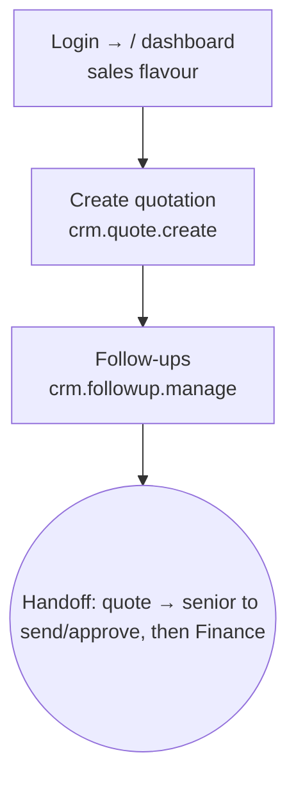

# Flow — MARKETING_EXECUTIVE

Junior sales: creates quotes and does follow-ups within their own office. Desk/mobile.
Scope OWN/OWN. Permissions: `access.php:460-461`.

- **Landing:** `/` dashboard, sales flavour (via `crm.quote.create`). Sees Sales and Directory (clients); **no Insights** (no `mod.reports.view`).
- **Can:** create/edit inquiries & quotes, manage follow-ups; view orders/sales-reports/clients.
- **Cannot:** send or approve quotes, touch operations or money, manage users.
- **Handoff:** a drafted quote is sent/approved by a senior sales role, then registered by Finance.
- **Who takes the next step is named (owner, 13 Nov 2026):** an approved quotation no longer tells you "Next: send it to the client" — you may not send. It says who does, by name (the people of your branch first), so you can tell them it is ready. A won quotation says it is with Accounts, by name, and that nothing more is yours to do. The "Actions" box is not drawn when it would hold nothing for you to press. The strip at the top shows the lead a quotation was made from, and there is one way back — to that lead.
- Most common task = draft a quote (through the quote form).

### Enquiries show what became of them (owner, 13 Nov 2026)

An enquiry now says **Open → Quoted → Won / Lost** by itself, following its quotation — you never set
it. If you will not quote at all, open the enquiry → **Drop this enquiry** → pick why (we declined /
the client withdrew / duplicate) → "Drop it"; "Reopen it" undoes that. An enquiry with a quotation
cannot be dropped — mark the quotation lost instead. The register's cards show how many were quoted
and won, and the hit rate.
