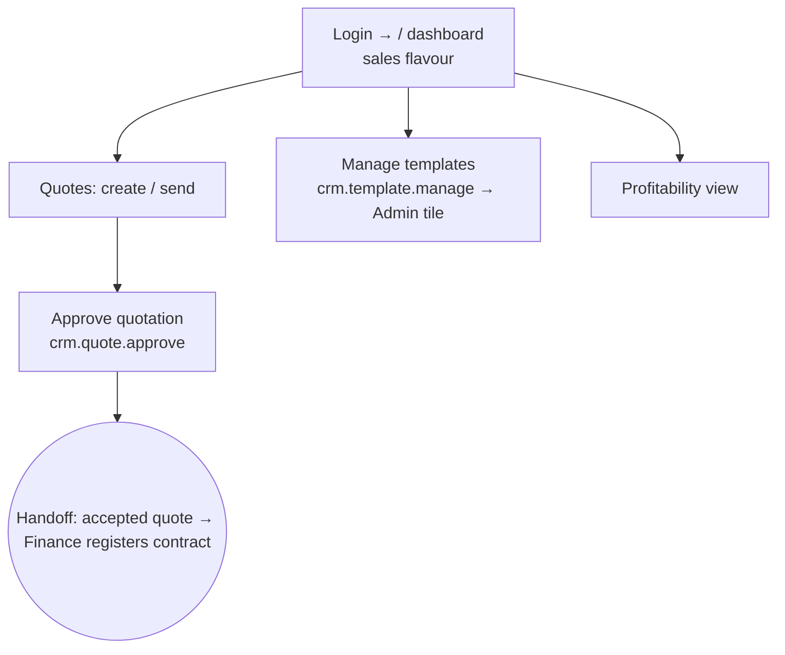

# Flow — MARKETING_MANAGER

Senior sales/marketing: can **approve** quotations and manage templates across all
offices. Desk-first. Scope ALL/ALL. Permissions: `access.php:458-459`.

- **Landing:** `/` dashboard, sales flavour. Sees Sales (incl. pre-order checklist via `crm.quote.approve`, `areas.php:51`), Money (profitability), Insights, Directory, and the Admin **Document-templates** tile (via `crm.template.manage`, `areas.php:222`).
- **Can:** the full quote lifecycle incl. **approve**; manage quote/e-mail templates; see revenue/profitability.
- **Cannot:** run operations, register contracts, manage users/settings.
- **Handoff:** accepted quote → Finance's "contracts to register".
- **Quirk:** the Admin area appears for this role **only** because of the templates tile — no user/settings access. See `99-gaps-and-risks.md`.
- Most common task = approve a quotation (open quote → Approve, ~2 clicks).

### Approving a project costing — the trail (owner, 13 Nov 2026)

On a costing waiting for you, the band at the top says what it waits for, by name. The Approval box
shows who prepared it, who submitted it and each level with who signed and when; your signature (with
its reference, if you type one) and any send-back with its reason are recorded there and in "History
of this costing". "Create quotation" is not offered after your signature unless every level has
signed — with "all levels at the same time" the others still sign. Nothing about who approves changed.

### Project costing — 14 Nov 2026

- **Settings are at the top** of a costing, four to a row: no scrolling to change Overhead, Negotiation or the default basis.
- **Each role has its own basis** — per man-month, per man-day or lump sum — so one costing can hold a man-month team and man-day specialists. The costing's basis is only the default for new roles.
- **An approved costing is reopened only by whoever gave the last approval**, someone at that level, their delegate, or someone above them — never by the person who prepared it.
- **When a costing is sent back**, the preparer and everyone who had already approved it get an e-mail and a dashboard notice; after it is revised, every level approves it again.
