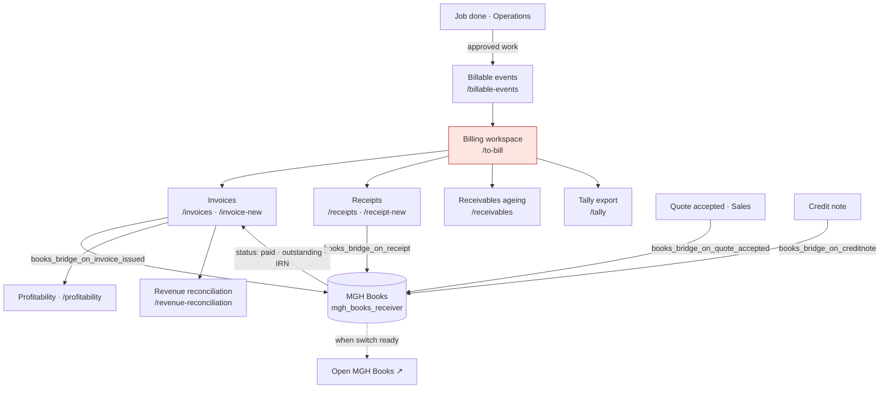

# D2 — Module dependency map (Phase C, in progress)

First chapter: **the money chain**, because the owner's open question was
*"who owns invoices — EXAACT or MGH Books?"* and the answer changes the severity
of several findings.

---

## 1. Who owns the money — answered from the code

**Short answer: EXAACT raises the paperwork; MGH Books owns the arithmetic —
but only when Books is switched on. When it is not, EXAACT is the whole system
of record.**

### The evidence

`mgh_books_receiver/README.md` is the Books side of the contract and states it
plainly:

> "The money truth lives here: an invoice arrives `UNPAID` with its full total
> outstanding; a `RECEIPT` reduces the party's open invoices oldest-first; and
> a `CREDITNOTE` reduces the invoice it names; and `status` reports back the
> paid, outstanding and IRN the ERP then shows on its invoice screen.
> **The ERP never recomputes any of it, so the two can never disagree.**"

`phpapp/lib/booksbridge.php` is the EXAACT side. It pushes four document kinds
and reads one status back:

| EXAACT event | Pushed to Books | Function |
|---|---|---|
| Quote accepted | `QUOTE` | `books_bridge_on_quote_accepted()` |
| Invoice issued | `INVOICE` | `books_bridge_on_invoice_issued()` |
| Receipt recorded | `RECEIPT` | `books_bridge_on_receipt()` |
| Credit note raised | `CREDITNOTE` | `books_bridge_on_creditnote()` |
| — | ← `status` (paid, outstanding, IRN) | read back on the invoice screen |

### What that means in business terms

| Question | Answer |
|---|---|
| Where is an invoice **raised**? | In EXAACT — `/invoice-new`, from billable work |
| Where is a receipt **recorded**? | In EXAACT — `/receipt-new` |
| Who decides **what is still outstanding**? | **MGH Books**, when connected. EXAACT displays its answer and does not recompute it |
| What if Books is **not** connected? | EXAACT keeps its own invoice, receipt and ageing records. `books_connected()` is off by default; `books_dryrun()` exists for trying it |
| Is there a way to **work in Books directly**? | Yes — a Money tile "📗 Accounts & GST ↗" opens Books already signed in, but **only when `books_switch_ready()`**, i.e. connected *and* an app URL is set |

### Consequence for the audit

The screens the Phase B draft called "unreachable" — `/invoices`, `/receipts`,
`/receivables`, `/tally` — are **not retired and not dead**. They are EXAACT's
own billing screens, reached from **Money → Billing workspace** (`/to-bill`),
which links to all four. The original finding was a method error and is
corrected in `08-GAP-REGISTER.md`.

**One claim I drafted here was wrong, and is withdrawn.** I first wrote that
the tile "over-promises" by describing a tabbed workspace that does not exist.
It does exist: `billing_tabs()` (`booksui.php:26-46`) draws exactly the five
tabs the tile names — To bill · Invoices · Money in · Ageing · Export. The tile
is accurate. I had read the view and not the helper it calls on its first line.

**Checking that properly turned up the real finding.** The tab strip is the
*only* navigation between the five billing screens, so I checked whether anyone
could get a door without the strip, or the strip without a door:

| | Condition |
|---|---|
| The tile | `can('mod.invoicing.view') && (finance.reconcile ‖ data.credit ‖ master)` |
| The tab strip, `books_can()` | `licence_module_live('invoicing') && (finance.reconcile ‖ data.credit ‖ master)` |

`can()` consults the licence itself (`access.php:1186`), so the tile implies the
strip and **no role gets a dead end** — verified for all 15 roles
(`evidence/books-write-authority.py`). But the same three-key test appears a
third time, at `booksui.php:225`, where it guards **everything that writes**:

```php
// Everything below writes.
ops_require($canIssue || can('data.credit'), 'You cannot change the books.');
```

And `data.credit` is defined as **"See the inter-office credit figures"**
(`access.php:133`) — a read-only visibility permission, given to coordinators
and managers so they can see a credit figure on a job screen. It is being used
as a key to the cash book. The measured consequence is **GAP-010 (P0)**: a
Coordinator, a Branch Manager and a Business Director can all record money
received and raise an invoice, where the permission matrix grants them "View",
"View" and nothing.

The second point I drafted — that the chain is gated more narrowly than the
module — stands, but the conclusion drawn from it was also wrong, and GAP-003
is rewritten accordingly. `docs/02-permission-matrix.md:215` grants Invoicing /
Receipts to **MA · AD · BM · CO · FIN** and withholds it from **OM**. The
Operation Manager's 403 and the Coordinator's access are therefore **the
documented intent**, not a defect. What is a defect is the Business Director's
and SBU Head's access, which the matrix withholds.

---

## 2. Money chain — as built



`/to-bill` is marked because it is the **single point of failure** in this
chain: it is the only tile, and every other billing screen hangs off it — and
because the tab strip that carries you across those screens is drawn only when
`books_can()` is true, so losing that one condition loses the navigation for
the whole chain at once.

**Transition grades** (per the charter's evidence rule):

| Transition | Grade |
|---|---|
| Billable events → Billing workspace → invoices / receipts / ageing / Tally | **CONFIRMED** — crawled, `evidence/reachability-crawl.json` |
| Invoice issued → Books | **READ** — `booksbridge.php:246`; not executed against a live Books instance |
| Who may write to the books | **CONFIRMED** — executed per role, `evidence/books-write-authority.py` |
| Books status → invoice screen | **READ** — not executed |
| Quote accepted → Books | **READ** |
| Invoice → profitability / reconciliation | **SUSPECTED** — the screens exist and are reachable; the figures are not yet reconciled (Phase F / D7) |

---

## 3. Systems in this repository, and which owns what

Now that everything is in scope, these are the deployables found:

| Deployable | Lines | What it owns | Talks to |
|---|---|---|---|
| `phpapp/` | 190,674 | The ERP: operations, quality, reporting, recruitment, sales, money paperwork | Books, Licence server |
| `mgh_books_receiver/` | ~250 | **The money arithmetic**: paid, outstanding, IRN | ← phpapp |
| `licence-server/` | ~6 files | Subscription renewal from a Razorpay webhook; issues licences | ← phpapp check-in |
| `mgh-hire/` | 2,555 | **A second, standalone recruitment product** — own tables, no shared code | nothing |
| `sop/` | 10 docs | Plain-English SOPs for Masters and dropdown lists | — |

`mgh-hire` is the finding here: two implementations of recruitment in one
repository (GAP-007). `phpapp`'s module is the one in UAT.

---

## 4. Still to do in Phase C

- [ ] Ownership table for all 30 modules — which creates, reads, updates, owns
- [ ] The 317 tables mapped to owning module; duplicate/overlapping entities
- [ ] Sales → Operations chain (enquiry → quote → order → call → job)
- [ ] Quality chain (NCR → CAPA → audit → management review)
- [ ] Reporting chain (job → report → review → vetting → release → acceptance)
- [ ] Recruitment chain (already partly mapped during the October fixes)
- [ ] Which dashboard metrics read which authoritative source (feeds D7)
