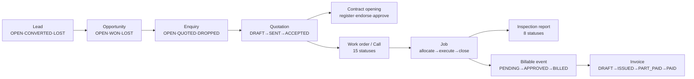
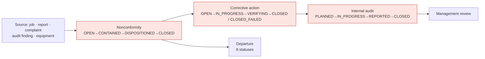

# D3 — Workflow catalogue

What the business processes are, what states a record can be in, and whether
those states are written down anywhere that governs them.

**Evidence:** `evidence/lifecycle-and-ownership.txt` §A (every status vocabulary
the running application defines, read by reflection rather than by grep),
`evidence/lifecycle-coverage.txt` (those reconciled against
`docs/03-object-lifecycles.md`).

---

## 1. The governance finding, first

`CLAUDE.md` sets a hard rule for this repository:

> Never add a status or transition that is not in `docs/03-object-lifecycles.md`
> without asking.

That rule can only bite where the document actually covers the object. Measured:

| | Count |
|---|---|
| Objects with their own lifecycle section in the document | **26** |
| Status vocabularies defined in the running code | **63** |
| Matched to a documented object by name | 19 |
| Not matched — needing a read | 44 |

Keyword matching is approximate in both directions, so "not matched" is a
reading list, not a verdict. I therefore checked the clear cases by searching
the document for the business word itself:

| Object | Mentions in `03-object-lifecycles.md` | Reading |
|---|---|---|
| Invoice (`INV_STATUS`, 5 states) | **17** | Discussed throughout, but has **no section of its own**. The states DRAFT · ISSUED · PART_PAID · PAID · CANCELLED are not set out anywhere as a lifecycle |
| Lead (`LEAD_STATUS`) | 5 | Mentioned, no section |
| Deputation (`PDSO_STATUS`, **12 states**) | 2 | Mentioned, no section — the largest undocumented workflow in the system |
| Risk (`RISK_STATUSES`) | 1 | Mentioned, no section |
| Enquiry (`INQUIRY_STATUS`) | 1 | Mentioned, no section |
| **Nonconformity** (`NCR_STATUS`) | **0** | Entirely absent |
| **Corrective action** (`CAPA_STATUS`) | **0** | Entirely absent |
| **Opportunity** (`OPP_STATUS`) | **0** | Entirely absent |
| **Equipment & calibration** (`EQUIP_STATUS`) | **0** | Entirely absent |
| **Items & samples** (`SAMPLE_STATUSES`) | **0** | Entirely absent |
| **Internal audit** (`AUDIT_STATUS`) | **0** | Entirely absent |

**The absences are not random. They cluster in two places:** the whole
**Quality and accreditation** set, and the **top of the sales funnel**. Those
are precisely the areas an ISO/IEC 17020 assessor examines and where the
business wins work — and they are the two areas where nobody can say whether a
state change is intended, because the intent was never written down.

This is the documentary half of GAP-004, found independently: when I needed the
intended audience for nonconformities, the matrix had no row; when I needed the
intended states, the lifecycle document has no section.

**Recommendation.** Write the missing sections, starting with the eleven above.
This is not paperwork for its own sake — it is what makes the CLAUDE.md control
enforceable, and it is what an assessor asks to see. Order: Nonconformity and
Corrective action first (an accreditation requirement and now has new closing
authority), then Invoice (the money record), then the accreditation registers,
then the sales funnel.

---

## 2. The chains, as built

Each chain below was traced through the route map, the area definitions and the
handlers. Transition grades: **CONFIRMED** = driven or crawled;
**READ** = the code says so, not executed; **SUSPECTED** = inferred.

### 2.1 Sales → Operations — enquiry to finished job

**The work order carries 15 statuses** — RECEIVED · DRAFT · UNDER_REVIEW ·
CLARIFICATION · ACCEPTED · REJECTED · ON_HOLD · READY_TO_SCHEDULE · SCHEDULED ·
ASSIGNED · IN_PROGRESS · COMPLETED (+3 more). That is the most stateful object
in the system and it is the one the business touches most. It *is* documented
(§Call), which is right. Worth asking whether 15 states are all distinguishable
to a coordinator in practice — a Phase E/usability question, not a defect.

### 2.2 Reporting — the inspection report

`DRAFT → SUBMITTED → VETTING → UNDER_REVIEW → APPROVED → ISSUED` plus
REJECTED and ARCHIVED (`IDEMS_STATUS`, 8 states), with a separate vetting
vocabulary (`IDEMS_VET_STATUS`: VETTED · RETURNED · DEBRIEFED) and an approval
vocabulary (`IDEMS_APPR_STATUS`: PENDING · APPROVED · REJECTED · SENTBACK ·
DELEGATED). Documented. The rule that matters commercially — **approver ≠
issuer** — is enforced in code (`idems.php:4456,4460`) and recorded in the
permission matrix footnote 18. **CONFIRMED** by the existing suite.

### 2.3 Quality — the loop that has no written lifecycle

Marked because **none of these three has a lifecycle section**, and until
2026-10-18 only a system administrator could close the first two (GAP-004, now
fixed with the Quality Head and Technical Head roles). `CLOSED_FAILED` on a
corrective action is a good design — it records that a fix was tried and did not
work, which is exactly what an assessor wants to see — and it is undocumented.

### 2.4 Recruitment — requirement to joiner

`Hiring request` DRAFT → SUBMITTED → UNDER_REVIEW → APPROVED / REJECTED /
CANCELLED, with **REJECTED → DRAFT** added in October (documented in the same
commit, as required). Then `Candidate` stages, `Interview`, `Job offer`
(9 states), `Candidate document` (9 states), and a change-control layer
(`RVER_STATUSES`) for altering an approved request. All documented — this is
the best-covered chain in the system, because it was worked on most recently.

### 2.5 Money — see D2

The chain and the MGH Books boundary are in
`02-MODULE-DEPENDENCY-MAP.md` §1–2. Books owns paid/outstanding/IRN when
connected; EXAACT raises the documents and never recomputes.

---

## 3. Exception paths — what happens when things go wrong

An audit should ask not just "what is the happy path" but "can the business
recover". Measured from the status vocabularies:

| Exception | Provided? | Evidence |
|---|---|---|
| Reject and correct a hiring request | **Yes** — REJECTED → DRAFT, added October | `test_hreq_reopen.php` |
| Change an already-approved hiring request | **Yes** — a change proposal needing re-approval | `lib/reqversion.php` |
| Send a report back rather than reject it | **Yes** — SENTBACK, and DEBRIEFED after vetting | `IDEMS_APPR_STATUS` |
| Record that a corrective action **failed** | **Yes** — CLOSED_FAILED | `CAPA_STATUS` |
| Cancel an invoice | **Yes**, Accounts only, and **the number stays in the series** — "a GST series may not have gaps" | `books.php:740-751` |
| Credit-note instead of cancelling a settled invoice | **Yes**, and cancelling is refused once money is recorded | `books.php:747` |
| Reopen a closed nonconformity | **Yes** — `ncr-reopen`, guarded | permission matrix fn. 143 |
| Withdraw a quote revision | **Yes** — revisions are versioned | `quote_revisions` |
| **Undo an empty record created by accident** | **See D4 §2** — an empty work order and an empty candidate can be created, and each burns a code from a numbered sequence | `evidence/validation-check.json` |

The exception handling in this system is markedly better than average. The
invoice-cancellation rule in particular is the work of somebody who understands
Indian GST numbering, and the refusal to cancel a settled invoice is the right
call. The one real gap is at the *entry* point, not the exit — see D4.

---

## 4. Remaining work

- [ ] Transition-level verification: for each documented object, drive every
      documented transition and confirm the code permits exactly those
- [ ] The 44 unmatched vocabularies read individually and either documented or
      declared internal (several, like `ADS_OUT_STATUS` and `COCKPIT_STATUSES`,
      are plainly internal plumbing and should be marked as such rather than
      written up as business lifecycles)
- [ ] Who may make each transition, cross-checked against the permission matrix
- [ ] Timing: which transitions carry an SLA (`TOSRM_SLA_STATUS` exists —
      WITHIN · AT_RISK · BREACHED · NA — and is undocumented)
