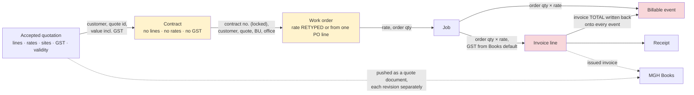

# EXAACT Sales — cross-module reconciliation

**From the quotation to the money in the bank: what travels, what is retyped,
what is lost** · Written 19 Oct 2026 · investigation only

Every statement is graded **EXEC** (run on a throwaway database through the real
handlers) or **READ** (traced in the code). Evidence is under
`../evidence/sales-audit/`. Finding ids `SA-nn` are in
`SALES-USER-AND-INDUSTRY-AUDIT.md` §10; decisions `D-nn` in
`SALES-BUSINESS-DECISIONS.md`.

This document supersedes the single "SUSPECTED" row of `../workflows/01-SALES.md`
§5 ("the quote's line rates are the basis of the later invoice"): **they are
not** (§3).

---

## 1. The spine, and where the figure breaks



Yellow: figures are lost or retyped. Red: figures are wrong by default.

---

## 2. Each handoff — the ten questions

| Handoff | Trigger | Record created / changed | Next owner | Must be present | Validation today | If it fails | Retry without duplicate? | Cancel / revise / reopen | History | Related records |
|---|---|---|---|---|---|---|---|---|---|---|
| **Lead → customer + enquiry** | "Convert" | customer, enquiry; lead CONVERTED | salesperson | company | refuses a CONVERTED lead; **a LOST one converts** | best-effort | **No** — two simultaneous converts → two customers (SA-18) | no reopen | **none** | quote raised later links back |
| **Deal → quote** | "Create quote" on the deal | quote DRAFT with deal and customer | preparer | customer | — | — | yes (a second click makes a second quote) | — | none | the deal is won/lost by its quotes (SA-27) |
| **Enquiry → quote** | "Raise quote" | quote DRAFT; enquiry QUOTED | preparer | — | — | — | **No** — a double click makes two quotes (SA-26) | enquiry can be set back to OPEN | none | — |
| **Quote → approval** | Submit | approval steps from the bands | the band's approver | **nothing** (an empty quote can be submitted) | bands matched on total incl. GST | — | resubmit rebuilds the chain, **deleting the rejected one** | approver may retract own approval | "Submitted" only | — |
| **Approval → approved** | last step signed | APPROVED | sender | — | **does not check the quote is still PENDING**; a rejection does not end the chain; another branch's approver accepted (SA-05/06) | — | — | **an edit after approval keeps it** (SA-02) | **one-click approval writes nothing** | checklist blocks chain steps only (SA-13) |
| **Approved → sent** | Send | SENT; e-mail; follow-ups | salesperson | send right | **does not require APPROVED** (SA-01) | e-mail failure reported | — | revise only | **none** | deal moved to "quotation sent" |
| **Sent → accepted** | customer's yes | ACCEPTED; customer landed; deal WON; lead CONVERTED; Books queue | Finance (contract) | **view right only** (SA-03) | **none on from-status**; superseded revisions accepted (SA-10) | best-effort cascade | **re-accept re-runs everything** (SA-48) | flips to LOST | **none — who accepted is never stored** | duplicates the customer on a near-match name (SA-18) |
| **Accepted → contract** | Finance registers | contract PENDING; quote shows number | endorser | `crm.contract.register` | **no quote-status check** (SA-09) | **orphan contract on a mid-way failure** (SA-47) | same number heals; auto-number leaves orphan | reopen (no guard — SA-19) | "registered" | PO pre-fill used for blanks |
| **Contract → open** | endorse, approve | OPEN | coordinator | two signatures, approver ≠ endorser | ✓ | — | ✓ | **OM cannot endorse by default** (SA-20) | ✓ | — |
| **Contract → work order** | "Raise work order" | call with contract no., quote, BU, office | coordinator | an OPEN contract (raise path) | **a DRAFT quote or a non-existent contract no. accepted** on the direct path (SA-34) | — | — | — | ✓ | **rate retyped** (SA-23) |
| **Work order → job** | allocation | job | inspector | — | visits ≤ quote line man-days; ≤ contract end ✓; **a job after contract CLOSED allowed** | — | — | — | ✓ | advance / report-hold flags carried from the quote ✓ |
| **Job → billable event** | job closed | event (PENDING) | Finance | — | — | — | ✓ one per job | — | ✓ | **amount = order value, not job's** |
| **Billable → invoice** | Finance adds the job | invoice line | Finance | job closed (or Finance override) | job not already invoiced ✓; **customer not checked** (SA-36) | — | ✓ | credit note | ✓ | **qty = order's, not job's** (SA-15) |
| **Invoice issued → billable BILLED** | reconcile | event BILLED, amount overwritten | — | an issued invoice | **amount ← invoice TOTAL incl. GST** (SA-16) | — | ✓ | — | ✓ | — |
| **Invoice → receipt** | payment | receipt; outstanding | Finance | — | figures validated (GAP-034…036); bank charges notice (Q-J) | — | ✓ | — | ✓ | — |
| **Accepted quote → Books** | acceptance | outbox item | — | Books configured | identical payload dropped ✓ | queued, retried ✓ | ✓ | **each revision a new document, none retracted** (SA-35) | outbox | Books also receives the invoice — possible double invoice (D-20) |

---

## 3. Field by field

| Figure | Quotation | Contract | Work order | Job | Billable event | Invoice line | Verdict |
|---|---|---|---|---|---|---|---|
| **Customer** | `client_id` or typed `client_name` | landed at acceptance | inherited | inherited | inherited | **re-chosen**; job's customer not checked | ✓ until the invoice (SA-36) |
| **Contract number** | — | generated / typed | inherited **locked** on the raise path; **typed freely** on the direct path | inherited | inherited | from the job | ◐ (SA-34) |
| **Lines** | many: service, unit, qty, rate, site | **not copied** — `contract_lines_from_quote()` (`contracts.php:205`) exists and is **never called** | — | — | — | — | ✗ (SA-23) |
| **Quantity** | per line, per unit | **one number summing every unit** — 10 man-days + 4 visits = 14 | order qty | — | order qty | **order qty, not the job's** (`books.php:661`) | ✗ (SA-15) |
| **Rate** | per line | **no rate column** | filled by browser script from the quote line, or by the server from a PO with exactly one open line (`contracts.php:1500`); **editable; never compared** | from the order | from the order | from the order (`books.php:657`) | ✗ — 9,500 billed against a quoted 8,000 (SA-23) |
| **Value** | subtotal + GST = total | PO value, else the quote **total incl. GST** (`crm.php:2241`); freely editable on an OPEN contract | rate × qty (`ops.php:5586`) | — | order value; later **overwritten with the invoice total** | qty × rate | ✗ — no ceiling (SA-23); tax basis mixed (D-16a) |
| **GST %** | one rate per quote | **lost** | — | — | — | `books_default_gst()` (`books.php:670`) | ✗ |
| **Validity / end date** | `validity_days` | end date **blank** unless a PO supplies it | checked against contract end ✓ | — | — | — | ◐ |
| **Sites** | `quote_locations` + per-line site | **lost** | vendor site carried; address re-picked | site | — | one GSTIN per customer | ◐ (SA-38) |
| **Payment terms** | from the master, editable | lost | — | — | — | from the customer master | ◐ |
| **Advance %, report-hold** | on the quote | — | — | **carried** (`crm.php:2641`) | — | — | ✓ |
| **Reimbursables** | clause 4 "at actuals" | — | — | engineer uploads `job_bills` | — | **never read** | ✗ (SA-32) |
| **Business unit, office** | on the quote | carried | carried | carried | carried | — | ✓ |
| **Approval** | chain | — | — | — | — | — | not carried, and not needed downstream once SA-09 holds |

### The end-to-end money probe (C/p2, C/p3, C/p3e — figures exactly as printed)

| Step | What was entered or derived | What happened |
|---|---|---|
| Quotation #8 | 10 man-days × 8,000 = 80,000 · 4 visits × 5,000 = 20,000 · subtotal 1,00,000 · **total 1,18,000** with 18 % GST | accepted |
| Contract | registered at **1,18,000** (the total *with* GST), no lines; then edited to **5,00,000** with an end date — no approval, history "edited" | contract quantity **14** (10 man-days + 4 visits added together) |
| Work order | rate typed **9,500** against the quote line's 8,000; quantity 3 → **28,500** | accepted, no warning |
| Job 1 · 3 man-days | billable event 3 × 9,500 = 28,500 | correct for the typed rate |
| Job 2 · **2 man-days**, same work order | billable event and default invoice line **28,500** — the order's 3 × 9,500 | should be 2 × 9,500 = 19,000 (or 2 × 8,000 = 16,000 at the quoted rate) |
| Invoice of Job 2 + Job 3 | subtotal 40,500 · total **47,790** | after issue, **each** of the two billable events was set to 47,790 — 95,580 between them |
| Everything invoiced under the contract | **11,00,586** | against a contract of 5,00,000 that began as a quotation of 1,18,000; nothing warned |

---

## 4. Costing → quotation — the formula and tax treatment

`lib/projcosting.php:234-273`, checked by hand against the engine (B/p3, EXEC).

```
direct cost   = Σ of 18 cost heads (salary, statutory, travel, accommodation,
                food, PPE, capex, tools, calibration, misc …) — no subcontract head
loading %     = overhead + insurance + bad debt + contingency
                (defaults 8 / 0.5 / 0 / 0.5 — read from settings, no screen sets them)

COST mode     loaded = direct × (1 + loading %)
              rate   = manual rate if given, else loaded ÷ (1 − target %)
RATE mode     rate   = direct ÷ (1 − target % − loading %)   (if that is > 0, else direct)
              loaded = direct + rate × loading %

proposed rate = rate × (1 + negotiation %)        (default 5 %)

man-month / man-day: revenue = proposed × quantity;  cost = loaded × quantity + one-off
lump sum:            revenue = proposed;             cost = loaded + one-off
margin              = (revenue − cost) ÷ revenue
```

**Margin or markup?** The *target* is a **margin on the selling price** (dividing
by 1 − target), which is the right convention for a services business. The
*negotiation allowance* is then a **markup on top**, so a 20 % target with 5 %
negotiation shows 23.81 % margin on the proposed rate — and 20 % only if the
whole allowance is conceded. The screen does not say which is which (SA-14,
§6.1 of the audit).

**Tax.** The costing is tax-free throughout. When it makes a quote it writes
**GST 18 %**, hard-coded, regardless of the service (SA-30); the quote then
computes `GST = round(subtotal × gst % ÷ 100, 2)` with one rate for the whole
quote (`crm.php:620-626`) and no IGST / CGST + SGST type. The approval band
compares the **total including GST** (D-04). An external (portal) quote stores
its typed total as both subtotal and total with GST 0, so reports that sum
`total_amount` add tax-inclusive and tax-free figures together.

**Overheads.** Loadings are a percentage on direct cost. Company overheads
allocated to business units (`lib/costing.php`) are a separate engine for
*actual* costs and do not feed the quotation, so "positive gross margin but
unprofitable after overheads" is visible only after the fact, in Insights.

**What the quote sees of the costing.** A panel with the costing's margin **as it
was when the quote was made** — it is not recalculated when the quote is
re-priced (SA-14).

---

## 5. Seven money measures that must never be confused

| Measure | Definition to adopt | Where it lives today | Problem today |
|---|---|---|---|
| **Quoted value** | Σ current-revision quotations, **before tax**, in a period, by created date | `/crm-reports` "of X quoted" (incl. GST) | mixes tax-inclusive and external tax-free totals |
| **Weighted pipeline** | Σ open deal value × stage (or deal) probability | `/crm-dashboard` ✓ | correct; exists for deals only |
| **Won deal value** | Σ deal value at WON | `/crm-dashboard` "average won deal" | it is the salesperson's *estimate*, not a quote |
| **Accepted quote value** | Σ current-revision ACCEPTED quotations, before tax, by **accepted** date | three screens, three definitions: `/crm-reports` (current revision, by created month), home (all-time), Command Centre "Committed" (**every revision**) | SA-10, SA-28 |
| **Contracted value** | Σ OPEN + CLOSED contract values, before tax | `partner_contracts.value` — **in no report**; defaults to the quote total incl. GST | SA-40, D-16a |
| **Invoiced value** | Σ issued invoices less credit notes, before tax | Command Centre "Billed" ✓ (reconciled 19 Oct, GAP-040…043) | — |
| **Collected revenue** | Σ receipts allocated | Command Centre "Received" ✓ | — |

And two rates:

| Rate | Definition to adopt | Today |
|---|---|---|
| **Deal win rate** | WON ÷ (WON + LOST) deals closed in the period | `/crm-dashboard` ✓ |
| **Quote acceptance rate** | ACCEPTED ÷ (ACCEPTED + LOST) current-revision quotes decided in the period; EXPIRED shown separately as *lapsed* (D-08a) | `/crm-reports` counts EXPIRED as lost; home is all-time — three answers on one day |

---

## 6. The reporting reconciliation probe

Known dataset (`../evidence/sales-audit/D/recon_read.json`), office A, business
unit IND:

| Quote | Created | Subtotal | Total | Status |
|---|---|---|---|---|
| RQ-1 | May | 1,00,000 | 1,18,000 | ACCEPTED |
| RQ-2 rev 0 | Jun | 50,000 | 59,000 | ACCEPTED, then revised through the real `/quote-revise` |
| RQ-2 rev 1 | Jul | 60,000 | 70,800 | ACCEPTED |
| RQ-3 | Aug | 20,000 | 23,600 | LOST (price) |
| RQ-4 | Sep | 10,000 | 11,800 | EXPIRED by the real sweep |
| RQ-5 | Oct | 30,000 | 35,400 | DRAFT |
| RQ-6 | Dec 2025 (previous FY) | 2,00,000 | 2,36,000 | ACCEPTED |
| RQ-7 external | Oct | 50,000 typed | 50,000, GST 0 | SENT |
| RQ-8 | Oct | 1,50,000 | 1,77,000 | PENDING_APPROVAL (L1 BM, L2 MM) |

| Figure | Expected | Shown | |
|---|---|---|---|
| `/crm-reports` raised / won value (this FY) | 7 / 1,88,800 | 7 / 1,88,800 | ✓ |
| `/crm-reports` monthly table | a June row | **no June row**; the deal appears in its revision month | SA-28 |
| Command Centre "Committed" | 4,24,800 | **4,83,800** | SA-10 |
| Home "Sales won (FY)" / "Won this FY" | 1,88,800 / 2 | **4,24,800 / 3** | SA-28 |
| Win rate, same day | one per measure | **50 % / 60 % / 50 %** | SA-28 |
| `/crm-dashboard` "Became opportunities", BM office A | 100 % | **200 %** | SA-28 |
| "Due to close in 30 days" | 1 | **2** (includes overdue) | SA-28 |
| Weighted forecast, open deals, deal win rate, cycle time | hand-computed | match | ✓ |

The earlier dashboard reconciliation (`../07-DASHBOARD-AND-KPI-AUDIT.md` §10,
GAP-040…043) fixed the *money* figures (billed, received, margin). It did not
cover the *sales* figures above, which is why these survive.

---

## 7. The five missing reports — definitions to build from

| Report | Definition | Built from |
|---|---|---|
| **Quote-to-order conversion** | quotes ACCEPTED ÷ quotes SENT, current revision, by sent month; by business unit and salesperson | `quotations` |
| **Quoted → contracted** | for each accepted quote: quoted (before tax) vs contract value vs invoiced to date | `quotations`, `partner_contracts`, invoices |
| **Nearing expiry** | SENT quotes whose `sent_at + validity_days` falls in the next 7 days | `quote_validity()` (exists) |
| **Enquiries due today** | OPEN enquiries whose received date + SLA = today, and those already past it | `inquiries` + the existing SLA setting |
| **Margin by customer and business unit** | invoiced value − job cost, by customer and business unit, for a period | the reconciled job-money engine (`job_money`, 19 Oct) |

Plus one view Operations asked for in effect: **contracts at risk** — OPEN
contracts with invoiced-to-date above a share of value you set, end date within
30 days, or no rate card.

---

## 8. What reconciles correctly today

- The quote register and `/crm-reports` count only the current revision.
- Invoices, receipts and credit notes reconcile (GAP-034…036, 040…043).
- A job cannot be invoiced twice; a billable event is marked BILLED only against
  an issued invoice.
- The Books outbox drops identical payloads and retries.
- Advance and report-hold flags reach the job.
- Visits cannot exceed the quote line's man-days or the contract's end date.
