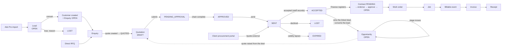

# EXAACT Sales — deep business-user and industry audit

**Audited:** 19 October 2026 · **Code:** branch `claude/testing-branch-setup-0gqe8n`
**Status:** investigation only — **no application code, schema, setting,
permission or record was changed.** Stop-before-implementation applies: nothing
below is to be built until the product owner approves the scope
(`SALES-REMEDIATION-ROADMAP.md` §0).

**The five documents of this audit**

| Document | Answers |
|---|---|
| **This one** | What Sales does for real businesses, what is broken, what is missing — and every finding (§10) |
| `SALES-END-TO-END-TEST-MATRIX.md` | 197 scenarios: preconditions, actions, expected result, and today's result (40 pass, 124 fail, 12 partial, 21 established from the code or untested) |
| `SALES-CROSS-MODULE-RECONCILIATION.md` | Quote → costing → contract → work order → job → invoice → payment: which figure travels, which is retyped, which is lost |
| `SALES-BUSINESS-DECISIONS.md` | 30 rules only the owner can set, each with a recommendation |
| `SALES-REMEDIATION-ROADMAP.md` | The corrections in order, with dependencies, acceptance criteria and regression tests |

They extend `../workflows/01-SALES.md` (the screen-by-screen description of the
area) rather than replace it. Where that document is now known to be wrong, it is
corrected in place and points here.

---

## 0. How this was established

Four investigations ran side by side, each on its own throwaway database booted
from the real application (`tests/bootstrap.php`), driving the **real route
handlers** — module gate, permission checks and all — one request per process,
as users holding the **shipped default rights** of each role. No production
system, live server or external service was touched: mail was switched off, the
MGH Books link ran in its own dry-run mode and the Ads Pro link was a stub on the
local machine.

| | |
|---|---|
| Probes | 42 probe scripts plus their shared harnesses (59 files), every one re-runnable — `../evidence/sales-audit/{A,B,C,D}/` |
| Grades | **EXEC** — run and observed · **READ** — traced in the code, not run · **UNTESTED** |
| Re-checked by the lead auditor | Ten findings were independently re-read in the code after the probe reported them: SA-01, 02, 03, 04, 06, 09, 11 (re-run from the access engine), 15, 16 and 21 (including its matrix contradiction). Every other finding rests on its investigator's executed probe, cited in §10 — where two investigators found the same thing independently, both are cited |
| Default rights table | `../evidence/sales-audit/lead-roles.out` — the shipped rights of all 18 roles for the eight Sales rights that matter |

**What this audit could not do.** It did not render screens in a browser (UI
statements come from the view files), did not run on MariaDB (the production
engine; two race and rounding results may differ there), did not contact MGH
Books or Ads Pro, and tested only the shipped role presets — a company that has
edited its role grid may see different results for the permission findings.

---

## 1. Executive summary

### The verdict in one paragraph

EXAACT Sales is **broad and thoughtfully worded, but its commercial controls do
not hold.** It already does a lot that most products in this segment do not: a
real lead → deal → enquiry → quotation chain, revisions that freeze what was
sent, value-banded multi-level approval, a project-costing engine that builds a
man-month, man-day or lump-sum rate from eighteen cost heads, a procurement-portal
quote register, a contract-review checklist, an industry template library, and an
honest weighted forecast. But the controls that make those features trustworthy —
*a quotation reaches the customer only after it is approved; an approval
belongs to the price that was approved; only an authorised person declares a deal
won; the price approved is the price invoiced* — are enforced by **hidden
buttons, not by the server**. Each was bypassed in testing by an ordinary user
with no special knowledge beyond a browser's developer tools, and several by
simply pressing **Edit**.

For the inspection business it was built around, the product is **usable today
with discipline and unsafe without it.** For manpower supply, recruitment,
manufacturing and construction it is **partly usable** — the pipeline and
quotation work, but the commercial shape of those businesses (deployment
periods, placement fees, BOQs, retention, price breaks) is not modelled.

### The five most consequential risks — and the least that fixes each

| # | Risk | What happened in testing | Minimum change |
|---|---|---|---|
| **1** | **The approval matrix does not control what reaches the customer** | A quote was sent to the customer straight from DRAFT, from *awaiting approval* and from *rejected* (SA-01). An approved ₹59,000 quote was re-priced to ₹1.06 crore by pressing **Edit** and sent as approved (SA-02). A level-1 rejection was overturned by a level-2 approval (SA-05). A Branch Manager approved another branch's quote (SA-06). A value above every band was approved by anyone holding the approve right (SA-08) | Five server-side guards on routes that already exist: send only from APPROVED; any price/line edit after submission returns the quote to DRAFT and voids its steps; a rejection ends the chain; approval re-checks the quote's branch; an unmatched value is refused or sent to the top band (owner decides — **D-03**) |
| **2** | **Anyone who can *see* a quote can declare it won** | Finance and a Branch Manager — both view-only on quotes — marked a never-approved, never-sent DRAFT **ACCEPTED**. That created the customer, won the deal, converted the lead and queued the quote to the accounting system (SA-03). The procurement-portal register stores whatever status the form posts, including one that does not exist (SA-04). A contract was registered on DRAFT and LOST quotes (SA-09) | Give "record the customer's decision" its own right (owner names the roles — **D-08**); check the from-status on every transition against the lifecycle; validate the external quote's status; refuse contract registration unless the quote is ACCEPTED |
| **3** | **The price approved is not the price invoiced** | The contract keeps no rates, lines, tax or sites (SA-23). The work-order rate is retyped and never compared to the quote — 9,500 against a quoted 8,000 flowed to the invoice. Each job on a work order defaults to billing the **whole order's** quantity (SA-15). A work order raised from a won deal carries the deal's *estimate*, not the accepted quote (SA-22). A superseded revision can still be accepted — both revisions of one quote were accepted and both pushed to Books, and the Command Centre counted both (SA-10). No ceiling stops invoicing beyond the contract (SA-23) | Make the accepted quote's lines the contract's rate card; default work-order rates from it and flag a difference; default a job's invoice quantity to the job's own man-days; allow acceptance only on the current revision. The ceiling and tolerance are owner decisions (**D-16, D-17**) |
| **4** | **The people who sell cannot open the pipeline** | Business Development Manager, Key Accounts Manager, Marketing Manager and Marketing Executive — the four sales roles — and Branch Manager and Finance are all **refused** Leads, Opportunities and Pipelines. Only the Master Admin, Admin and Business Director have them (SA-11, `lead-roles.out`). Finance — the only role that may register a contract — is refused the screen that registers one for a deal won without a quote | Decide which roles work leads and deals (**D-01**), then grant `mod.leads` through the owner-rule mechanism already used for Q-B1/Q-G/Q-K, and write the rows into the permission matrix in the same commit |
| **5** | **Commercial decisions leave no record of who made them** | Direct approval, sending, acceptance, loss, manual rejection and expiry write no history line; who accepted a quote is never stored; edits to leads, deals, enquiries and costings are not logged at all; a one-click approval writes no audit row (SA-12). The contract-review checklist records no who or when and can be ticked by the quote's own author (SA-13). The matrix states the ISO/IEC 17020 preparer/approver separation is preserved, yet a Marketing Manager raised, approved and sent their own quote (SA-07) | One history line per status change (who, when, from, to, reason) through the existing `crm_log_change`; record who ticked each checklist item; apply the organisation's existing self-approval switch to quotations (owner confirms — **D-06**) |

Two further risks sit just below these five and are cheap to close: **a
blacklisted or inactive customer is never stopped** at any step from enquiry to
invoice (SA-17), and **customers are duplicated** when a quote is accepted for a
typed name that differs slightly from one on file, when two people convert the
same lead at once, and when the advertising link imports a lead already typed by
hand (SA-18).

### What works and should be kept

Each of these was confirmed by execution and should survive any remediation
unchanged:

- **The record model.** Lead (a company) → opportunity (a deal) → enquiry (a
  request to quote) → quotation is the right separation, and the tile wording
  that explains it is the clearest explanation of the sales model anywhere in the
  product.
- **A sent quotation is immutable** — even to the master — and a **revision** is a
  fresh DRAFT that copies every line and site and keeps a snapshot. Unique
  indexes on quote number + revision and on contract number hold even under a
  simultaneous double submit.
- **Direct approval is diverted into the chain** when a rule matches, and a master
  override is logged as a bypass. Bands are inclusive at both ends and the same
  in both places they are computed. A rejection requires a comment. An approver
  can take back only their own approval, and later levels reset with it.
- **Acceptance propagates up the funnel** — lands the customer, wins the deal,
  converts the lead — without creating a duplicate when the name matches exactly.
- **Validity and expiry**: the nightly sweep expires a sent quote past its
  validity; accepting after expiry is allowed and recorded as such.
- **Contract opening needs two signatures**, and the approver must differ from the
  endorser. Contract registration is Finance's alone. One quote has one live
  contract.
- **A work order raised from a contract inherits** its customer, contract number
  (locked), quote, business unit, office and coordinator; a purchase-order line
  carries its rate with a "Read off PO" note. Visits cannot exceed the quote
  line's man-days or run past the contract's end date. A job cannot be invoiced
  twice.
- **The figure validation added on 19 Oct** (GAP-047) — no negative quantity, no
  tax outside 0–100 %, no total below zero.
- **The costing arithmetic** is correct against a hand calculation in both modes.
- **The procurement-portal register** (`/quote-external`) exists and requires
  `origin`; without it a large share of real deals would never appear.
- **The weighted forecast**, the history-based funnel, the quote register's
  current-revision-only counting, and the stage-gate rule that **forbids
  self-approval** — which is exactly the model the quotation chain lacks.
- **Enquiry validation**: the server requires five things and says so in one
  sentence a salesperson can act on. The lead and opportunity forms keep what was
  typed after a refusal.
- **Ads Pro**: a failed push is visible on a **Failed** tab; imports de-duplicate
  on the external id across both import doors.

### Findings by severity

| Severity | Count | Examples |
|---|---|---|
| **P0** | 7 | Confirmed bypasses of approval and acceptance: SA-01…06, SA-09 |
| **P1** | 15 | Superseded revisions live SA-10, pipeline closed to sellers SA-11, no decision history SA-12, money defaults SA-15/16/22/23, customer master SA-17/18, contract amendment SA-19 |
| **P2** | 18 | Template switches accreditation off, line–site pairing, stuck approvers, empty and duplicate quotes, enquiry status, reports with three definitions of "win rate" |
| **P3** | 14 | Wording, duplicate headings, rounding, a crash revising an old revision |

### What is missing (business gaps)

Discount as a named figure · a cost floor or margin check on the quote · a
rate card on the contract · a contract amendment with approval · structured
reimbursables (included / excluded / at actuals / capped) · multi-currency ·
GST type (IGST or CGST + SGST) at quote stage · a withdrawn / cancelled /
partially-accepted quote · a recruitment fee agreement (percentage, fixed,
milestones, replacement guarantee) · a deployment model for manpower supply
(minimum period, mobilisation, overtime, extensions) · a BOQ, retention and
variation-order model for construction · price breaks and minimum order
quantities for trading · five reports the business asks for daily (§9).

### What is already configurable — and by whom

| Can be configured | By (shipped defaults) | Without code |
|---|---|---|
| Pipelines and their stages, probability and days allowed | Master Admin, Business Director | ✓ |
| Industry template (pipelines, list values, wording, accreditation pack) | Master Admin, Business Director, Admin | ✓ |
| Quote approval bands, levels, approver role or person | Marketing Manager, Master Admin | ✓ |
| Pre-order (contract-review) checklist | Marketing Manager, Master Admin | ✓ |
| Quote letter templates, letterhead, signature, default terms | Marketing Manager, Master Admin, Admin | ✓ |
| Business units, sources, lost reasons, service types | Admin-level only | ✓ |
| Stage gates on the deal pipeline | Leads module holders | ✓ |
| Costing loading defaults (overhead, insurance, bad debt, contingency, negotiation) | **nobody** — read from settings but no screen writes them | ✗ |

### What requires a business decision

Thirty rules, listed with options and a recommendation in
`SALES-BUSINESS-DECISIONS.md`. Eight block the P0 and P1 fixes: **D-01** who works
leads and deals · **D-02** must a quote be approved before it is sent · **D-03**
what happens to a value no band covers · **D-04** is the band measured before or
after tax and discount · **D-06** may a preparer approve their own quote · **D-07**
which edits void an approval · **D-08** who records the customer's decision ·
**D-12** what a blacklisted, inactive or on-hold customer may still receive.

### What can wait

Multi-currency, IGST/CGST at quote stage, partial acceptance, the
construction / trading / professional-services commercial models, the
deployment model for manpower, a second industry template running side by side,
the merged sales dashboard, and every P3 item. None of them makes today's
figures wrong; they make some businesses work around the product.

---

## 2. What Sales actually is today — corrections to the earlier description

`../workflows/01-SALES.md` was written from the screens. Driving the handlers
shows seven statements there to be wrong. Each is corrected in place in that
document.

| 01-SALES.md said | What the code does | Evidence |
|---|---|---|
| §1: quote statuses are "DRAFT → SENT → ACCEPTED (with revisions)" | Eight statuses: DRAFT, PENDING_APPROVAL, APPROVED, SENT, REJECTED, ACCEPTED, LOST, EXPIRED (`crm.php:129-138`), as `docs/03-object-lifecycles.md` already records | READ |
| §4: converting a lead creates an **opportunity** | It creates a **customer and an enquiry**; no opportunity | A/p01 EXEC |
| §4: a WON opportunity flows into an **enquiry** | Winning a deal creates nothing. Acceptance of a linked quote wins the deal — the arrow runs the other way | A/p02 §2 EXEC |
| §3.9 and S-1 step 5: a quote awaiting approval appears in **Approvals → Waiting** | Quote approvals never appear in `/approvals` (`approvals_hub.php:40-63` has no quote section); they are at **Quotes → "To approve"** (`/quotes?mine=approve`) | B, D EXEC |
| S-1 step 6: the enquiry becomes QUOTED when the quote is **approved** | It becomes QUOTED when the quote is **created** (`crm.php:1680`) | A/p03 EXEC |
| §3.4 and E-1: `/inquiry-new` has 0 required fields; empty submit untested | The server requires five (client, contact, e-mail or mobile, business unit, subject) and refuses an empty form with a model message (`crm.php:1342-1355`) | D EXEC |
| §3.10: twelve industry templates | Thirteen (`industry.php:46-463`) | D READ |

And one finding the earlier document marked SUSPECTED is now settled:
**"the quote's line rates are the basis of the later invoice"** — they are
**not**. The rate is retyped on the work order and never compared (SA-23).

### The sales chain as it is built

**Legitimate entry points, all supported:** a lead (marketing), a deal (an
account manager's relationship), a direct enquiry with no lead or deal (an RFQ
by e-mail), a quote straight off a lead, a repeat work order under an open
contract with no new quote, and a quote lodged on the client's procurement
portal. **That a won opportunity should create an enquiry in every case is
not how the product works and should not be**: in an inspection business the
enquiry usually *precedes* the deal being won, and in a repeat order there is no
new enquiry at all. Recommendation in **D-21**: keep the enquiry optional and
linkable, never auto-created on WON.

---

## 3. Lifecycles — as built, and what they should be

`docs/03-object-lifecycles.md` has a lifecycle only for the quotation and the
contract opening. Lead, opportunity, enquiry and project costing have none, so
nobody can say which transitions are intended. The tables below record what the
code allows today (**as built**, from execution) beside a **proposal** for the
owner. Under CLAUDE.md, no new status or transition is added to the lifecycle
document, or to the code, until the owner approves it — the proposals are
recorded as **D-22…D-25**.

### 3.1 Lead

| From | To | As built | Proposed |
|---|---|---|---|
| OPEN | (stage) | ✓ `lead_move()` `leads.php:587` | keep |
| OPEN | LOST | ✓ reason required | keep |
| OPEN | CONVERTED | ✓ creates customer + enquiry | keep; **take a lock** so two simultaneous conversions cannot create two customers (SA-18) |
| LOST | CONVERTED | **✓ allowed** (`leads.php:650` refuses only CONVERTED) | refuse, or reopen to OPEN first with a reason |
| LOST | OPEN | ✗ | **reopen with a reason** (a lost lead comes back) — D-22 |
| CONVERTED / LOST | edited | **✓, unlogged** | locked except notes; changes logged |
| any | deleted | refused once converted; a quote raised from it is left pointing at nothing (A F-28) | refuse while anything points at it |

Terminal: CONVERTED. History: none today — every move should write who, when,
from, to and reason.

### 3.2 Opportunity (deal)

| From | To | As built | Proposed |
|---|---|---|---|
| OPEN | (stage) | ✓ stage gates may hold | keep |
| OPEN | WON | ✓ by stage move, or by a linked quote's acceptance | keep |
| OPEN | LOST | ✓ reason required; **also when *any* linked quote is marked LOST** | lose the deal only when **every** linked quote is closed and none accepted (SA-27) |
| WON / LOST | OPEN | ✗ | **reopen with a reason, manager only** — D-22 |
| WON / LOST | edited | **✓ value can be changed, unlogged** | locked; changes logged |
| WON | contract (no quote) | Finance **refused** (`opportunity-contract` sits behind the leads module) | Finance allowed (SA-11) |

Terminal: WON, LOST (reopenable by decision). A deal may carry several
alternative quotations — the model supports it; the LOST rule above breaks it.

### 3.3 Enquiry

| From | To | As built | Proposed |
|---|---|---|---|
| OPEN | QUOTED | ✓ when a quote is created | keep |
| OPEN | DROPPED | ✓ | keep, with a reason |
| any | any typed value | **✓ — the status is taken from the form unvalidated; "BANANA" was stored** (`crm.php:1337`) | validate against the list |
| DROPPED | QUOTED | ✓ silently, when a quote is raised | allowed, but logged as a revival |
| QUOTED | OPEN | ✓ while quotes exist | refuse while a live quote exists |

Terminal: DROPPED (reopenable). An enquiry should close itself when its last
live quotation is accepted, lost or expired — today nothing reacts.

### 3.4 Quotation

The documented lifecycle (`docs/03-object-lifecycles.md`) is sound. The code
**does not enforce it**:

| Transition | Lifecycle says | As built (EXEC) |
|---|---|---|
| DRAFT → SENT | not allowed (APPROVED → SENT only) | **allowed** — and from PENDING_APPROVAL and REJECTED |
| DRAFT → ACCEPTED | not allowed | **allowed, by any quotes viewer** |
| PENDING_APPROVAL → DRAFT / REJECTED / EXPIRED / LOST | not in the diagram | **allowed, by any quotes viewer** |
| ACCEPTED ↔ LOST | ACCEPTED is terminal | **flips repeatedly, with no history; a quote with a live contract can sit at LOST** |
| ACCEPTED → DRAFT | not allowed | **allowed for a master on a never-sent quote** |
| superseded revision → SENT / ACCEPTED / contracted | not addressed | **allowed**; the accepted old revision then disappears from the register |
| edit while PENDING_APPROVAL or APPROVED | not addressed | **allowed; the approval survives** |
| approve a step after the quote moved on | not addressed | **allowed; a SENT quote drops back to APPROVED with `sent_at` kept, so it can never expire** |

Missing states the business needs, each a decision (**D-24**): **WITHDRAWN** (we
pull an offer before the customer answers), **CANCELLED** (raised in error —
today there is no void and no delete), and **PARTIALLY ACCEPTED** (the customer
takes two of three sites). Recommended: add WITHDRAWN and CANCELLED; handle
partial acceptance as a revision containing only the accepted lines, which needs
no new status.

### 3.5 Project costing

| From | To | As built | Proposed |
|---|---|---|---|
| DRAFT | SUBMITTED | ✓ from any state | DRAFT only |
| any | APPROVED | **✓ from any state, including DRAFT, by its own author** | SUBMITTED only; approver ≠ preparer |
| APPROVED | DRAFT (reopen) | ✓ **keeps the old approver's name** | clears the approval; logged |
| any | quote | **✓ from DRAFT and REJECTED, repeatedly; the link is overwritten** | APPROVED only (D-11) |
| — | edited after its quote is accepted | ✓ | locked once its quote is accepted |

### 3.6 Contract (as it bears on Sales)

The two-signature opening works. What is missing is everything after it:
**an OPEN contract's value and end date can be changed freely** (118,000 →
500,000 in testing) with a log line that says only "edited"; **Reopen** on an
OPEN contract wipes both signatures (`contracts.php:868`); there is no
amendment, extension or cancellation status. Proposal **D-25**: an *amendment*
is a new version of the contract that goes through the same two signatures,
keeping the old values.

---

## 4. Does it fit the business? — six business models

**Legend:** ✓ supported · ◐ partly · ✗ not supported · ⚙ configurable today ·
→ out of scope for Sales (another module, or a different product).

### A. Third-party inspection, testing and certification (the home market)

| Need | Fit | Notes |
|---|---|---|
| RFQ / inspection call capture | ✓ | Enquiry, or a quote straight off a lead or deal |
| Shop, site, resident, vendor inspection under one order | ✓ | Sites block + per-line site; `location_type` and vendor site |
| Spot visit vs man-day vs man-month vs lump sum | ✓ | Units MANDAY, MANMONTH, VISIT, AUDIT_DAY, LOT |
| Client rate contracts | ◐ | A repeat order under an open contract needs no new quote, and a PO line carries its rate — but the contract itself has **no rate card** (SA-31) |
| Travel, lodging, boarding | ◐ | Only default terms clause 4 "at actuals"; the engineer's bills **never reach the invoice** (SA-32) |
| Vendor / freelance inspector cost | ◐ | Costing has 18 heads but **no subcontract head** |
| Qualification / NDT capability | → | Competence register in Quality; not consulted at quote stage (roadmap 3.3) |
| Cancelled visit, standby, additional scope | ✗ | No standby or cancellation charge line; additional scope means a revision — fine before sending, a new quote after acceptance |
| Customer-specific report and accreditation requirement | ◐ | Pre-order checklist and free terms; no structured "customer requirement" on the quote |
| Is what is included, excluded, chargeable and billable clear? | ◐ | Inclusions and exclusions exist on the **costing only**, not on the quote the customer reads |

**Verdict:** usable. The quotation describes the work well; it does not yet say
clearly what is *excluded* and what is billed at actuals, and nothing enforces
that the rates billed are the rates quoted.

### B. Technical manpower supply / deputation

| Need | Fit | Notes |
|---|---|---|
| Monthly, daily, hourly billing | ◐ | Man-month and man-day ✓; **no hour unit** |
| Minimum deployment period, minimum billing | ✗ | Not modelled |
| Mobilisation, demobilisation, overtime, holiday, shift allowance | ✗ | Only as free-text lines |
| Replacement personnel, extension, headcount change | ◐ | An extension is a contract edit — unapproved and unrecorded today (SA-19) |
| Rate revision on salary change | ◐ | Costing can be reopened; the quote does not see it, and reopening keeps the old approval |
| PO ceiling, approved rate card | ✗ | No ceiling (SA-23); no rate card |
| Total contract value, cost exposure, expected margin | ◐ | The costing computes all three correctly; **nothing stops a quote below cost** (SA-14), and the contract value includes GST |

**Verdict:** the costing engine is the strongest piece here — it was clearly
designed for deputation — but the contract cannot hold the deployment terms that
decide what is billed. Template gap: there is no deputation funnel (§7).

### C. Recruitment agency

| Need | Fit | Notes |
|---|---|---|
| Permanent placement fee — % of CTC or fixed | ✗ in Sales · ◐ in Recruitment | The requisition holds one typed fee and `rate_basis`; no percentage or fixed-fee choice (SA-37) |
| Contract recruitment / temporary staffing | ◐ | Treated as deputation (B) |
| Replacement guarantee | ◐ | A guarantee date taken from the *agency* side; no client-side replacement terms |
| Payment on joining / retention milestone | ✗ | No milestones |
| Several candidates under one requirement | ✓ | In Recruitment |
| Withdrawn offer, replacement placement | ✓ | In Recruitment's offer lifecycle |
| Not treated as an inspection enquiry | ◐ | The quote form has no business-model switch: a recruitment agreement is written on an inspection-shaped form |

**Verdict:** recruitment's operational side is mature, but its **commercial
agreement lives nowhere**. The requisition's contract, PO and quote references
are free text and link to neither the quotation nor the contract. Whether the
fee is something we charge or something we pay is ambiguous in the data
(**D-27**).

### D. Manufacturing, engineering and trading

| Need | Fit | Notes |
|---|---|---|
| RFQ with many items | ✓ | Unlimited lines |
| Units of measure | ◐ | Inspection units only (no kg, metre, nos); unknown unit codes are accepted silently |
| Price breaks, discount | ✗ | Discount = a negative line, invisible to the approver (SA-39) |
| Material, processing, packing, freight, installation | ◐ | As free lines; the costing has no material head |
| MOQ, lead time, supplier price change | ✗ | → would belong to an item/inventory module, which EXAACT does not have |
| Partial delivery, repeat orders | ◐ | Repeat work orders under a contract ✓; partial delivery is an operations concept here |
| Taxes, freight, payment terms, advance | ◐ | One GST rate per quote; advance % ✓; payment terms ✓ |

**Verdict:** the quotation can carry a manufacturing offer, but there is no item
master behind it. Building one is a product decision, not a fix (**D-28**,
recommended out of scope).

### E. Construction, infrastructure, project services

| Need | Fit | Notes |
|---|---|---|
| Tender invitation, competitive bid, deadline | ◐ | The construction template's stages fit; **no tender deadline field**, so "deadline passes while approval is pending" cannot be detected |
| BOQ, provisional quantities | ◐ | Lines carry quantities; no provisional flag |
| Milestones, phased billing | ✗ | Not modelled |
| Retention, performance guarantee | ✗ | Not modelled |
| Variation orders | ◐ | A revision before acceptance; after acceptance only an unapproved contract edit |
| Subcontractor cost, risk allowance | ◐ | Costing has contingency %; no subcontract head |

**Verdict:** the pipeline fits; the commercial model does not. Out of scope
until the owner decides to sell into construction (**D-28**).

### F. Professional services, consulting, software

| Need | Fit | Notes |
|---|---|---|
| Hourly / daily fee | ◐ | Daily ✓, **no hour** |
| Fixed fee | ✓ | Lump sum |
| Retainer / recurring | ✗ | No recurrence on the quote or contract |
| Milestone billing | ✗ | |
| Change requests | ◐ | Revision; see E |
| Several consultants, locations, expense categories | ✓ | Lines, sites, costing heads |

### What can be shared, and what genuinely differs

Shared by all six, and already present: the pipeline, the quotation header,
lines, sites, approval, revision, acceptance, contract registration and the
reports. **Genuinely different, and each a decision rather than a defect:**
the **unit of charge** (hour, kg, metre, placement), the **billing trigger**
(per visit, per month, on joining, per milestone), the **commercial guard-rails**
(minimum period, retention, replacement guarantee), and **what the costing must
include** (subcontract, material). The cheapest path that serves several models
is **one optional "commercial terms" section on the quotation**, switched on per
business unit, rather than six forms (recommended in **D-28**).

---

## 5. The product from each person's chair

Each row: **objective · needs · decides · should never re-enter · may do (as
shipped) · likely error → consequence · alerts needed · minimum acceptable
outcome.** "As shipped" is from `lead-roles.out`.

### 5.1 Salesperson / account manager (BDM, KAM, Marketing Executive)

| | |
|---|---|
| Objective | Win profitable work and keep the pipeline honest |
| Needs | The customer's history, open deals, past rates, what this customer was quoted last time |
| Decides | Which deals to chase; what to offer; when to follow up |
| Should never re-enter | Customer, contact, site and requirement from the enquiry into the quote — **met** (prefilled, except the service requirement) |
| May do today | Create and (BDM/KAM) send quotes; open enquiries. **Cannot open Leads, Opportunities or Pipelines** |
| Likely error → consequence | Sends before approval because the server lets them (SA-01) → an unapproved price is binding. Types a customer name slightly differently (SA-18) → duplicate customer, split history |
| Alerts needed | Quote approved; quote nearing expiry (no list today); follow-up due (✓); customer replied |
| Minimum outcome | Can run their own deals end to end without a manager's login — **not met** (SA-11) |

### 5.2 Estimator / costing engineer

| | |
|---|---|
| Objective | A defensible price with a known floor |
| Needs | Cost heads, loadings, target margin, BOQ, the customer's rate history |
| Decides | Basis (man-month / man-day / lump sum), loadings, target margin |
| Should never re-enter | The costing's rate and quantity into the quote — **met** (one click), but business unit, owner, GST and inclusions are dropped (SA-30) |
| May do today | Anyone except Finance and Inspector can create and edit a costing; Coordinators via the hiring edit right |
| Likely error → consequence | Approves their own costing, even at a negative margin (SA-14) → a loss-making rate looks "approved". A negative cost head raises the margin (B F16) |
| Alerts needed | Quote priced below the costing; costing changed after its quote was sent |
| Minimum outcome | A quote cannot silently fall below its approved costing — **not met** |

### 5.3 Sales manager reviewing pipeline and forecast

| | |
|---|---|
| Objective | Know what will close, when, and why deals are lost |
| Needs | Weighted pipeline by month, conversion, loss reasons, stalled deals |
| Decides | Where to put people; which deals to escalate |
| May do today | Business Director: everything in Sales; Marketing Manager: quotes and approvals but **not the pipeline** |
| Likely error → consequence | Reads "Sales won (FY)" on the home screen — it is **all-time**, and "win rate" has three definitions on three screens (SA-28) → wrong conclusions in a review |
| Alerts needed | Deals stopped moving (✓), due to close (✓ but includes overdue), lost this week |
| Minimum outcome | One number for each concept, the same everywhere — **not met** |

### 5.4 Quotation approver

| | |
|---|---|
| Objective | Approve only what the business can deliver at a margin it accepts |
| Needs | Price, discount, margin against costing, customer status, contract-review checklist, what changed since last time |
| Decides | Approve, reject with reason |
| May do today | Marketing Manager approves; any role a band names approves **in any branch** |
| Likely error → consequence | Approves a quote that is then re-priced after approval (SA-02) — **not the approver's error, but they carry it**. Never sees a discount (it is a negative line) or the margin (no floor) |
| Alerts needed | Quote waiting for me — in the approvals inbox (**it is not there**, SA-25); escalation when I am away (none for quotes; delegation ignored) |
| Minimum outcome | What I approved is what the customer receives — **not met** |

### 5.5 Operations manager receiving awarded work

| | |
|---|---|
| Objective | Start work with the right scope, sites, rates and dates |
| Needs | Contract, sites, rates, duration, customer requirements, contacts |
| Decides | Who is allocated; when |
| Should never re-enter | Sites, rates and duration from the quote — **not met**: rates are retyped, sites re-picked, end date blank unless a PO supplies it |
| May do today | **Operation Manager cannot endorse a contract opening by default** — the route sits behind the Quotes module, which the role does not have (SA-20) |
| Likely error → consequence | Raises a work order against a DRAFT quote or a mistyped contract number (SA-34) → work starts without a commercial basis |
| Minimum outcome | Receives a complete commercial packet, once — **partly met** (the "float" packet exists; its rate content does not) |

### 5.6 Finance registering the contract and billing

| | |
|---|---|
| Objective | Register the contract, invoice exactly what was agreed, collect |
| Needs | Accepted quote, PO, rates, tax basis, ceiling, billing trigger |
| May do today | Register a contract from a quote ✓ — **including a DRAFT or LOST one**; **refused** for a deal won without a quote. Can also mark any quote ACCEPTED (SA-03) |
| Likely error → consequence | Accepts the default invoice quantity on a multi-job order → bills the whole order per job (SA-15). Bills past the contract value — nothing stops it |
| Alerts needed | Contracts to register (✓); invoiced beyond contract; rate differs from quote |
| Minimum outcome | Invoice figures reconcile to the approved commercial terms — **not met** |

### 5.7 Administrator configuring Sales

| | |
|---|---|
| Objective | Set Sales up once, without a developer |
| May do today | See the configurable table in §1. Lists (business units, sources, lost reasons) are admin-only, so the Marketing Manager cannot maintain the lists their own screens use |
| Likely error → consequence | Writes a band with min > max or no approver — accepted (SA-25); applies an industry template, which **also switches the accreditation pack and rewrites company wording** (SA-21) |
| Minimum outcome | Configuration that cannot leave a value uncovered or a quote stuck — **not met**; no coverage check on the band screen |

---

## 6. Terminology, forms and usability

### 6.1 Words

| Term | Problem | Recommendation |
|---|---|---|
| Inquiry / Enquiry | Both spellings, in code (334 vs 84) and on screen (7 vs 10 visible); the engine's own definition uses both (`terms.php:37`) | **Enquiry** on every screen (British/Indian business usage, matching the tile text); leave the code alone |
| "Sales dashboard" | Two screens with the same heading (`/crm-dashboard`, `/crm-reports`); the menu calls one "Sales reports"; the home link goes to the other | One **Sales dashboard** with the monthly table as a tab |
| "Document templates" | Two screens (`/templates`, `/crm-templates`) | "Report & document templates" vs "Quotation letters & letterhead" |
| "Quote & report approvals" / "Approvals" | Two screens each | "Quotation approval rules" vs "Report approval rules"; and quote approvals belong **in** the one approvals inbox |
| "Pipeline value" | Three meanings (deals open; quotes open including REJECTED; quotes open excluding REJECTED) | One definition per concept — see `SALES-CROSS-MODULE-RECONCILIATION.md` §5 |
| "Win rate" | Three definitions (deals; quotes counting EXPIRED as lost; quotes all-time) | Two named measures: *deal win rate* and *quote acceptance rate* |
| "Approval" | Quotation approval vs report approval vs contract opening approval vs costing approval | Always qualify: "quotation approval", "contract opening" |
| Margin vs markup | The costing computes a **margin on the selling price** (`rate = loaded ÷ (1 − target)`) and then applies a **negotiation markup on top**, so a 20 % target displays as 23.81 % | Label the two separately on the costing screen: "Target margin 20 %" and "Negotiation allowance 5 % (on top)" |

### 6.2 The forms

| Form | Fields | Server requires to save | On refusal | Zero Training gate |
|---|---|---|---|---|
| `/lead-new` | — | company; a site for man-month leads | keeps what was typed | **passes** |
| `/opportunity-new` | — | name, and a customer or a name | *"Give the opportunity a name — what is the piece of business?"*; keeps typing | **passes** |
| `/inquiry-new` | 13 | client, contact, e-mail or mobile, business unit, subject | *"Please add a client (pick one, or type a name); the contact person; a contact e-mail or mobile; the business unit (business unit); a subject."* | **partly** — four fields show "*" but the browser enforces none; "business unit (business unit)" is a doubled label |
| `/quote-new` | 96, six tabs | **nothing** — an empty submit created "Q-00001", a DRAFT with no customer and ₹0 | a refused save (figure validation) **loses everything typed** (READ) | **fails** — 96 fields, nothing marked, an 11-column line table that cannot work on a phone, internal codes in labels |
| `/quote-external` | 72 | nothing — `origin` and total are browser-only | empty submit made a **SENT ₹0** quote | fails |
| Project costing | 5 to start | nothing — an empty submit saved "Untitled costing" with no office | — | partly |

**Three-level requirement model, recommended for the quotation** (the
smallest change that makes the form honest — not a new screen):

| Level | What must be present | Why |
|---|---|---|
| **Save a draft** | Customer (picked or typed) and a subject | So no numbered empty quote exists; everything else can wait |
| **Submit for approval** | At least one chargeable line; every line has unit, quantity and rate; every line's site belongs to this quote; validity; payment terms; business unit | An approver cannot judge an offer without them |
| **Send** | Approved; contact e-mail; letter template | So what leaves the building is complete |

The form keeps its six tabs; each tab shows a ✓ when its part of the next level
is satisfied, and the **Submit** button says what is missing in one sentence,
as the enquiry form already does.

**Repeating sections.** The sites and lines blocks are understandable, but on a
**new** quote a line cannot be paired with a site until the quote is saved once
(the site has no id yet) — the user must save, reopen and pair. And a line will
store a site from another quote or one that does not exist; posting another
quote's site id deletes this quote's own site and drops the edit (SA-24).

**Resuming work.** A quote saves as DRAFT and can be resumed — good. A *refused*
save, however, throws the typing away. That is the first fix to make in the
form, because it is what makes people distrust the screen.

**Duplicate entry.** Enquiry → quote and lead → quote prefill correctly. Costing
→ quote carries rate and quantity but drops business unit, owner, GST and
inclusions/exclusions. Quote → contract → work order drops lines, rates, tax and
sites (see the reconciliation document).

---

## 7. Industry templates and configuration

Thirteen templates (`industry.php:46-463`); stages, probabilities and days in
`../evidence/sales-audit/D/industry_templates.md`.

| Business model in scope | Template | Fit |
|---|---|---|
| Inspection & technical services | `inspection` — Enquiry received 10 %/7 d → Scope agreed 30/10 → Quotation sent 50/14 → Rate negotiation 70/10 → PO / work order 90/7 → Won / Lost; alternate "Annual contracts & renewals" | **Good.** Keep |
| Technical manpower / deputation | — | **Missing.** `staffing` is placement-shaped (profiles, interviews, joining) |
| Recruitment | `staffing` — Requirement received 15 → Terms agreed 35 → Profiles submitted 55 → Interviews 75 → Offer / joining 90 | Good for permanent placement |
| Manufacturing & trading | `manufacturing` (RFQ 10 → Technical review 25 → Costing 40 → Offer 55 → Technical approval 75 → Commercial closing 90); `trading` | Good |
| Construction & projects | `construction` (5 → 15 → 30 → 50 → 70 → 90, long allowances) | Good; lacks a tender-submission stage with a deadline |
| Professional services | `services` (10 → 25 → 45 → 65 → 85); `itservices` | Good |

**Two problems with the mechanism, not the content:**

1. **Applying a template does three things at once** — builds pipelines, sets
   the company's wording, and switches the accreditation pack on or off. A
   Business Director applying *Manufacturing* to try its pipeline **switched the
   ISO/IEC 17020 pack off** for the whole company (SA-21). The pipeline part
   should be separable from the company-wide part.
2. **One company, one template.** An inspection agency that also supplies
   manpower cannot run both funnels as defaults side by side — it can only clone
   a second pipeline by hand.

**Recommendation:** add exactly one template — **"Technical manpower supply"**
(Requirement → Profiles / rate card shared → Rates agreed → PO / deployment
order → Mobilised) — because evidence shows a real gap for business model B.
Build no others now. Let a template's *pipelines* be added without changing the
company's wording or accreditation (D-29).

**Who should configure what (recommendation, D-30):** a *Sales administrator*
capability — the same pattern as the existing `hiring.admin` for Recruitment —
covering pipelines, templates (pipelines only), approval bands, checklist and
the Sales lists (business units excepted). System-wide settings, wording and the
accreditation pack stay with the administrator.

---

## 8. Permissions, security and data integrity

### 8.1 Code against the permission matrix

From execution with the shipped defaults (`../evidence/sales-audit/D/route_matrix.tsv`,
`perm_probe.tsv`, `lead-roles.out`):

| Action | Who can, in code | `docs/02-permission-matrix.md` | |
|---|---|---|---|
| Open leads, opportunities, pipelines | Master Admin, Admin, Business Director | silent; the BDM flow document starts there | **contradiction** |
| Create a quotation | MA, Admin, MM, BDM, KAM, ME | Create | consistent |
| Send a quotation | MA, Admin, MM, BDM, KAM | Send | consistent — **but from any status** |
| Approve a quotation (direct) | MA, Admin, MM | fn. 19: MM, "not Branch Manager" | consistent |
| Approve a routed step | **anyone the band names, in any branch** | fn. 19 | **contradiction** when a band names BM |
| Record ACCEPTED / LOST / REJECTED / EXPIRED / DRAFT | **anyone who can view quotes**: incl. BD, BM, SBU Head, Finance | no row | **contradiction** |
| Register a contract from a quote | Finance (on any quote status) | Finance | consistent on who; **no status check** |
| Register a contract for a deal won without a quote | **nobody but MA/BD** — Finance is refused | Finance | **contradiction** |
| Endorse a contract opening | OM refused (Quotes module) | OM: Endorse | **contradiction** |
| Apply an industry template | MA, Admin, **BD** (`industry_can()` admits `mod.settings.view`, which BD holds) | Settings: MA, Admin only | **contradiction** |
| See costing margins | everyone except Inspector, regardless of the profitability right | silent | gap |
| Edit / approve a costing | edit: all but Finance, Inspector; approve: MA, BD, BM, MM — incl. own | silent | gap |
| Edit an enquiry | Branch Manager, via the delete right implying edit | silent | gap |
| Business-unit scope "OWN" | behaves as ALL when the user's own unit is blank | 01-roles: Marketing Executive is OWN | **contradiction** |

### 8.2 The security findings in plain words

- **Approval authority crosses branches (SA-06).** The quotation scope gate
  looks for the quote's id in the request. An approval request carries only the
  step's id, so the gate returns early and never asks the branch question. A
  Branch Manager in office B approved office A's quote. *Hidden-button
  protection does not apply here — the button is visible to the approver.*
- **View is treated as decide (SA-03).** The status route is gated by
  `mod.quotes.view` only; ACCEPTED, LOST, REJECTED, EXPIRED and DRAFT carry no
  further check (`crm.php:1913`, `:2004`).
- **The external register trusts the form (SA-04).** `crm.php:1520` stores
  `$_POST['status']` as is.
- **Inbox visibility is not authority, and the two disagree.** The home tile
  "Pending your approval" showed the Marketing Manager 2 (inbox 0) and the
  actual Branch Manager approver 0 (inbox 1). A step addressed to a deactivated
  user stays "pending with" them forever.
- **Records saved with no office** (SA-33): a costing with no office is visible
  to every branch; a quote with no office is filed under the Ahmedabad office
  and its own creator in another branch loses sight of it; enquiries have no
  office at all and are scoped only by business unit.
- **Concurrent edits** (SA-26): the second of two saves from the same screen
  silently overwrites the first — only calls and jobs carry a version check.
- **Double submit** (SA-26): two quotes from one double-click; at the same
  instant, one saves and the other shows a raw database error.
- **Tenant isolation** was not re-tested here; the platform-wide session and
  backup fixes of 19 Oct (GAP-048, GAP-049) apply to Sales unchanged.

---

## 9. Reporting and commercial decisions

Figure definitions and the reconciliation probe are in
`SALES-CROSS-MODULE-RECONCILIATION.md` §5–§6. The questions the business asks:

| Question | Can the reports answer it? |
|---|---|
| How much qualified pipeline? | **Partly** — no stage is marked "qualified" |
| What will close, and when? | **Partly** — one weighted total; "due in 30 days" includes overdue deals; no forecast by month |
| Which enquiries need a response today? | **No** — only "older than the SLA (7 days)" |
| Which quotes await approval, or are nearing expiry? | Approval **yes** (`/quotes?mine=approve`); expiry **no list** |
| Which customers and business units are profitable? | **No** — ranked by value, not margin |
| Why are deals lost? | **Yes** for deals; a quote's lost reason is not required on the server |
| Quote-to-order conversion? | **No** |
| Quoted value → contracted value? | **No** — contracted value appears in no report |
| Contracted work ready for Operations? | **Partly** — "contracts to register" only |
| Contracts at risk (scope, rates, approvals incomplete)? | **Partly** — "expiring soon" only |

**Seven measures that must never be used interchangeably**, defined in the
reconciliation document: *quoted value · weighted pipeline · won deal value ·
accepted quote value · contracted value · invoiced value · collected revenue.*
Today the product names three of them "pipeline value" and counts a superseded
revision in one of them.

---

## 10. Findings register

**Severity** is the register's own scale (`../08-GAP-REGISTER.md`): **P0**
security, data integrity or a business control · **P1** a core workflow
failure · **P2** a missing function, validation or important usability · **P3**
refinement. As in the register (GAP-034, an invoice credited beyond its value,
was P0), a **confirmed bypass** of an approval or acceptance control is P0; a
control that is merely absent is not raised for its absence alone.

**Classification:** CONFIRMED DEFECT · CONFIRMED BUSINESS GAP · PARTIALLY
SUPPORTED · UNTESTED · DOCUMENTATION GAP · USABILITY GAP · BUSINESS DECISION
REQUIRED · ENHANCEMENT.

**Evidence** paths are under `../evidence/sales-audit/`. The original
investigator ids are kept in brackets so each line can be traced to its probe.
"Regression" names the guard-rail test the fix must add; test ids are in
`SALES-END-TO-END-TEST-MATRIX.md`.

### P0

#### SA-01 · A quotation reaches the customer without approval
- **Model / persona:** all · salesperson, approver
- **Scenario:** an approval rule covers the quote's value; the quote is DRAFT, PENDING_APPROVAL or REJECTED
- **Where:** `quote-status` → SENT · `lib/crm.php:1846` (send right only)
- **Expected:** only an APPROVED quote can be sent (the documented lifecycle)
- **Actual (EXEC):** sent from all three statuses; the e-mail goes and the quote locks — so it can no longer even be corrected [A F-03, B F1, C F2, D F3]
- **Evidence:** A/p05, A/p06 §A, B/p5_output.txt §A, C/p1.out, D/flow_*.out
- **Classification:** CONFIRMED DEFECT · **Impact:** an unapproved price becomes a binding offer
- **Correction:** SENT accepted only from APPROVED, server-side; master bypass logged as on approval · **Depends on:** D-02
- **Acceptance:** a send from any other status is refused with a sentence naming what is missing; the UI and server agree · **Regression:** TM-Q07…Q09

#### SA-02 · An approval survives a change of price
- **Model / persona:** all · approver, finance
- **Scenario:** a quote is PENDING_APPROVAL or APPROVED; the author presses **Edit** and changes lines or rates
- **Where:** `quote-edit` save · `lib/crm.php:1660-1667`; edit allowed while unlocked `:1764`
- **Expected:** a material change voids the approval and the chain is rebuilt for the new value
- **Actual (EXEC):** approved at ₹59,000, edited to ₹1,06,20,000, stayed APPROVED, sent; pending ₹50,000 raised to ₹50 lakh kept its ≤ ₹1 lakh approver, who approved it; an approved ₹50,000 cut to ₹1 stayed APPROVED. History says only "Edited" [A F-01/F-02, B F2, D F4]
- **Evidence:** A/p06 §B–C, B/p5_output.txt §F
- **Classification:** CONFIRMED DEFECT · **Impact:** the approval matrix can be defeated by the normal Edit button — the single most consequential finding
- **Correction:** any change to lines, rates, quantities, tax, discount, validity or payment terms after submission returns the quote to DRAFT, voids its steps and records old → new total · **Depends on:** D-07
- **Acceptance:** an edited approved quote is DRAFT with no live steps and the history shows both totals · **Regression:** TM-Q14…Q16

#### SA-03 · Anyone who can view quotes can declare the customer's decision
- **Model / persona:** all · finance, branch manager, owner
- **Scenario:** Finance or a Branch Manager (view-only on quotes) posts a status change
- **Where:** `lib/crm.php:1913` (ACCEPTED), `:2004` (all other statuses); buttons `views/ops/crm/quote_detail.php:197/204/215`
- **Expected:** only a named right records ACCEPTED / LOST, and only from SENT or EXPIRED
- **Actual (EXEC):** Finance marked a never-approved, never-sent DRAFT ACCEPTED → customer created, deal won, lead converted, quote queued to Books; a Branch Manager moved a pending quote to DRAFT, REJECTED, EXPIRED and LOST; ACCEPTED ↔ LOST flipped repeatedly with a live contract [A F-05/F-06, B F3, C F1/F3, D F5]
- **Evidence:** A/p05 §2–5, B/p5 §A, C/p1.out, C/p8.out
- **Classification:** CONFIRMED DEFECT + DOCUMENTATION GAP · **Impact:** the pipeline, the customer master and the accounting system can be changed by people with read access
- **Correction:** a from → to table enforced on the route (the lifecycle document becomes the code's table); "record the customer's decision" gated on a right the owner names; ACCEPTED terminal · **Depends on:** D-08
- **Acceptance:** every transition not in the lifecycle is refused; a view-only role sees no decision buttons and the POST is refused · **Regression:** TM-Q20…Q25

#### SA-04 · The procurement-portal register stores any status
- **Model / persona:** all (large accounts) · salesperson
- **Where:** `/quote-external` · `lib/crm.php:1520`
- **Expected:** a portal-lodged quote is registered as SENT (or follows the same approval as any quote — D-18)
- **Actual (EXEC):** a Marketing Executive registered ₹9 lakh straight to ACCEPTED, another APPROVED, another "BOGUS"/"NOT_A_STATUS"; an empty submit made a SENT ₹0 quote; a typed total of 100 against lines of 10,00,000 was not reconciled; its GST is stored as 0 so its total mixes into tax-inclusive reports [A F-13, B F23, C F28, D F20]
- **Evidence:** A/p04 §3, B/p7_output.txt, D/flow_*.out
- **Classification:** CONFIRMED DEFECT · **Impact:** a won deal can be invented with no approval and no acceptance side effects
- **Correction:** status from a whitelist (default SENT); total = Σ lines; required origin and total enforced on the server · **Depends on:** D-18
- **Acceptance:** an unknown status is refused; ACCEPTED is reachable only through the normal decision route · **Regression:** TM-Q30…Q32

#### SA-05 · The approval chain can be completed out of order, or after a rejection
- **Model / persona:** all · approver
- **Where:** `quote-approve` · `lib/crm.php:2130`, `:2163` (counts only pending steps), `:3096`
- **Expected:** a rejection ends the chain; level 2 signs after level 1 (D-05); a step cannot be signed once the quote has moved on
- **Actual (EXEC):** level 1 rejected, level 2 approved, quote ended APPROVED; level 2 signed before level 1; approving a stale step on a SENT quote turned it back to APPROVED with `sent_at` kept (so it never expires); a stale step on a DRAFT made it APPROVED [A F-04, B F4/F12, D F7]
- **Evidence:** A/p06 §D, B/p5 §A–B, §D
- **Classification:** CONFIRMED DEFECT · **Impact:** a rejected price can still become approved
- **Correction:** any REJECTED step closes the chain and sets the quote REJECTED; a step can be signed only while the quote is PENDING_APPROVAL and (if D-05 says sequential) only at the lowest open level · **Depends on:** D-05
- **Acceptance:** each of the four sequences above is refused · **Regression:** TM-A10…A13

#### SA-06 · A Branch Manager can approve another branch's quotation
- **Model / persona:** multi-branch · approver
- **Scenario:** a band names BRANCH_MANAGER; a Branch Manager of office B posts the approval of office A's quote
- **Where:** `crm_quote_scope_gate()` · `lib/crm.php:1410-1411` — returns early when the request has no `id`, which an approval request (it carries `step`) never has
- **Expected:** the approver's branch scope covers the quote
- **Actual (EXEC + READ):** approved [D F6]
- **Evidence:** D/flow_*.out (P7c); the gate re-read by the lead
- **Classification:** CONFIRMED DEFECT (authorisation) · **Impact:** branch segregation of commercial authority does not hold — recorded also on the security list (roadmap §2a, S-10)
- **Correction:** resolve the step to its quote *before* the early return, as `quote-file` already does
- **Acceptance:** an out-of-scope approval is refused; an in-scope one still works · **Regression:** TM-A20

#### SA-09 · A contract can be registered on a quote nobody accepted
- **Where:** `quote-contract` · `lib/crm.php:2211` (right checked, status not)
- **Actual (EXEC):** contracts registered on DRAFT, PENDING_APPROVAL and LOST quotes [A F-20, C F4, D F11]
- **Evidence:** A/p08 §1, C/p2.out (`/00002` DRAFT, `/00003` LOST)
- **Classification:** CONFIRMED DEFECT · **Impact:** work can start, and be invoiced, on an offer the customer never accepted
- **Correction:** registration only from ACCEPTED (and from a won deal — SA-11)
- **Acceptance:** refused from any other status with a sentence saying why · **Regression:** TM-K01…K03

### P1

#### SA-07 · The preparer can approve their own quotation
- **Model / persona:** inspection (ISO/IEC 17020 contract review) · approver
- **Where:** `crm_can_act_approval`; the organisation's self-approval switches (`recruit_approval.php:2836+`) apply to recruitment only
- **Expected:** what the matrix states — the preparer/approver separation is preserved — unless the owner decides otherwise
- **Actual (EXEC):** a Marketing Manager (holding create, approve and send) raised, approved and sent their own quote, both directly and through a chain step; the same for costings [A F-08, B F5, D F8]
- **Classification:** CONFIRMED BUSINESS GAP + BUSINESS DECISION REQUIRED · **Impact:** an assessor's first contract-review question has no evidence behind it
- **Correction:** apply the existing self-approval switch to quotations and costings; master exception logged · **Depends on:** D-06
- **Acceptance:** with the switch on, the creator cannot approve; with it off, the approval is recorded as a self-approval · **Regression:** TM-A15

#### SA-08 · A value no band covers gets the weakest approval
- **Model / persona:** all · owner, approver
- **Scenario:** value above the highest band, in a gap between bands, with a business unit no rule names, or with no rules at all
- **Where:** `lib/crm.php:2971-3002`, `:1129-1138`
- **Actual (EXEC):** one generic "any approver" step, and direct approval allowed — a ₹9 lakh quote was approved directly by the Marketing Manager although the top band belonged to the Business Director. This matches the lifecycle document ("when no rule matches, the direct set is unchanged"), so it is a policy, not a bug — but nothing warns the administrator that the bands leave a hole
- **Evidence:** B/p4_output.txt cases 0b, 2d, 3, 6
- **Classification:** BUSINESS DECISION REQUIRED + USABILITY GAP · **Impact:** the largest quotes can receive the least scrutiny
- **Correction:** owner chooses (D-03); in every option the band screen shows a coverage line — "₹0 – ₹10 lakh covered; above ₹10 lakh: *who*"
- **Acceptance:** per D-03 · **Regression:** TM-A01…A06

#### SA-10 · A superseded revision is still live — and counted twice
- **Where:** `quote-revise` sets only `is_current=0` on the old row (`lib/crm.php:2010`); `quote-status`, `quote-contract` do not check it; `lib/finevent.php:40-46` sums every ACCEPTED row
- **Actual (EXEC):** after rev 1 existed, rev 0 could be sent, accepted and contracted; both R00 and R01 were ACCEPTED and both pushed to Books (118,000 and 106,200); the accepted rev 0 vanished from the register (which shows current revisions only); the Command Centre "Committed" showed 4,83,800 against 4,24,800. Revising an ACCEPTED quote is also allowed and the revision inherits the contract number, then can go LOST while the contract stays live [A F-17/F-18, C F21, D F13]
- **Classification:** CONFIRMED DEFECT · **Impact:** committed revenue overstated; two Books documents for one deal
- **Correction:** a superseded revision is read-only for every action; "Committed" sums current revisions; revising an ACCEPTED quote is refused, or becomes an amendment (D-25)
- **Acceptance:** every action on a non-current revision is refused; Committed reconciles to the register · **Regression:** TM-Q40…Q43, TM-R05

#### SA-11 · The people who sell cannot open the pipeline
- **Model / persona:** all · salesperson, sales manager, finance
- **Where:** `mod.leads` held only by MASTER_ADMIN, ADMIN, BUSINESS_DIRECTOR (`lead-roles.out`); `opportunity-contract` behind the leads module (`lib/ops.php:3250-3254`)
- **Actual (EXEC):** BDM, KAM, Marketing Manager, Marketing Executive, Branch Manager and Finance get 403 on `/leads`, `/opportunities`, `/pipelines` and both create forms; Finance cannot register a contract for a deal won without a quote [A F-22/F-29, D F1/F2]
- **Classification:** CONFIRMED DEFECT (against `docs/04-flows`, which starts the BDM there) + DOCUMENTATION GAP + BUSINESS DECISION REQUIRED (which roles) · **Impact:** the pipeline and forecast are only as good as what a director types; the deal-to-contract door is closed for the only role that may use it
- **Correction:** owner names the roles (D-01); granted through `access_owner_grants()` exactly as Q-B1/Q-G/Q-K were, with the matrix rows written in the same commit; `opportunity-contract` gated on `crm.contract.register`, not the leads module
- **Acceptance:** each named role can open, create and move its own deals; Finance can register from a won deal · **Regression:** TM-P01…P04

#### SA-12 · Commercial decisions leave no record of who made them
- **Where:** `crm_log_change` is called on submit and edit only; nothing in lead, deal, enquiry or costing saves
- **Actual (EXEC):** no history line for direct APPROVED, SENT, ACCEPTED, LOST, manual REJECTED, EXPIRED; who accepted is never stored; lead, deal, enquiry and costing edits write nothing; a one-click approval writes no audit row; a resubmission deletes the rejected chain and its remarks [A F-07/F-09, B F25, D F8]
- **Evidence:** A/p10_audit.out
- **Classification:** CONFIRMED BUSINESS GAP · **Impact:** no evidence for ISO/IEC 17020 §7.1 (review of requests, tenders and contracts); disputes ("who said they accepted?") cannot be settled
- **Correction:** one history line per transition and per material edit — who, when, from, to, reason, old and new total — through the existing helper; a rejected chain is archived, not deleted
- **Acceptance:** every row of the lifecycle table produces exactly one history line · **Regression:** TM-H01…H05

#### SA-13 · The contract-review checklist is enforced at one door of four
- **Where:** `/preorder-checklist`; check at `lib/crm.php:2138` only
- **Actual (EXEC):** with *require all* on and one item unticked, chain-step approval is blocked — but direct approval, sending and acceptance are not; ticks record no who or when; the quote's author can tick everything; ticks are copied onto a revision and silently lost if an item's wording is edited (md5 key, `:2957`); an empty list passes; the approver it gates can switch it off; there is no waiver [B F11]
- **Evidence:** B/p6_output.txt
- **Classification:** PARTIALLY SUPPORTED · **Impact:** the accreditation control an assessor asks for first can be walked round
- **Correction:** the check at every route that moves a quote towards the customer (approve, send, accept); each tick records who and when; a revision starts unticked; a waiver with a reason (D-10)
- **Acceptance:** each door refuses with the same sentence; the record shows who ticked what · **Regression:** TM-A30…A33

#### SA-14 · Nothing stops a quote below cost; costing approval is a stamp
- **Model / persona:** manpower, inspection · estimator, approver
- **Where:** `lib/projcosting.php:234-273` (formula), `:487-510` (transitions), `:309-332` (to quote)
- **Actual (EXEC):** a quote cut to ₹10,000 a month against ₹59,950 loaded cost was approved with no warning, while its costing panel still showed the costing's old 23.8 % margin; a costing at −68.7 % was approved without warning; the author approved their own DRAFT costing without submitting it; reopening an approved costing keeps the approver's name; quotes were raised from DRAFT and REJECTED costings; negative cost heads and a negative one-off (which *raised* the margin to 47 %) were accepted [A F-36/F-37, B F14/F15/F16, D F26]
- **Classification:** CONFIRMED BUSINESS GAP (floor) + CONFIRMED DEFECT (costing transitions and inputs) · **Impact:** loss-making work approved as if it were profitable
- **Correction:** the quote shows its *live* margin against its costing and against loaded cost; below the owner's floor it warns or blocks (D-09); costing transitions as §3.5; costing inputs validated like quote figures (GAP-047 pattern)
- **Acceptance:** per D-09; costing transitions refused outside §3.5 · **Regression:** TM-C01…C08

#### SA-15 · Each job on a work order defaults to billing the whole order
- **Model / persona:** inspection, manpower · finance
- **Where:** `lib/books.php:637-662` — the invoice line takes `billable_qty` and `billable_rate` from the **work order** (`calls`), not the job; `lib/billable.php:253` the same
- **Actual (EXEC):** a 2-man-day job on a 3-man-day order was invoiced 3 × 9,500 = 28,500 [C F14]
- **Evidence:** C/p3e.out; the query re-read by the lead
- **Classification:** CONFIRMED DEFECT · **Impact:** over-billing whenever an order is delivered as more than one job, unless Finance notices and retypes
- **Correction:** default a job's quantity to the job's own man-days (or the share the owner defines — D-17), never the order's total
- **Acceptance:** the sum of the job lines of one order equals the order quantity · **Regression:** TM-B05

#### SA-16 · Billable events are overwritten with the whole invoice total
- **Where:** `lib/billable.php:372` — on reconcile, each event's `amount` is set to the issued invoice's **total** (including GST and every other line)
- **Actual (EXEC):** two events on one 47,790 invoice recorded 95,580 between them; every GST invoice then shows a mismatch [C F15]
- **Classification:** CONFIRMED DEFECT · **Impact:** the billed-work figures that read billable events are overstated; reconciliation screens show false differences
- **Correction:** keep each event's own amount; store the invoice id only, or the matching line's amount
- **Acceptance:** Σ events billed on one invoice = that invoice's taxable value for those jobs · **Regression:** TM-B06

#### SA-17 · A blacklisted or inactive customer is never stopped
- **Where:** two unrelated customer status systems — `status` (ACTIVE / INACTIVE / BLACKLISTED…) and `hold_status` (BLOCKED); only the second is consulted, once (`lib/ops.php:761`)
- **Actual (EXEC):** for BLACKLISTED and INACTIVE customers, enquiry, quote, approval, acceptance, contract, work order and draft invoice all succeeded. For BLOCKED, only a *non-manager's* new quote was refused; a Coordinator raising the work order passed with a warning, and an existing quote could still be sent, accepted and contracted [A F-15, C F25]
- **Classification:** CONFIRMED DEFECT + BUSINESS DECISION REQUIRED · **Impact:** credit and compliance decisions about a customer are not applied to new business
- **Correction:** one rule, checked at quote send, acceptance, contract registration and work order (D-12)
- **Acceptance:** per D-12 at each of the four doors · **Regression:** TM-D10…D13

#### SA-18 · Customers are duplicated
- **Where:** acceptance `quote_land_on_client` / `partner_carry_from_crm()` (`lib/crm.php:2690-2703`); lead conversion `lib/leads.php:647` (no lock); Ads Pro import (does not call `lead_possible_duplicate()`); enquiry numbering COUNT+1
- **Actual (EXEC):** "ACME VALVES PRIVATE LIMITED" created a new customer although "Acme Valves Pvt Ltd" existed, then a loose enquiry was linked to the duplicate; two simultaneous conversions of one lead created two customers and two enquiries, 3 of 3 times; an Ads Pro lead whose e-mail differed only in case created a second lead, and a hand-typed lead was duplicated by import; enquiry INQ-2610-003 was issued twice (no unique index) [A F-25/F-26, C F23/F24]
- **Classification:** CONFIRMED DEFECT · **Impact:** split customer history, wrong credit exposure, duplicate invoices to "two" customers; the quote has no GSTIN, so an exact match is impossible
- **Correction:** normalised-name and GSTIN match with a "did you mean" step at acceptance and on typed enquiries; a row lock on conversion; the import calls the existing duplicate check; enquiry numbers from the sequence used for quotes, with a unique index
- **Acceptance:** each of the four cases produces one customer and a visible "possible duplicate" · **Regression:** TM-D01…D05

#### SA-19 · An open contract can be amended with no approval and no record of what changed
- **Where:** contract edit; Reopen `lib/contracts.php:868`
- **Actual (EXEC):** value 118,000 → 500,000 and an end date added; history "Contract … edited"; Reopen on an OPEN contract reset it to PENDING and wiped both signatures [C F8/F9]
- **Classification:** CONFIRMED BUSINESS GAP + CONFIRMED DEFECT · **Impact:** sidesteps the two-signature opening and the expiry override
- **Correction:** commercial fields of an OPEN contract change only through an amendment that takes the same two signatures and keeps the old values (D-25); Reopen only from CLOSED or REJECTED
- **Acceptance:** an edit to value or dates on an OPEN contract creates a pending amendment · **Regression:** TM-K10…K12

#### SA-20 · The Operation Manager cannot endorse a contract opening
- **Where:** `/contract-open` is mapped to the **quotes** module (`lib/ops.php:3313`); OPERATION_MANAGER holds no quotes right
- **Actual (EXEC):** the endorse POST showed "module locked"; a branch with only an OM and a BM cannot open a contract without a master [C F11]
- **Classification:** CONFIRMED DEFECT (matrix: OM endorses) · **Impact:** work cannot start in such a branch
- **Correction:** gate `/contract-open` on the endorse/approve functions it already calls, not on the quotes module
- **Acceptance:** OM endorses, BM approves, with default rights · **Regression:** TM-K05

#### SA-22 · A work order raised from a won deal carries the deal's estimate
- **Where:** `lib/opportunities.php:209` vs `:694` — `opp_quotes()` never selects `subtotal`
- **Actual (EXEC):** the work order carried the deal estimate 2,50,000, not the accepted quote's 1,00,000 [D F12]
- **Classification:** CONFIRMED DEFECT · **Impact:** a guess becomes the billing basis
- **Correction:** take value and lines from the accepted quote; fall back to the estimate only when no quote exists, and say so
- **Acceptance:** work order value = accepted quote subtotal · **Regression:** TM-K20

#### SA-23 · The approved rate is never the enforced basis of the invoice
- **Where:** contract has no rate column; `contract_lines_from_quote()` (`lib/contracts.php:205`) is never called; work-order rate filled by browser script and editable (`contracts.php:1500`); invoice rate from the work order (`books.php:657`); contract value = PO value, else the quote **total including GST** (`crm.php:2241`)
- **Actual (EXEC):** 9,500 on the work order against a quoted 8,000 flowed to the invoice with no warning; 1,100,586 was invoiced under a 500,000 contract that came from a 118,000 quote; the contract quantity summed 10 man-days + 4 visits = 14 [C F6/F7/F10/F13/F16]
- **Classification:** CONFIRMED BUSINESS GAP · **Impact:** what was approved and what is billed can drift without anyone being told
- **Correction:** the accepted quote's lines become the contract's rate card (the dormant function already exists); the work-order rate defaults from it and a difference is flagged; contract value stored before tax; invoicing beyond the contract warns or blocks (D-16)
- **Depends on:** D-16, D-17 · **Acceptance:** a rate difference is visible on the work order and the invoice; the contract shows invoiced-to-date against value · **Regression:** TM-K30…K33

### P2

| ID | Model · persona | Scenario → actual (grade) | Evidence | Class | Correction · acceptance · regression |
|---|---|---|---|---|---|
| **SA-21** | all · administrator | Applying an industry template (Business Director may) switched the ISO/IEC 17020 pack **off** and replaced company wording (EXEC). `industry_can()` admits `mod.settings.view`, which BD holds; matrix gives Settings to MA/Admin only (READ) [D F24] | D/flow, `industry.php:465` | CONFIRMED DEFECT + DECISION (D-29) | Separate "add pipelines" from "set company wording/accreditation"; the latter `settings.manage` only · TM-T03 |
| **SA-24** | all · salesperson | A line stores another quote's site id or one that does not exist; posting another quote's site id **deleted this quote's own site** and dropped the edit; on a new quote lines cannot pair with sites before the first save (EXEC/READ) [A F-14, B F13] | B/p1_output.txt | CONFIRMED DEFECT + USABILITY | A line's site must belong to this quote; sites get temporary keys on a new form · TM-Q50…Q52 |
| **SA-25** | all · approver, admin | Quote approvals never appear in `/approvals`; home tile counts disagree with the inbox; a step to a deactivated user, an unheld role or Coordinator is stuck forever; no escalation; delegation does not cover quotes although the setup screen says it covers everything; the band form accepts min > max, blank name, negative level, no approver; approvers can edit the bands that bind them; rule changes unlogged (EXEC) [B F7–F10, D F9/F10] | B/p5 §E, §I | CONFIRMED DEFECT + USABILITY | Quote approvals in the one inbox; a rule cannot name an inactive person; band validation and a coverage line; rule changes logged · TM-A40…A45 |
| **SA-26** | all · salesperson | Empty `/quote-new` created a numbered DRAFT with no customer, no lines, ₹0, which went all the way to ACCEPTED; a double submit made two quotes, a simultaneous one a raw database error; a refused save loses the typing; the second of two concurrent edits silently wins (EXEC) — *answers roadmap S-5 / UAT T-11* [A F-10/F-11/F-12, D F21] | A/p04 §1–2 | CONFIRMED DEFECT | §6.2 three-level model; a once-only form token; the version check calls and jobs already use · TM-Q01…Q05 |
| **SA-27** | all · salesperson | Enquiry status stored from the form unvalidated ("BANANA"); QUOTED editable back to OPEN; a LOST lead can be converted; closed leads and deals editable (value set to 1) with no history; marking one alternative quote LOST loses the whole deal and accepting the other cannot win it back; a quote for a different customer can win a deal (EXEC) [A F-27/F-30/F-31/F-32/F-33] | A/p01–p03 | CONFIRMED DEFECT | §3.1–3.3 transition tables · TM-L01…L06, TM-O01…O05, TM-E01…E04 |
| **SA-28** | all · sales manager | Home "Sales won (FY)" and "Won this FY" are all-time (4,24,800/3 vs 1,88,800/2); "win rate" 50 / 60 / 50 % on three screens the same day; EXPIRED counted as lost against the lifecycle; "Became opportunities" unscoped (200 % for one branch); "due in 30 days" includes overdue; funnel conversion 0 %/100 % on skipped stages; the monthly table dates a revised deal by its revision (EXEC) [D F14–F19] | D/recon_read.json | CONFIRMED DEFECT | One definition per measure (reconciliation §5) · TM-R01…R08 |
| **SA-29** | export / multi-state · finance | Currency is free text with no validation, bands ignore it, and the amount in words always says "Rupees" (a USD quote reads "… Rupees Only"); one GST rate per quote, no IGST/CGST type (EXEC/READ) [B F19/F20] | B/p1 | DEFECT (words) + DECISION (D-14, D-15) | Validate currency against a list; words in the quote's currency · TM-Q60 |
| **SA-30** | manpower · estimator | Costing → quote: GST hard-coded 18 %; owner, business unit and inclusions/exclusions not carried, so business-unit-scoped bands **never match** a costing-made quote (EXEC) [B F18] | B/p3 | CONFIRMED DEFECT | Carry them · TM-C10 |
| **SA-31** | inspection, manpower · finance | Reusing a contract number for a repeat quote re-points the contract to the new quote and does not update its value; no rate card on the contract (EXEC) [A F-23, C F19/F29] | C/p7.out | CONFIRMED DEFECT + GAP | Draw-down records the new quote against the contract without moving its source · TM-K40 |
| **SA-32** | inspection, manpower · finance | Reimbursables exist only as clause 4 "at actuals"; the engineer's uploaded bills never reach any invoice (READ + EXEC) [B F27, C F17] | C | CONFIRMED BUSINESS GAP + DECISION (D-13) | Per D-13; offer the job's bills as invoice lines · TM-B10 |
| **SA-33** | multi-branch · all | A costing with no office is visible to every branch; a quote with no office is filed under the Ahmedabad office and its creator in another branch loses it; enquiries have no office; "OWN" business-unit scope behaves as ALL when the user's own unit is blank; a delete right implies edit, giving BD and BM edit (EXEC) [D F23/F27/F31] | D/perm_probe.tsv | CONFIRMED DEFECT + DOC GAP | Default office from the user; OWN with no unit fails closed (as the office scope fix of Oct did) · TM-P10…P13 |
| **SA-34** | inspection · operations | A work order was accepted against a DRAFT quote and against a contract number that does not exist (which then became a contract record at allocation); a job was allocated after the contract was CLOSED; a new work order on a CLOSED contract is refused with the misleading "not open yet — needs endorsement" (EXEC) [C F12/F18] | C/p10.out | CONFIRMED DEFECT + DECISION (D-19) | Per D-19; message names CLOSED · TM-K50…K52 |
| **SA-35** | all · finance | Every quote revision is pushed to Books as a separate document with no retraction; the quote is pushed "so Books can convert it" while the ERP also pushes its issued invoices — double invoicing in Books is possible (outbox EXEC in dry run; Books side READ) [C F20] | C | DECISION (D-20) + DEFECT | Per D-20 · TM-X01 |
| **SA-36** | all · finance | An invoice to customer B accepted customer A's job line (`books_line_add()` does not check the customer) (EXEC at function level; route READ) [C F26] | C/p11.out | CONFIRMED DEFECT | Refuse a job whose customer differs · TM-B12 |
| **SA-37** | recruitment, manpower · all | The recruitment commercial agreement lives nowhere: requisition fee is one typed amount with a free-text quote/PO reference; no % or fixed choice, milestones or replacement terms; fee-we-charge vs cost-we-pay ambiguous. No manpower/deputation template (READ) [C F30, D F25] | C, D | CONFIRMED BUSINESS GAP + DECISION (D-27) | Per D-27 · — |
| **SA-38** | multi-site · finance | Many addresses and contacts per customer, but the invoice has one GSTIN and no bill-to choice — which pushes people to create a second customer and feeds SA-18 (READ) [C F27] | C | PARTIALLY SUPPORTED | A bill-to address with its own GSTIN · — |
| **SA-39** | all · approver | A discount is a negative line, invisible to the approver as a discount (EXEC) [B F21] | B/p1 | ENHANCEMENT (D-13a) | A named discount the approver sees · TM-Q61 |
| **SA-40** | all · sales manager | Five reports the business needs do not exist: quote-to-order conversion, quoted → contracted value, nearing-expiry list, enquiries due today, margin by customer / business unit; and a forecast by month (READ) [D F32] | D | CONFIRMED BUSINESS GAP | Reconciliation §7 · TM-R10…R14 |

### P3

| ID | Finding (grade) | Class | Correction |
|---|---|---|---|
| SA-41 | Duplicate headings: two "Sales dashboard", two "Document templates", two "Quote & report approvals", two "Approvals"; the hub's only button "Command Centre →" unexplained (READ) [D F28, S-F2/3/6/7] | USABILITY | §6.1 |
| SA-42 | Inquiry / Enquiry spelling (EXEC count) [D F29] | USABILITY | §6.1 |
| SA-43 | A ₹0 quote, a quote with no lines, unknown unit codes, and a negative validity (never expires) are accepted (EXEC) [B F22] | DEFECT | Part of SA-26 |
| SA-44 | Quantity not rounded before multiplying; on MariaDB `DECIMAL(12,2)` the stored quantity may not match the amount (EXEC SQLite, UNTESTED MariaDB) [B F24] | UNTESTED | Round once, before multiplying |
| SA-45 | Only the first approval level is e-mailed (READ) [B F26] | DEFECT | Notify each level as it opens |
| SA-46 | Costing loading defaults are read from settings but no screen writes them (READ) [B F17] | USABILITY | A settings panel |
| SA-47 | Contract registration not atomic: a failure after insert leaves an orphan PENDING contract (EXEC, injected fault) [C F5] | DEFECT | One transaction |
| SA-48 | Re-accepting an accepted quote re-runs every side effect and restamps the date (EXEC) [C F22] | DEFECT | Part of SA-03 |
| SA-49 | A quote can be marked LOST with no reason on the server (EXEC) [A F-16, D F22] | DEFECT | Require it, as deals do |
| SA-50 | No WITHDRAWN or CANCELLED quote; no void (READ) [A F-38] | DECISION (D-24) | — |
| SA-51 | Revising an older revision again crashes on the unique index; a simultaneous contract registration shows a raw error page (no duplicate is created) (EXEC) [A F-19/F-24] | DEFECT | Refuse with a sentence |
| SA-52 | Deleting a lead leaves its quote pointing at nothing; a POST to `/call-new?contract_id=` reports "Call updated." and saves nothing (latent — the shipped form does not reach it) (EXEC) [A F-28, C F31] | DEFECT | Refuse the delete; fix the message |
| SA-53 | The `crm_orders` permission controls nothing (READ) [D F30] | DOC GAP | Remove from the grid or give it a meaning |
| SA-54 | `01-SALES.md` and `docs/03`/`docs/02` out of step with the code (§2 above) [A F-40, D F33] | DOC GAP | Corrected in this commit (01-SALES); lifecycle and matrix rows wait for the owner's decisions |

**Count:** P0 7 (SA-01…06, SA-09) · P1 15 (SA-07, 08, 10…20, 22, 23) · P2 18 (SA-21, 24…40) · P3 14 (SA-41…54) — 54 findings.
