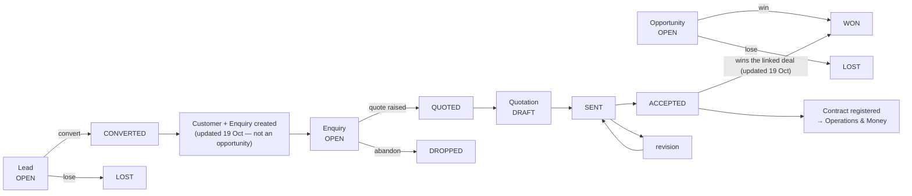

# 1 — SALES

**Menu:** left rail → **Sales** → `/sales`
**Screens in this area:** 24 (9 tiles, 15 reached from them)
**Modules that gate it:** `leads`, `inquiries`, `quotes`, `crm_orders`, `crm_reports`
**Who can open the area** (measured, `../evidence/role-access-matrix.md`):
Master Admin · Business Director · Branch Manager · Coordinator · **Finance**
can open `/sales`. **Inspector is refused (403).**

---

## Status at 19 Oct 2026 — what changed since this document was first written

*First issued 18 Oct 2026. The changes below are in the code on branch `claude/testing-branch-setup-0gqe8n`; they reach the live site only when it is updated (`../14-LIVE-CHECKS-GUIDE.md`, Part 2). Statements in the body that they made untrue are corrected where they stand and marked **(updated 19 Oct)**.*

| Change | What it means in this area | Ref | How it was verified |
|---|---|---|---|
| A quotation refuses impossible figures | A negative quantity, GST or advance outside 0–100%, a non-number, or lines that total below zero are refused with a message naming the line. A **negative rate stays allowed**, because a negative-rate line is how a discount is written today | GAP-047 | **Live over HTTP**: the old code saved −17,700 and a 500% GST; the new code refuses both and saves the ordinary and discount controls unchanged |
| The same rules on an external quotation | `/quote-external` checks the same figures and the total typed in | GAP-047 | Guard-rail test |
| Bank charges are the client's | The **built-in** default terms gain clause 11: bank and remittance charges are to the payer's account; foreign payments to be remitted OUR. Terms a company already saved are untouched | Q-J | Test |
| Recommended, not built | A proper **discount** field on the quotation, so a discount is a named figure rather than a negative line | Roadmap | — |
| **Deep business-user audit (19 Oct)** | Sales was driven end to end on throwaway databases as each role, across six business models. **The approval and acceptance controls are enforced by hidden buttons, not by the server**: a quote can be sent unapproved, an approval survives a re-price, anyone who can view a quote can mark it accepted. 54 findings (7 P0, 15 P1), 197 test scenarios, 30 owner decisions. Nothing was changed in the application | `../sales/` | 42 probes, `../evidence/sales-audit/` |
| **Built 20 Oct, on the owner's answers** | Approval follows the company's own rules and is measured before tax; any commercial or terms change cancels it; the person assigned records the customer's answer; a blocked customer gets nothing new; the sales roles open Leads and deals; **Sales → Set up Sales** answers it all in a few questions | `../sales/SALES-REMEDIATION-ROADMAP.md` §8a | 5 guard-rail tests, 135 checks, each through the real dispatcher as each role |

**Seven statements below were found wrong by that audit** and are corrected where they stand, marked **(updated 19 Oct)**. Read `../sales/SALES-USER-AND-INDUSTRY-AUDIT.md` first; this document remains the screen-by-screen description.

---

## 1. What this area is for

This is where work is won, before any inspection happens. It carries five
distinct records, and the distinction matters because the business asks
different questions of each:

| Record | The question it answers | Statuses |
|---|---|---|
| **Lead** | Is this company worth pursuing at all? | OPEN · CONVERTED · LOST |
| **Opportunity** | Is there a live deal here, and will we win it? | OPEN · WON · LOST |
| **Enquiry** | A client has asked us to quote something specific | OPEN · QUOTED · DROPPED |
| **Quotation** | What we offered, at what price, and did they accept | DRAFT · PENDING_APPROVAL · APPROVED · SENT · ACCEPTED · LOST · EXPIRED · REJECTED, with revisions (`crm.php:129-138`) **(updated 19 Oct)** |
| **Project costing** | What the job will cost us, so the price has a floor | DRAFT · SUBMITTED · APPROVED · REJECTED |

A lead is a *company*; an opportunity is a *deal*; an enquiry is a *request to
quote*. The screens keep these apart deliberately, and the tile wording says so
("A company worth pursuing — before any specific job", "A live deal you are
working to win or lose", "A specific request to quote — a quote is raised from
it"). **That wording is good and should not be changed** — it is the clearest
explanation of the sales model anywhere in the system.

---

## 2. The area home — `/sales`

| | |
|---|---|
| Heading | **Sales** |
| Module gate | **none** — the hub itself is open to anyone who can see a tile |
| Fields | none of its own |
| Controls | **Command Centre →** |

Nine tiles, in one unnamed section:

| Tile | Opens | What the tile says |
|---|---|---|
| Leads | `/leads` | A company worth pursuing — before any specific job. |
| Opportunities | `/opportunities` | A live deal you are working to win or lose. |
| Inquiries | `/inquiries` | A specific request to quote — a quote is raised from it. |
| Quotes | `/quotes` | Quotations, revisions and approvals. |
| Quote templates | `/templates?kind=quote` | Letter and covering-note templates for quotes. |
| Pre-order checklist | `/preorder-checklist` | Enquiry / tender / contract review before a quote is approved. |
| Project costing | `/project-costings` | Team cost build-ups → man-month / man-day / lump rates and margin. |
| Approvals | `/approvals` | Deals held at a stage gate. |
| Pipelines & funnels | `/pipelines` | Stages and conversion. |

**Finding — the hub has one control and it is unexplained.** The only button on
`/sales` is **"Command Centre →"**. Nothing on the screen says what the Command
Centre is or why a salesperson would go there. (`/command-centre` is measured as
openable by Finance and refused to Inspector; it is not a Sales screen.)
*Minor, P3 — label it, or move it.*

---

## 3. Every screen, in depth

### 3.1 `/leads` — Leads

| | |
|---|---|
| Heading | Leads · module `leads` |
| Own fields | `fy` (select — financial year filter) |
| Controls | **+ New lead** · **⬇ CSV** · **Board** · **List** |
| Leads to | `/lead-new`, `/sales` |

Two views of the same data: **Board** (stages as columns, drag a lead along) and
**List**. The financial-year filter is a select, so the register is always
scoped to a year rather than showing everything — sensible for a sales register
that accumulates.

**Edge case — no required fields on the filter.** Nothing is required here and
nothing should be; this is a register, not a form.

### 3.2 `/opportunities` — Opportunities

Identical shape to Leads: `fy` filter, **+ New opportunity**, **⬇ CSV**,
**Board**, **List**. Module `leads` — **opportunities are gated by the Leads
module, not one of their own.** So a role given "Leads: view" also gets
Opportunities. That is a deliberate grouping, but it means the two cannot be
separated for a role that should see one and not the other. *Worth knowing
before anyone asks for that split.*

### 3.3 `/inquiries` — Inquiry register

| | |
|---|---|
| Heading | **Inquiry register** · module `inquiries` |
| Own fields | `st` (status filter), `fy` (year filter) |
| Controls | **+ New inquiry** |
| Columns | Inquiry · Received · Client · Subject · Business Unit · Owner · Source · Status |
| Leads to | `/inquiry-new`, `/sales` |

**Note the terminology split:** the tile says "Inquiries", the screen says
"Inquiry register". Both are fine, but the system also uses "enquiry" elsewhere
(`INQUIRY_STATUS`, and `/inquiry-new` is headed "New client inquiry"). See
`../05-BUSINESS-GLOSSARY.md` — this is one of the words with several spellings.

### 3.4 `/inquiry-new` — New client inquiry

| | |
|---|---|
| Module | `inquiries` |
| Fields | **13**, of which **0 are marked required** |
| | `client_id`, `client_name`, `received_date`, `contact_name`, `contact_email`, `contact_mobile`, `sbu`, `source`, `status`, `assigned_to`, `subject`, `service_requirement`, `notes` |
| Controls | **Create inquiry** · **← CRM — Inquiries** · **Cancel** |

**(updated 19 Oct) The server requires five of the thirteen** — client, contact, e-mail or mobile, business unit, subject — and refuses an empty form with one clear sentence (`crm.php:1342-1355`). The finding that remains is that the screen does not *show* which five. Original text: **FINDING (P2) — thirteen questions, none of them marked required.** The person
cannot tell from the screen what the system needs. Compare `/partner-new`,
which refuses an empty submit with *"Select at least one role (Client / Vendor /
Both)"* — a model message. Here nothing is marked, so the guidance only arrives
after pressing Create.

Note the pairing `client_id` **and** `client_name`: pick an existing client, or
type a new name. That is a good pattern (it stops the register stalling because
a client is not yet on file) and appears again in `/quote-new`.

### 3.5 `/quotes` — Quote register

| | |
|---|---|
| Heading | **Quote register** · module `quotes` |
| Own fields | `fy` |
| Controls | **⬇ Export** · **Approval rules** · **Templates** · **+ External** · **+ New quote** |
| Columns | Quote · Client · Subject · Business Unit · **Total** · **Contract** · Status |
| Leads to | `/quote-new`, `/quote-external`, `/approval-rules`, `/templates`, `/sales` |

The **Contract** column is the join to Operations and Money: once a quote is
won, a contract number is registered against it, and that number is what work
orders and invoices are filed under. See §5.

### 3.6 `/quote-new` — New quote

**The largest data-entry screen in Sales, and the second largest in the whole
application.**

| | |
|---|---|
| Module | `quotes` |
| Fields | **96**, of which **1 is marked required** |
| Controls | **+ Add site** · **+ Add line** · **Create quote** · **← CRM — Quotations** · **Cancel** |
| Repeating blocks | **sites** (Name/label · Type · Vendor site · Address 1 · Line 2 · City · State · PIN) and **lines** (Business Unit · Activity · Service · Description · Site · Order · Qty · Unit) |

Field groups, in the order the screen asks:

1. **Who** — `client_id` or `client_name`, `sbu`, `contact_name`,
   `contact_email`, `contact_mobile`
2. **What** — `subject`, then `inspection_types[]` repeated (a multi-select of
   service types; the harness counted **more than ten instances**, which is the
   checkbox list)
3. **Where** — the repeating **site** block, added with **+ Add site**
4. **How much** — the repeating **line** block, added with **+ Add line**

**(updated 19 Oct) Tested: an empty submit creates a numbered DRAFT with no customer and ₹0, which could be taken all the way to ACCEPTED — SA-26.** Original text: **FINDING (P2) — 96 fields and one required.** This is the commercial document
the business lives on. A quote with no client, no line and no price would be
meaningless, yet the screen marks almost nothing. *Not tested server-side* —
`/quote-new` was excluded from the empty-submit test because its target table
could not be identified automatically (there is no `quotes` table; the header
table is `quotations`). **This is the single highest-value remaining test in
this area** and is listed in `../09-UAT-PLAN.md`.

**Edge case worth testing** — a quote with two sites and one line: which site
does the line belong to? The line block has a **Site** column, so the model
supports it; whether the form enforces a valid pairing is untested.

### 3.7 `/quote-external` — Register an external quote

| | |
|---|---|
| Module | `quotes` · Fields **72**, **2 required** (`origin`\*) |
| Controls | **+ Add line** · **Register it** · **← CRM — Quotations** · **Cancel** |
| Columns (line block) | Description · Type of inspection · Qty · Unit · Rate · Amount |

For a quote the client made us submit **through their own portal** — the origin
fields (`origin`, `origin_portal`, `origin_ref`, `quote_no`, `submitted_on`)
record where it was lodged and under what reference. This is a thoughtful screen:
large accounts force suppliers onto their procurement portals, and without this
the quote would exist only in the client's system and never appear in EXAACT's
pipeline. **`origin` is required**, which is exactly the right field to insist on.

### 3.8 `/quote-approval-rules` and `/quote-approval-rule-new`

| | |
|---|---|
| `/quote-approval-rules` | module `quotes`; one control, **+ Add rule**; columns Level · Rule · Applies to · **From ₹** · **Up to ₹** · Approver · Status |
| `/quote-approval-rule-new` | module `quotes`; **9 fields, 1 required** (`name`\*): `level`, `active`, `match_type`, `sbu`, `min_amount`, `max_amount`, `approver_role`, `approver_user_id` |

Value-banded approval: a quote between two rupee amounts, optionally for one
business unit, goes to a named role or a named person, at a level. Multiple
levels give a chain.

**Finding — two approval-rule screens, one area.** `/quote-approval-rules`
(module `quotes`, with ₹ bands) and `/approval-rules` (module **none**, with
`sla_hours` and `report_type_code`) are **different screens for different rule
sets** — quote approvals and report approvals. They render near-identical
headings ("Quote & report approvals"), which is confusing. Both are reachable
from the Quote register's **Approval rules** button. *P3 — the headings should
differ.* Related: `/quote-approval-rules` was one of the twelve screens with no
menu door at all (GAP-002).

### 3.9 `/approvals` and `/approval-act` — the approvals inbox

| | |
|---|---|
| `/approvals` | **no module gate**; controls **Approval rules** · **Waiting** · **Approved** · **Rejected** · **Withdrawn** |
| `/approval-act` | module `leads`; same controls — this is the handler that records a decision |

**(updated 19 Oct) Quotation approvals are not listed here** — `approvals_hub.php` has no quotation section; they wait under **Quotes → To approve**. SA-25 recommends bringing them in.

Four state tabs. This is the unified inbox built in an earlier milestone, and it
is shared with other areas — the same screen serves quote gates, report
approvals and hiring requests. **Measured: every one of the seven roles can open
`/approvals`**, which is correct, because what it lists is what *you* have been
asked to approve.

### 3.10 `/pipelines` — Pipelines & funnels

| | |
|---|---|
| Module | `leads` · Fields **4**, **1 required** (`name`\*): `entity_kind`, `clone_from`, `make_default` |
| Controls | **Create it** · **Start from an industry template** · **Edit stages** |
| Columns | Name · Stages · In use · Default · State |
| Leads to | `/industry`, `/pipeline`, `/leads` |

`entity_kind` means a pipeline can be defined for leads, for opportunities, or
for another record type — so the funnel is configurable per record, not global.
`clone_from` copies an existing pipeline, and **Start from an industry template**
goes to `/industry`, which offers **thirteen (updated 19 Oct)** prepared industries (Inspection,
testing & certification · Testing & calibration laboratory · Manufacturing &
engineering · Trading & distribution · Professional & consulting · Construction
& infrastructure · IT & software · Healthcare & diagnostics · Education &
training · Logistics & transport · Real estate & facilities · General B2B) each
carrying stages with **Probability** and **Days allowed**.

**This is a genuinely strong feature** and it is buried: `/industry` is headed
"Your industry" and is gated by the **`settings`** module, so a salesperson who
can build a pipeline may not be able to open the templates that would fill it.
*P2 — worth checking against the intended audience.*

### 3.11 `/preorder-checklist` — Pre-order review checklist

| | |
|---|---|
| Module | `quotes` · Fields **3**, **0 required**: `enabled`, `require_all`, `items` |
| Controls | **Save pre-order checklist** · **Back to Quotes** |

The ISO/IEC 17020 "review of requests, tenders and contracts" control, as a
configurable checklist: `enabled` turns it on, `require_all` decides whether
every item must be ticked before a quote can be approved, `items` is the list.

**This is an accreditation-critical screen** and it has **no lifecycle section**
and **no mention in the permission matrix**. Its effect is to block quote
approval, which makes it a business control. *Document it — see
`../03-WORKFLOW-CATALOGUE.md` §1.*

### 3.12 `/project-costings` — Project costing

| | |
|---|---|
| **No module gate** · Fields **5**, **1 required** (`title`\*): `client_id`, `office_id`, `site`, `basis` |
| Controls | **Create costing** |

`basis` selects man-month / man-day / lump sum. Statuses are
`PC_STATUS` = DRAFT · SUBMITTED · APPROVED · REJECTED — so a costing is itself
approved, giving the quote a defensible floor price.

**Since 20 Oct 2026 (owner's D-11 A/B):** the moves are enforced — submit needs a
role, approve only from Submitted and **never by the costing's author** (matched by
user id, so a variant spelling of a name cannot get round it; older sheets fall
back to the name), send back needs a reason, reopening an approved costing
withdraws its approval. A quotation is drafted only from an approved costing, and a
man-month quotation is submitted, approved or sent only on one.

**Measured:** Finance can open it; Inspector is refused (302). It has **no
module gate**, so its protection is whatever the handler applies — it was in the
GAP-008 shortlist and came back read-only for a least-privileged role.

### 3.13 `/templates` and `/crm-templates` — two template screens

| Screen | Module | Fields | Controls |
|---|---|---|---|
| `/templates` | **none** | 13, 1 required (`type`\*) | **Upload my Word file & build the form →** · **Add template** |
| `/crm-templates` | `crm_reports` | 8, 0 required | **Save letterhead** · **Save signature** · **+ Add template** |
| `/crm-template-new` | `crm_reports` | 11, 1 required (`name`\*) | **Add template** · **← CRM — Sales reports** · **Cancel** |

**FINDING (P2) — both render the heading "Document templates".** `/templates`
is the general template library (report types, clients, offices, document and
format numbers, revisions); `/crm-templates` is the **letterhead and signature**
screen plus quote/e-mail templates. Two screens, one heading, reached from
different places — and `/crm-templates` was another of the twelve with no menu
door (GAP-002). *Give them distinct headings and one owner.*

`/templates` carries `document_number`, `format_number`, `doc_revision`,
`issue_date` — the controlled-document fields an assessor looks for. Good.

### 3.14 `/crm-dashboard` and `/crm-reports` — Sales dashboard, twice

| Screen | Module | Controls | Columns |
|---|---|---|---|
| `/crm-dashboard` | `crm_reports` | **⬇ Funnel CSV** · **Pipeline board** · 30 days · 90 days · 6 months · 12 months · 2 years | — |
| `/crm-reports` | `crm_reports` | **⬇ Download CSV** | Month · Raised · Won · Lost · Won value |

**FINDING (P2) — two screens, both headed "Sales dashboard".** One is a
period-filtered funnel view, the other a month-by-month table. Neither has a
menu tile (GAP-002 lists `/crm-reports`). A person looking for "the sales
dashboard" can land on either and see something different. *Decide which is the
sales dashboard, link it from the Sales hub, and make the other a tab of it.*

### 3.15 `/adspro` and `/ads-roi` — paid advertising

| Screen | Module | Fields | Controls |
|---|---|---|---|
| `/adspro` | `leads` | 4: `url`, `workspace`, `token`, `autopush` | **Save** · **Test the connection** · **Bring leads across** · **Refresh 90 days of spend** · **⇄ Sync now, both ways** · **Queue every lead we already have** · **Queue every enquiry we already have** · Waiting to go · Sent · Failed · Not sent |
| `/ads-roi` | `leads` | 2: `from`, `to` | **Apply** |

A two-way integration with an external "Ads Pro" system: leads come in, and
leads/enquiries are pushed out, with an outbox showing Waiting / Sent / Failed /
Not sent (`ADS_OUT_STATUS` = PENDING · SENT · FAILED · SKIPPED). `/ads-roi`
answers "what the advertising actually returned" over a date range.

**Edge case the screen already handles well:** a failed push is visible rather
than silent — there is a **Failed** tab. That is the right design, and it is
better than the money bridge, whose outbox (`books_outbox`) has no equivalent
screen in Money.

---

## 4. Statuses this area moves through

**Gap:** of the five records above, **only Quotation has a lifecycle section**
in `docs/03-object-lifecycles.md`. Lead is mentioned (5 times) without a
section; **Opportunity and Enquiry have none at all** (`../03-WORKFLOW-CATALOGUE.md`
§1). So for three of the five, nobody can say which transitions are intended.

---

## 5. Data flow — what arrives, what leaves

### Arrives from

| From | What | Grade |
|---|---|---|
| **Directory** | The client record (`business_partners`) that `client_id` points at on every enquiry, quote and costing | **CONFIRMED** — the field is a select of partners |
| **Directory / Masters** | Business units (`sbu`), offices (`office_id`), service types (`inspection_types[]`), sources — all from the lookup tables | **CONFIRMED** — `lookup_values` holds 1,280 rows |
| **Marketplace** | Nothing into Sales directly. A marketplace requirement is its own record; see `02-MARKETPLACE.md` | **READ** |
| **External: Ads Pro** | Leads, via `/adspro` → **Bring leads across** | **READ** — not executed against a live Ads Pro |
| **Admin / Settings** | The industry pipeline templates (`/industry`, module `settings`) | **CONFIRMED** |
| **Admin / Approvals setup** | Which quote value band goes to which approver | **CONFIRMED** |

### Leaves for

| To | What | Grade |
|---|---|---|
| **Operations** | An accepted quote becomes a **contract number**, and a work order (`/call-new`) is filed under it. The Quote register's **Contract** column is this join | **READ** — `crm.contract.register` → `contracts.php:1830` |
| **Money** | Quote accepted → pushed to MGH Books as a `QUOTE` document (`books_bridge_on_quote_accepted()`) | **READ** — `booksbridge.php`; not executed against a live Books |
| **Money** | The quote's line rates are the basis of the later invoice; project costing sets the margin floor | **SETTLED 19 Oct — they are not.** The rate is retyped on the work order and never compared; no floor exists (`../sales/SALES-CROSS-MODULE-RECONCILIATION.md` §3) |
| **Insights** | Funnel and conversion figures, via `/crm-dashboard` and `/crm-reports` | **CONFIRMED** — both screens render |
| **Quality** | The **pre-order checklist** is the contract-review record an assessor asks for | **READ** |
| **External: Ads Pro** | Leads and enquiries pushed out, with a visible outbox | **READ** |

**The one join to watch:** quote → contract → work order → job → billable event
→ invoice is the spine of the business, and it crosses four areas. It is traced
end to end in `../02-MODULE-DEPENDENCY-MAP.md` §2 and tested in
`../09-UAT-PLAN.md` scenario S-1.

---

## 6. Scenarios

### S-1 — A new client asks for inspection at two sites, and we win it

**Who:** a Business Development Manager, then Marketing Manager for approval,
then Accounts.

1. **Sales → Leads → + New lead.** Record the company. Status OPEN.
2. **Sales → Opportunities → + New opportunity.** A live deal against that
   company. Drag it along the **Board** as it progresses.
3. **Sales → Inquiries → + New inquiry.** The client's actual request to quote.
   Fill `client_id` (or type `client_name` if they are not on file yet),
   `received_date`, `subject`, `service_requirement`. *Nothing is marked
   required — fill everything you know.* Status OPEN.
4. **Sales → Quotes → + New quote.** 96 fields. Pick the client, the business
   unit, the contact. Tick the `inspection_types[]` that apply. Press
   **+ Add site** twice — one per site, each with its own address. Press
   **+ Add line** for each chargeable item, choosing which **Site** the line
   belongs to. Press **Create quote**.
5. The quote's value lands it in an **approval band**
   (`/quote-approval-rules`). It appears for the approver that band names under
   **Quotes → To approve** (`/quotes?mine=approve`) — **not** in Approvals → Waiting,
   which has no quotation section **(updated 19 Oct)**. *Quote-approve is MARKETING_MANAGER by default,
   **not** Branch Manager — permission matrix fn. 19.*
6. Approver opens **Quotes → To approve**, approves. *(The enquiry became QUOTED
   when the quote was created, at step 4 — updated 19 Oct.)*
7. Client accepts. The quote becomes ACCEPTED, and **Accounts registers the
   contract** (`crm.contract.register` — FINANCE only). The contract number now
   appears in the Quote register's **Contract** column.
8. **Hand-off to Operations:** a work order is raised against that contract
   number. Continue in `03-OPERATIONS.md` §6 S-1.

### S-2 — The client insists we quote through their procurement portal

1. The client's portal, not EXAACT, is where the quote is lodged.
2. **Sales → Quotes → + External.** `/quote-external` — 72 fields.
3. Set **`origin`** (required), `origin_portal` (which portal),
   `origin_ref` (their reference), `quote_no`, `submitted_on`.
4. Add lines with **+ Add line**: Description · Type of inspection · Qty ·
   Unit · Rate · Amount.
5. **Register it.** The quote now exists in EXAACT's pipeline and will appear
   in the funnel, even though it was never produced here.

**Why this matters:** without this screen the deal is invisible to EXAACT, and
every conversion figure in Insights is understated by however much of the
business comes through client portals.

### S-3 — Setting up the sales funnel for the first time

1. **Sales → Pipelines & funnels.**
2. Press **Start from an industry template** → `/industry` → choose
   **Inspection, testing & certification**. Stages arrive with a
   **Probability** and **Days allowed** each.
3. Back on `/pipelines`, name the pipeline, set `entity_kind` (leads or
   opportunities), tick `make_default`, press **Create it**.
4. **Edit stages** to adjust.
5. Set up the money gates: **Quotes → Approval rules → + Add rule**. Name it,
   set `min_amount` / `max_amount`, pick `approver_role` or a named
   `approver_user_id`, set `level`.
6. Turn on contract review: **Sales → Pre-order checklist**, tick `enabled`,
   decide `require_all`, list the `items`.

**Blocker to know about:** step 2 needs the **`settings`** module, because
`/industry` is gated by it. A salesperson configuring their own funnel may be
refused at exactly that step.

### S-4 — Measuring whether the advertising pays

1. **Sales → Leads**, then `/adspro`. Fill `url`, `workspace`, `token`, press
   **Test the connection**.
2. **Bring leads across** pulls leads in. **Refresh 90 days of spend** pulls
   cost. **⇄ Sync now, both ways** reconciles.
3. Turn on `autopush` so new leads go out automatically; back-fill history with
   **Queue every lead we already have** / **Queue every enquiry we already have**.
4. Watch the outbox tabs — Waiting to go · Sent · **Failed** · Not sent.
5. `/ads-roi`: set `from` and `to`, press **Apply**, read the return.

---

## 7. Edge cases

| # | Edge case | What happens | Grade |
|---|---|---|---|
| E-1 | Submit `/inquiry-new` with nothing filled | **Refused** — the server requires five fields and says which (updated 19 Oct) | **CONFIRMED** |
| E-2 | Submit `/quote-new` with nothing filled | **A numbered DRAFT is created with no customer and ₹0** (updated 19 Oct) — SA-26 | **CONFIRMED** |
| E-3 | A quote with two sites and one line | A line will store **another quote's site, or one that does not exist**; posting another quote's site id deletes this quote's own site (updated 19 Oct) — SA-24 | **CONFIRMED** |
| E-4 | A quote whose value sits in two overlapping approval bands | **Every matching band becomes a step**; on a shared boundary both levels are needed (updated 19 Oct) — D-04a | **CONFIRMED** |
| E-5 | A quote value *above* every band's `max_amount` | **One generic step, and direct approval allowed** — a ₹9 lakh quote was approved by the Marketing Manager although the top band named the Business Director (updated 19 Oct) — SA-08 | **CONFIRMED** |
| E-6 | Client not yet on file when the enquiry arrives | Handled well — type `client_name` instead of picking `client_id`. The register does not stall | **CONFIRMED** (the field pair exists on both `/inquiry-new` and `/quote-new`) |
| E-7 | The Ads Pro connection breaks mid-sync | Visible: the outbox has a **Failed** tab. Nothing is silently lost | **READ** |
| E-8 | Pre-order checklist set to `require_all` and one item cannot be met | **Blocks chain-step approval only** — direct approval, sending and acceptance pass; no waiver (updated 19 Oct) — SA-13 | **CONFIRMED** |
| E-9 | Two people edit the same quote at once | **The second save silently wins** (updated 19 Oct) — SA-26 | **CONFIRMED** |
| E-10 | A won opportunity whose client is later blacklisted | **Nothing is stopped** — enquiry, quote, approval, acceptance, contract, work order and draft invoice all succeed (updated 19 Oct) — SA-17 | **CONFIRMED** |
| E-11 | Inspector tries to open Sales | **403.** Correct and clean | **CONFIRMED** |
| E-12 | Finance opens Sales | **Opens.** Correct — Accounts registers contracts off won quotes | **CONFIRMED** |

---

## 8. Findings raised in this area

| Id | Severity | Finding |
|---|---|---|
| S-F1 | **P2** | `/quote-new` — 96 fields, 1 marked required. `/inquiry-new` — 13 fields, 0 required. The person is told what is needed only after pressing Create |
| S-F2 | **P2** | Two screens headed **"Sales dashboard"** (`/crm-dashboard`, `/crm-reports`), neither with a menu tile |
| S-F3 | **P2** | Two screens headed **"Document templates"** (`/templates`, `/crm-templates`) |
| S-F4 | **P2** | `/industry` — the pipeline templates a salesperson needs are gated by the **Settings** module |
| S-F5 | **P2** | Opportunity, Enquiry and Lead have **no lifecycle section**; the pre-order checklist is an accreditation control with no documentation at all |
| S-F6 | **P3** | `/quote-approval-rules` and `/approval-rules` render near-identical headings for different rule sets |
| S-F7 | **P3** | The Sales hub's only control is **"Command Centre →"**, unexplained |
| S-F8 | — | *Credit:* `/quote-external` exists and requires `origin`. Without it, portal-lodged deals would be invisible and every conversion figure wrong |

Cross-area findings that bite here: **GAP-002** (`/crm-reports`,
`/crm-templates`, `/quote-approval-rules` have no menu door), **GAP-001** (the
rail's "Find a screen…" box cannot find any of them).
