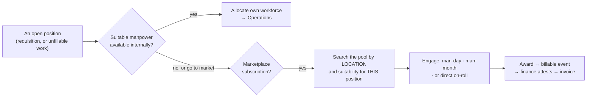
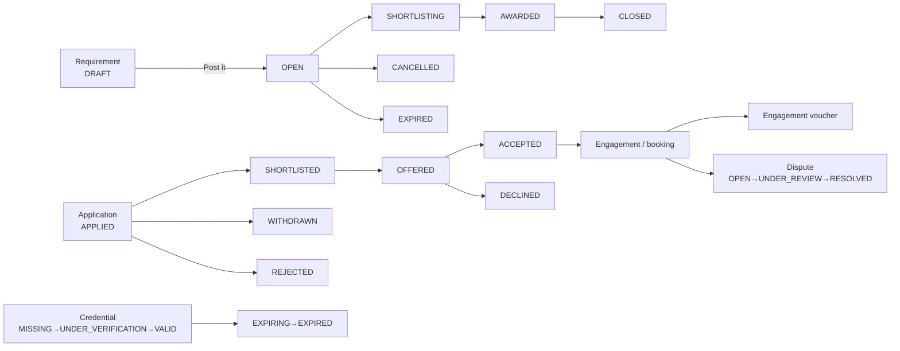

# 2 — MARKETPLACE

**Menu:** left rail → **Marketplace** → `/marketplace`
**Screens in this area:** 18 (14 tiles, 4 reached from them)
**Modules that gate it:** **none.** Not one of the 14 tiles has a module gate.
**Who can open it** (measured): the hub `/marketplace` opens for Master Admin,
Business Director, Branch Manager, Operation Manager and Coordinator.
**Inspector and Finance get 403.** Two screens — `/connect-orgs` and
`/access-requests` — are **Master Admin only**.

---

## Status at 19 Oct 2026 — what changed since this document was first written

*First issued 18 Oct 2026. The changes below are in the code on branch `claude/testing-branch-setup-0gqe8n`; they reach the live site only when it is updated (`../14-LIVE-CHECKS-GUIDE.md`, Part 2). Statements in the body that they made untrue are corrected where they stand and marked **(updated 19 Oct)**.*

| Change | What it means in this area | Ref | How it was verified |
|---|---|---|---|
| A paid plan or credit pack is never handed out free | With no payment keys, a priced item is **refused** with "Online payment is not set up yet"; free plans and the launch promo still activate. The admin plans screen names the priced items nobody can buy | GAP-037 | Test (`test_mkt_pay`) |
| The credit wallet stops at zero | Two posts at once can no longer draw the last credit twice | GAP-038 | Test, draw called past the read |
| Payment applied exactly once | Two verifications of one marketplace payment cannot both activate it | GAP-032 | Test |
| Client portal: two offered permissions now enforced | "Ask for a new job" and the portal assistant obey the user's own rights | GAP-013, GAP-014 | Execution, per user |
| Professional portal: forged-request protection added; messages delivered | Every form carries the anti-forgery token; nine actions that discarded their answer now show it | GAP-020, GAP-015, GAP-023 | Execution |
| Portal screens: refusals look like refusals; fields labelled; contrast passes; the tenant's own words | | GAP-016–019 | Browser checks at 390 px |
| Uploads say why a file was refused, with the real limit | | GAP-024 | Execution |
| A voucher line rejects any quantity or any date | | GAP-022 | Execution |
| **Fair plan changes** | An upgrade starts today with the unused time credited (any excess becomes extra days); a downgrade starts when the paid period ends, nothing charged now; buying the same plan early extends it instead of cancelling it. Each plan card says what choosing it would do | GAP-039, Q-L (owner, "Yes build as per your recommendation") | 33-assertion test; **live over HTTP**: the downgrade is explained, booked for the day after the period, Pro carries on |

---

## 1. What this area is for — corrected by the owner, 2026-10-18

> **I had this wrong, and the correction matters enough to lead with it.**
> I first described Marketplace as a separate two-sided product that duplicated
> Recruitment, and asked which of them was "the business". **It is neither
> separate nor a duplicate.**

**The owner's description:** Marketplace is the **external sourcing channel for
technical manpower**. It exists for the moment when a position is open and
there is **no suitable manpower available internally** — or the business simply
wants to go to the market. With a marketplace subscription, the user clicks and
**finds manpower in that location suitable for the open position**.

Whoever is found is engaged on one of three bases:

| Basis | Where it lives in the code |
|---|---|
| **Man-day deputation** | `cx_pro_work_types()['manday']` — *"Man-day / man-month deputation"* |
| **Man-month deputation** | the same work type; `engagement_type` = `MONTHLY`, with `manmonth_basis` on the job allocation |
| **Direct, on the company's own roll** | `roll_type` = **OWN** (against **AGENCY**) |

So **Recruitment and Marketplace are the internal and external branches of one
supply chain**, not two implementations of one idea:

**And the product implements exactly that.** `recruit_pro_pool($req)`
(`lib/recruit.php:754`) reads the marketplace pool and scores every active
professional against the requisition, keeping those at or above a fit
threshold, strongest first. Its own comment says why:

> *"a recruiter filling a requisition **automatically sees benched / verified
> people from the marketplace who fit** — not only existing candidate rows."*

The fit score (`recruit_pro_fit_score()`) is computed over
**`base_city`, `preferred_locations`, `pan_india`** — the location match the
owner described — plus `disciplines`, `skills`, `work_types`, `availability`,
`verification_tier` and `day_rate_min`/`day_rate_max`. It returns explainable
`factors`, not just a number.

And `candidate-link-pro` / `candidate-unlink-pro` link a marketplace
professional to a candidate row — which is what **`/candidate-pool`
("candidate pool convergence")** is for. That screen, which I listed as having
no door and no confirmed purpose, is the convergence point of the two branches.

---

## 1a. The product as a product

Marketplace (called **Connect** in the code) is also a genuine two-sided
platform: companies post manpower requirements, self-listed professionals and
agencies apply, and the platform takes a commission.

Three facts set the scale:

1. **68 database tables** — `mkt_*`, `cx_*`, `connect_*`. That is the **largest
   single block in the 317-table schema**, bigger than Quality (46) or
   Operations (32). More of this system's data model is marketplace than is
   core inspection business.
2. **`/connect-qualifications` carries 619 form fields, 234 of them required** —
   the largest screen in the entire application by a wide margin.
3. **No module gates anywhere.** Access rests on `connect_enabled()` (has the
   company bought Marketplace?) and the portal permission helper `pcan()`,
   not on the `mod.*.view` system that governs every other area.

**This is the area the owner should decide about first**, before any deep
remediation: it is the biggest thing in the system, it is a different business
from inspection, and whether it is live changes the priority of everything in
this document. See **open question Q-C** in `../08-GAP-REGISTER.md` — the same
question is open for `mgh-hire/`, which is a *third* implementation of hiring
in this repository.

---

## 2. The two front doors

### `/connect` — the public storefront
Measured as openable by **all seven roles**, and it is public-facing by design.
It renders a marketing page: *"Post a job. Find the right inspector. Get it
done."* with a GET search box (`need`) posting to `/connect/start`, trust
counters (professionals listed, open jobs), and links to **join as a
professional** and sign in.

It was on the GAP-008 shortlist — an ungated route that opens for an inspector —
and came back clean: a GET search form, nothing written, no records shown.

### `/marketplace` — the staff hub
| | |
|---|---|
| Heading | Marketplace · **no module gate** |
| Own fields | none |
| Controls | **Command Centre →** |

14 tiles. Like the Sales hub, its only control is an unexplained
**"Command Centre →"**.

**FINDING (M-F1, P2) — the hub and its screens refuse differently.**
`/marketplace` answers an inspector with **403**; the individual screens behind
it answer with a **302 redirect**. Same meaning, two shapes, in one area — this
is GAP-006 made concrete. From the outside, the 302 is indistinguishable from a
dead link, which is exactly what has been reported as "nothing happens".

---

## 3. Every screen, in depth

### 3.1 `/connect-requirements` — Manpower marketplace

The core screen: post a requirement, manage who applies.

| | |
|---|---|
| Fields | **13**, **1 required** (`title`\*) |
| | `poster_party_id`, `work_type`, `sector_code`, `discipline_code`, `location`, `positions`, `start_date`, `end_date`, `rate_min`, `rate_max`, `description`, **`commission_pct`** |
| Controls | **Save** · **Post it — open for applications** · **Save as draft** · **💬 Guided post — answer a few questions** |
| Statuses | `CX_REQ_STATUSES` = DRAFT · OPEN · SHORTLISTING · AWARDED · CLOSED · CANCELLED · EXPIRED |

**Three save paths, which is good design:** *Save* (keep working), *Save as
draft* (DRAFT), *Post it* (OPEN, visible to applicants). The separation between
"saved" and "open for applications" is the right one — it means a half-written
requirement never goes live.

**`commission_pct` sits on the requirement.** The platform's cut is per
requirement, not a global setting. That is a commercial decision embedded in a
form field, and it is **not** mentioned in the permission matrix — so there is
no documented rule about who may change a commission rate. *Raise with the
owner.*

**FINDING (M-F2, P2) — `title` is the only required field on a job posting.**
A requirement with no discipline, no location, no rate and no positions can be
posted and opened for applications. For a marketplace, an unfillable posting is
worse than no posting: it wastes every applicant who reads it. (Untested
server-side; the pattern matches `/call-new` and `/candidate-new`, which **do**
create empty records — see `../04-SCREEN-AND-FIELD-AUDIT.md`.)

### 3.2 `/connect-concierge` — Guided post

| | |
|---|---|
| **Heading: none.** This is the one screen out of 256 with no `<h1>` | |
| Fields | 23 — `title`, then `discipline_code` repeated (the discipline picker) |
| Controls | **Next →** · **Cancel** |

A wizard that builds a requirement by asking a few questions, reached from
**💬 Guided post** on the requirement screen. The right idea: a 13-field form
with a commission rate on it is not something a first-time poster should face.

**FINDING (M-F3, P2) — no heading at all.** Every other screen in the system
has one, the breadcrumb is derived centrally, and a wizard with no title gives
the person nothing to orient by. *One-line fix.*

### 3.3 `/connect-talent` — Talent search

| | |
|---|---|
| Fields | 5: `discipline`, `work_type`, `location`, `available_only` |
| Controls | — (filter-driven) |

Searches the shared pool of self-listed professionals. Per the permission matrix
(Connect fn. 20), a client searching the pool sees **privacy-safe cards** and
must **request contact**, which the professional approves —
`connect_privacy_resolve()` enforces it, and no contact detail is exposed by the
search itself. **That is the correct design** and it is the kind of thing a data
regulator asks about.

### 3.4 `/connect-verify` — Verification desk

Confirms identity and credential checks; moves professionals up a **trust
ladder**. One screen, no own fields measured (it works on records).
Statuses: `CREDENTIAL_STATUS` = VALID · EXPIRING · EXPIRED ·
UNDER_VERIFICATION · REJECTED · SUPERSEDED · MISSING.

**EXPIRING as a distinct state is good** — it allows chasing before a
credential lapses, rather than discovering it has.

Openable by Coordinator and above; Inspector and Finance redirected.
**A coordinator can therefore verify a professional's identity documents.**
Whether that is intended is a question for the owner: credential verification
is an accreditation-relevant act (`competence`, `identity` modules exist for
exactly this on the staff side, and they are gated).

### 3.5 `/connect-qualifications` — Qualification & role taxonomy

**The largest screen in EXAACT: 619 fields, 234 required.**

| | |
|---|---|
| Controls | **Job families** · **Roles** · **Qualification levels** · **ITI trades** · **Certifications** · **Add job family** · **Save changes** · **Switch off** · **Delete** · **Add role** · **Add qualification level** |
| Repeating fields | `code`\*, `name`\*, `detail`, `nsqf_min`, `nsqf_max` — once per row |
| Columns | Code · Name · Description · **NSQF min** · **NSQF max** · Status · Actions / Code · Job family · Name · **Also known as** · Minimum entry band · Typical certifications · Status |

Five tabs modelling the Indian skills ladder: ITI → diploma → engineer → MBA,
mapped to **NSQF bands** (the National Skills Qualifications Framework), with
job families, roles, aliases ("Also known as") and typical certifications.

**This is domain modelling of real quality** — NSQF banding and alias handling
are what make a marketplace able to match "welding inspector" to "CSWIP 3.1" to
a diploma holder. It is also, at 619 fields on one page, **unusable on a phone
and punishing on a laptop**. The 234 required fields are per-row `code` and
`name`, which is correct behaviour for a grid, not a validation defect.

**FINDING (M-F4, P2) — one screen, five tabs, 619 fields.** Each tab should be
its own screen, or the grid should page. *This is the clearest "form fatigue"
case in the system.*

### 3.6 `/connect-channels` — WhatsApp, SMS & email

| | |
|---|---|
| Fields | **48** — `body`, `enabled`, `approval_status`, `provider_ref`, repeated per event/channel |
| Controls | **Off (record only)** · **Log (simulate)** · **Live (provider)** · **Save** |
| Columns | Event · Channel · Message · Status · Edit |

**The three-mode switch is excellent engineering.** *Off* records the intent
without sending, *Log* simulates so templates can be tested without messaging
real people, *Live* actually sends. A system that can message candidates and
clients needs exactly this, and most do not have it.

`approval_status` per template matters because WhatsApp business templates
require provider approval before use; the field tracks it
(`VOCAB_STATUSES` = APPROVED · PENDING · REJECTED).

### 3.7 `/connect-orgs` — Organisations · **Master Admin only**

| | |
|---|---|
| Fields | 2, **1 required** (`name`\*): `org_type` |
| Controls | **Register** |

Registers organisations and their module entitlements — TPIA / agency /
company. Correctly the most restricted screen in the area: this is where a new
party is admitted to the platform.

### 3.8 `/access-requests` — Access requests · **Master Admin only**

*"People who signed up for a company we already work with — decide, then invite
them the usual way."*

The self-signup safety valve: somebody registers claiming to belong to a client
you already have, and an administrator decides rather than the system assuming.
**Correct and important** — the alternative is a stranger joining a client's
workspace.

### 3.9 `/connect-bench` — Agency bench

| | |
|---|---|
| Fields | 1: `org` |

An agency's own private roster — add people, allocate them to jobs. The private
relationship data is scoped to the owning party and never exposed to the
professional or to other clients (matrix fn. 20).

### 3.10 `/connect-messages` — Messages

Two-way chat with applicants, tied to each requirement. No own fields measured
(it posts per thread).

**Edge case to be aware of:** a messaging channel inside a marketplace is where
parties try to take a deal off-platform to avoid the commission. Whether
`/connect-messages` is monitored or filtered is **not** documented anywhere.

### 3.11 `/rating-disputes` — Rating-integrity desk

*"Investigate reported ratings; uphold, annotate or remove them from scores."*
Statuses: `CX_DISPUTE_STATUSES` = OPEN · UNDER_REVIEW · RESOLVED · WITHDRAWN,
and separately `NCDCA_DISPUTE_STATUS` = OPEN · UNDER_REVIEW · UPHELD · REVISED ·
WITHDRAWN.

Three outcomes — **uphold, annotate, or remove from scores** — is the right
set: a disputed rating that was fair should stand with a note, and only an
unfair one should stop counting.

### 3.12 `/connect-taxonomy` and `/connect-taxonomy-admin`

| Screen | Fields | Controls |
|---|---|---|
| `/connect-taxonomy` | none | **⚙ Manage graph →** |
| `/connect-taxonomy-admin` | 6, 1 required (`name`\*): `kind`, `kind_new`, `code`, `parent_id` | **Filter** · **Retire** · **Add node** |

Sectors, equipment, materials, disciplines, standards, certifications — held as
a **graph** with parents and aliases, not a flat list. `cx_tax_nodes` (348 rows)
and `cx_tax_aliases` (478 rows) are among the most populated tables in the test
database, so this is real, loaded reference data.

**Retire rather than delete** — the right choice for reference data that
historical records point at.

### 3.13 `/connect-analytics` — Labour-market analytics

*"Supply vs demand, fill funnel, time-to-award, rate benchmarks, pool growth."*
No own fields. This is the area's commercial intelligence, and it is the kind of
data a marketplace can sell. Its figures are **not reconciled** in this audit —
see `../07-DASHBOARD-AND-KPI-AUDIT.md`.

### 3.14 `/passport-share` — Professional passport

A professional's public, verifiable credential page. One control: the
professional's name (**UAT Inspector** in the test data).

**FINDING (M-F5, P3) — the one role-access anomaly in the area.** Finance gets
**SCREEN** here while being redirected from every other Marketplace screen. It
is a public credential page so the exposure is nil, but the inconsistency means
the area has no single access rule. *Decide: is `/passport-share` public like
`/connect`, or staff-only like the rest?*

### 3.15 `/join` — Set up your organisation (public)

| | |
|---|---|
| Fields | **37**, **3 required** (`name`\*, and two others) |
| Controls | **Create my account →** |
| Repeating | `caps[]` — the business-capability checklist, 15+ instances |

**Public self-signup.** A company creates its own workspace, declaring its
capabilities. Then `/access-requests` catches the case where the company already
exists as your client.

**This is the only public write path into the system**, and it has **no
breadcrumb** (one of the five screens without one — correct here, since the
person is not inside the app yet).

### 3.16 `/connect-capabilities` — Company business capabilities

| | |
|---|---|
| **Module `settings`** — the only Marketplace-reachable screen that *is* module-gated | |
| Fields | 28: `party`, then `caps[]` repeated |
| Controls | **Show** · **Make this the operating company** · **Save capabilities** |

What this company does, which drives what the rest of the app shows — the
`connect_cap_owner_does_inspection()` check that decides whether the Quality
area's inspection tiles appear at all (see `05-QUALITY.md` §2).

**This is a high-leverage screen with a quiet reach:** turning off a capability
here removes tiles in other areas. That dependency is not stated on the screen.
*P2 — say so on the screen.*

---

## 4. Statuses this area moves through

**Unusually well documented:** Connect Requirement, Connect Application, Connect
Engagement / Booking, Connect Engagement Voucher, Connect Dispute, Connect
Rating-Integrity Dispute and Credential **all have lifecycle sections** in
`docs/03-object-lifecycles.md` — 7 of the 26 sections in that document are
Marketplace. Compare Quality, which has none. Whoever built Marketplace
documented it properly.

---

## 5. Data flow — what arrives, what leaves

### Arrives from

| From | What | Grade |
|---|---|---|
| **Public internet** | A new organisation via `/join`; a professional self-listing | **READ** |
| **Directory** | `poster_party_id` on a requirement points at a business partner | **CONFIRMED** — the field exists |
| **Admin / Settings** | `connect_enabled()` — whether the company has bought Marketplace at all; `/connect-capabilities` for what it does | **CONFIRMED** |
| **Admin / Marketplace plans** | `/marketplace-plans` (34 fields, 5 required) sets plans and limits — it sits in **Admin**, not here | **CONFIRMED** |
| **Recruitment** | **A requisition automatically sees the marketplace pool** — `recruit_pro_pool()` scores every active professional against it on location, discipline, skills, work type, availability and verification tier, strongest first. *(I first recorded this as "nothing automatic" — wrong; see §1)* | **READ** — `lib/recruit.php:754` |

### Leaves for

| To | What | Grade |
|---|---|---|
| **Operations** | An awarded engagement becomes work to schedule — `Connect Engagement / Booking` then `Connect Engagement Voucher` | **READ** |
| **Money** | Commission (`commission_pct`), escrow (`mkt_escrow`), credit packs and purchases (`mkt_credit_*`), a marketplace ledger (`mkt_ledger`), fee rules (`mkt_fee_rules`), subscriptions and usage | **READ** — a **second money system**, parallel to the invoice chain |
| **Quality** | Credential verification feeds the trust ladder; ratings and rating disputes | **READ** |
| **Insights** | `/connect-analytics` | **CONFIRMED** (renders) |
| **External** | WhatsApp / SMS / email via `/connect-channels` in Live mode | **READ** — not fired |

### ~~M-F6 — "Marketplace has its own money system, parallel to the invoice chain"~~ **WITHDRAWN**

I wrote that there were **two sets of books with nothing joining them**, because
I found the `mkt_*` tables and no link in the navigation. **There is a link, and
it is deliberate and well built:** `lib/connect_bridge.php`.

> *"when a marketplace requirement is AWARDED, turn it into a billable
> engagement that flows through the invoicing chain EXAACT already has — the P4
> Billable Event ledger → finance attestation → books invoice. **We do NOT
> build a new invoicing engine; we hand the award to the existing one.**"*
>
> *"this is an explicit staff action ('Send to billing'), and it creates a
> **PENDING** billable event — **finance still approves and attests** the real
> invoice, so **the books ledger stays the single money truth**."*

`connect_engagement_billable()` calls
`billable_event_upsert('connect', 'MARKETPLACE_AWARD', $requirementId, …)`
with the party, the contract reference, the quantity, the **unit derived from
the engagement basis** (`connect_bridge_unit()`: visit · day · engagement) and
the rate from the awarded bid or the requirement's band. A **crew** requirement
bills the whole position manifest by headcount.

**So marketplace engagement revenue already reaches the same chain, the same
ledger and the same invoice as inspection work** — and it arrives as PENDING so
Accounts attests it, which is the right control.

**What the `mkt_*` tables actually are:** the **platform's own** economics —
subscriptions, credit packs, commission, fee rules, escrow. That is the
marketplace operator's revenue, which legitimately sits apart from the
customer's client billing. **Two different kinds of money, correctly
separated** — not two sets of books for one thing.

**Q-M1 is therefore answered** (customer-facing engagement revenue does reach
the P&L) and **Q-M3 is withdrawn** (see §1 — Recruitment and Marketplace are
one supply chain).

**What survives, and it is narrower:**

- **Q-M2 stands.** Who may change a `commission_pct`, a fee rule or release
  escrow? Observed as "Coordinator and above"; **documented nowhere**. The
  marketplace operator's money has no permission-matrix coverage.
- **M-F6a (P2, new).** The bridge is an **explicit staff action**
  ("Send to billing"). Nothing measured shows **what happens if nobody presses
  it** — an awarded engagement that is never sent to billing is unbilled work,
  and there is no "awarded but not billed" screen equivalent to Money's
  `/billable-events`. *Worth one test and possibly one tile.*

---

## 6. Scenarios

### S-1 — A client posts a requirement and awards it

**Who:** a client (or a coordinator acting for them), then applicants, then
whoever awards.

1. **Marketplace → Manpower marketplace** (`/connect-requirements`).
2. Either fill the 13 fields directly, or press **💬 Guided post** for the
   wizard (`/connect-concierge` — note it has no title, so you will not see a
   heading confirming where you are).
3. Set `title` (the only required field), `discipline_code`, `location`,
   `positions`, `start_date`/`end_date`, `rate_min`/`rate_max`,
   `commission_pct`.
4. **Save as draft** while you think, or **Post it — open for applications**
   when ready. Status DRAFT → OPEN.
5. Applications arrive: APPLIED. Status moves to SHORTLISTING.
6. **Marketplace → Messages** to ask applicants questions, tied to the
   requirement.
7. Shortlist → SHORTLISTED → OFFERED. The applicant ACCEPTS or DECLINES.
8. Award: requirement → AWARDED, then CLOSED. An **engagement** is created, and
   an **engagement voucher** records the work done.
9. Commission and fees land in the marketplace ledger (`mkt_ledger`), **not**
   in the invoice chain.

### S-2 — A professional joins, is verified, and becomes findable

1. Public: the professional self-lists (from `/connect` → *join as a
   professional*).
2. Credentials start at **MISSING** or **UNDER_VERIFICATION**.
3. **Marketplace → Verification desk** (`/connect-verify`). Staff confirm
   identity and credential checks; the professional moves **up the trust
   ladder**. Credential → **VALID**.
4. They become visible in **Talent search** (`/connect-talent`) — as a
   **privacy-safe card**. A client cannot see contact details; they must
   **request contact**, which the professional approves.
5. Their **Professional passport** (`/passport-share`) is a public, verifiable
   credential page they can show anyone.
6. Later the credential nears expiry → **EXPIRING**, so it can be chased
   before it becomes **EXPIRED**.

### S-3 — A rating is disputed

1. A professional (or client) reports a rating as unfair.
2. **Marketplace → Rating-integrity desk** (`/rating-disputes`). Status OPEN →
   UNDER_REVIEW.
3. Three outcomes: **uphold** (it stands), **annotate** (it stands with a
   note), or **remove it from scores** (it no longer counts).
4. Status → RESOLVED, or WITHDRAWN if the reporter drops it.

**Why three outcomes matter commercially:** a marketplace whose only options are
"keep" and "delete" either protects bad reviews or lets people erase fair ones.

### S-4 — Setting Marketplace up from nothing

1. **Admin → Marketplace plans & limits** (`/marketplace-plans`, 34 fields,
   5 required) — note this lives in **Admin**, not Marketplace.
2. **Marketplace → Organisations** (`/connect-orgs`, *Master Admin only*) —
   register the TPIAs, agencies and companies, with their entitlements.
3. **Marketplace → Industry taxonomy → ⚙ Manage graph** — build or extend the
   sector / equipment / discipline graph. Use **Retire**, never delete.
4. **Marketplace → Qualification & role taxonomy** — the 619-field screen.
   Five tabs: job families, roles, qualification levels, ITI trades,
   certifications, with NSQF bands.
5. **Marketplace → WhatsApp, SMS & email** — set each event's template, leave
   the mode on **Log (simulate)** until the templates read well, then switch to
   **Live (provider)**.
6. **Marketplace → Access requests** — from now on, watch this for people
   signing up against companies you already work with.

---

## 7. Edge cases

| # | Edge case | What happens | Grade |
|---|---|---|---|
| E-1 | Post a requirement with only a title | Not refused by the browser — `title` is the only required field. Server behaviour untested; the comparable `/call-new` and `/candidate-new` **do** create empty records | **UNTESTED** |
| E-2 | Someone signs up via `/join` for a company that is already your client | Handled properly — it lands in `/access-requests` for an administrator to decide, rather than joining their workspace | **READ** |
| E-3 | A credential expires while the professional is mid-engagement | `EXPIRING` exists as a state so it can be chased first. Whether an engagement is blocked on expiry is not enforced on any screen measured | **SUSPECTED** |
| E-4 | Two parties take the deal off-platform via Messages to dodge commission | No monitoring or filtering is documented. A real commercial exposure for a marketplace | **UNTESTED** |
| E-5 | A requirement expires with applicants mid-process | `EXPIRED` exists. What happens to the open applications is not documented | **UNTESTED** |
| E-6 | WhatsApp template not yet approved by the provider, but mode is **Live** | `approval_status` per template tracks it. Whether Live sending is blocked on a PENDING template is untested | **UNTESTED** |
| E-7 | A taxonomy node is retired while requirements point at it | **Retire, not delete** — so history stays readable. Correct design | **CONFIRMED** (the control is **Retire**) |
| E-8 | Marketplace not purchased, but someone types `/connect-requirements` | `connect_enabled()` guards it, and the menu's "would this link work?" peek is deliberately made honest for marketplace routes (`ops.php` comment, Milestone 11) so no dead link is offered | **READ** |
| E-9 | An inspector opens the Marketplace hub | **403.** But every screen behind it answers **302** — M-F1 | **CONFIRMED** |
| E-10 | Finance opens `/passport-share` | **Opens**, unlike every other Marketplace screen for that role — M-F5 | **CONFIRMED** |
| E-11 | A coordinator verifies a professional's identity documents | **Allowed.** Whether a coordinator should hold that authority is an open question, given that staff-side identity is a gated module | **CONFIRMED (behaviour)** |
| E-12 | A commission rate is changed after applications arrive | `commission_pct` is on the requirement and editable. No audit rule is documented for changing it mid-flight | **UNTESTED** |

---

## 8. Findings raised in this area

| Id | Severity | Finding |
|---|---|---|
| M-F6 | **P1 (owner decision)** | Marketplace runs a **second, parallel money system** (`mkt_ledger`, `mkt_escrow`, credit packs, fee rules) with no measured join to the invoice chain and no permission-matrix coverage |
| M-F1 | **P2** | The hub refuses with 403 while its screens refuse with 302 — one area, two refusal shapes (GAP-006) |
| M-F2 | **P2** | A job posting requires only `title` |
| M-F3 | **P2** | `/connect-concierge` has **no heading** — the only screen of 256 without one |
| M-F4 | **P2** | `/connect-qualifications` — 619 fields and five tabs on one screen |
| M-F7 | **P2** | `/connect-capabilities` silently controls whether tiles appear in **other** areas; the screen does not say so |
| M-F5 | **P3** | Finance can open `/passport-share` but no other Marketplace screen |
| M-F8 | — | *Credit:* the **Off / Log / Live** messaging switch, the **privacy-safe** talent cards with approved contact requests, **Retire** instead of delete on taxonomy, **EXPIRING** as a credential state, and three outcomes on a rating dispute. This area is the best-documented in the system — 7 of the 26 lifecycle sections are Marketplace |

**Open questions for the owner:** Q-C (is Marketplace live?), Q-M1 (should
marketplace revenue reach the same P&L?), Q-M2 (who may change commission, fee
rules, escrow?), Q-M3 (Marketplace vs Recruitment vs `mgh-hire` — three
implementations of matching people to work).
