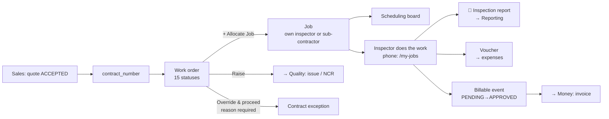

# 3 — OPERATIONS

**Menu:** left rail → **Operations** → `/operations`
**Screens:** 65 reachable in or from this area; **12 are gated by Operations' own
modules** (`calls`, `jobs`, `vouchers`, `reconcile`), the rest are cross-area
links the Operations home offers.
**Who can open the area** (measured): Master Admin · Business Director · Branch
Manager · Operation Manager · Coordinator · **Finance** (view-only).
**Inspector gets 403 on `/operations`** — by design: inspectors do not use the
desk hub, they use `/my-jobs` and `/my-voucher` on a phone.

> **The Operations home is not a tile grid.** Unlike Sales or Money, it is a
> hand-built screen (`served_by_area_engine: false`), so its "tiles" are links
> it chooses to offer — and several of them lead into *other* areas
> (`/clients`, `/vendors`, `/documents`, `/recruitment`, `/system-status`).
> That makes it the busiest crossroads in the application, and it is why this
> document separates **Operations' own screens** from **the doors it offers
> elsewhere**.

---

## 1. What this area is for

This is the engine room: a client's request becomes a **work order**, the work
order is **allocated** as one or more **jobs**, an inspector does the work,
expenses become a **voucher**, and completed work becomes a **billable event**
that Money turns into an invoice.

| Record | What it is | Statuses |
|---|---|---|
| **Work order** (a "call") | The client's instruction to inspect something | **15** — RECEIVED · DRAFT · UNDER_REVIEW · CLARIFICATION · ACCEPTED · REJECTED · ON_HOLD · READY_TO_SCHEDULE · SCHEDULED · ASSIGNED · IN_PROGRESS · COMPLETED (+3) |
| **Job** | One allocation of that work to one person, on dates | allocate → execute → close |
| **Voucher** | An inspector's monthly expense claim | `VOUCHER_STATUS` |
| **Deputation** | Long-term manpower placed at a client's site | **12** — PLANNED · APPROVED · MOB_PENDING · MOBILIZED · ACTIVE · ON_LEAVE (+6) |
| **Attendance** | Who was where, each day | 7 states incl. TRAINING, WFH, COMPOFF |
| **Availability** | Whether a person can be given work | 8 states incl. ON_JOB, TRAVEL, HALF_DAY |
| **Billable event** | Approved work waiting to be invoiced | PENDING → APPROVED → BILLED (· CANCELLED · DISPUTED) |

**The work order's 15 statuses make it the most stateful record in the system**,
and it is the one a coordinator touches most. It *is* documented
(`docs/03-object-lifecycles.md` §Call). **Deputation's 12 statuses are not
documented at all** — the largest undocumented workflow in EXAACT.

---

## 2. Operations' own screens, in depth

### 2.1 `/calls` — Work order register

| | |
|---|---|
| Heading | **Work order register** · module `calls` |
| Own fields | `mincost` |
| Controls | **⬇ CSV** · **➕ New work order** |

The register. `mincost` filters to work orders above a cost threshold — useful
for a manager who only wants the significant ones.

### 2.2 `/call-new` — New work order

**139 fields. One marked required. An empty submit creates a record.**

| | |
|---|---|
| Module | `calls` |
| Fields | **139**, **1 required** |
| Controls | **+ Add another date** · **Save work order** · **Add & select** · **Cancel** · **← Work Orders** · **Complete it** |

The field groups, in the order asked:

| Group | Fields |
|---|---|
| **Commercial origin** | `client_id`, `quotation_id`, `contract_number`, `quote_line_id` — the join back to Sales |
| **Who is inspected** | `vendor_id`, `site_address_id` |
| **What** | `sbu`, `activity_id`, `service_code`, `inspection_type`, `inspection_type_other`, `product_category`, `product_other` |
| **When** | `call_received_date`, plus repeating inspection dates via **+ Add another date** |
| **Where the paperwork lives** | `folder_link` |

**FINDING (O-F1, P1 — the most serious in this area).** Submitting this form
completely empty **creates work order `CALL-00001`, status `OPEN`**, with 8 of
71 database columns filled — all of them system defaults (`call_code`,
`ibo_office_id`, `status`, `created_by`, `created_at`, `billable_qty`,
`engagement_type`). **No client, no vendor, no site, no service, no date.**

Why this matters more than an ordinary validation gap: **it consumes a number
from the work-order sequence.** `CALL-00001` now exists and the next real work
order is `CALL-00002`. For an inspection body under ISO/IEC 17020, a gap or a
ghost in a work-order series is something an assessor asks about, and the
answer "somebody pressed Save on an empty form" is not a good one.

**Measured:** `evidence/entry-form-feedback.json`. The same pattern affects
`/candidate-new`, `/incident-new` and `/endorsement-new` — four forms in all.

**Credit where it is due:** the form has a **"Complete it"** / **"Complete
details"** control, and the work order screen shows it — so the application
*knows* a record is incomplete and offers to finish it. The design intent is
right; the gate is simply missing at the front.

### 2.3 `/call?id=…` — the work order record

**The most control-dense screen in Operations: 13 fields, 4 required, 15
controls.** Inventoried against the real `CALL-00001`.

| | |
|---|---|
| Heading | **Work order CALL-00001** (68 KB) |
| Fields | `reason`\*, `op_status`, `override`, `priority`, `criticality`, `source`, `raised_to`, `subject`\*, `detail`, `kind`, `body` |
| Controls | **Delete call** · **Override & proceed** · **Set** · **Save** · **Raise** · **Log** · **Edit call** · **+ Allocate Job** · **📑 New report** · **Allocate a job →** · **Add it on this work order** · **Complete details** · **Allocate a job** · **Open jobs** · **Jobs** |
| Table 1 | **Stage · Target · Actual · Status** — an SLA tracker per stage |
| Table 2 | **Job · Inspector · Engineer · Scheduled · Stage · Expected credit · Closed** |

What each control actually does:

| Control | What it does |
|---|---|
| **Edit call** | Opens the 139-field form against this record. **This is where concurrency is protected** — see §4 |
| **+ Allocate Job** / **Allocate a job →** | Opens `/job-new?call=<id>` — the allocation form |
| **📑 New report** | Starts an inspection report against this work order → Reporting |
| **Raise** | Raises an **issue** against the work order (`subject`\*, `detail`, `kind`, `raised_to`, `priority`, `criticality`) → Quality |
| **Override & proceed** | The **contract exception** path, requiring `reason`\* |
| **Set** / **Save** | Sets `op_status` — the operational status, separate from the 15 lifecycle statuses |
| **Log** | Records an entry against the work order |
| **Complete details** | Fills in what an incomplete record is missing |
| **Delete call** | Destroys it. *Not fired by this audit.* |

**FINDING (O-F2, P2) — the record screen is stricter than the creation screen.**
`/call?id=` marks **4 fields required**; `/call-new` marks **1**. So the system
insists on more when you *edit* a work order than when you *create* one. The
requirements exist; they are simply not applied at the point of entry.

**Credit — "Override & proceed" demands a reason.** A contract exception that
cannot be taken silently is exactly right, and it is the pattern the four
empty-record forms should copy.

### 2.4 `/job-new?call=…` — Allocate a work order

| | |
|---|---|
| Heading | **Allocate work order CALL-00001** (92 KB) |
| Key fields | **`row_version`** (see §4), `executing_office_id`, `stage`, `job_type`, `service_code`, `inspection_type`, `sbu`, `activity_id`, `req_trade_id`, `staff_kind_pick`, `non_asset_kind`, `inspector_id`, `subcon_id`, `subcon_cost`, `other_cost`, `boss_id`, `quotation_id`, `engagement_type`, `manmonth_basis`, `pattern_kind`, `schedule_weekdays[]` |

The commercial heart of the operation. Note what it asks:

- **`executing_office_id`** separate from the contracting office — this is the
  cross-office model (ADR-005): the office that *contracts* owns the client
  revenue, the office that *executes* earns an **inter-office credit**. The
  `Expected credit` column on the work order screen is this number.
- **`staff_kind_pick` / `non_asset_kind` / `subcon_id` / `subcon_cost`** — the
  work can go to your own inspector, or to a sub-contractor at a cost. Both
  paths are first-class.
- **`pattern_kind` + `schedule_weekdays[]`** — a job can recur on chosen
  weekdays rather than being a single visit.

**Behaviour confirmed:** posting the allocation without identifying a work order
is refused with **"Pick a call to allocate first."** — a clear, plain message.

**Not inventoried:** `/job?id=…`, the job record screen itself. The test
database has **zero jobs**, and allocating one needs a linked inspector and
trade that the test data does not have. This is the **single biggest gap in this
document** and the top item in `../09-UAT-PLAN.md`.

### 2.5 `/jobs` — Job register

| | |
|---|---|
| Module `jobs` · 7 fields, 0 required | `status`, `inspector`, `office`, `month`, `from`, `to`, **`unallocated`** |
| Controls | **⬇ Download CSV** |

The `unallocated` filter is the one that matters operationally: work that exists
and has nobody on it.

### 2.6 `/schedule` — Scheduling board

| | |
|---|---|
| Module `jobs` · 3 fields, **1 required** (`s_from`\*) | `s_to`, `s_sbu` |
| Controls | **‹ Earlier** · **Today** · **Later ›** |
| Columns | **Inspector · Sun 18 Oct · Mon 19 Oct · Tue 20 Oct · Wed 21 Oct · Thu 22 Oct · Fri 23 Oct · Sat 24 Oct** — 15 columns in all |

A week-grid: people down the side, days across. **15 columns is the second
widest table in the application** — inherent to a week view, and it will not fit
a phone. Coordinators are desk-first (CLAUDE.md), so that is acceptable here;
it is listed in `../04-SCREEN-AND-FIELD-AUDIT.md` for completeness, not as a
defect.

### 2.7 `/availability` — Team member availability

| | |
|---|---|
| Module `jobs` · 8 fields, 0 required | `day`, `office`, `sbu`, `status`, `trade`, `month`, `check_from`, `check_days` |
| Controls | **Apply** · **Check** |
| Columns | Team Member · Business Unit · Office |

`AVAIL_STATUS` has 8 states — AVAILABLE · ON_JOB · OFFICE · LEAVE · TRAINING ·
WFH · HALF_DAY · TRAVEL. **HALF_DAY and TRAVEL as first-class states** is the
mark of someone who has actually scheduled field inspectors: a person travelling
is neither free nor working, and a half day is not a leave day.

**Check** with `check_from` + `check_days` answers "is this person free for the
next N days", which is the question a coordinator actually asks.

### 2.8 `/capacity-outlook` — Capacity outlook

| | |
|---|---|
| Module `jobs` · 2 fields | `from`, `to` · Control: **Show** |
| Columns | **Week · From · To · Free inspector-days · Unallocated demand · Gap · Signal** |

Supply against demand, week by week, with a **Gap** and a **Signal**. This is a
genuinely valuable management screen — it answers "will we be able to service
what we have sold" — and **it has no menu tile**; it is reachable only from the
Operations home's links. Related to GAP-002.

### 2.9 `/vouchers` — Inspector vouchers

| | |
|---|---|
| Module `vouchers` · 2 fields, **both required** (`ins`\*, `month`\*) |
| Controls | **Open / create** |
| Columns | Month · Inspector · Status · Total claimed |

**Both fields required** — the one form in Operations that insists on what it
needs. A voucher is per inspector per month, so neither can be guessed; marking
both required is correct and shows the pattern is understood elsewhere in the
codebase.

### 2.10 `/attendance-recon` — Attendance reconciliation

| | |
|---|---|
| Module `reconcile` · 2 fields, **1 required** (`hr`\*) | `month` |
| Controls | **Reconcile** |

Reconciles attendance against HR's record. `hr` being required means the
comparison cannot be run against nothing.

Related screen: **`/attendance-review`** — one of the twelve screens with **no
door at all** (GAP-002).

### 2.11 `/deputations` — Deputation & site operations

| | |
|---|---|
| Module `jobs` · 7 fields, **2 required** (`position`\*, `required`\*) | `client_id`, `project`, `planned`, `mobilized`, `status` |
| Controls | **Add position** · **Deputation reports** |

Long-term manpower at a client's site: positions needed, planned, mobilised.

**FINDING (O-F3, P1 — documentation).** The deputation workflow carries
**12 statuses** (`PDSO_STATUS`: PLANNED · APPROVED · MOB_PENDING · MOBILIZED ·
ACTIVE · ON_LEAVE + 6 more), plus three more vocabularies of its own
(`PDSO_APPROVAL_STATUS` 7 states, `PDSO_MOB_STATUS` 7 states, `PDSO_LOG_STATUS`
5 states) — **31 states across four vocabularies**, and
`docs/03-object-lifecycles.md` mentions "deputation" **twice** with no section.

It also has **13 database tables** (`dep_att_approval`, `dep_checklist`,
`dep_gate_pass`, `dep_manpower`, `dep_site_history`, `dep_site_log`,
`dep_status_events`, `dep_timesheet`, and more). This is a substantial business
line — site manpower contracts — running undocumented.

**And `/deputations` has no menu door** (GAP-002). A business line with 31
states, 13 tables and no way in from the menu.

### 2.12 `/recurring` — Recurring services

| | |
|---|---|
| Module `calls` · 8 fields, **1 required** (`title`\*) | `client_id`, `inspection_type`, `frequency`, `interval_n`, `start_date`, `end_date`, `deliverables` |
| Controls | **Generate due now** · **Create schedule** |
| Columns | Title · Client · Service · Frequency · Next run · Generated · State |

Standing instructions that generate work orders on a cycle. **Generate due now**
is a manual trigger — important, because it means the business is not dependent
on a scheduled task running unattended.

**Edge case worth testing:** what happens if **Generate due now** is pressed
twice in a minute — two work orders, or one? The `Generated` column suggests it
is tracked. *Untested.*

### 2.13 `/contract-overrides` and `/contract-override` — Contract exceptions

Both render **"Contract exceptions"**, module `calls`, **no fields**, one
control: **← Work orders**.

**FINDING (O-F4, P3) — two routes, one screen, identical heading.** Singular and
plural both resolve. One is presumably the list and one the act, but as measured
they are indistinguishable. *Make the headings differ, or retire one.*

### 2.14 `/timesheet` and `/ratings` — no module gate

| Screen | Fields | Controls |
|---|---|---|
| `/timesheet` | 2 | **Show** · **⬇ CSV** |
| `/ratings` | 7 | **Save** |

Both have **no module gate**. Both were in the GAP-008 shortlist; both came back
openable by Finance and refused to Inspector, read-only for the former.
`/ratings-config` — the configuration behind inspector ratings — is another of
the twelve with **no door** (GAP-002).

---

## 3. The doors Operations offers into other areas

The Operations home links to these; they belong to other areas and are
documented there:

| Link | Area | Document |
|---|---|---|
| `/clients`, `/vendors` | Directory | `09-DIRECTORY.md` |
| `/documents`, `/expediting` | Reporting | `06-REPORTING.md` |
| `/issues` | Quality | `05-QUALITY.md` |
| `/recruitment` | Recruitment | `04-RECRUITMENT.md` |
| `/sla-targets`, `/system-status` | Admin | `10-ADMIN.md` |
| `/command-centre` | cross-area | — |

**This is why Operations feels like "everything".** A coordinator's day crosses
five areas, and the Operations home is the only screen that acknowledges it.
That is a *strength* of the design, not a defect — but it means a permission
change in Directory or Reporting shows up as a broken Operations home.

---

## 4. Concurrency — the strongest thing in this area, and its limit

Two coordinators editing the same work order is an everyday risk. EXAACT
handles it:

```php
function stale_edit_block($table, $id, $postedVersion) {
    if (!in_array($table, ['calls', 'jobs'], true)) return '';   // allow-list
    ...
    return 'Someone else saved changes to this record while you had it open. '
         . '... so nothing of theirs was overwritten.';
}
```

A `row_version` token is stamped on every save; a save carrying a stale token is
**refused**, and the message tells the person plainly that nothing of the other
person's work was lost. The allocation form carries `row_version`; the call edit
path checks it (`ops.php:5646`) and re-stamps it (`touch_row_version`).

**FINDING (O-F5, P2) — the protection covers two record types out of roughly
twenty.** The allow-list is `['calls', 'jobs']`, deliberately so ("never
interpolate arbitrary names" — a sound reason). Everything else — quotations,
invoices, business partners, hiring requests, candidates, reports,
nonconformities — has **no concurrency control: last save wins, silently.**

This also settles a question raised in `01-SALES.md` (E-9): `/quote-new` has no
`row_version`, and now **CONFIRMED** rather than suspected — quotes are outside
the allow-list.

*Recommendation: extend the allow-list, record type by record type, starting
with quotations and invoices, since those carry money.*

---

## 5. Data flow — what arrives, what leaves

### Arrives from

| From | What | Grade |
|---|---|---|
| **Sales** | `quotation_id`, `quote_line_id`, `contract_number` on the work order. A won quote becomes the commercial basis of the work | **CONFIRMED** — the fields are on `/call-new` |
| **Directory** | `client_id`, `vendor_id`, `site_address_id` — every work order points at partner records | **CONFIRMED** |
| **Directory / Masters** | `activity_id`, `service_code`, `inspection_type`, `sbu`, trades — from the lookup tables | **CONFIRMED** |
| **Recruitment** | People. A hired inspector becomes allocatable; `/availability` and `/schedule` show them | **READ** |
| **Marketplace** | An awarded engagement becomes work to schedule | **READ** |
| **Admin / SLA targets** | The **Target** column in the work order's Stage/Target/Actual table | **CONFIRMED** (the table renders) |
| **Admin / Settings** | Offices, business units, the cross-office credit model | **CONFIRMED** |

### Leaves for

| To | What | Grade |
|---|---|---|
| **Reporting** | **📑 New report** on the work order starts an inspection report against it | **CONFIRMED** (the control exists) |
| **Money** | A closed job becomes a **billable event** (PENDING → APPROVED → BILLED), which `/billable-events` lists and `/to-bill` turns into an invoice | **READ** |
| **Money** | `subcon_cost` and `other_cost` on the job feed profitability; the **Expected credit** column is the inter-office credit | **READ** |
| **Quality** | **Raise** on a work order creates an issue → nonconformity · hold & witness points · departures | **READ** |
| **Insights** | Capacity, utilisation, unallocated demand | **CONFIRMED** (`/capacity-outlook` renders) |
| **Inspector's phone** | `/my-jobs`, `/my-voucher`, site check-in | **CONFIRMED** — measured separately; the inspector's 403 on `/my-jobs` in the test data is a **test-data artefact** (an unlinked `inspector_id`), not a defect: linking it raised the inspector from 32 to 33 openable screens |

**The spine of the business runs through this area:**



---

## 6. Scenarios

### S-1 — A won quote becomes a completed, billed inspection

**The main line of the business, end to end.**

1. **Sales**: quote ACCEPTED, Accounts registers the **contract number**
   (`01-SALES.md` S-1).
2. **Operations → Work order register → ➕ New work order.** Fill
   `client_id`, then `quotation_id` / `contract_number` / `quote_line_id` to tie
   it to the commercial document. Add `vendor_id` and `site_address_id` (who is
   being inspected, where), `service_code` / `inspection_type`, and
   `call_received_date`. Press **+ Add another date** for each inspection date.
   **Save work order.**
   *Fill everything you know — only one field is marked required, and submitting
   empty creates a numbered ghost (O-F1).*
3. The work order moves through its statuses — RECEIVED → UNDER_REVIEW →
   ACCEPTED → READY_TO_SCHEDULE. The **Stage · Target · Actual · Status** table
   tracks it against the SLA targets set in Admin.
4. **On the work order: + Allocate Job.** `/job-new?call=…`. Choose the
   **executing office** (which may differ from the contracting office — this
   sets the inter-office credit), the `inspector_id` *or* a `subcon_id` with its
   `subcon_cost`, the `stage`, and for recurring work the `pattern_kind` and
   `schedule_weekdays[]`. Save.
5. **Operations → Scheduling board.** The job appears on the week grid against
   the inspector. Use **‹ Earlier / Today / Later ›** to move around.
   Cross-check with **Team member availability** — is the person AVAILABLE, or
   ON_JOB / TRAVEL / HALF_DAY?
6. **The inspector, on a phone:** `/my-jobs` → opens the job, checks in on
   site, uploads documents, records the day's expenses, closes the visit.
7. **📑 New report** on the work order starts the inspection report →
   `06-REPORTING.md`.
8. Job closes. A **billable event** appears (PENDING). Somebody approves it
   (APPROVED).
9. **Money → Billable events → Billing workspace** turns it into an invoice →
   `07-MONEY.md` S-1.
10. Month end: **Operations → Inspector vouchers**, pick `ins` and `month`,
    **Open / create**, and the inspector's expenses are claimed and approved.

### S-2 — The client changes the dates after the job is allocated

1. Open the work order (`/call?id=…`).
2. **Edit call** — the 139-field form, now against the record. **Four fields
   are required here that were not required when it was created** (O-F2).
3. Change the inspection dates. **Save.**
4. **If a colleague saved the same work order while you had it open**, the save
   is refused with: *"Someone else saved changes to this record while you had it
   open… so nothing of theirs was overwritten."* Re-open and redo your change.
   **This protection exists only for work orders and jobs** (O-F5).
5. The allocated job may now clash on the scheduling board. Re-open
   **+ Allocate Job** or use **Open jobs** to adjust, checking
   **Team member availability** for the new dates.

### S-3 — The work falls outside the contract, and must proceed anyway

1. On the work order, press **Override & proceed**.
2. **`reason` is required.** You cannot take the exception silently.
3. The exception is recorded and visible in **Contract exceptions**
   (`/contract-overrides`).
4. Separately, if the departure is a *quality* matter rather than a commercial
   one, press **Raise** instead: `subject`\*, `detail`, `kind`, `raised_to`,
   `priority`, `criticality` — and it becomes an issue in Quality
   (`05-QUALITY.md`).

**Knowing which button to press is the real decision here**, and the screen does
not explain the difference between **Override & proceed** (commercial) and
**Raise** (quality). *Worth a line of helper text — P3.*

### S-4 — Standing monthly inspections for a retained client

1. **Operations → Recurring services → Create schedule.** `title`\* (required),
   `client_id`, `inspection_type`, `frequency` + `interval_n` (e.g. monthly),
   `start_date` / `end_date`, `deliverables`.
2. Each cycle, **Generate due now** creates the work orders. The **Next run**
   and **Generated** columns show where the schedule stands.
3. Each generated work order then follows S-1 from step 3.

### S-5 — Placing eight people at a client's site for a year

1. **Operations → Deputation & site operations** (*reachable only from the
   Operations home — there is no menu tile*, GAP-002).
2. **Add position**: `position`\*, `required`\* (both required — good),
   `client_id`, `project`, `planned`, `mobilized`.
3. The deputation moves through **PLANNED → APPROVED → MOB_PENDING →
   MOBILIZED → ACTIVE**, with ON_LEAVE and six more states, plus separate
   approval, mobilisation and log vocabularies — **31 states in all, none
   documented** (O-F3).
4. **Deputation reports** covers the site paperwork — gate passes, checklists,
   timesheets, attendance approval, site log (13 tables).
5. Attendance feeds **`/attendance-recon`**: pick the `month`, supply the `hr`
   record, press **Reconcile**.

---

## 7. Edge cases

| # | Edge case | What happens | Grade |
|---|---|---|---|
| E-1 | **Save a new work order with nothing filled** | **Creates `CALL-00001`, status OPEN**, 8 of 71 columns, all defaults. Burns a sequence number | **CONFIRMED by execution** |
| E-2 | Two coordinators edit one work order at once | Refused with a clear message; nothing overwritten | **CONFIRMED (code + form token)** |
| E-3 | Two people edit the same **quotation** at once | **No protection** — quotations are outside the `['calls','jobs']` allow-list. Last save wins | **CONFIRMED (the allow-list)** |
| E-4 | Allocate a job without naming the work order | Refused: *"Pick a call to allocate first."* | **CONFIRMED by execution** |
| E-5 | Allocate work to a person who is on LEAVE / TRAVEL | `AVAIL_STATUS` knows; whether allocation is *blocked* was not tested | **UNTESTED** |
| E-6 | Executing office ≠ contracting office | Supported by design: the executing office earns an **inter-office credit**, shown as **Expected credit** | **READ** (ADR-005) |
| E-7 | Work given to a sub-contractor instead of staff | First-class: `subcon_id`, `subcon_cost` on the allocation; cost flows to profitability | **READ** |
| E-8 | **Generate due now** pressed twice in a minute | The **Generated** column tracks runs, so duplication is probably prevented. Not verified | **UNTESTED** |
| E-9 | A recurring schedule whose `end_date` has passed | Not tested; does **Generate due now** skip it? | **UNTESTED** |
| E-10 | A job closed with no expenses | The voucher is per inspector per month, so a zero claim is a valid month | **SUSPECTED** |
| E-11 | A voucher opened for a month that has no jobs | Both `ins` and `month` are required, so the form cannot be submitted blank — but an empty voucher is presumably creatable | **UNTESTED** |
| E-12 | An inspector with no linked inspector record opens `/my-jobs` | **403, with a clear explanation.** Verified as a **test-data artefact**, not a defect: linking the record fixed it | **CONFIRMED** |
| E-13 | Finance opens the work order register | **Opens, view-only** — correct, Accounts bills from work orders and jobs (matrix fn. for FINANCE) | **CONFIRMED** |
| E-14 | Inspector opens `/operations` | **403.** Correct — inspectors are phone-first and use `/my-jobs` | **CONFIRMED** |
| E-15 | Delete a work order that already has jobs and a report | **Partly answered by reading the control.** `Delete call` is gated `is_master() \|\| can('ops.call.delete')` — and of the role presets, only the **Branch Application Manager** holds that right. It is styled as a danger button and carries the confirmation **"Delete this call and its jobs? This cannot be undone."**, so the **cascade to jobs is stated to the person**. What is still unknown: what becomes of an **inspection report** and a **billable event** already attached. The route was **not fired** | **READ (gate + cascade warning), UNTESTED (effect on reports and billing)** |
| E-16 | A deputation position mobilised then cancelled mid-contract | 31 states exist across four vocabularies; which transitions are legal is undocumented | **UNTESTED** |

---

## 8. Findings raised in this area

| Id | Severity | Finding |
|---|---|---|
| **O-F1** | **P1** | `/call-new` creates **`CALL-00001`, status OPEN** from a completely empty submit, burning a work-order sequence number. 139 fields, 1 marked required |
| **O-F3** | **P1** | The **deputation** business line — 31 states across four vocabularies, 13 tables — is **undocumented** and **has no menu door** |
| **O-F5** | **P2** | Concurrency protection is well built but covers only `calls` and `jobs`. Quotations, invoices, partners, candidates and reports have none |
| **O-F2** | **P2** | The work order **record** screen requires 4 fields; the **creation** screen requires 1 |
| **O-F6** | **P2** | `/capacity-outlook`, `/deputations`, `/attendance-review`, `/ratings-config` have **no menu tile** (GAP-002) |
| **O-F4** | **P3** | `/contract-override` and `/contract-overrides` both render "Contract exceptions" |
| **O-F7** | **P3** | The work order screen offers **Override & proceed** (commercial) and **Raise** (quality) with nothing explaining which to use |
| **O-F9** | **P2** | Deleting a work order warns that **its jobs** go too, but what happens to an attached **inspection report** or an already-approved **billable event** is unestablished. A work order is the parent of billable work; an orphan there is a money problem |
| **O-F8** | — | *Credit:* mandatory reason on a contract override · the stale-edit message · **HALF_DAY** and **TRAVEL** as availability states · **Check** for "free for the next N days" · the **Gap/Signal** capacity outlook · `/vouchers` requiring both its fields · **Complete details** acknowledging an incomplete record · sub-contractor cost as a first-class path |

---

## 9. What this document could not measure

Stated plainly, because the gaps are where the risk hides:

1. **`/job?id=…`, the job record screen, was not inventoried.** The test
   database has zero jobs and allocating one needs a linked inspector and trade
   it does not have. Since the job is where the work actually happens, **this is
   the highest-value remaining measurement in the whole audit.**
2. **No screen was tested at volume.** Zero work orders and zero jobs in the
   test data means nothing here says how `/calls`, `/jobs` or `/schedule`
   behave with 10,000 rows.
3. **Destructive controls were not fired** — **Delete call** in particular.
   What a delete cascades to (jobs, reports, billable events, vouchers) is
   unknown and matters a great deal.
4. **The inspector's phone journey** was measured for *access*, not for
   *usability at 390px*. An earlier milestone did a systematic 390px pass; this
   audit did not repeat it.
