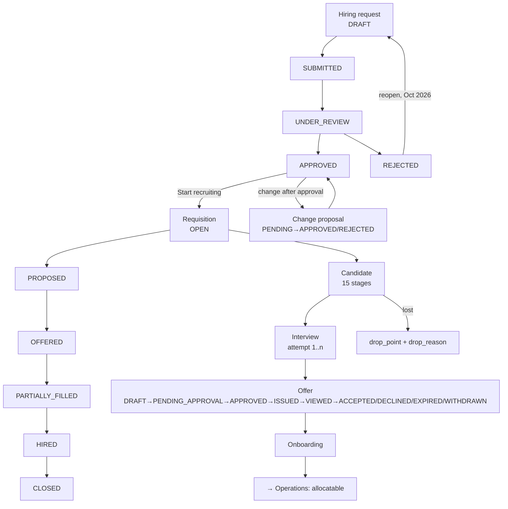

# 4 — RECRUITMENT & WORKFORCE

**Menu:** left rail → **Recruitment** → `/recruitment`
**Screens:** 29 in or from this area; **17 gated by the `hiring` module**
**Who can open it** (measured): Master Admin · Business Director · Branch
Manager · Operation Manager · Coordinator. **Inspector and Finance refused.**
Per the permission matrix: BM, OM and CO **edit**; BD and SBU **view**; FINANCE
and INSPECTOR **nothing**.

> **This area was rebuilt in October 2026** — the duplicate home was retired,
> the hiring request gained change-control, the interview panel was fixed, and
> every recruitment screen moved from the Operations menu into its own. So it is
> the most recently worked, best-documented part of the system: **9 of the 26
> lifecycle sections** in `docs/03-object-lifecycles.md` are recruitment
> objects.

---

## Status at 19 Oct 2026 — what changed since this document was first written

*First issued 18 Oct 2026. The changes below are in the code on branch `claude/testing-branch-setup-0gqe8n`; they reach the live site only when it is updated (`../14-LIVE-CHECKS-GUIDE.md`, Part 2). Statements in the body that they made untrue are corrected where they stand and marked **(updated 19 Oct)**.*

| Change | What it means in this area | Ref | How it was verified |
|---|---|---|---|
| `mgh-hire/` is dormant | The owner has seen only its first screen; it was never deployed or connected. Marked dormant in its README; **not a duplication question any more** | Q-C, GAP-007 | Owner's answer |
| No other change in this area | The recruitment screens, fields and flows below are as first measured | — | — |

---

## 1. The thing to understand first: this area runs two different businesses

Reading the candidate record's own fields makes it unmistakable:

| Internal hiring — staff onto your payroll | Client manpower supply — people sold to a client |
|---|---|
| `requisition_id`, `position_id`, `hiring_department_id` | `client_id`, `call_id`, `proposed_site` |
| Organogram Verification · HOD Shortlisting | `submitted_client_date`, `client_feedback`, `client_feedback_date`, `client_feedback_note` |
| `min_qualification`, Salary Structure, HR Discussion | `agency_id`, `agency_cost`, `placement_fee`, `roll_type` |
| Offer Letter · Offer Acceptance · Onboarding | Deputation to a site → Operations |

**The same candidate record, the same 15-stage pipeline, serves both.** A CV can
be screened to join your company, or screened and *submitted to a client* who
gives feedback and accepts or rejects them.

That is an efficient design — one pipeline, one register.

### ~~"EXAACT has four ways to match a person to work"~~ — WITHDRAWN, corrected by the owner 2026-10-18

I wrote that Recruitment, Deputation, Marketplace and `mgh-hire/` were **four
implementations of one idea** that would inevitably diverge, and asked which was
"the business". **That was wrong, and it was the most consequential thing I got
wrong in the audit.**

**They are one supply chain with two branches and an engagement basis:**

| | What it actually is |
|---|---|
| **Recruitment** | The **internal** branch — hiring into your own organisation, and supplying people to clients |
| **Marketplace** | The **external** branch — when a position is open and **no suitable manpower is available internally**, you search the market *by location* for somebody suitable (subscription required) |
| **Deputation** | Not a module competing with either. It is an **engagement basis** — man-day or man-month — alongside **direct on-roll** (`roll_type` = OWN) |
| **`mgh-hire/`** | ~~The only genuine duplication question left.~~ **(updated 19 Oct)** **Dormant** — never deployed or connected; the owner has seen only its first screen (Q-C). A standalone product, 2,555 lines, own tables, no shared code |

**And the two branches are joined in code.** `recruit_pro_pool($req)`
(`lib/recruit.php:754`) scores every active marketplace professional against a
requisition and returns the ranked shortlist:

> *"a recruiter filling a requisition **automatically sees benched / verified
> people from the marketplace who fit** — not only existing candidate rows."*

`recruit_pro_fit_score()` scores on **`base_city`, `preferred_locations`,
`pan_india`** — the location match — plus `disciplines`, `skills`,
`work_types`, `availability`, `verification_tier` and the day-rate band, and it
returns **explainable `factors`**, not just a number, so a recruiter can see
*why* somebody fits.

`candidate-link-pro` / `candidate-unlink-pro` then link that professional to a
candidate row — which is what **`/candidate-pool` ("candidate pool
convergence")** is for. I had listed that screen as having no door and no
confirmed purpose; **it is the convergence point of the internal and external
branches**, and it deserves a door rather than retirement.

Full description, with the engagement bases and the billing bridge, in
`02-MARKETPLACE.md` §1.

**Why I got it wrong:** I inferred "four competing implementations" from the
*absence of a link in the navigation*, having never read `recruit_pro_pool()`,
`connect_bridge.php` or `candidate-link-pro` — all in files my route inventory
never covered. **Absence of evidence in an incomplete map is not evidence of
absence**, and I graded it "CONFIRMED (absence)", which was the wrong grade
entirely. Same root cause as `../00a-ERRATUM-COVERAGE.md`.

---

## 2. The area home — `/recruitment`

| | |
|---|---|
| Heading | **Recruitment & Workforce** · module `hiring` |
| Fields | `fy`, `month`, `dept`, `source`, `manager` — five filters |
| Controls | **＋ New hiring request** · **＋ Add candidate** · **Requisitions** · **Hiring requests** · **Candidates** · **🧮 Project costing** · **⚙️ Setup ▾** · **⬇️ Export ▾** |

A working home screen, not a tile grid: two primary actions, three registers,
and two menus. The **Today / Risks / Opportunities** triage panel added in
October lives here.

**History worth knowing:** there used to be two recruitment homes
(`/recruitment` and `/recruitment-cc`) showing different things. They were
merged; `/recruitment-cc` now redirects. If anyone has the old URL bookmarked it
still works.

---

## 3. Every screen, in depth

### 3.1 `/hiring-requests` — Hiring requests register

| | |
|---|---|
| Module `hiring` · no own fields |
| Controls | **+ New request** · **Requisitions →** |
| Columns | Request · What · Department · **How many** · **Est. cost** · **Needed by** · Priority · Status |

**Est. cost on the register** is the right call: a manager approving a hire
should see what it costs without opening the record.

### 3.2 `/hiring-request` — New hiring request / the record

| | |
|---|---|
| Module `hiring` · **30 fields, 3 required** (`job_title`\*, `quantity`\*, `required_by`\*) |
| Controls (new) | **＋ Add another line** · **Create request** · **×** |
| Controls (record) | **Start recruiting** · **Propose this change** · **+ Add another line** · **← Recruitment** |
| Statuses | `HREQ_STATUS` = DRAFT · SUBMITTED · UNDER_REVIEW · APPROVED · REJECTED · CANCELLED, **plus REJECTED → DRAFT** |

Fields: `requested_by_id`, `requesting_department_id`, `job_title`\*,
`designation`, `hiring_department_id`, `position_id`, `job_description`,
`min_qualification`, `min_experience_years`, **`skills_grp_mode[]` /
`skills_grp_items[]`**, **`qual_grp_mode[]` / `qual_grp_items[]`**,
`quantity`\*, `office_id`, `work_location`, `project_ref`, `required_by`\*,
`employment_type`, `priority`.

**The requirement builder (`*_grp_mode` / `*_grp_items`)** is the "all of / any
one of" feature built in October: a requirement can be *(CSWIP **OR** ASNT)
**AND** (B.E. **OR** Diploma)*. The mode is per group; the text rendering joins
groups with AND and items with OR or commas, and brackets a group only when
there are several.

**Change control, when the request is already APPROVED:**
- The record screen shows **Propose this change** instead of a plain save.
- `change_reason` is required.
- A table renders: **What changes · Approved now · Proposed · Why it needs a
  decision** — so an approver sees exactly what is being altered and why it
  needs re-approval.
- Statuses `RVER_STATUSES` = PENDING · APPROVED · REJECTED · WITHDRAWN.

**This is the best-designed change-control flow in the application** and it
exists because an approved hiring request used to be editable with no trace.

**FINDING (R-F1, P2) — an empty submit is refused, and says nothing.**
Of eight creation forms tested, this is the only one that refuses silently: the
page re-renders identically with no message. The person presses **Create
request** and nothing appears to happen. Compare `/internal-audit-new`:
*"Name the auditor. An audit with no auditor on it is not evidence."*
*(`evidence/entry-form-feedback.json`.)*

### 3.3 `/requisitions` — Requisition register

| | |
|---|---|
| Module `hiring` · no own fields · Control: **➕ New requisition** |
| Statuses | `REQ_STATUS` = OPEN · PROPOSED · OFFERED · PARTIALLY_FILLED · HIRED · CLOSED (+1) |

An approved hiring request becomes a **requisition** — the live vacancy that
candidates are attached to. **PARTIALLY_FILLED** is a thoughtful state: a
request for eight people is rarely filled all at once.

**`REQ_STATUS` has no lifecycle section** — one of the 44 undocumented
vocabularies, and it governs the record that joins requests to candidates.

### 3.4 `/candidates` — Candidate register

| | |
|---|---|
| Module `hiring` · no own fields |
| Controls | **+ Add candidate CV** · then stage tabs with live counts: **All** · **CV received (0)** · **Submitted to client (0)** · **Shortlisted (0)** · **Interview scheduled (0)** · **Offer released (0)** · **Offer declined (backed out) (0)** · **On hold (0)** · **Rejected (0)** |
| Columns | CV · Candidate · Trade · Client · **Proposed site** · Exp (yrs) · Source · Stage · Actions |

**The tabs carry counts**, which is how a register should work — you see where
the pipeline is clogged before clicking. And note **"Offer declined (backed
out)"** — plain language for the thing that actually happens, rather than a
code word.

**The columns show the dual business again:** `Client` and `Proposed site` are
manpower-supply columns, sitting beside `Trade` and `Exp (yrs)`.

### 3.5 `/candidate-new` — Add candidate CV

| | |
|---|---|
| Module `hiring` · **28 fields, 2 required** (`requisition_id`\*, `first_name`\*) |
| Controls | **Extract →** · **Add candidate** · **Add & select** · **Cancel** · **← Recruitment** |

Fields: `cv_file`, `cv_text`, `requisition_id`\*, `first_name`\*,
`middle_name`, `last_name`, `experience_years`, `email`, `mobile`, `client_id`,
`call_id`, `proposed_site`, `group_id`, `trade_id` …

**`Extract →`** reads a CV file or pasted text and fills the form. The right
feature for a recruiter handling CVs in volume.

**FINDING (R-F2, P1) — an empty submit creates `CV-00001`.** Despite
`requisition_id` and `first_name` being marked required, the server accepts an
empty post and creates a candidate. Opening it shows the heading
**"(no name) CV received"** — the application displays the ghost gracefully,
which is good, but the record is in the pipeline and has consumed a CV number.

*Note the nuance: this form marks two fields required and still creates the
record. So the `required` attribute is present but the server does not enforce
it — a different failure from `/call-new`, which marks nothing.*

### 3.6 `/candidate?id=…` — the candidate record

**The deepest workflow screen in EXAACT: 106 fields, 38 controls, 146 KB.**

The controls are a **numbered 15-stage pipeline**:

| # | Stage | What happens |
|---|---|---|
| 1 | *CV received* | the starting state |
| 2 | **Organogram Verification** | does the position exist in the org chart and is it sanctioned? |
| 3 | **Candidate Sourcing** | where the person came from |
| 4 | **CV Screening** | first filter |
| 5 | **HOD Shortlisting** | the hiring department's own choice |
| 6 | **L1 Interview** | first interview round |
| 7 | **Document Collection** | certificates, identity |
| 8 | **Salary Structure** | build the offer |
| 9 | **HR Discussion** | the conversation about the offer |
| 10 | **Salary Acceptance** | they agree the number |
| 11 | **Reference Verification** | checks |
| 12 | **One-Pager Approval** | the summary that gets signed off |
| 13 | **Offer Letter** | issued |
| 14 | **Offer Acceptance** | they sign |
| 15 | **Onboarding** | they join |

Plus: **Advance → \<next stage\>** (one-click progression), **Apply**,
**Analyse & save keywords**, **Save tracking**, **Update stage**, **Save notes**.

Field groups:

| Group | Fields |
|---|---|
| **Client submission** | `submitted_client_date`, `client_feedback`, `client_feedback_date`, `client_feedback_note` |
| **Interviews** | `interview_required`\*, `interview_date`, `interview_done_date`, `interview_outcome` |
| **Commercials** | `agency_id`, `agency_cost`, `placement_fee`, `roll_type`, `team_role`\* |
| **Why we lost them** | **`drop_point`**, **`drop_reason`** |
| **Working notes** | `remark`, `notes`, `to_stage`, `pipeline_id`, `cv_file`, `cv_text` |

**`drop_point` + `drop_reason` is excellent instrumentation.** Recording *where*
in fifteen stages a candidate was lost and *why* is what lets a business fix its
funnel rather than guess at it. Most systems record only "rejected".

**Interview behaviour** (built in October, `lib/recruit_iv.php`): a panel is
chosen from a department-grouped picker with search; re-interviews are supported
via an `attempt` counter; the outcome prompts a stage move; and panel members
see their own diary at **`/my-interviews`** — a screen deliberately *not* gated
on recruitment access, so an interviewer who is not a recruiter can still see
what they must attend.

**FINDING (R-F3, P2) — 106 fields and 38 controls on one screen.** This is the
busiest screen in the system after `/connect-qualifications`. It is defensible
(a candidate genuinely has this much state) but it is not usable on a phone, and
a recruiter new to it will not find the control they need. *Consider collapsing
the 15 stages into the current stage plus a history.*

### 3.7 `/recruit-pipelines` — Hiring workflows

| | |
|---|---|
| Module `hiring` · **205 fields, 21 required** |
| Controls | **＋ New workflow** · **Save workflow** · **Save** · **Add stage** |
| Columns | **Order · Stage · Type · Responsible · Condition · SLA** |
| Scoping fields | `applies_company`, `applies_sbu`, `applies_department`, `applies_position`, `applies_employment`, `applies_grade`, `applies_location` |
| Stage fields | `seq`, `name`, `kind`, `responsible_role` |

**The 15-stage pipeline above is configurable, not hard-coded.** A workflow can
differ by business unit, department, position, employment type, grade or
location — so hiring a site welder can follow a shorter path than hiring a
manager, and each stage has a **responsible role**, a **condition** and an
**SLA**.

This is genuinely enterprise-grade workflow configuration. It is also a
205-field screen, which is the price.

### 3.8 `/recruit-approvals` — Recruitment approvals

| | |
|---|---|
| Module `hiring` · 3 fields | `self_approval`, `master_exception`, `trigger_redefined` |
| Controls | **＋ New rule** · **Save policy** · **Save triggers** |

Three policy switches that matter:
- **`self_approval`** — may a person approve their own hiring request?
- **`master_exception`** — may the master administrator bypass the chain?
- **`trigger_redefined`** — does redefining a requirement re-trigger approval?

**These are exactly the right three questions**, and the third is the one most
systems get wrong — changing the requirement after approval without
re-approving is the hole that the change-control flow (§3.2) closes.

*This screen was moved out of the "Report configuration" tab into its own
Approvals section in October, after the owner pointed out that recruitment
approvals were filed under reporting.*

### 3.9 `/approval-delegations` — Approval delegation

| | |
|---|---|
| Module `hiring` · 7 fields, **2 required** (`delegator_user_id`\*, `delegate_user_id`\*) |
| | `entity`, `office_id`, `effective_from`, `effective_to`, `reason` |
| Controls | **Add delegation** |
| Columns | **Who is away · Acting for them · Applies to · Branch · From · To · State · Reason** |

**"Who is away" / "Acting for them" as column headings** is a small thing that
matters: it is written for the person using it, not for the database. Dated
delegation with a reason is the correct design for an approval chain that must
not stall when somebody is on leave.

### 3.10 `/positions`, `/positions-org`, `/positions-import` — the organogram

| Screen | Fields | Controls |
|---|---|---|
| `/positions` — Position master | **12, 1 required** (`name`\*): `code`, `grade`, `department`, `sbu`, `level`, `reports_to_id`, `office_id`, `hod_name`, **`sanctioned_headcount`**, **`occupied_headcount`**, **`budgeted_headcount`** | **＋ New position** · **Save position** · **Org chart →** |
| `/positions-org` — Organisation chart | none | **🏛️ Departments** · **⬆ Import organogram** · **← Positions** |
| `/positions-import` — Import organogram | 2: `file`, `data` | **Read & preview** · **← Positions** |

**Three headcounts per position — sanctioned, occupied, budgeted** — is proper
establishment control: you can see that a position is budgeted for three,
sanctioned for two and filled by one. This is what "Organogram Verification"
(stage 2 of the candidate pipeline) checks against.

**`Read & preview` before importing** is the right pattern for a bulk import —
see what will happen before it happens.

### 3.11 `/departments` — Departments

19 fields (a repeating `department` grid), controls **🏛️ Department list** ·
**🗂️ Org chart** · **⬆ Import organogram**. **No module gate.**

### 3.12 `/comp-setup` — Compensation setup

| | |
|---|---|
| **No module gate** · **74 fields, 0 required** |
| Fields | `comp_basic_pct`, `comp_balance_code`, then repeating `sort`, `name`, `code`, `calc`, `rate`, **`statutory`** |
| Controls | **Save** · **Off** · **Add** |
| Columns | **Order · Heading · Code · Calculation · Rate % · Statutory** |

The salary-structure builder: components in order, each with a calculation, a
rate and a **statutory** flag (PF, ESI, professional tax). `comp_basic_pct` and
`comp_balance_code` mean the structure can be driven from basic pay with a
balancing component — the standard Indian CTC pattern.

**This is a configuration grid, so "0 required" is correct** — not a validation
defect. (Contrast `/candidate-new`, where it is.)

**It has no module gate**, and it holds salary structure. It did not appear in
the GAP-008 shortlist because it refuses a least-privileged role — but *which*
right protects it is worth confirming in Phase F.

### 3.13 `/careers-admin` — Careers page

| | |
|---|---|
| Module `hiring` · 6 fields | `careers_enabled`, `careers_intro`, `about`, `offer`, `apply`, `tone` |
| Controls | **Save settings** · **Save posting defaults** · **Open public page ↗** |

A public careers page, with a **`tone`** setting for the generated copy.
**`Open public page ↗`** lets you see what the world sees — the right control.

**This is a public-facing write surface** (applications arrive from it) and it
deserves the same attention as `/join` in Marketplace. Not separately tested
here.

### 3.14 `/candidate-pool` — Candidate pool convergence

Module `hiring`, no fields, one control: **← Recruitment**.

**One of the twelve screens with no menu door** (GAP-002), and the only way in
is this audit. "Convergence" suggests de-duplicating candidates who arrive from
several sources (agency, careers page, marketplace, direct) — which, with four
ways to source people, is a real need. *Its purpose should be confirmed with the
owner before deciding whether to give it a tile or retire it.*

### 3.15 `/doc-templates` — Document Studio

**No module gate** · 3 fields (`company_address`, `doc_letterhead`,
`doc_footer`) · controls **＋ New template** · **Save letterhead**.

Offer letters and recruitment paperwork. **Note this is a *third* template
screen**, alongside `/templates` and `/crm-templates` (both headed "Document
templates" — see `01-SALES.md` S-F3). Three template systems in one
application.

### 3.16 Shared screens reached from here

`/availability`, `/schedule`, `/capacity-outlook`, `/jobs`, `/call-new` belong
to **Operations** (`03-OPERATIONS.md`); `/hierarchy` to **Admin**;
`/approval-rules`, `/approvals-setup`, `/approver-map` to the shared
**Approvals** workbench; `/project-costings` to **Sales**.

The recruitment home links to Operations' workforce screens because a newly
hired inspector must become allocatable — which is the correct join, and the
reason this area is called "Recruitment **& Workforce**".

---

## 4. Statuses

**Documented:** Hiring request, Candidate, Interview, Candidate document, Job
offer, Requirement change proposal, Requirement review, Fulfilment allocation,
Approval request — 9 sections. **Undocumented:** `REQ_STATUS` (the requisition
itself), `DOC_STATUSES` partially, `REQF_MANUAL_STATUSES`.

**The job offer has 9 states** including **VIEWED** — knowing the candidate
opened the offer, before they accept or decline, is a real recruiting advantage.

---

## 5. Data flow

### Arrives from

| From | What | Grade |
|---|---|---|
| **Admin / Organisation** | Positions, departments, the org chart, `reports_to_id`, the three headcounts — what stage 2 (Organogram Verification) checks | **CONFIRMED** |
| **Admin / Users** | `requested_by_id`, approver and delegate identities | **CONFIRMED** |
| **Directory / Masters** | Trades (`trade_id`), groups, sources, employment types, grades | **CONFIRMED** |
| **Operations** | `call_id` on a candidate — a candidate proposed against a specific work order | **CONFIRMED** (the field exists) |
| **Directory / Clients** | `client_id`, `proposed_site` for manpower supply | **CONFIRMED** |
| **Public** | Applications from the careers page | **READ** |
| **Agencies** | `agency_id`, `agency_cost` — candidates sourced through an agency | **CONFIRMED** (fields exist; `agencies` table) |
| **Marketplace** | **The ranked professional shortlist for a requisition** — `recruit_pro_pool()`, scored on location, discipline, skills, work type, availability and verification tier. `candidate-link-pro` links a professional to a candidate row | **READ** — `lib/recruit.php:754` *(I first recorded this as "nothing automatic" — wrong)* |

### Leaves for

| To | What | Grade |
|---|---|---|
| **Operations** | A hired person becomes allocatable — appears in `/availability`, `/schedule`, assignable to jobs | **READ** |
| **Operations / Deputation** | Supplied manpower placed at a client site | **READ** |
| **Money** | `placement_fee` (what we charge), `agency_cost` (what we pay), salary structure from `/comp-setup` → cost of the person | **READ** — *not reconciled; see `../07-DASHBOARD-AND-KPI-AUDIT.md`* |
| **Money / Project costing** | Team cost build-ups feed the quote's floor price | **CONFIRMED** (the link exists on the home) |
| **Quality** | Competence records, identity documents, certificates collected at stage 7 | **READ** |
| **Insights** | Funnel, time-to-hire, `drop_point` analysis, source effectiveness | **SUSPECTED** — the data exists; whether a screen shows it was not confirmed |
| **The candidate** | Offer letter from Document Studio; the careers page | **READ** |

---

## 6. Scenarios

### S-1 — Hire two inspectors onto the payroll

1. **Recruitment → ＋ New hiring request.** `job_title`\*, `quantity`\* = 2,
   `required_by`\*, the hiring department, the position, and the requirement
   using the builder: **all of / any one of** — e.g. *(CSWIP 3.1 **OR** ASNT
   Level II) **AND** (B.E. **OR** Diploma)*. **Create request.**
   *If nothing happens when you press Create, the form was incomplete and the
   screen will not tell you — R-F1.*
2. Status DRAFT → SUBMITTED → UNDER_REVIEW. It appears in **Approvals →
   Waiting** for whoever the recruitment approval rules name. The three policy
   switches in `/recruit-approvals` decide whether the requester can approve
   their own, whether the master may bypass, and whether a later change
   re-triggers approval.
3. Approved. The record shows **Start recruiting** → a **requisition** opens.
4. **＋ Add candidate CV.** Attach `cv_file` or paste `cv_text`, press
   **Extract →** to fill the form, pick the `requisition_id`\*, set
   `first_name`\*. **Add candidate.**
5. Work the 15 stages on the candidate record, pressing **Advance →** at each
   step: Organogram Verification (is the position sanctioned? check the three
   headcounts) → CV Screening → HOD Shortlisting → **L1 Interview**.
6. The interview panel is picked from a department-grouped list with search.
   Panel members see it in **their own diary at `/my-interviews`**, whether or
   not they have recruitment access. A second attempt is recorded as a
   re-interview rather than overwriting the first.
7. Outcome recorded → the screen prompts the stage move.
8. Document Collection → **Salary Structure** (built from `/comp-setup`
   components, with statutory items flagged) → HR Discussion → Salary
   Acceptance → Reference Verification → One-Pager Approval.
9. **Offer Letter** issued from Document Studio. Status DRAFT →
   PENDING_APPROVAL → APPROVED → ISSUED → **VIEWED** → ACCEPTED.
10. **Onboarding.** Requisition → PARTIALLY_FILLED (one of two), then HIRED and
    CLOSED when both are in.
11. The new inspector appears in **Operations → Team member availability** and
    can be allocated to jobs.

### S-2 — Supply four welders to a client's site

1. The client's need arrives as a **work order** in Operations, or as a
   **deputation** requirement.
2. **Recruitment → ＋ Add candidate CV** for each person, setting `client_id`,
   `call_id` and **`proposed_site`** — the manpower-supply fields.
3. Screen them, then set **`submitted_client_date`** — they have gone to the
   client.
4. The client replies: record **`client_feedback`**, `client_feedback_date`,
   `client_feedback_note`. The register's **Submitted to client** and
   **Shortlisted** tabs track the whole batch.
5. Accepted candidates → offer → onboarding, with `roll_type` recording whose
   payroll they sit on, `agency_id` / `agency_cost` if sourced through an
   agency, and **`placement_fee`** for what the client is charged.
6. **→ Operations → Deputation & site operations**: positions, planned,
   mobilised, through the 31 deputation states.

### S-3 — The approved request has to change

1. The request is **APPROVED** and recruiting has started, but the requirement
   was wrong — six months, not sixteen.
2. Open the hiring request. Because it is approved, the screen offers
   **Propose this change**, not a plain save.
3. Make the change and give a **`change_reason`** (required).
4. The approver sees a table: **What changes · Approved now · Proposed · Why it
   needs a decision.**
5. They approve or reject the *change*, not the whole request. The original
   approval history is intact.

**Before October 2026 this was impossible** — an approved request could be
edited silently, or rejected and retyped from scratch, losing the discussion and
the approval trail. A **REJECTED → DRAFT** reopen was added at the same time, so
a request rejected for a typo no longer has to be abandoned.

### S-4 — Setting Recruitment up from nothing

1. **Admin → Organisation & people**, then **Recruitment → Position master**:
   build the establishment — positions with `grade`, `level`, `reports_to_id`,
   and **sanctioned / occupied / budgeted** headcounts. Or
   **⬆ Import organogram** → `/positions-import` → **Read & preview** first.
2. **Departments** → the department list and org chart.
3. **Compensation setup** (`/comp-setup`): salary components in order, each
   with a calculation, a rate and a **statutory** flag.
4. **Hiring workflows** (`/recruit-pipelines`): define the stage sequence, who
   is **Responsible** for each, the **Condition** and the **SLA** — and scope
   the workflow by business unit, department, position, employment type, grade
   or location. Different paths for a site welder and a manager.
5. **Recruitment approvals** (`/recruit-approvals`): decide `self_approval`,
   `master_exception`, `trigger_redefined`.
6. **Approval delegation**: who acts for whom when somebody is away, with dates
   and a reason.
7. **Careers page** (`/careers-admin`): turn it on, write the intro, set the
   `tone`, press **Open public page ↗** to see what applicants see.
8. **Document Studio** (`/doc-templates`): letterhead and the offer-letter
   template.

---

## 7. Edge cases

| # | Edge case | What happens | Grade |
|---|---|---|---|
| E-1 | Press **Create request** with the form empty | **Refused, and nothing is said.** The page re-renders identically. The only silently-refusing form of the eight tested | **CONFIRMED by execution** |
| E-2 | Submit **Add candidate** empty | **Creates `CV-00001`**, shown as **"(no name) CV received"** — despite two fields being marked required | **CONFIRMED by execution** |
| E-3 | A request is approved, then the requirement changes | Handled properly: **Propose this change** + required reason + a what-changed table + re-approval | **CONFIRMED** (built and tested in October) |
| E-4 | A request is rejected over a typo | **REJECTED → DRAFT** reopen, so the history survives | **CONFIRMED** (`test_hreq_reopen.php`) |
| E-5 | A candidate is interviewed twice | Supported — an `attempt` counter records a re-interview rather than overwriting | **CONFIRMED** |
| E-6 | A panel member has no recruitment access | **`/my-interviews` is deliberately not gated on it** — they still see their diary | **CONFIRMED** |
| E-7 | Hiring eight people, three accept | **PARTIALLY_FILLED** exists for exactly this | **READ** |
| E-8 | A candidate backs out after accepting | The register has **"Offer declined (backed out)"** as its own tab; `drop_point` + `drop_reason` record where and why | **CONFIRMED** (the tab exists) |
| E-9 | Hiring into a position with no sanctioned headcount left | Stage 2 **Organogram Verification** is the control, and the three headcounts are on the position. Whether it *blocks* is untested | **UNTESTED** |
| E-10 | The approver is on leave | **Approval delegation** with dates and a reason; `/approver-map` also has **temp cover** with From/To | **CONFIRMED** (both screens exist) |
| E-11 | A person approves their own request | Governed by the **`self_approval`** switch | **READ** |
| E-12 | The same candidate arrives from an agency and the careers page | `/candidate-pool` ("convergence") appears to exist for this — **but it has no door and its purpose is unconfirmed** | **UNTESTED** |
| E-13 | A hiring workflow is changed while candidates are mid-pipeline | `pipeline_id` is stored on the candidate, which suggests they keep the workflow they started on. Not verified | **SUSPECTED** |
| E-14 | Two recruiters edit one candidate at once | **No protection** — `candidates` is outside the `['calls','jobs']` concurrency allow-list. Last save wins | **CONFIRMED** (the allow-list) |
| E-15 | Finance needs to see what a hire will cost | **Finance cannot open Recruitment at all** (403). `Est. cost` is on the register, but not to them | **CONFIRMED** |

---

## 8. Findings raised in this area

| Id | Severity | Finding |
|---|---|---|
| **R-F2** | **P1** | `/candidate-new` creates `CV-00001` from an empty submit **although two fields are marked required** — the attribute is there, the server does not enforce it |
| ~~R-F4~~ | — | ~~Four implementations of matching people to work~~ — **WITHDRAWN** by the owner's correction of 2026-10-18. Recruitment and Marketplace are the **internal and external branches of one supply chain**, joined by `recruit_pro_pool()`; deputation is an **engagement basis**, not a module. **`mgh-hire/` remains the only genuine duplication question** (GAP-007, Q-C). See §1 |
| **R-F1** | **P2** | `/hiring-request` refuses an empty submit **silently** — the only one of eight tested that says nothing |
| **R-F3** | **P2** | The candidate record carries **106 fields and 38 controls**; `/recruit-pipelines` carries 205 |
| **R-F5** | **P2** | `/candidate-pool` has **no menu door** — and its purpose is now confirmed: it is where the **internal pipeline and the marketplace pool converge** (`candidate-link-pro`). It should get a door, not be retired |
| **R-F6** | **P2** | `/comp-setup` holds salary structure and has **no module gate** |
| **R-F7** | **P3** | A **third** template system (`/doc-templates`), alongside `/templates` and `/crm-templates` |
| **R-F8** | **P3** | `REQ_STATUS` — the requisition's own 7 states — has no lifecycle section |
| **R-F9** | — | *Credit, and there is a lot of it:* the **all of / any one of** requirement builder · change-control on an approved request with a what-changed table · **REJECTED → DRAFT** · `drop_point` + `drop_reason` · **VIEWED** on an offer · **PARTIALLY_FILLED** · sanctioned/occupied/budgeted headcount · **Read & preview** before an organogram import · dated approval delegation with "Who is away / Acting for them" · `/my-interviews` ungated for panel members · the three approval policy switches · stage counts on the register tabs · **"Offer declined (backed out)"** in plain English |

**This is the strongest area in the application.** It is also the most recently
worked, which is the lesson: the quality is a function of attention, not of
anything inherent to the module.
