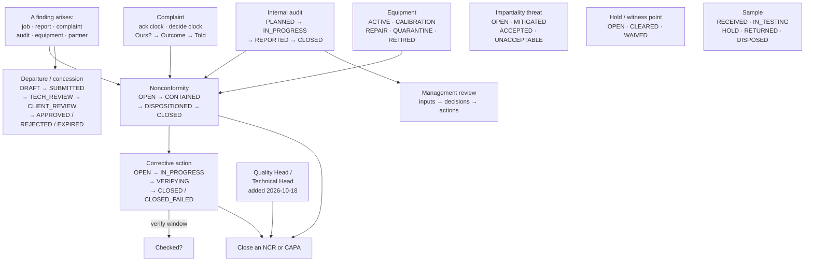

# 5 — QUALITY & ACCREDITATION

**Menu:** left rail → **Quality & Accreditation** → `/quality`
**Screens:** 25 in or from this area; **23 tiles in two named sections**
**Modules:** `ncr`, `capa`, `complaints`, `competence`, `impartiality`,
`confidentiality`, `identity`, `audits`, `datacontrol`, `equipment`
**Who can open the area:** all seven roles can open `/quality` — correct,
because the hub shows only the tiles you can use. Behind it, access varies
sharply; see §2.

The area describes itself: *"Two halves: the everyday quality work you touch
during jobs, and the accreditation registers an assessor asks for."* That is
exactly right, and the two sections are named **Everyday quality** and
**Accreditation registers**.

---

## 1. What this area is for

EXAACT is software for an **inspection body**, and an inspection body lives or
dies by its accreditation. This area is the ISO/IEC 17020 machinery: the records
an assessor will ask to see, and the day-to-day controls that produce them.

Judged on coverage, **this is a serious implementation.** Equipment and
calibration, competence and authorisation, impartiality and conflicts of
interest, confidentiality undertakings, complaints and appeals, nonconformities
and corrective actions, deviations and concessions, internal audits, management
review, control of data and information, identity documents gating site access,
hold and witness points, items and samples, client acceptance of reports — all
present, with sensible fields.

**And it is the worst-documented area in the system.** That contrast is the
headline of this document:

| | |
|---|---|
| Lifecycle sections in `docs/03-object-lifecycles.md` for Quality objects | **0** |
| Mentions of "NCR" in that document | **0** |
| Mentions of "corrective action" | **0** |
| Mentions of "equipment", "sample", "internal audit" | **0 each** |
| Rows in `docs/02-permission-matrix.md` for NCR / CAPA before this audit | **0** |
| Status vocabularies this area uses | **at least 14** |

So the functionality an assessor would be impressed by is governed by no written
rule about who may do what, or which state may follow which. The CLAUDE.md
control — *never add a status that is not in `03-object-lifecycles.md`* — cannot
bite here, because the document has no Quality sections to add to.

**Two of those gaps were closed during this audit:** NCR and CAPA rows were
added to the permission matrix, and the **Quality Head** and **Technical Head**
roles were created on the owner's rule *"only Quality or Technical Head can
close it"*. The rest remain.

---

## 2. Who can actually reach what — measured

This is the area where role access diverges most, so it is worth stating before
the screens.

| Screen | MA | BD | BM | OM | CO | INS | FIN | QH/TH |
|---|---|---|---|---|---|---|---|---|
| `/quality` (hub) | ✓ | ✓ | ✓ | ✓ | ✓ | ✓ | ✓ | ✓ |
| `/ncr`, `/issues`, `/departures` | ✓ | ✓ | **403** | **403** | **403** | **403** | **403** | **✓** |
| `/capa` | ✓ | ✓ | ✓ | ✓ | ✓ | 403 | 403 | ✓ |
| Close an NCR or CAPA | ✓ | ✗ | ✗ | ✗ | ✗ | ✗ | ✗ | **✓** |

**Three things follow from that table:**

1. **Five roles can see a corrective action but not the nonconformity behind
   it** (SBU Head, Branch Manager, Operation Manager, Coordinator, Assistant
   Manager). You are shown the remedy with the finding hidden. *This reads as a
   broken screen rather than a permission, and it is **open question Q-B2**.*
2. **An inspector can reach neither** — the person who meets the nonconformity
   on site cannot record or read one. *Open question Q-B1.*
3. **Until 2026-10-18, only a system administrator could close either**, which
   for an accredited body is both a bottleneck and a segregation-of-duties
   weakness. Fixed with the two new quality roles.

**Also fixed during this audit (GAP-011):** the Quality hub offered the
**"Nonconformity workspace"** tile to anyone holding *either* module and always
pointed it at an NCR screen — so Branch Manager, Operation Manager and
Coordinator were each shown a door that answered **403**. The tile now reads
**"Corrective actions"** and goes to `/capa` for those roles. Verified by
driving it as all seven roles.

**One structural dependency to know:** several tiles here appear only when
`connect_cap_owner_does_inspection()` is true — i.e. when
**Marketplace → Company business capabilities** says this company performs
inspection. Turning a capability off there silently removes tiles here
(`02-MARKETPLACE.md` M-F7).

---

## 3. Everyday quality — the screens you touch during live jobs

### 3.1 `/issues` — the nonconformity workspace

| | |
|---|---|
| Module `ncr` · 1 field (`status`) |
| Controls | **Filter** · **Deviations & concessions** · **NCR register** · **Issue reports** |

The umbrella register, with a tab strip carrying you across the family. The tile
describes it as *"Issues, NCRs, corrective actions and departures — one screen
with tabs"*, and unlike the Billing workspace's equivalent claim, this one is
accurate.

### 3.2 `/ncr` — Nonconformities

| | |
|---|---|
| Module `ncr` · 11 `cols[]` fields — **a column chooser** |
| Controls | **Apply** · **+ Raise a nonconformity** · **⬇ CSV** |
| Columns | **Ref · Severity ▲ · What was wrong · Where it came from · Branch · Owner / due · Disposition · Corrective action** |
| Statuses | `NCR_STATUS` = **OPEN → CONTAINED → DISPOSITIONED → CLOSED** |

**The column headings are written for a human**: *"What was wrong"*,
*"Where it came from"*, *"Owner / due"*. Not `description`, `source_type`,
`assignee_id`. This is the Zero Training UI standard being met.

**`CONTAINED` as a distinct state is the mark of real quality practice** —
stopping the bleeding is not the same as fixing the cause, and a system that
collapses the two cannot show an assessor that containment happened first.

The nonconformity's source is modelled properly: the `nonconformities` table
carries `job_id`, `report_doc_id`, `complaint_id`, `audit_finding_id`,
`equipment_id`, `partner_id` — a finding can arise from a job, a report, a
complaint, an internal audit or a piece of equipment, and the link is kept.

### 3.3 `/capa` — Nonconformities & corrective actions

| | |
|---|---|
| Module `capa` · 2 fields: **`capa_due_days`**, **`capa_verify_days`** |
| Controls | **Save** · **Raise one** |
| Columns | Ref · Raised · What · From · Owner · **Due** · **Checked?** · State |
| Statuses | `CAPA_STATUS` = OPEN → IN_PROGRESS → **VERIFYING** → CLOSED / **CLOSED_FAILED** |

Two configurable clocks: how long a corrective action has, and how long after
closure before it must be **verified as effective**.

**`VERIFYING` and `CLOSED_FAILED` are the two states that separate a real CAPA
system from a to-do list.** A corrective action that was carried out but did not
work is recorded as having failed, rather than quietly closed — which is exactly
what an assessor looks for, and what a business needs in order to stop repeating
the same fix.

**The `Checked?` column** is the verification flag on the register, so an
unverified closure is visible without opening anything.

### 3.4 `/departures` — Deviations, concessions & waivers

| | |
|---|---|
| Module `ncr` · **13 fields, 1 required** (`title`\*) |
| | `kind`, `client_id`, **`requirement`**, **`planned_condition`**, **`actual_condition`**, **`reason`**, **`justification`**, **`risk`**, **`compensating_controls`**, `valid_from`, `valid_to`, **`temporary`** |
| Controls | **Create — starts as Draft** |
| Statuses | `NCDCA_DEPARTURE_STATUS` = DRAFT → SUBMITTED → **TECH_REVIEW** → **CLIENT_REVIEW** → APPROVED / REJECTED / EXPIRED / CLOSED |

**This is the best-designed screen in the area, and possibly in the
application.** A concession — permission to depart from a requirement — is where
inspection bodies get into trouble, and this screen asks every question that
matters:

- **`requirement`** — what the rule actually is
- **`planned_condition`** vs **`actual_condition`** — what should have been, and what is
- **`reason`** and **`justification`** — separated, because *why it happened* is
  not *why it is acceptable*
- **`risk`** and **`compensating_controls`** — what the exposure is and what is
  being done instead
- **`valid_from` / `valid_to` / `temporary`** — a concession that expires rather
  than becoming permanent by neglect

And the route: **TECH_REVIEW then CLIENT_REVIEW**. The client must agree to a
departure from their own specification. The button even says
**"Create — starts as Draft"**, so nobody is surprised by the state.

**Its only weakness is that `title` is the one required field** — on a screen
where `requirement`, `risk` and `compensating_controls` are the substance.

### 3.5 `/complaints` — Complaints & appeals

| | |
|---|---|
| Module `complaints` · 3 fields: **`complaint_ack_days`**, **`complaint_decide_days`**, `complaints_policy` |
| Controls | **Save** · **Published description** · **Record one** |
| Columns | Ref · Received · From · About · **Ours?** · Outcome · **Decided by** · **Told** |

Two clocks again: time to acknowledge, time to decide — the two deadlines
ISO/IEC 17020 cares about.

**The column `Ours?`** asks whether the complaint is about work within our
scope — the first triage question. **`Decided by`** records who decided (and the
standard requires that this person was not involved in the original work).
**`Told`** records that the complainant was informed of the outcome, which is
the step most often missed.

**Published description** produces the publicly available description of the
complaints process that the standard requires. A screen that knows it has to
publish something is a screen built by someone who has read the clause.

### 3.6 `/competence` — Competence & authorisation

| | |
|---|---|
| Module `competence` · no own fields |
| Controls | **Switch enforcement on** · **← Quality & Accreditation** |
| Columns | Team member · Certificates · **Authorised for** · **Last witnessed** · State |

**`Authorised for`** — what each person is permitted to inspect. **`Last
witnessed`** — when they were last observed doing it, which is the evidence of
continuing competence rather than a certificate on file.

**`Switch enforcement on` is the interesting control.** It implies competence
can be *recorded* without being *enforced* — so a body can build the register
first and only then start refusing allocations to unauthorised people. That is
a thoughtful migration path, and it is also a control whose state nobody
documents: **whether enforcement is on is not in the permission matrix or any
lifecycle document.**

### 3.7 `/impartiality` — Impartiality & conflicts of interest

| | |
|---|---|
| Module `impartiality` · **6 fields, 1 required** (`description`\*) |
| | `ib_type`, **`threat_kind`**, `person_id`, `partner_id`, `raised_on` |
| Controls | **Save** · **Raise it** · **← Quality & Accreditation** |
| Columns | Team member · Declared · Valid to · **Conflicts?** · On the register |
| Statuses | `IMP_STATUS` = OPEN · **MITIGATED** · **ACCEPTED** · **UNACCEPTABLE** |

`ib_type` is the inspection body's type (A, B or C under 17020 — the degree of
independence), and `threat_kind` classifies the threat. The four statuses are
precisely the right four: a threat is open, mitigated, accepted as tolerable, or
**unacceptable** — and the last one means the work must be declined.

**A system that can record "we should not take this job" is doing impartiality
properly.**

### 3.8 `/confidentiality` — Confidentiality

| | |
|---|---|
| Module `confidentiality` · **7 fields, 1 required** (`person_id`\*) |
| | `kind`, `signed_on`, `valid_to`, **`wording_ref`**, `file`, `note` |
| Controls | **Record it** |
| Columns | Person · State · Signed · Valid to · **Wording** |
| Breach statuses | `CONF_BREACH_STATUS` = OPEN · **CONTAINED** · CLOSED |

**`wording_ref`** records *which version of the undertaking* a person signed —
so when the wording changes you know who signed what. That is the detail that
makes an NDA register defensible years later.

### 3.9 `/evidence-review` — Evidence review

| | |
|---|---|
| Module `idems` · 5 fields: `entry_exit`, `photo`, **`date_guard`**, **`geofence_on`**, **`geofence_radius_m`** |
| Controls | **Save** · **← Reports (IDEMS)** |
| Columns | Report · File · Taken · **Where it was taken** · **Uploaded from** · **Flags** · Looked at |

**Field-evidence integrity, and it is strong.** A site photograph is checked
for *when* it was taken (`date_guard`) and *where* (`geofence_on` with a
radius), and the register shows **where it was taken** against **where it was
uploaded from**, with **Flags** for the mismatches.

This is the control that answers "was the inspector actually on site". For a
third-party inspection agency whose entire value is independent attendance,
this is close to the most commercially important feature in the product — and
it sits on a screen with no lifecycle documentation and a generic heading.

### 3.10 `/hold-points` — Hold & witness points

Reached from the Quality hub (*"Points where work pauses for us"*).
Statuses: `HW_POINT_STATUS` = OPEN · CLEARED · **WAIVED** · CANCELLED.

A hold point is where the client's work must stop until we attend. **WAIVED**
is the honest state for "we let it proceed without us", and having it as a
recorded state rather than a deletion is correct.

*Noted in `01-SALES.md` E-8: the pre-order checklist has no equivalent waiver
state, which is an inconsistency between two similar controls.*

### 3.11 `/samples` — Items & samples

Reached from the hub (*"Items received for verification"*).
Statuses: `SAMPLE_STATUSES` = RECEIVED · IN_TESTING · HOLD · RETURNED ·
**DISPOSED**.

Chain of custody for items in your possession. **DISPOSED** closes the loop —
you must be able to say what happened to a client's sample.

### 3.12 `/report-reviews` — Client acceptance of reports

Module `idems`, no own fields, one control: **⬇ CSV**.
Statuses: `CREV_STATUSES` = OPEN · **CONTINUED** · REJECTED.

Whether the client accepted the report. **This was one of the twelve screens
with no menu door** until the tile was confirmed (GAP-002 lists `/report-ack`,
its sibling).

### 3.13 `/satisfaction` — Customer satisfaction

From the hub (*"Surveys and follow-up"*), with a **followup** count badge.
`SAT_STATUSES` = REQUESTED · RECEIVED · DECLINED.

---

## 4. Accreditation registers — the set-once / periodic records

### 4.1 `/internal-audits` and `/internal-audit-new`

| Screen | Fields | Controls |
|---|---|---|
| `/internal-audits` | 1: **`audit_cycle_days`** | **Save** · **Management reviews** · **Plan one** |
| `/internal-audit-new` | **26, 1 required** (`auditor`\*): `planned_on`, `area_owner`, `scope`, `method`, **`clauses[]`** × many | **Plan it** · **← Internal audits & management review** · **Cancel** |

Columns on the register: Ref · **Planned** · **Carried out** · **Clauses** ·
Auditor · **Area owner** · Findings · State.
Statuses: `AUDIT_STATUS` = PLANNED → IN_PROGRESS → REPORTED → CLOSED.

**`clauses[]`** maps each audit to the standard's clauses — so the programme can
be shown to cover the whole standard over a cycle, which is precisely what
`audit_cycle_days` is for. **Planned vs Carried out** as separate columns shows
slippage.

**Credit, and it is the best refusal message in the application:** submitting
`/internal-audit-new` empty is refused with
> *"Name the auditor. An audit with no auditor on it is not evidence."*

That sentence explains the business reason, not the technical rule. It should be
the template for every other form — and it is the direct contrast with
`/call-new`, which creates an empty numbered work order.

### 4.2 `/management-reviews` — Management review

| | |
|---|---|
| Module `audits` · 5 fields: `held_on`, `period_from`, `period_to`, **`chair`**, **`attendees`** |
| Controls | **Open it** · **← Internal audits** |
| Columns | Ref · Held · Period · Chair · **Decisions** · State |

With `mr_inputs` and `mr_actions` tables behind it — the standard requires
specific *inputs* to a management review and tracked *actions* out of it, and
both are modelled.

### 4.3 `/data-control` — Control of data & information

| | |
|---|---|
| Module `datacontrol` · **20 fields, 4 required** (`component`\*, `purpose`\*, `what_tested`\*, +1) |
| | `kind`, `version`, `result`, `validated_on`, **`next_review`**, `expected`, `observed`, `limitations`, `evidence`, `data_affected` |
| Controls | **Record it** · **Run them now** · **Save** · **Compliance overview** |
| Columns | Ref · What · Version · **For what purpose** · Result · Validated · **Review by** |
| Statuses | `SW_VALIDATIONS` table; `TEMPLATE_STATUS` = DRAFT · IN_REVIEW · PUBLISHED · SUPERSEDED · ARCHIVED |

**This is software validation under 17020 §6.2 / ISO 17025 §7.11** — proving
that the spreadsheets and software you rely on actually compute correctly.
`expected` vs `observed`, with `limitations` and `evidence`, and a
`next_review` date. **Four required fields** — the most insistent form in the
area, correctly.

**`Run them now`** suggests automated re-validation checks (`data_check_runs`
table). That is unusually mature.

### 4.4 `/equipment` — Equipment & calibration

From the hub (*"Instruments and calibration status"*).
`EQUIP_STATUS` = ACTIVE · **CALIBRATION** · **REPAIR** · **QUARANTINE** ·
RETIRED.

**QUARANTINE** is the state that matters: an instrument suspected of being out
of tolerance must be removed from service *before* anyone knows whether it was,
and the results it produced may need recalling.

### 4.5 `/identity`, `/site-docs`, `/agency-staff` — identity gating site access

| Screen | Fields | Controls |
|---|---|---|
| `/identity` — Identity documents | 13: **`iddoc_retain_days`**, **`iddoc_purpose`**, `person_req_docs[]` × many | **Save & sweep** · **🔎 Access review (DPO)** · **Agency-staff roster →** |
| `/site-docs` — What each site requires | **6, 1 required** (`partner_id`\*): `site_address_id`, `doc_kind`, **`valid_days_after`**, **`is_mandatory`**, `note` | **Add it** |
| `/agency-staff` — Agency staff & their documents | 2: `agency`, **`gap`** | **+ Add a person** · **Agencies →** |

This cluster is **data-protection-aware in a way most systems are not**:

- **`iddoc_retain_days` + `iddoc_purpose`** — a retention period and a stated
  purpose for holding identity documents. That is GDPR/DPDP thinking.
- **`Save & sweep`** — the control is on the form that saves
  `iddoc_retain_days`, `iddoc_purpose` and the required-document checklist
  (`views/ops/identity.php:169`). The name implies that saving the retention
  rule also applies it. **I verified the control and the form it submits, not
  the deletion itself** — so read this as the intent the label states, not as a
  measured behaviour. The comparable, fully verified case is `/compliance` →
  **"Trim what is past retention"**, which posts `_do=trim` behind the
  confirmation *"Remove audit entries older than N days? This cannot be
  undone."*
- **`🔎 Access review (DPO)`** — a data-protection officer can review who has
  looked at identity documents (`person_document_access` table).
- **`/site-docs`** — each client site declares which papers are needed, whether
  each is **mandatory**, and how long it stays valid after issue.
- **`/agency-staff`** with a **`gap`** filter — which agency-supplied people are
  *missing* documents, which is the practical question before a site visit.

**`/site-docs` has no menu door** (GAP-002).

### 4.6 `/compliance` — Where we stand

| | |
|---|---|
| **No module gate** · no own fields |
| Controls | **Trim what is past retention** · **Incident register** · **Consent register** · **Requests about personal data** · **Audit trail** · **+ Record one** |
| Columns | What · State · **Where it stands** · **What to do** |

A compliance dashboard whose last column is **"What to do"** — the Zero Training
UI standard again. Behind it: incidents (`security_incidents`), consents
(`data_consents`), subject requests (`data_requests`), the audit trail.

**`/incident-new` creates `INC-2026-001` from an empty submit, and the message
says "The six-hour clock started…"** — so an empty incident starts a regulatory
notification clock. That is the most consequential of the four empty-record
forms (`../04-SCREEN-AND-FIELD-AUDIT.md`).

### 4.7 `/sla-targets` — SLA targets

Module **`settings`** · 4 fields (`client_id`, `stage`, `target_days`, `note`) ·
**Save target** · columns Client · Stage · **Target (days)** · Note.

Per-client, per-stage turnaround targets. **This is what the work order's
Stage · Target · Actual · Status table measures against** — the join from
Quality into Operations.

Note it is gated by **`settings`**, not a quality module, so the person who owns
turnaround commitments may not be able to set them.

---

## 5. Statuses

**Every box in that diagram is undocumented** in
`docs/03-object-lifecycles.md`. That is the single largest documentation gap in
the product, and it sits in the area an external assessor examines.

---

## 6. Data flow

### Arrives from

| From | What | Grade |
|---|---|---|
| **Operations** | **Raise** on a work order creates an issue; jobs and visits produce findings; `job_id` on a nonconformity | **CONFIRMED** (the control exists) |
| **Reporting** | `report_doc_id` — a finding against an issued report; report-review outcomes | **CONFIRMED** (field exists) |
| **Recruitment** | People, their certificates and identity documents; competence and authorisation records | **READ** |
| **Directory** | `partner_id`, `client_id`, `site_address_id` — whose site, whose complaint | **CONFIRMED** |
| **Marketplace** | `connect_cap_owner_does_inspection()` decides whether the inspection tiles appear at all | **READ** |
| **Admin / Settings** | SLA targets; retention periods; the module switches | **CONFIRMED** |
| **Field (phone)** | Site photographs with time and location, checked by `date_guard` and `geofence_on` | **READ** |

### Leaves for

| To | What | Grade |
|---|---|---|
| **Operations** | A hold point stops work until we attend; a quarantined instrument stops being allocated; competence enforcement (when switched on) limits who may be allocated | **READ** |
| **Reporting** | A nonconformity against a report may force revision or recall; evidence-review flags gate acceptance | **READ** |
| **Sales** | The **pre-order checklist** (contract review) blocks quote approval | **READ** |
| **Insights** | Open nonconformities, overdue corrective actions, audit-cycle coverage, complaint clocks | **SUSPECTED** — counts render on tiles; no reconciliation done |
| **The assessor** | Everything. This is the area whose output is shown to an accreditation body | **READ** |
| **The data subject** | Identity-document retention sweeps, DPO access review, consent and subject-request registers | **READ** |

---

## 7. Scenarios

### S-1 — An inspector finds a nonconformity on site, and it is closed properly

1. **The finding.** On the work order (`/call?id=…`), press **Raise**:
   `subject`\*, `detail`, `kind`, `raised_to`, `priority`, `criticality`.
   *Or* raise it directly: **Quality → Nonconformity workspace →
   + Raise a nonconformity.*
   **Blocker today:** the inspector who found it **cannot open `/ncr`** (403).
   Someone else must record it — **open question Q-B1**.
2. **Contain it.** Status OPEN → **CONTAINED**. Stop the immediate harm: the
   batch is quarantined, the instrument pulled, the report held.
3. **Disposition.** OPEN → CONTAINED → **DISPOSITIONED** — decide what happens
   to the affected work.
4. **Corrective action.** From `/capa` → **Raise one**. The clocks start:
   `capa_due_days` to act, `capa_verify_days` to prove it worked. Status OPEN →
   IN_PROGRESS.
5. **Verify.** Status → **VERIFYING**. Did the fix actually work? The register's
   **Checked?** column shows whether verification happened.
6. **Close.** → **CLOSED**, or **CLOSED_FAILED** if the fix did not work — in
   which case you are back at step 4 with knowledge, not back at step 1 with
   none.
7. **Who may close:** **Quality Head** or **Technical Head** (and the two
   administrator accounts). Nobody else — that is the owner's rule of
   2026-10-18.

### S-2 — The client asks us to accept work that does not meet the specification

1. **Quality → Nonconformity workspace → Deviations & concessions**, or
   `/departures` directly.
2. **Create — starts as Draft.** Fill `title`\*, then the substance:
   **`requirement`** (what the rule is), **`planned_condition`** vs
   **`actual_condition`**, **`reason`** (why it happened), **`justification`**
   (why it is nonetheless acceptable), **`risk`**,
   **`compensating_controls`** (what we do instead), and
   `valid_from` / `valid_to` / `temporary` so it expires.
3. DRAFT → SUBMITTED → **TECH_REVIEW** — a technically competent person decides
   whether the justification holds.
4. → **CLIENT_REVIEW** — the client must agree to a departure from their own
   specification.
5. → APPROVED (with the validity dates) or REJECTED. If nobody acts, EXPIRED.
6. If the departure was *not* authorised in advance, it is not a concession —
   it is a nonconformity. Go to S-1.

### S-3 — A complaint arrives, and the clocks start

1. **Quality → Complaints & appeals → Record one.**
2. Two clocks begin: **`complaint_ack_days`** to acknowledge,
   **`complaint_decide_days`** to decide.
3. Triage: the **`Ours?`** column — is this about work within our scope?
4. Investigate. **`Decided by`** must be someone who was not involved in the
   original work.
5. Record the **Outcome**, then **`Told`** — the complainant was informed. *This
   is the step most bodies miss, and it is a column on the register.*
6. If the complaint reveals a real failure → raise a nonconformity (S-1).
7. **Published description** keeps the public statement of the complaints
   process current, as the standard requires.

### S-4 — Getting ready for the accreditation assessment

A walk through the registers an assessor will ask for, in the order they usually
ask:

1. **Impartiality** — the register of threats, each OPEN / MITIGATED /
   ACCEPTED / **UNACCEPTABLE**, with `ib_type` recording the body's type.
2. **Confidentiality** — undertakings per person, with **`wording_ref`** so you
   can prove which version each signed, and `valid_to`.
3. **Competence & authorisation** — who is **Authorised for** what, and when
   each was **Last witnessed**. Decide whether to **Switch enforcement on**.
4. **Equipment & calibration** — every instrument ACTIVE / CALIBRATION /
   REPAIR / **QUARANTINE** / RETIRED.
5. **Control of data & information** — software validation records:
   `component`\*, `purpose`\*, `what_tested`\*, `expected` vs `observed`,
   `limitations`, `evidence`, `next_review`. Press **Run them now** for the
   automated checks.
6. **Internal audits** — the programme, with **`clauses[]`** showing the whole
   standard is covered within `audit_cycle_days`, and **Planned** vs
   **Carried out**.
7. **Management review** — `held_on`, `chair`, `attendees`, the **Decisions**,
   and the actions out of it.
8. **Nonconformities and corrective actions** — the full loop, including any
   **CLOSED_FAILED**, which an assessor will respect more than a suspiciously
   clean record.
9. **Complaints** — with the two clocks met and **`Told`** ticked.
10. **Identity and site documents** — `iddoc_purpose`, `iddoc_retain_days`, the
    **Access review (DPO)**, and the **`gap`** list for agency staff.
11. **Evidence review** — that field evidence was taken at the right time and
    place, with **Flags** on the exceptions.
12. **`/compliance` — "Where we stand"** pulls the state together, with a
    **What to do** column.

**What you cannot show an assessor from the system:** a written statement of
which states each of these records may be in and who may move them between
states. That is the documentation gap in §1, and it is the one thing on this
list that software cannot produce for you.

---

## 8. Edge cases

| # | Edge case | What happens | Grade |
|---|---|---|---|
| E-1 | The inspector who found the nonconformity tries to record it | **403.** They cannot open `/ncr`. Someone else must record it | **CONFIRMED** |
| E-2 | A coordinator opens the Quality hub and clicks the nonconformity tile | **Now goes to `/capa`** and says "Corrective actions". Before 2026-10-18 it offered the tile and answered **403** (GAP-011) | **CONFIRMED, fixed** |
| E-3 | A corrective action is carried out and does not work | **`CLOSED_FAILED`** — recorded as a failed fix rather than quietly closed | **READ** |
| E-4 | A corrective action is closed but never verified | The **Checked?** column shows it, and `capa_verify_days` sets the window | **READ** |
| E-5 | A concession is granted and then forgotten | `valid_to` + **EXPIRED** — it lapses rather than becoming permanent | **READ** |
| E-6 | The client refuses the departure | **CLIENT_REVIEW → REJECTED.** The work cannot proceed as planned | **READ** |
| E-7 | An instrument is found out of tolerance | **QUARANTINE** removes it from service. Whether past results are automatically flagged for recall is **not** visible on any screen measured | **UNTESTED — and this is the one I would test first** |
| E-8 | An inspector is allocated work they are not authorised for | Depends on **Switch enforcement on**. Whether allocation is actually refused when enforcement is on was not tested | **UNTESTED** |
| E-9 | A site photo is taken outside the geofence | **Flagged** — the register shows **Where it was taken** vs **Uploaded from** and a **Flags** column | **READ** |
| E-10 | Identity documents held past their retention period | **Save & sweep** sits on the retention form and the label says it applies the rule. The control and its form are verified; **the deletion itself was not executed**. The equivalent audit-entry trim at `/compliance` is fully verified, retention-bounded and confirmed | **READ (control), UNTESTED (effect)** |
| E-11 | Someone browses identity documents they should not | **Access review (DPO)** exists for exactly this (`person_document_access`) | **READ** |
| E-12 | An empty incident is recorded | **Creates `INC-2026-001` and says the six-hour clock started.** An empty record on a regulatory clock | **CONFIRMED by execution** |
| E-13 | A complaint about work that is not ours | The **`Ours?`** column is the first triage question | **CONFIRMED** (column exists) |
| E-14 | An internal audit planned with no auditor | **Refused:** *"Name the auditor. An audit with no auditor on it is not evidence."* | **CONFIRMED by execution** |
| E-15 | The company switches off its inspection capability in Marketplace | Quality's inspection tiles **disappear**, and nothing on either screen says so | **READ** (M-F7) |
| E-16 | A nonconformity is closed, then reopened | `ncr-reopen` exists and is guarded — but the guard reaches across modules (`mod.capa.edit` also grants it), per matrix fn. 143 | **READ** |
| E-17 | Two people edit one nonconformity at once | **No protection** — outside the `['calls','jobs']` concurrency allow-list | **CONFIRMED** |

---

## 9. Findings raised in this area

| Id | Severity | Finding |
|---|---|---|
| **Q-F1** | **P1** | **Not one Quality object has a lifecycle section.** NCR, CAPA, equipment, samples, internal audits, impartiality, departures, hold points — 14+ status vocabularies, zero documentation. The CLAUDE.md control cannot bite here |
| **Q-F2** | **P1** | Five roles see a **corrective action** without the **nonconformity** behind it; an **inspector sees neither**. Open questions Q-B1, Q-B2 |
| **Q-F3** | **P1** | `/incident-new` creates **`INC-2026-001` from an empty submit and starts a six-hour regulatory clock** |
| **Q-F4** | **P2** | `/departures` — the best-designed screen in the area — marks only `title` required, while `requirement`, `risk` and `compensating_controls` are the substance |
| **Q-F5** | **P2** | `/site-docs` has **no menu door** (GAP-002) |
| **Q-F6** | **P2** | **Whether competence enforcement is switched on** is a business control with no documentation and no permission-matrix entry |
| **Q-F7** | **P2** | `/sla-targets` is gated by **`settings`**, so the people who own turnaround commitments may not be able to set them |
| **Q-F8** | **P3** | Hold points have **WAIVED**; the pre-order checklist has no waiver path (`01-SALES.md` E-8) |
| **Q-F9** | — | *Credit — this area is full of it:* **CONTAINED** before DISPOSITIONED · **CLOSED_FAILED** · **VERIFYING** with a Checked? column · the departure screen's requirement/planned/actual/reason/justification/risk/compensating-controls set with **TECH_REVIEW then CLIENT_REVIEW** · **UNACCEPTABLE** impartiality · **QUARANTINE** · **`wording_ref`** on an NDA · **Last witnessed** competence · **`Ours?`**, **`Decided by`** and **`Told`** on complaints · **Published description** · geofenced and time-guarded site evidence with a **Flags** column · software validation with expected vs observed · **`clauses[]`** audit coverage · `iddoc_purpose` + retention + **Save & sweep** + **DPO access review** · the agency-staff **`gap`** list · and *"Name the auditor. An audit with no auditor on it is not evidence."* |

**The verdict on this area:** the functionality is the work of people who know
ISO/IEC 17020 properly. The documentation is absent. An assessor would be
impressed by the screens and then ask for the one thing that is missing — the
written statement of states and authorities. **Write the Quality sections of
`docs/03-object-lifecycles.md` before the next assessment**; it is the
highest-value documentation task in the product.
