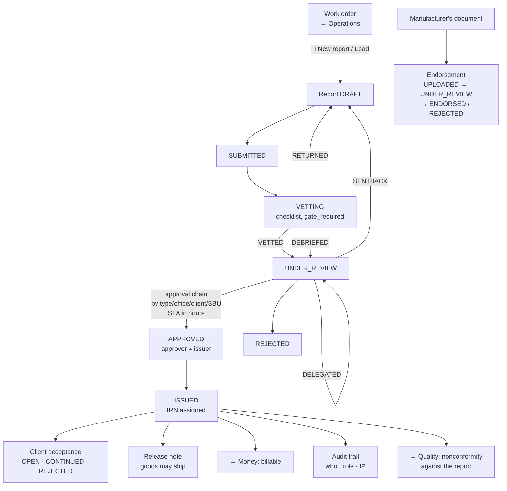

# 6 — REPORTING (IDEMS)

**Menu:** left rail → **Reporting** → `/reporting`
**Screens:** 32 in or from this area; 8 tiles
**Module:** almost everything here is gated by **`idems`** — the Inspection
Document & Evidence Management System
**Who can open it** (measured): Master Admin · Business Director · Branch
Manager · Operation Manager · Coordinator · **Inspector** (inspectors write
reports — `$edit = ['idems']` is the only module they hold).
**Finance gets 403.**

Per the permission matrix (fn. 18): MA/AD **Full** · BD **View** · SBU/BM/OM
**Finalise** · BAM **config only** · CO/AM **Edit** · FIN **View** · INS
**Edit(own)**.

---

## Status at 19 Oct 2026 — what changed since this document was first written

*First issued 18 Oct 2026. The changes below are in the code on branch `claude/testing-branch-setup-0gqe8n`; they reach the live site only when it is updated (`../14-LIVE-CHECKS-GUIDE.md`, Part 2). Statements in the body that they made untrue are corrected where they stand and marked **(updated 19 Oct)**.*

| Change | What it means in this area | Ref | How it was verified |
|---|---|---|---|
| No change in this area | Checked on 19 Oct 2026: none of the fixes since first issue touches a Reporting screen, field or flow. Upload-message fixes (GAP-024) are in the external portals (`02-MARKETPLACE.md`) | — | Commit history read |

---

## 1. What this area is for

The inspection report is the product. Everything in Sales exists to sell one,
everything in Operations exists to produce one, and everything in Money exists
to get paid for one. This area builds it, routes it for approval, numbers it,
issues it, and proves it was based on real evidence.

| Record | What it is | Statuses |
|---|---|---|
| **Inspection report** | The technical finding, issued to the client | **8** — DRAFT → SUBMITTED → VETTING → UNDER_REVIEW → APPROVED → ISSUED (· REJECTED · ARCHIVED) |
| **Vetting** | Technical check before approval | VETTED · RETURNED · **DEBRIEFED** |
| **Approval step** | One signature in the chain | PENDING · APPROVED · REJECTED · **SENTBACK** · **DELEGATED** |
| **Release note** | Permission for the goods to ship | its own register |
| **Endorsement** | Our stamp on a *manufacturer's* document | UPLOADED → UNDER_REVIEW → ENDORSED · REJECTED · ARCHIVED |
| **Expediting report** | Chasing a vendor's delivery progress | with Risk and Forecast |
| **Vendor assessment** | Risk-scoring a supplier | Risk · Score · Re-assess by |
| **Incident** | A security or data incident, on a regulatory clock | OPEN · RESOLVED |

**The commercially critical rule — approver ≠ issuer — is enforced in code**
(`idems.php:4456,4460`) and recorded in the permission matrix. An inspection
body whose author can approve their own report has no independence, and this
one cannot.

---

## 2. The report, end to end

### 2.1 `/documents` — Report register

| | |
|---|---|
| Module `idems` · 2 fields: `type`, `status` |
| Controls | **Release Notes** · **Vendors** · **Report types** · **IRN rules** · **Audit log** · **+ New report** |
| Columns | **IRN** · Type · Title · Client · Inspector · Date · Status |

The **IRN** (Inspection Report Number) is the first column, which is right — it
is the reference the client quotes and the number that must be unique and
traceable.

### 2.2 `/document-new` — New report

| | |
|---|---|
| Module `idems` · **13 fields, 1 required** (`report_type_id`\*) |
| | **`call`**, `title`, `inspection_date`, `office_id`, `sbu`, `client_id`, `vendor_id`, `po_ref`, `product_category`, `inspector_id`, **`approver_user_id`** |
| Controls | **Load** · **Generate report** · **Cancel** |

**`call`** is the join back to Operations: a report is produced *against a work
order*, and pressing **Load** pulls the work order's details in rather than
re-keying them. That is the right design — re-keying a client, vendor and PO
reference is exactly where the second version of a figure comes from.

**`approver_user_id` is chosen at creation**, which together with the
approver ≠ issuer rule means the independence is decided up front rather than
negotiated later.

**`Generate report`** produces the document from the type's template.

### 2.3 `/report-types` and `/report-type-edit` — Report types

| | |
|---|---|
| Module `idems` · **7 fields, 2 required** (`code`\*, `name`\*) |
| | `category`, `active`, **`format_number`**, **`doc_control_no`**, **`revision`** |
| Controls | **Add type** · **Set up the ready inspection report** · **Repair split table rows** · **Hide 28 empty types** · **Show all 1 hidden type again** · **Deactivate** · **Remove** · **☑ Vetting checklist** · **Design form** |

`format_number`, `doc_control_no` and `revision` are the **controlled-document**
fields an assessor asks for: every report form must be a controlled document at
a known revision.

**Three of those controls are unusual and worth noting:**

- **"Hide 28 empty types" / "Show all 1 hidden type again"** — the labels carry
  live counts. A good touch: the screen tells you how much clutter it is hiding.
  It also tells you something uncomfortable: **28 report types exist with no
  form behind them.**
- **"Repair split table rows"** — a **data-repair button in the user interface**.
  Its existence implies a known defect that produces split rows, with a manual
  remedy rather than a fix. *This is worth asking the owner about: what causes
  split rows, and why is repair a button rather than a bug fix?* (R-F3 below.)
- **"Design form"** — a form designer per report type (`report_fields` is the
  largest table in the test database at **1,578 rows**, with `report_sections`
  at 621). So report layouts are configured, not coded, which is why this
  product can serve many inspection disciplines.

### 2.4 `/vetting-checklist` — Vetting checklist

| | |
|---|---|
| Module `idems` · **4 fields, 1 required** (`gate_required`\*) |
| | `enabled`, `require_all`, `items` |
| Controls | **Save vetting checklist** · **Back to report types** |

Per report type: a checklist the vetter must work through, with
**`gate_required`** deciding whether vetting is a hard gate and
**`require_all`** whether every item must be ticked.

Same pattern as Sales' pre-order checklist — and the same gap: **it is a
business control with no lifecycle documentation.**

### 2.5 `/irn-rules` — IRN numbering rules

| | |
|---|---|
| Module `idems` · **20 fields** |
| | `idems_irn_format`, **`idems_company_code`**, **`idems_serial_width`**, then `irn_format` **per office** |
| Controls | **Save numbering rules** · **Save** |
| Columns | **Office · Code · Pattern (blank = global)** |

Report numbering, configurable globally and **overridable per office** — with
"blank = global" stated in the column heading, which is the kind of plain
explanation that stops a configuration mistake.

**Numbering matters more here than it looks.** An IRN is a legal reference; a
duplicate or a gap is a serious finding. Note that four forms elsewhere in the
application **create empty records that consume a number from a sequence**
(`../04-SCREEN-AND-FIELD-AUDIT.md`), and `/endorsement-new` is one of them —
see §2.7.

### 2.6 `/release-notes` — Release Notes

| | |
|---|---|
| Module `idems` · 1 field: `status` · Control: **Report register** |
| Columns | **Release Note No.** · **Against inspection report** · Client · Vendor / Mfr · Date · **Release** · Status |

A release note is the document that lets the goods ship. It is raised **against
an inspection report** — the column says so — which is the correct dependency:
you cannot release what you have not inspected.

### 2.7 `/endorsements` and `/endorsement-new` — Endorsement register

| | |
|---|---|
| Module `idems` · `/endorsement-new`: **21 fields, 1 required** (`doc_type`\*) |
| | `title`, **`orig`**, `doc_version`, **`heat_no`**, `item_desc`, `vendor_id`, `client_id`, **`report_doc_id`**, `project_code`, `project_name`, `po_ref` |
| Controls | **+ New endorsement** · **Create endorsement** · **Cancel** |
| Columns | Endorsement no. · Type · Title · Vendor · **Heat/Lot** · Status |

Endorsing a **manufacturer's** document — a mill certificate, a test report —
with our stamp. **`heat_no`** is steel traceability: a heat (or lot) number ties
a certificate to the physical material. Getting that field onto the register's
columns shows domain knowledge.

**FINDING (R-F1, P1):** submitting `/endorsement-new` empty **creates
`MGH/AHM/2026/GEN/END/000001`** — a formal, office-coded certificate number — on
a record with nothing in it. Of the four empty-record forms, this is the one
whose number looks most like a legal reference.

### 2.8 `/expediting` and `/expediting-projects`

| Screen | Fields | Controls | Columns |
|---|---|---|---|
| `/expediting` — Expediting register | 1: `status` | **Projects view** · **Reports** · **+ New expediting report** | ER No. · Vendor · PO / project · **Progress** · Status · **Risk** · **Required** · **Forecast** |
| `/expediting-projects` — Project delivery consolidation | none | **PO register** | multi-vendor projects by milestone |

Chasing vendor delivery. **Required vs Forecast** side by side is the whole
point of expediting: the date the client needs it against the date it will
actually arrive, with a **Risk** flag. `/expediting-projects` consolidates
across vendors by milestone, for a project with many suppliers.

### 2.9 `/vendors` and `/vendor-profile-save` — Vendor register

| | |
|---|---|
| Module `idems` (**not** `vendors`) |
| `/vendors` columns | Code · Name · Roles · Industry · GSTIN · Status · Actions |
| `/vendor-profile-save` columns | Vendor · Type · Category · **Risk** · **Score** · Status · **Assessed** · **Re-assess by** |
| Controls | **+ Add Vendor** · **⬆ Import from a spreadsheet** · **⬇ Export** · **🔍 Possible duplicates** · **360** |

**Vendor risk assessment with a score and a re-assessment date** — supplier
prequalification as a managed cycle rather than a one-off.

**This is the `/vendors` oddity reported in `../06-DATA-AND-PERMISSION-AUDIT.md`
§4:** the route is gated by the **`idems`** module, and the handler admits
anyone holding *any* of `mod.idems.view`, `mod.idems.edit`,
`mod.clients.view` or `mod.vendors.view` — **17 of 18 roles pass that test, and
the only role refused is FINANCE**, who pays the vendors' invoices. Driving it,
an inspector is nonetheless refused (302) while `/documents` and `/expediting`
in the same module open for the same session — a discrepancy this audit did not
isolate. **Open question Q-G.**

### 2.10 `/approver-map` — Approver mapping

| | |
|---|---|
| Module `idems` · 4 fields: `approver_user_id`, **`temp_user_id`**, **`temp_from`**, **`temp_to`** |
| Controls | **Save** · **Approval rules →** |
| Columns | **Inspector · Approver · Temp cover · From · To** |

Who approves whose reports, with **dated temporary cover**. Together with
Recruitment's `/approval-delegations`, this means an approval chain does not
stall when somebody is on leave — in two places, by two mechanisms.

### 2.11 `/idems-approval-rules` and `/idems-approval-rule-edit`

Module `idems`, 11 fields each: `name`, `level`, **`sla_hours`**, `active`,
`report_type_code`, `office_id`, `client_id`, `sbu`, `approver_kind`,
`approver_user_id`, `approver_role`. Controls: **Add rule** · **Approver
mapping →**. Columns: Level · Rule · Applies to · Approver · **SLA** · Status.

Report approval routed by type, office, client or business unit, at a level,
with an **SLA in hours**.

### 2.12 `/audit-log` — Audit trail

| | |
|---|---|
| Module `idems` · 6 fields: `action`, `office`, `user`, `from`, `to`, **`risk`** |
| Controls | **Filter** · **⭳ Export CSV** · **Clear** |
| Columns | When · **IRN / ref** · Action · By · **Role** · Detail · **IP** |

Who did what to which report, with the role they held at the time and the IP
address. A **`risk`** filter surfaces the entries that matter.

**A finding I drafted here and withdrew — recorded because the reasoning
matters.** My harness listed the controls on this screen as **Filter ·
⭳ Export CSV · Clear**, and I wrote up "the audit trail has a Clear control" as
a P1: an audit trail that can be erased from the user interface is not an audit
trail, and for an accredited body it would undermine every report it covers.

**It is not that.** `Clear` is
`<a class="btn small secondary" href="/audit-log">Clear</a>`
(`views/ops/idems/audit.php:115`) — a plain link back to the unfiltered screen.
**It clears the filter, not the trail.** There is no delete control on this
screen at all.

The lesson is about method, not about this button: a control inventory gives you
the *words*, and the words "Clear" next to "Filter" mean something ordinary.
Any finding that rests on a button's label has to be checked against what the
button is wired to before it is written down. I have re-checked the other
destructive-sounding labels in this document the same way.

**What the audit trail actually offers:** filtering by action, office, user,
date range and **high-risk only**, plus **Export CSV**. No clearing, no editing.
That is the correct design.

**The trail *can* be trimmed, but from somewhere else, and properly.**
Re-checking the other destructive-sounding labels led to `/compliance`, whose
**"Trim what is past retention"** control posts `_do=trim` behind this
confirmation:

> *"Remove audit entries older than N days? This cannot be undone."*

and the screen explains itself first:

> *"Keeping it for ever is not the safe answer either — on a shared host it is a
> growing record of who did what. Trimming removes only entries past the
> retention you have set."*

So: **retention-bounded, confirmed, and honestly explained** — not an arbitrary
erase. That is a defensible design, and better than most systems manage.

The legitimate question it leaves is not "can the trail be wiped" but
**"is the retention period long enough, and who may change it?"** —
`audit_retain_days()` is a setting, and neither it nor the trim right appears in
`docs/02-permission-matrix.md`. Recorded as **R-F11 (P3 / question for the
owner)**, not as an alarm.

### 2.13 The writing tools — `/writing-assistant`, `/phrase-library`, `/learning`

| Screen | Fields | Controls | Columns |
|---|---|---|---|
| `/writing-assistant` — Technical writing assistant (**no module gate**) | 1: `text` | **Convert to report language** · **Phrase library** | — |
| `/phrase-library` / `/phrase-edit` — Phrase library | **5, 1 required** (`phrase`\*): `category`, **`shorthand`**, `discipline`, `active` | **Add phrase** · **Off** · **← Writing assistant** · **Edit** | Category · **Shorthand** · Phrase · **Used** · Status |
| `/learning` — Learning insights | none | **Phrase library** | Type · Report / client · Field · **Learned wording** · **Seen** |

**This is the quiet gem of the area.** An inspector types shorthand; the
assistant converts it into proper report language from the phrase library. It is
**local string matching** (`tech_expand()`, `idems.php:9377`), not an AI service
— no external call, nothing paid, nothing leaving the building. Confirmed during
the GAP-008 testing, which is why an inspector being able to open it is correct
rather than a hole.

- **`shorthand`** is what the inspector types; **Phrase** is what the report
  says.
- **`Used`** counts usage, so dead phrases can be found and retired.
- **`discipline`** scopes a phrase to welding, NDT, coating, and so on.
- **`/learning`** surfaces **"Learned wording"** — phrasings seen repeatedly in
  past reports that are not yet in the library, with a **Seen** count. So the
  library grows from what inspectors actually write.
- Managing the library is separately gated (`idems.type.manage`), so an
  inspector can *use* it but not change it. **That separation is exactly right.**

### 2.14 `/report-reviews` and `/report-ack` — Client acceptance

Both module `idems`, both headed **"Client acceptance of reports"**, both with
one control: **⬇ CSV**. Statuses `CREV_STATUSES` = OPEN · **CONTINUED** ·
REJECTED.

Whether the client accepted the report. `/report-ack` is one of the twelve
screens with **no menu door** (GAP-002).

### 2.15 `/evidence-review` — Evidence review

Shared with Quality and documented in `05-QUALITY.md` §3.9: site photographs
checked for *when* (`date_guard`) and *where* (`geofence_on`,
`geofence_radius_m`), with **Where it was taken** vs **Uploaded from** and a
**Flags** column. This is the control that answers "was the inspector actually
on site" — the foundation of a third-party inspection agency's value.

### 2.16 The compliance cluster — `/incidents`, `/incident-new`, `/consents`, `/data-requests`, `/compliance`

These have **no module gate** and are reachable from both Reporting and Quality.

| Screen | Fields | Columns |
|---|---|---|
| `/incidents` — Incident register | none · **+ Record an incident** | Ref · Detected · What happened · Severity · **Six-hour clock** · **CERT-In** · **Board / people** · Status |
| `/incident-new` — Record an incident | **14, 2 required** (`detected_at`\*, `summary`\*): `kind`, `severity`, `systems`, `people_affected`, `data_kinds`, `immediate_action`, `root_cause`, **`certin_reported_at`**, **`certin_ref`**, **`dpb_reported_at`** | — |
| `/consents` — Consent & lawful basis | **6, 2 required** (`subject_name`\*, `purpose`\*): `subject_kind`, **`basis`**, `given_at`, `note` | Whose data · Kind · Purpose · **Basis** · Given · State |
| `/data-requests` — Requests about personal data | **5, 1 required** (`requester`\*): `received_at`, `contact`, `kind`, `detail` | Received · **Waiting** · Who · **What they want** · Detail · Status · **Answer** |

**This is Indian regulatory compliance, modelled specifically:**

- **The six-hour clock** is the **CERT-In** directive: a reportable cyber
  incident must be notified within six hours. The register has it as a
  **column**, with `certin_reported_at` and `certin_ref` to prove it was.
- **`dpb_reported_at`** is the Data Protection Board under the DPDP Act.
- **`/consents`** records a **lawful `basis`** per purpose per data subject.
- **`/data-requests`** tracks subject access requests with a **Waiting** column
  — days elapsed, which is what matters against a statutory deadline.

**FINDING (R-F4, P1):** `/incident-new` **creates `INC-2026-001` from a
completely empty submit, and the confirmation says "The six-hour clock
started…"** — despite `detected_at` and `summary` both being marked required.
A ghost incident on a regulatory notification clock is the worst of the four
empty-record cases.

---

## 3. Four duplicate screen pairs — one pattern, worth fixing once

Measured in this area alone:

| Pair | Both render | Both have |
|---|---|---|
| `/report-types` · `/report-type-edit` | "Report types" | the same 7 fields, 2 required, the same 9 controls |
| `/report-templates` · `/report-template-edit` | "Document templates" | the same 13 fields, 1 required |
| `/idems-approval-rules` · `/idems-approval-rule-edit` | "Quote & report approvals" | the same 11 fields |
| `/report-reviews` · `/report-ack` | "Client acceptance of reports" | the same single control |
| `/phrase-library` · `/phrase-edit` | "Phrase library" | the same 5 fields, 1 required |

**FINDING (R-F5, P2) — five pairs, in one area.** The pattern is a *list* route
and an *edit* route resolving to the same handler and rendering the same screen.
That is defensible engineering (one handler, two entry points) but it produces
**ten routes where a person sees five screens**, with identical headings, and it
is a large part of why the "Find a screen…" results and breadcrumbs feel
confusing.

Note also that **"Document templates"** is rendered by `/report-templates`
*and* by `/templates` (Sales) *and* `/crm-templates` (Sales) — so **three
different template systems share one heading**, plus a fourth in Recruitment
(`/doc-templates`, "Document Studio").

---

## 4. Statuses

**Documented:** Inspection report (and its vetting and approval vocabularies) —
one of the better-covered chains. **Undocumented:** the endorsement lifecycle
(`ENDORSE_STATUS`), the release-note register, expediting, vendor assessment,
the incident register, template statuses.

---

## 5. Data flow

### Arrives from

| From | What | Grade |
|---|---|---|
| **Operations** | `call` — the work order the report is produced against; **Load** pulls its client, vendor, PO and site in rather than re-keying | **CONFIRMED** (the field and control exist) |
| **Operations** | `inspector_id` — who did the work | **CONFIRMED** |
| **Admin / Users** | `approver_user_id`, the approver map, temporary cover | **CONFIRMED** |
| **Directory** | `client_id`, `vendor_id`, `po_ref`, project codes | **CONFIRMED** |
| **Field (phone)** | Site photographs with time and GPS, and the inspector's own report editing (`idems.edit` is the inspector's only module) | **READ** |
| **Sales** | `po_ref` and the quotation behind the work order | **READ** |
| **Admin / Settings** | IRN numbering rules, per office; report-type form designs | **CONFIRMED** |

### Leaves for

| To | What | Grade |
|---|---|---|
| **The client** | The issued report, with its IRN. Then **client acceptance** (OPEN · CONTINUED · REJECTED) | **READ** |
| **Operations / the vendor** | The **release note** — permission for goods to ship | **READ** |
| **Money** | An issued report completes the work, which becomes a **billable event** | **READ** |
| **Quality** | A nonconformity may be raised **against a report** (`report_doc_id`); evidence-review flags; vetting outcomes | **CONFIRMED** (the field exists) |
| **Quality / Compliance** | Incidents on the CERT-In six-hour clock; consents; subject requests | **CONFIRMED** (the screens render) |
| **Insights** | Report throughput, approval SLA breaches, vetting returns | **SUSPECTED** |
| **The phrase library** | `/learning` feeds observed wordings back for inclusion | **CONFIRMED** (the screen renders) |

---

## 6. Scenarios

### S-1 — An inspection becomes an issued report

1. **Operations**: the job is done. From the work order, press **📑 New
   report** — or **Reporting → New report**.
2. `/document-new`: pick the **`report_type_id`\*** (the only required field),
   set **`call`** and press **Load** so the client, vendor, PO reference and
   site come across rather than being re-typed. Name the **`approver_user_id`**
   now — the approver cannot be the author.
3. **Generate report** builds the document from the type's designed form
   (`report_fields`, 1,578 rows of field definitions).
4. The inspector fills it in — on a phone if they are still on site. The
   **writing assistant** converts shorthand into report language from the
   phrase library.
5. Site photographs upload. **Evidence review** checks each for *when*
   (`date_guard`) and *where* (`geofence_on`), flagging any taken outside the
   fence or at the wrong time.
6. **SUBMITTED → VETTING.** The vetting checklist for this report type is
   worked through; `gate_required` decides whether it is a hard gate.
   Outcome: **VETTED**, **RETURNED** (back to draft), or **DEBRIEFED**.
7. **UNDER_REVIEW.** The approval rules route it by type, office, client or
   business unit, at a level, with an **SLA in hours**. The approver may
   **APPROVE**, **REJECT**, **SENTBACK** (fix this), or it may be
   **DELEGATED** — and if they are on leave, `/approver-map`'s temporary cover
   takes it.
8. **APPROVED → ISSUED.** The **IRN** is assigned from the numbering rules —
   global pattern, or this office's override.
9. Every step is in the **audit trail**: when, IRN, action, by whom, **the role
   they held**, and the IP address.
10. The client accepts (or rejects) — `/report-reviews`.
11. If the goods may now ship, raise a **release note** against this report.
12. The completed work becomes a **billable event** → `07-MONEY.md`.

### S-2 — Endorsing a manufacturer's mill certificate

1. **Reporting → Endorsement register → + New endorsement.**
2. `doc_type`\* (the required field), then `title`, **`orig`** (the original
   document), `doc_version`, **`heat_no`** (the heat or lot — the steel's
   traceability), `item_desc`, `vendor_id`, `client_id`,
   **`report_doc_id`** (the inspection report it relates to), `project_code`,
   `po_ref`.
3. **Create endorsement.** UPLOADED → UNDER_REVIEW → **ENDORSED** or REJECTED.
4. The register shows **Heat/Lot** as a column, so material can be found by it.

*Caution: pressing **Create endorsement** on an empty form issues
`MGH/AHM/2026/GEN/END/000001` — a formal number on an empty record (R-F1).*

### S-3 — Chasing a late vendor on a multi-vendor project

1. **Reporting → Expediting register → + New expediting report.**
2. Record **Progress**, the **Required** date and the **Forecast** date, with a
   **Risk** flag where the two diverge.
3. **Projects view** (`/expediting-projects`) consolidates every vendor on the
   project by milestone — so the project manager sees which supplier is about to
   make the whole project late.
4. **PO register** links to the purchase orders behind it.
5. A vendor who is repeatedly late feeds the **vendor assessment**: Risk,
   Score, **Re-assess by**.

### S-4 — A data incident, on the six-hour clock

1. **Reporting → Where we stand → Incident register → + Record an incident**
   (or `/incident-new`).
2. **`detected_at`\*** and **`summary`\*** are required. Then `kind`,
   `severity`, `systems`, **`people_affected`**, **`data_kinds`**,
   `immediate_action`, `root_cause`.
3. **The six-hour clock starts at `detected_at`.** The register shows it as a
   column.
4. Report to **CERT-In** within six hours, and record
   **`certin_reported_at`** + **`certin_ref`** as the proof.
5. If personal data is involved, report to the Data Protection Board and record
   **`dpb_reported_at`**.
6. Related: **`/consents`** (whose data, what purpose, what lawful **basis**)
   and **`/data-requests`** (subject requests, with a **Waiting** column against
   the statutory deadline).
7. `/compliance` — **"Where we stand"** — pulls it together with a **What to
   do** column.

---

## 7. Edge cases

| # | Edge case | What happens | Grade |
|---|---|---|---|
| E-1 | The author tries to approve their own report | **Refused** — approver ≠ issuer is enforced in code | **READ** (`idems.php:4456,4460`) |
| E-2 | The approver is on leave | `/approver-map` **temporary cover** with From/To dates | **CONFIRMED** (fields exist) |
| E-3 | The report is wrong after vetting | **RETURNED** to draft, or **SENTBACK** from review — two different returns at two different stages | **READ** |
| E-4 | A report is issued, then found to be wrong | A nonconformity can be raised against it (`report_doc_id`). Whether an issued report can be **withdrawn or superseded** is not visible in the 8 statuses — ARCHIVED exists but is not the same thing | **UNTESTED — important** |
| E-5 | Two offices need different report numbering | Supported: `irn_format` per office, "blank = global" | **CONFIRMED** (the column says so) |
| E-6 | Create an endorsement with nothing filled | **Issues `MGH/AHM/2026/GEN/END/000001`** on an empty record | **CONFIRMED by execution** |
| E-7 | Record an incident with nothing filled | **Creates `INC-2026-001`** and reports that the six-hour clock has started | **CONFIRMED by execution** |
| E-8 | A site photo taken a day later, or a mile away | **Flagged** by `date_guard` / `geofence_on`; the register shows taken-vs-uploaded location and a **Flags** column | **READ** |
| E-9 | Someone presses **Clear** on the audit trail | **It clears the filter.** `Clear` is `<a href="/audit-log">`. The trail cannot be erased from this screen — there is no delete control | **CONFIRMED by reading the view** |
| E-10 | A report type with no form designed | 28 such types exist; the screen offers **"Hide 28 empty types"**. What happens if you start a report on one is untested | **UNTESTED** |
| E-11 | "Split table rows" occur | A **repair button** exists in the UI, implying a known recurring defect with a manual remedy | **UNTESTED — ask the owner** |
| E-12 | An inspector opens the vendor register | **Refused (302)** — although the handler's own guard reads as admitting them. Discrepancy not isolated (Q-G) | **CONFIRMED (behaviour)** |
| E-13 | Finance needs a report to raise an invoice against | Finance holds **View** on reports per the matrix, but **403 on `/reporting`** as measured. Worth reconciling | **CONFIRMED (behaviour)** |
| E-14 | Two people edit one report at once | **No protection** — `documents` is outside the `['calls','jobs']` concurrency allow-list | **CONFIRMED** |
| E-15 | A phrase is retired while reports use it | `active` flag plus a **Used** count, so dead phrases are findable before retiring | **CONFIRMED** (columns exist) |

---

## 8. Findings raised in this area

| Id | Severity | Finding |
|---|---|---|
| ~~R-F2~~ | — | ~~The audit trail has a `Clear` control~~ — **WITHDRAWN.** `Clear` is a link back to the unfiltered screen; it clears the filter, not the trail. There is no delete control on the audit log. See §2.12 |
| **R-F4** | **P1** | `/incident-new` creates **`INC-2026-001` and starts the CERT-In six-hour clock** from an empty submit, despite two fields being marked required |
| **R-F1** | **P1** | `/endorsement-new` issues a formal certificate number **`MGH/AHM/2026/GEN/END/000001`** on an empty record |
| **R-F6** | **P2** | No status represents **withdrawing or superseding an issued report**. ARCHIVED is not the same thing, and an issued report found to be wrong is a real scenario (E-4) |
| **R-F5** | **P2** | **Five duplicate screen pairs** in this area alone; "Document templates" is rendered by three different screens across three areas, and a fourth template system exists in Recruitment |
| **R-F3** | **P2** | **"Repair split table rows"** is a data-repair button in the user interface, implying a known recurring defect with a manual workaround |
| **R-F7** | **P2** | **28 report types have no form designed**, and the screen's own control says so |
| **R-F8** | **P2** | `/report-ack` has **no menu door** (GAP-002) |
| **R-F9** | **P2** | The vendor register's guard admits **17 of 18 roles** and refuses only **Finance** (Q-G, `../06-DATA-AND-PERMISSION-AUDIT.md` §4) |
| **R-F11** | **P3 / question** | Audit-trail **trimming** exists at `/compliance`, bounded by `audit_retain_days()` and confirmed. Neither the retention period nor the right to trim is in the permission matrix. For accreditation, is the period long enough, and who should hold it? |
| **R-F10** | — | *Credit:* **approver ≠ issuer** enforced in code · two distinct return paths (RETURNED at vetting, SENTBACK at review) · **DEBRIEFED** as a vetting outcome · per-office IRN patterns with "blank = global" · **Load** from the work order instead of re-keying · the form designer behind 1,578 field definitions · **heat/lot** traceability on endorsements · **Required vs Forecast** with a Risk flag on expediting · vendor **Re-assess by** · the audit trail recording **the role held at the time** and the IP · and the writing assistant: local, free, shorthand-to-report-language, with usage counts, discipline scoping, learned-wording suggestions, and library management separately gated so an inspector may use it but not change it |
