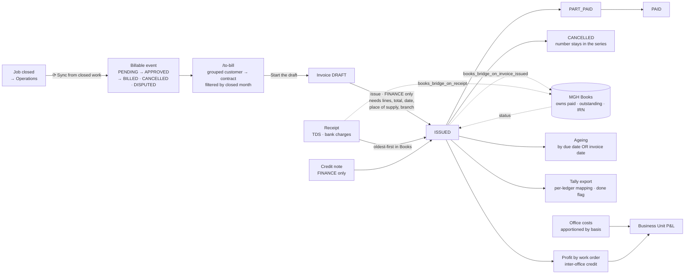

# 7 — MONEY

**Menu:** left rail → **Money** → `/money`
**Screens:** 20 · **11 tiles in two sections** (*Billing*, *Costs & margins*)
**Modules:** `invoicing`, `profitability`, `overheads`
**Who can open it** (measured): Master Admin · Business Director · Branch
Manager · **Coordinator** · Finance. **Operation Manager and Inspector get
403.**

Per `docs/02-permission-matrix.md` row 215, as corrected on the owner's decision
of 2026-10-18: MA/AD **Full** · BD/SBU/BM/CO **Raise** · OM/AM/INS **—** ·
FIN **Issue**.

---

## Status at 19 Oct 2026 — what changed since this document was first written

*First issued 18 Oct 2026. The changes below are in the code on branch `claude/testing-branch-setup-0gqe8n`; they reach the live site only when it is updated (`../14-LIVE-CHECKS-GUIDE.md`, Part 2). Statements in the body that they made untrue are corrected where they stand and marked **(updated 19 Oct)**.*

| Change | What it means in this area | Ref | How it was verified |
|---|---|---|---|
| **A job bills its own share of its work order (20 Oct)** | When a man-day work order is delivered as several jobs, each job's invoice line defaults to **its own man-days** — a 2-day job of a 3-day order is 2 × rate, not 3 × rate. An order delivered as one job is unchanged. An invoice refuses a job done for another customer | Sales audit SA-15, SA-36 | `test_sales_billing_defaults.php` |
| **Billing events report what they were billed (20 Oct)** | Once an invoice is issued, each job's billing event records **its own line, before tax** — no longer the invoice's whole total with GST, which made every GST invoice look like a mismatch and two jobs on one invoice report twice its value | Sales audit SA-16 | same test |
| **A blocked customer still gets invoices for work done (20 Oct)** | The owner's rule D-12 stops all *new* business for a blacklisted, inactive, on-hold or blocked customer; invoicing work already done, payment reminders and receipts carry on | D-12 | `test_sales_d12_blocked.php` |
| **Credit notes are bounded cumulatively** | Notes against one invoice may not, together, exceed what it still owes. The old ceiling added earlier notes back, so an 11,800 invoice took four 5,900 notes | GAP-035 (P1) | Execution + test |
| **Over-credited invoices are shown on screen** | **Money → Billing workspace → Invoices** shows a red panel and a *Credited beyond their value* filter; accounts also see it under *needs attention* on the home screen. Silent on a clean ledger | GAP-035 follow-up | Test |
| Every figure off a form is validated | Negative rate, quantity, GST, receipt, TDS, bank charges; GST outside 0–100%; non-numbers — refused, naming the field | GAP-034 | Execution |
| Allocation and credit-note writes re-check their ceiling in the database | Two accounts users at once cannot overdraw a receipt or over-credit an invoice | GAP-036 | Test, write called past the checks |
| **Tally sales vouchers balance** | The round-off is its own ledger entry (a *Round-off ledger* on the Tally panel, default "Round Off"), so Tally accepts invoices printed to the whole rupee | GAP-044 (P1) | Execution: every voucher kind sums to zero |
| Tally CSVs match the XML | GST %, round-off, the same voucher number, and TDS | GAP-045 | Test |
| **Bank charges are the customer's** | They never settle an invoice; the receipt form and page say so, and that absorbing one is an expense, not a credit note | Q-J (owner) | Test |
| Books' on-account money is visible | The invoice screen says when Books holds money on account for the customer | GAP-028, Q-H | Test |
| Home-screen *Outstanding* follows the ledger | Money received but not yet matched no longer hides what is owed; it shows as its own figure | GAP-043 | Execution |

---

## 1. Who owns the money — settle this first

**EXAACT raises the paperwork; MGH Books owns the arithmetic — when Books is
connected. When it is not, EXAACT is the whole record.**

`mgh_books_receiver/README.md` states the contract:

> "The money truth lives here: an invoice arrives `UNPAID` with its full total
> outstanding; a `RECEIPT` reduces the party's open invoices oldest-first; a
> `CREDITNOTE` reduces the invoice it names; and `status` reports back the paid,
> outstanding and IRN the ERP then shows on its invoice screen. **The ERP never
> recomputes any of it, so the two can never disagree.**"

| Question | Answer |
|---|---|
| Where is an invoice **raised**? | Here — `/invoice-new` |
| Where is a receipt **recorded**? | Here — `/receipt-new` |
| Who decides what is **outstanding**? | **MGH Books**, when connected. EXAACT displays its answer and never recalculates |
| If Books is not connected? | EXAACT keeps its own invoices, receipts and ageing. `books_connected()` is **off by default**; `books_dryrun()` exists for trying it |
| Work directly in Books? | A Money tile **"📗 Accounts & GST ↗"** opens it already signed in — but only when `books_switch_ready()` (connected **and** an app URL set) |

Full chain and transition grades: `../02-MODULE-DEPENDENCY-MAP.md` §1–2.

**And a second money system exists elsewhere.** Marketplace runs its own
ledger, escrow, credit packs, commission and fee rules (`mkt_*` tables) with no
measured join to this chain — `02-MARKETPLACE.md` M-F6, open question Q-M1.

---

## 2. Every screen, in depth

### 2.1 `/money` — the area hub

No module gate, no own fields, one control: **Command Centre →** (unexplained,
as in Sales and Marketplace). Eleven tiles in two sections.

### 2.2 `/billable-events` — Billable events

| | |
|---|---|
| Module `invoicing` · 1 field: `status` |
| Controls | **⟳ Sync from closed work** · **← Money** |
| Statuses | `BILLABLE_STATUS` = PENDING → APPROVED → BILLED (· CANCELLED · **DISPUTED**) |

The operational→commercial bridge: approved work on its way to an invoice, *so
nothing done is lost before it is billed* (the code's own comment). **⟳ Sync
from closed work** pulls newly closed jobs in — a manual trigger, so the
business is not dependent on an unattended task.

**DISPUTED as a state** matters: work the client disputes should not sit in
"ready to bill" pretending to be clean.

### 2.3 `/to-bill` — Work waiting to be billed · **the only door to the chain**

| | |
|---|---|
| Module `invoicing` · 1 field: `month` · Control: **Apply** |
| Heading | **Work waiting to be billed** |

The tile says *"Bill, invoice, collect, age and export — one screen with
tabs"*, and **that is accurate**: `billing_tabs()` (`booksui.php:26-46`) draws
**⧗ To bill · 🧾 Invoices · 💰 Money in · ⏳ Ageing · 📤 Export**, and the strip
appears on all five screens.

*(I first wrote this up as the tile over-promising a tabbed screen that did not
exist. It does exist — I had read the view and not the helper it calls on its
first line. Withdrawn in `../02-MODULE-DEPENDENCY-MAP.md` §1.)*

Billing is grouped **customer → contract/project** and filtered by the **closed
month**, because the code identifies three real billing rhythms: per call, per
month, per project. **Each project draws its own invoice.**

**This tile is the single point of failure in the chain.** It is the only tile,
every other billing screen hangs off it, and the tab strip that carries you
across them is drawn only when `books_can()` — so losing that one condition
loses the navigation for all five screens at once.

### 2.4 `/invoices` — Invoices

| | |
|---|---|
| Module `invoicing` · 10 `cols[]` — **a column chooser** |
| Controls | **Apply** · **Work waiting to be billed** · **Money in** · **+ New invoice** · **⬇ CSV** |
| Columns | Invoice · Customer · Invoice *(amount)* · **Settled** · **Outstanding** · **Due ▲** · Status |
| Statuses | `INV_STATUS` = DRAFT → ISSUED → **PART_PAID** → PAID (· CANCELLED) |

**Settled** and **Outstanding** are the figures MGH Books owns. **Due ▲** sorted
ascending puts the most overdue first, which is the right default for a
collections screen.

**(updated 19 Oct)** When any invoice has been settled beyond its own value
(payments plus credit notes over the total — possible before GAP-035 was
fixed), a red panel **"⚠ Invoices credited beyond their value"** heads this
screen, with a **Show them as a list →** link to the filter
`?f=overcredited`. On a clean ledger nothing appears.

**PART_PAID is essential and often missing** in small systems: a customer who
pays 60% of an invoice is neither unpaid nor paid.

### 2.5 `/invoice-new` — New invoice

| | |
|---|---|
| Module `invoicing` · **8 fields, 2 required** (`partner_id`\*, `office_id`\*) |
| | `invoice_date`, **`payment_terms`**, **`credit_days`**, `po_number`, **`contract_number`**, `notes` |
| Controls | **Start the draft** · **Cancel** |

**Two required fields, and they are the right two** — you cannot invoice nobody,
and `office_id` decides the **numbering series** (an invoice with no branch has
no series, which `books_issue_missing()` refuses).

**The button says "Start the draft", not "Create invoice"** — honest, because
that is exactly what it does. The invoice is then built up with lines and
issued separately.

**`contract_number`** is the join back to Sales; **`credit_days`** drives the
ageing buckets.

### 2.6 `/receipts` — Money in

| | |
|---|---|
| Module `invoicing` · no own fields |
| Controls | **+ Record money received** · **All** · **Not yet matched** · **⬇ CSV** |
| Columns | Receipt · Customer · **How** · Received · **TDS** · **Matched** · **Left to match** |

**"Not yet matched" as its own tab** is the control that matters: money in the
bank that has not been allocated to invoices is the commonest reconciliation
problem in a services business, and it is one click away.

**"How"** rather than "mode", **"Left to match"** rather than "unallocated
balance" — the Zero Training UI standard.

### 2.7 `/receipt-new` — Record money received

| | |
|---|---|
| Module `invoicing` · **10 fields, 2 required** (`partner_id`\*, `amount`\*) |
| | `office_id`, `receipt_date`, `mode`, **`tds_amount`**, **`bank_charges`**, `bank`, `reference`, `notes` |
| Controls | **Record it** · **Cancel** |

**`tds_amount` and `bank_charges` as first-class fields** is India-specific and
correct: a client who owes ₹100,000 pays ₹98,000 after 2% TDS, and the invoice
is still fully settled. A system without a TDS field forces staff to record
either a wrong receipt or a fake write-off — and then nothing reconciles.

After saving, the flash says *"Receipt RCP/… recorded. Now say which invoices it
settles."* — it tells you the next step rather than leaving you on a list.

**Confirmed by execution:** a **Coordinator** can record a receipt. Receipt
`RCP/2627/0001`, `created_by` "UAT Coord", was written during this audit on a
throwaway database. The owner reviewed that on 2026-10-18 and **accepted it**;
the permission matrix was corrected to match (GAP-010).

### 2.8 `/receivables` — Receivables ageing

| | |
|---|---|
| Module `invoicing` · no own fields |
| Controls | **⬇ Download CSV** · **Due date** · **Invoice date** |

**The Due date / Invoice date toggle is the detail that makes an ageing report
usable.** Ageing by invoice date tells you how long ago you billed; ageing by
due date tells you how overdue you are. Finance needs both and most systems
offer one.

### 2.9 `/tally` and `/tally-export` — Tally export

| | |
|---|---|
| Module `invoicing` · **19 fields** each (**20 since 19 Oct**: the *Round-off ledger*) · Controls: **Show** · **Save** |
| | `kind`, `from`, `to`, `done`, **`tally_company`**, **`tally_state`**, **`tally_sales_ledger`**, **`tally_bank_ledger`**, **`tally_tds_ledger`**, **`tally_cgst_ledger`**, **`tally_sgst_ledger`** (+ more) |

**A full Tally ledger mapping.** Not "export a CSV and sort it out yourself" —
the actual ledger names in the customer's Tally company, per tax head, with
`tally_state` driving CGST/SGST against IGST. For an Indian business whose
accountant lives in Tally, this is the difference between the system being
adopted and being bypassed.

**`done` tracks what has already been exported**, so entries are not sent twice.

**Duplicate pair** — `/tally` and `/tally-export` render identically (the same
19 fields, the same two controls). Same pattern as Reporting's five pairs.

### 2.10 `/invoicing` — Invoice register

| | |
|---|---|
| Module `invoicing` · no own fields |
| Controls | **⏳ Ageing** · **📤 Tally export** · **⬇ Download CSV** |
| Tile | *"Tick each job: invoiced, paid, inter-office credit."* |

A per-job commercial tracker — kept as its own tile "because everyone uses it"
(the code's comment). **Note the overlap:** this and `/invoices` are two
different registers with similar names; this one is job-oriented, that one is
document-oriented.

### 2.11 `/profitability` — Contract number register

| | |
|---|---|
| Module `profitability` · no own fields |
| Controls | **⬇ Download CSV** · **Management dashboard** · **Business Unit P&L** |
| Statuses | `BOSS_STATUS` = ACTIVE · CLOSED · **HOLD** (table `boss_numbers`) |

**A naming observation worth flagging.** The tile's label comes from the
terminology system (`T_REG('boss')`), so it reads **"Contract number
register"**, while the tile's description says **"Profit and margin by job"** —
and the screen's heading is the former. Both are defensible (it is the contract
register, and its purpose is profit by contract) but a person reading the
description and landing on the heading has to reconcile them. **M-F:** worth one
line of helper text. *P3.*

### 2.12 `/call-profit` — Profit by work order

| | |
|---|---|
| Module `profitability` · 5 fields: `fy`, `m`, `office`, `inspector`, `sbu` |
| Controls | **Show** · **Management dashboard** · **Business Unit profit & loss** |
| Columns | Job · Client · Team Member · Office · Days · **Revenue** · **Salary** · **Overhead** … **16 columns in all** |

**The widest table in the application.** Unavoidable for a profit breakdown, and
these users are desk-first, so it is recorded rather than raised as a defect.

Gated additionally by `data.profitability`, and cross-office aware: per ADR-005,
`data.revenue` says *whether* a person sees revenue, never *whose* — on a
cross-office job the client-billable figure belongs to the contracting office
and the executing office's revenue is its **inter-office credit**.

### 2.13 `/sbu-pl` — Business Unit profit & loss

| | |
|---|---|
| Module `profitability` · 4 fields: `office`, `span`, `m`, `fy` |
| Controls | **Show** · **Management dashboard** · **Month-end run** · **Enter office costs** |
| Columns | Business Unit · Revenue · **Engineers** · **Other salary** · **Sub-contractor** · **Office costs** · Total cost · **Profit** |

A real P&L: revenue less direct people cost, less sub-contractor cost, less
apportioned office cost. **Separating "Engineers" from "Other salary"** is the
split that tells you whether a business unit is carrying too much overhead.

### 2.14 `/office-finance` — Office costs & overheads

| | |
|---|---|
| Module `overheads` · **24 fields** — `amt[1..n]` / `note[1..n]` per expense head |
| Controls | **Show** · **Save October 2026** · **Copy last month** · **Edit expense heads** |
| Columns | Expense head · Amount (₹) · **Spreads across Business Units by** · Note |

**"Spreads across Business Units by"** is the apportionment basis — how rent or
electricity is divided between business units. That column is what makes
`/sbu-pl` defensible rather than arbitrary.

**"Copy last month"** and a save button that names the month (**"Save October
2026"**) are exactly right for a monthly data-entry screen: most months are
mostly the same, and a button that states which month it will write prevents the
classic error of entering September's costs into October.

### 2.15 `/cost-run` — Month-end cost run

Module `overheads` · 2 fields (`office`, `m`) · **Show** · **Enter office
costs** · **Business Unit P&L** · **Management dashboard**.

Commits the month's costs into the ledger that `/sbu-pl` reads.

### 2.16 The three reconciliation screens

| Screen | Module | What it reconciles |
|---|---|---|
| `/revenue-reconciliation` | **none** | *"Where a job's legacy invoice figure disagrees with the books ledger"* |
| `/cost-reconciliation` | **none** | *"Where a job's legacy sub-contractor cost disagrees with the committed cost ledger"* |
| `/reimbursable-dedup` | **none** | *"Jobs whose reimbursables are recorded on both doors — reconcile so profit is not double-counted"* |

Each has a `*_reader_mode` radio set and an **Apply** button.

**These three screens are the most honest thing in the application.** They exist
because the system has two sources for the same number — a figure stored on the
job when it was closed ("legacy") and a figure in the ledger — and rather than
pretending they always agree, the product *shows you where they don't* and lets
you choose which to read.

`reimbursable-dedup` is the sharpest: an inspector's expense can be captured at
job closure *and* on their voucher, and counting both would overstate cost and
understate profit. A screen that names that risk is a screen built by someone
who has been bitten by it.

**All three have no module gate.** Finance can post to them; Inspector is
refused. They were in the GAP-008 shortlist and came back as finance
reconciliation screens, which is what `finance.reconcile` is for.

### 2.17 `/mis` — Management dashboard

| | |
|---|---|
| Module `reports` · **8 filters**: `fy`, `m`, `sbu`, `activity`, `office`, `ibo`, `inspector`, `client` |
| Controls | **Apply** · **Clear** · **⬇ Download as CSV** |
| Columns | Business Unit · **Inspections** · **Closed** · **Man-days** · Revenue · **Direct cost** · Profit · **Margin** |

The MIS overview, and the junction between Money and Insights — it appears as a
tile in both areas. **`ibo`** is the inter-branch-office filter, so cross-office
work can be isolated.

*(**Clear** here is the same filter-reset pattern as Reporting's audit log, not
a destructive control — checked.)*

---

## 3. Statuses

**`INV_STATUS` has no lifecycle section** — "invoice" appears 17 times in
`docs/03-object-lifecycles.md` but has no section of its own
(`../03-WORKFLOW-CATALOGUE.md` §1). For the record the money turns on, that is
the gap I would close second, after Quality.

### What is correctly locked to Accounts

Tested per role on a throwaway database
(`../evidence/books-write-authority.py`):

| Act | Who | Verified |
|---|---|---|
| Open the billing chain | MA · BD · SBU · BM · CO · FIN | ✓ |
| Record a receipt, start a draft invoice | MA · BD · BM · CO · FIN | ✓ by execution |
| **Issue** an invoice | `finance.reconcile \|\| master` → **FIN · MA** | ✓ |
| **Cancel** an invoice | **FIN · MA** | ✓ by execution |
| **Raise a credit note** | **FIN · MA** | ✓ |

**The three acts that create a legal document stay with Accounts.** That is the
control that matters, and it holds.

### Two rules in the code worth knowing

- **A cancelled invoice keeps its number.** *"The number stays in the series — a
  GST series may not have gaps."* (`books.php:751`)
- **An invoice with money against it cannot be cancelled.** *"Money or a credit
  note has already been recorded against this invoice. Raise a credit note
  instead — cancelling would erase a settled entry."* (`books.php:748`)

Both are written by someone who understands Indian GST numbering, and the
second refusal explains *what to do instead*.

---

## 4. Data flow

### Arrives from

| From | What | Grade |
|---|---|---|
| **Operations** | Closed jobs → billable events, via **⟳ Sync from closed work**. Sub-contractor and other costs. The inter-office credit | **READ** |
| **Sales** | `contract_number`, `po_number`, the quotation's line rates as the basis of price; project costing as the margin floor | **CONFIRMED** (fields exist) |
| **Directory** | `partner_id` on every invoice and receipt; GSTIN, payment terms, credit days | **CONFIRMED** |
| **Recruitment** | Salary structures → people cost in the P&L; `placement_fee`, `agency_cost` | **READ** |
| **Admin / Settings** | Numbering series per office; Tally ledger names; expense heads and apportionment bases | **CONFIRMED** |
| **MGH Books** | ← **paid, outstanding, IRN** | **READ** — not executed against a live Books |

### Leaves for

| To | What | Grade |
|---|---|---|
| **MGH Books** | `QUOTE`, `INVOICE`, `RECEIPT`, `CREDITNOTE` documents | **READ** — `booksbridge.php`, not executed |
| **Tally** | Per-ledger accounting entries, with a `done` flag | **READ** |
| **Insights** | `/mis`, `/sbu-pl`, `/call-profit`, `/profitability` | **CONFIRMED** (they render) |
| **Operations** | Which work has been billed; disputed billables | **READ** |
| **The client** | The issued invoice | **READ** |

---

## 5. Scenarios

### S-1 — Completed work becomes a paid invoice

1. **Operations:** the job closes.
2. **Money → Billable events → ⟳ Sync from closed work.** The event appears
   **PENDING**. Someone approves it → **APPROVED**.
3. **Money → Billing workspace** (`/to-bill`). Pick the closed **month**; work
   is grouped **customer → contract/project**. Tick what to bill. *Each project
   draws its own invoice.*
4. **+ New invoice** → `/invoice-new`. **`partner_id`\*** and
   **`office_id`\*** (the branch, which decides the numbering series), then
   `invoice_date`, `payment_terms`, `credit_days`, `po_number`,
   `contract_number`. **Start the draft.** Status **DRAFT**.
5. Check the lines. Then **Accounts issues it** — nobody else can. The issue is
   refused unless it has lines, a non-zero total, a date, a place of supply (or
   the customer's GSTIN) and a branch. Status → **ISSUED**, and the invoice
   enters the customer's ledger and the ageing.
6. If Books is connected, the invoice is pushed as an `INVOICE` document and
   **Books now owns paid/outstanding/IRN**; EXAACT displays its answer.
7. **The client pays ₹98,000 against ₹100,000 after TDS.**
   **Money → Money in → + Record money received.** `partner_id`\*,
   `amount`\* = 98,000, **`tds_amount`** = 2,000, plus `bank_charges`, `bank`,
   `reference`, `mode`. **Record it.** The message says: *"Now say which
   invoices it settles."*
8. Allocate it. Books reduces open invoices **oldest-first**. Status →
   **PART_PAID** or **PAID**.
9. Anything unallocated shows under **Money in → Not yet matched**.
10. **Receivables ageing** — toggle **Due date** / **Invoice date** to chase.
11. **Tally export** — pick the range, press **Show**, then **Save**; the
    `done` flag stops a second send.

### S-2 — Month end: what did we actually make?

1. **Money → Office costs & overheads** (`/office-finance`). Pick the office
   and month. Press **Copy last month**, adjust the amounts, and set each
   head's **"Spreads across Business Units by"** basis. Press
   **Save October 2026** — the button names the month it will write.
2. **Money → Month-end cost run** (`/cost-run`). Pick office and month, press
   **Show** to commit the roll-up.
3. **Business Unit profit & loss** (`/sbu-pl`): Revenue · **Engineers** ·
   Other salary · **Sub-contractor** · **Office costs** · Total cost ·
   **Profit** per business unit.
4. **Profit by work order** (`/call-profit`) for the job-level breakdown —
   Revenue, Salary, Overhead, Days, across 16 columns.
5. **Management dashboard** (`/mis`): filter by year, month, business unit,
   activity, office, **`ibo`** (inter-branch), inspector or client, and read
   Inspections · Closed · **Man-days** · Revenue · Direct cost · Profit ·
   **Margin**.
6. **Then reconcile before you believe any of it** — S-3.

### S-3 — Making the numbers trustworthy

Run these three before reporting a profit figure:

1. **Revenue reconciliation** — where a job's stored ("legacy") invoice figure
   disagrees with the books ledger. Choose which to read with
   `revenue_reader_mode`, press **Apply**.
2. **Cost reconciliation** — the same for sub-contractor cost against the
   committed cost ledger.
3. **Reimbursable duplication** — jobs whose reimbursables are recorded **on
   both doors** (job closure *and* the inspector's voucher). Left alone, cost is
   overstated and **profit is double-counted**.

**That these three screens exist is the system telling you the truth about
itself.** Two sources for one number is a real condition of a system that grew;
showing the disagreement is the honest response.

### S-4 — Connecting MGH Books and Tally

1. **Admin → Settings:** connect Books. `books_connected()` is **off by
   default**, and **`books_dryrun()`** lets you push documents without
   committing — use it first.
2. Once connected, the Money area shows **📗 Accounts & GST ↗**, which opens
   Books already signed in — but only when `books_switch_ready()` (connected
   *and* an app URL set).
3. From then on, **Books owns paid, outstanding and IRN**. EXAACT shows Books'
   answer and never recomputes it, so the two cannot disagree.
4. **Tally:** on `/tally`, map `tally_company`, `tally_state` (which drives
   CGST/SGST against IGST) and each ledger — sales, bank, TDS, CGST, SGST.
   Press **Save**.
5. Export by date range; the **`done`** flag records what has gone.

---

## 6. Edge cases

| # | Edge case | What happens | Grade |
|---|---|---|---|
| E-1 | A coordinator records a receipt | **Allowed** — verified by writing `RCP/2627/0001`. The owner reviewed and **accepted** this on 2026-10-18; the matrix was corrected to match | **CONFIRMED by execution** |
| E-2 | A coordinator tries to **issue** an invoice | **Refused.** Issue, cancel and credit note are `finance.reconcile \|\| master` | **CONFIRMED by execution** |
| E-3 | Issue an invoice with no lines | **Refused:** *"It has no lines, so there is nothing to charge for."* Also refused with no date, no branch (no numbering series), zero total, or an unknown place of supply | **READ** (`books_issue_missing()`) |
| E-4 | Cancel an invoice | The **number stays in the series** — *"a GST series may not have gaps"* | **READ** |
| E-5 | Cancel an invoice that has money against it | **Refused:** *"Raise a credit note instead — cancelling would erase a settled entry."* | **READ** |
| E-6 | Client pays less because of TDS | **`tds_amount`** is a field; the invoice still settles fully | **CONFIRMED** (field exists) |
| E-7 | Money arrives that cannot be matched to an invoice | **"Not yet matched"** tab | **CONFIRMED** (tab exists) |
| E-8 | A receipt covers three invoices | Books allocates **oldest-first**; `/receipt-allocate` lets you direct it | **READ** |
| E-9 | The same reimbursable is on the job *and* the voucher | **`/reimbursable-dedup`** exists precisely for this | **CONFIRMED** (screen renders) |
| E-10 | The job's stored revenue disagrees with the ledger | **`/revenue-reconciliation`**, with a reader-mode choice | **CONFIRMED** |
| E-11 | Cross-office job: who books the revenue? | The **contracting** office books client revenue; the **executing** office earns an **inter-office credit**. `data.revenue` says whether you see revenue, never whose | **READ** (ADR-005) |
| E-12 | Books is not connected | EXAACT keeps its own invoices, receipts and ageing. Default state | **READ** |
| E-13 | Books is connected but unreachable mid-push | `books_outbox` exists — **but unlike Sales' Ads Pro outbox, no screen in Money shows Waiting / Sent / Failed**. A failed push would be invisible here | **SUSPECTED — worth fixing** |
| E-14 | Export the same entries to Tally twice | The **`done`** flag tracks what has gone | **CONFIRMED** (field exists) |
| E-18 | A credit note for more than the invoice still owes | **Refused:** *"Only ₹X is still outstanding on that invoice (credit notes already raised against it come to ₹Y)."* Before 19 Oct the ceiling added the earlier notes back and an invoice could be credited without limit (**GAP-035**) | **CONFIRMED by execution** (`tests/test_books_input_guard.php`) |
| E-19 | A negative rate, quantity or GST on a line; a negative receipt; a GST rate off the scale on a credit note | **Refused, naming the field.** Before 19 Oct every one went into the ledger (**GAP-034**) | **CONFIRMED by execution** |
| E-20 | Two accounts users allocate the same receipt at the same moment | The INSERT re-checks what is free in the database; the second is told *"Someone else allocated … a moment ago"* (**GAP-036**) | **CONFIRMED by execution** (the INSERT called directly past the pre-checks) |
| E-21 | Export to Tally an invoice printed to the whole rupee | The voucher carries the round-off as its own entry and **balances**. Before 19 Oct it was off by the round-off and Tally refused it (**GAP-044**) | **CONFIRMED by execution** (`tests/test_tally_balance.php`) |
| E-22 | A receipt with bank charges | The invoice stays short by the charge — **the owner's rule (Q-J): bank charges are the customer's to bear.** The receipt form and page now say so | **CONFIRMED** (test) |
| E-15 | An Operation Manager needs to see an invoice | **403 on the whole chain.** This is the documented intent (matrix row 215: OM = —), not a defect | **CONFIRMED** |
| E-16 | Two people edit one invoice at once | **No protection** — `invoices` is outside the `['calls','jobs']` concurrency allow-list | **CONFIRMED** |
| E-17 | `mod.invoicing.view` held, but no finance right | **No tile, and therefore no door** — the tile needs `mod.invoicing.view` **and** one of `finance.reconcile` / `data.credit` / master | **CONFIRMED** |

---

## 7. Findings raised in this area

| Id | Severity | Finding |
|---|---|---|
| **Y-F1** | **P2** | **`books_outbox` has no screen.** Sales shows its Ads Pro outbox as Waiting / Sent / **Failed** / Not sent; Money shows nothing, so a failed push to Books would be silent. *Copy the Sales pattern* |
| **Y-F2** | **P2** | **`INV_STATUS` has no lifecycle section** — the invoice is mentioned 17 times in `docs/03-object-lifecycles.md` and has no section of its own |
| **Y-F3** | **P2** | The whole chain hangs off **one tile** (`/to-bill`), and the tab strip that carries you across the five screens depends on the same single condition |
| **Y-F4** | **P2** | **GAP-010 mechanism (open):** the write gate's key is `data.credit`, defined as *"See the inter-office credit figures"* — a read permission doing a write permission's job. Harmless only because every money route also carries a module gate, two of them via a prefix fallback. Guarded now by `test_route_gate_regression.php`; the permanent fix is a named `finance.books.write` |
| **Y-F5** | **P3** | `/tally` and `/tally-export` are a duplicate pair |
| **Y-F6** | **P3** | `/profitability`'s terminology-driven label ("Contract number register") and its tile description ("Profit and margin by job") describe the same screen two ways |
| **Y-F7** | **P3** | `/invoices` and `/invoicing` are two registers with confusingly similar names (document-oriented and job-oriented) |
| **Y-F8** | — | *Credit:* **TDS and bank charges** as first-class receipt fields · a cancelled invoice **keeping its number** for GST · refusing to cancel a settled invoice **and saying to raise a credit note instead** · `books_issue_missing()` listing every reason an invoice cannot be issued · **PART_PAID** · **DISPUTED** billables · ageing by **due date or invoice date** · **"Not yet matched"** · **"Left to match"** · **"Copy last month"** and **"Save October 2026"** · **"Spreads across Business Units by"** · **Engineers vs Other salary** in the P&L · a **full Tally ledger map** with a `done` flag · **"Start the draft"** saying what it does · and above all the **three reconciliation screens**, which admit the system has two sources for one number and show you where they disagree |
